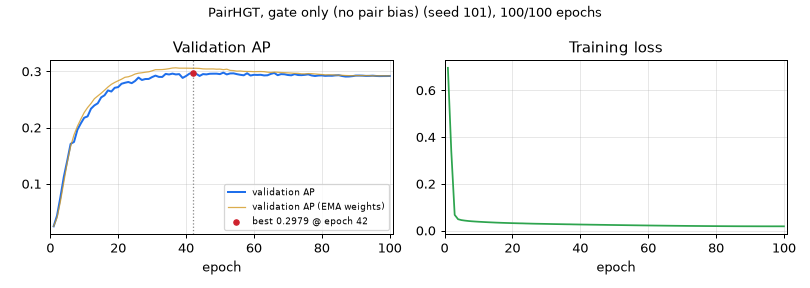

# PairHGT, gate only (no pair bias) — seed 101

[← all models](../README.md) · PairHGT notebook · ogbg-molpcba

| | |
|---|---|
| State | **finished** |
| Epochs | 100 of 100 |
| Best validation AP | **0.2979** at epoch 42 |
| Best validation AP, EMA weights | 0.3064 at epoch 37 |
| Test AP | raw 0.2927 / ema 0.3014 (final) |
| Seed | 101 |
| Parameters | 9,751,632 |
| Minutes per epoch (last 5, incl. validation) | 4.5 |
| Training time so far | 7.4 h |
| Training time left | done |
| Sessions (start + resumes) | 2 |
| Hottest GPU reading | 89.0 °C |
| Last update | 2026-11-15 04:14 (110.1 h ago) |



<details><summary>Settings of this run</summary>

| Setting | Value |
|---|---|
| Epochs (warm-up) | 100 (5) |
| Batch size | 512 |
| Learning rate, weight decay | 0.0005, 1e-05 |
| Layers × width, heads | 5 × 384, 4 |
| Dropout, attention dropout | 0.2, 0.5 |
| Pair channel | width 16, dropout 0.1, value gate True |
| Precision | fp32 (TF32 matrix products) |
| EMA decay | 0.9995 |
| Gradient clip | 1.0 |
| Protocol | v2_test_once |
| Notebook version, config hash | pairhgt-confirmatory-v2.0, 131dbd9447481a4c |

</details>

## Final test (evaluated once)

| Weights | Epoch | Validation AP | Test AP |
|---|---|---|---|
| raw | 42 | 0.2979 | 0.2927 |
| ema | 37 | 0.3064 | 0.3014 |

## Every epoch (newest first)

| Epoch | Train loss | Val AP | Val AP (EMA weights) | Best so far | LR | Minutes |
|---|---|---|---|---|---|---|
| 100 | 0.0184 | 0.2919 | 0.2921 | 0.2979 (ep 42) | 1.37e-07 | 4.5 |
| 99 | 0.0184 | 0.2918 | 0.2921 | 0.2979 (ep 42) | 5.47e-07 | 4.5 |
| 98 | 0.0184 | 0.2918 | 0.2921 | 0.2979 (ep 42) | 1.23e-06 | 4.5 |
| 97 | 0.0184 | 0.2917 | 0.2922 | 0.2979 (ep 42) | 2.18e-06 | 4.5 |
| 96 | 0.0184 | 0.2919 | 0.2922 | 0.2979 (ep 42) | 3.41e-06 | 4.5 |
| 95 | 0.0184 | 0.2924 | 0.2922 | 0.2979 (ep 42) | 4.91e-06 | 4.5 |
| 94 | 0.0184 | 0.2921 | 0.2925 | 0.2979 (ep 42) | 6.67e-06 | 4.5 |
| 93 | 0.0185 | 0.2920 | 0.2925 | 0.2979 (ep 42) | 8.70e-06 | 4.5 |
| 92 | 0.0185 | 0.2925 | 0.2926 | 0.2979 (ep 42) | 1.10e-05 | 4.5 |
| 91 | 0.0185 | 0.2926 | 0.2926 | 0.2979 (ep 42) | 1.35e-05 | 4.5 |
| 90 | 0.0186 | 0.2926 | 0.2926 | 0.2979 (ep 42) | 1.64e-05 | 4.5 |
| 89 | 0.0186 | 0.2916 | 0.2924 | 0.2979 (ep 42) | 1.94e-05 | 4.5 |
| 88 | 0.0186 | 0.2910 | 0.2925 | 0.2979 (ep 42) | 2.27e-05 | 4.5 |
| 87 | 0.0187 | 0.2909 | 0.2927 | 0.2979 (ep 42) | 2.63e-05 | 4.5 |
| 86 | 0.0187 | 0.2918 | 0.2932 | 0.2979 (ep 42) | 3.01e-05 | 4.5 |
| 85 | 0.0188 | 0.2933 | 0.2932 | 0.2979 (ep 42) | 3.42e-05 | 4.5 |
| 84 | 0.0189 | 0.2930 | 0.2936 | 0.2979 (ep 42) | 3.85e-05 | 4.5 |
| 83 | 0.0190 | 0.2923 | 0.2939 | 0.2979 (ep 42) | 4.30e-05 | 4.5 |
| 82 | 0.0190 | 0.2924 | 0.2940 | 0.2979 (ep 42) | 4.77e-05 | 4.5 |
| 81 | 0.0191 | 0.2921 | 0.2939 | 0.2979 (ep 42) | 5.27e-05 | 4.5 |
| 80 | 0.0192 | 0.2929 | 0.2945 | 0.2979 (ep 42) | 5.79e-05 | 4.5 |
| 79 | 0.0193 | 0.2927 | 0.2950 | 0.2979 (ep 42) | 6.33e-05 | 4.5 |
| 78 | 0.0194 | 0.2919 | 0.2955 | 0.2979 (ep 42) | 6.89e-05 | 4.5 |
| 77 | 0.0195 | 0.2928 | 0.2960 | 0.2979 (ep 42) | 7.47e-05 | 4.5 |
| 76 | 0.0196 | 0.2948 | 0.2962 | 0.2979 (ep 42) | 8.07e-05 | 4.5 |
| 75 | 0.0198 | 0.2939 | 0.2956 | 0.2979 (ep 42) | 8.69e-05 | 4.5 |
| 74 | 0.0199 | 0.2934 | 0.2958 | 0.2979 (ep 42) | 9.32e-05 | 4.5 |
| 73 | 0.0200 | 0.2936 | 0.2966 | 0.2979 (ep 42) | 9.97e-05 | 4.5 |
| 72 | 0.0201 | 0.2952 | 0.2967 | 0.2979 (ep 42) | 1.06e-04 | 4.5 |
| 71 | 0.0202 | 0.2931 | 0.2971 | 0.2979 (ep 42) | 1.13e-04 | 4.5 |
| 70 | 0.0204 | 0.2937 | 0.2974 | 0.2979 (ep 42) | 1.20e-04 | 4.5 |
| 69 | 0.0205 | 0.2949 | 0.2978 | 0.2979 (ep 42) | 1.27e-04 | 4.5 |
| 68 | 0.0207 | 0.2952 | 0.2980 | 0.2979 (ep 42) | 1.35e-04 | 4.5 |
| 67 | 0.0208 | 0.2933 | 0.2985 | 0.2979 (ep 42) | 1.42e-04 | 4.5 |
| 66 | 0.0210 | 0.2973 | 0.2988 | 0.2979 (ep 42) | 1.50e-04 | 4.5 |
| 65 | 0.0212 | 0.2956 | 0.2982 | 0.2979 (ep 42) | 1.57e-04 | 4.5 |
| 64 | 0.0213 | 0.2932 | 0.2987 | 0.2979 (ep 42) | 1.65e-04 | 4.5 |
| 63 | 0.0215 | 0.2929 | 0.2996 | 0.2979 (ep 42) | 1.73e-04 | 4.5 |
| 62 | 0.0216 | 0.2940 | 0.2998 | 0.2979 (ep 42) | 1.81e-04 | 4.5 |
| 61 | 0.0218 | 0.2938 | 0.2997 | 0.2979 (ep 42) | 1.89e-04 | 4.5 |
| 60 | 0.0220 | 0.2940 | 0.2995 | 0.2979 (ep 42) | 1.97e-04 | 4.5 |
| 59 | 0.0222 | 0.2927 | 0.2999 | 0.2979 (ep 42) | 2.05e-04 | 4.5 |
| 58 | 0.0223 | 0.2967 | 0.2999 | 0.2979 (ep 42) | 2.13e-04 | 4.5 |
| 57 | 0.0226 | 0.2931 | 0.3001 | 0.2979 (ep 42) | 2.21e-04 | 4.5 |
| 56 | 0.0227 | 0.2940 | 0.3008 | 0.2979 (ep 42) | 2.29e-04 | 4.5 |
| 55 | 0.0229 | 0.2952 | 0.3006 | 0.2979 (ep 42) | 2.38e-04 | 4.5 |
| 54 | 0.0231 | 0.2966 | 0.3014 | 0.2979 (ep 42) | 2.46e-04 | 4.5 |
| 53 | 0.0234 | 0.2964 | 0.3019 | 0.2979 (ep 42) | 2.54e-04 | 4.5 |
| 52 | 0.0235 | 0.2947 | 0.3040 | 0.2979 (ep 42) | 2.62e-04 | 4.5 |
| 51 | 0.0238 | 0.2979 | 0.3031 | 0.2979 (ep 42) | 2.71e-04 | 4.5 |
| 50 | 0.0240 | 0.2952 | 0.3041 | 0.2979 (ep 42) | 2.79e-04 | 4.5 |
| 49 | 0.0241 | 0.2960 | 0.3040 | 0.2979 (ep 42) | 2.87e-04 | 4.5 |
| 48 | 0.0244 | 0.2960 | 0.3045 | 0.2979 (ep 42) | 2.95e-04 | 4.5 |
| 47 | 0.0246 | 0.2958 | 0.3044 | 0.2979 (ep 42) | 3.03e-04 | 4.5 |
| 46 | 0.0248 | 0.2947 | 0.3044 | 0.2979 (ep 42) | 3.11e-04 | 4.5 |
| 45 | 0.0250 | 0.2952 | 0.3046 | 0.2979 (ep 42) | 3.19e-04 | 4.5 |
| 44 | 0.0252 | 0.2920 | 0.3053 | 0.2979 (ep 42) | 3.27e-04 | 4.5 |
| 43 | 0.0254 | 0.2957 | 0.3056 | 0.2979 (ep 42) | 3.35e-04 | 4.4 |
| 42 | 0.0257 | 0.2979 ⭐ | 0.3056 | 0.2979 (ep 42) | 3.43e-04 | 4.5 |
| 41 | 0.0259 | 0.2960 | 0.3057 | 0.2961 (ep 36) | 3.50e-04 | 4.5 |
| 40 | 0.0261 | 0.2918 | 0.3058 | 0.2961 (ep 36) | 3.58e-04 | 4.5 |
| 39 | 0.0264 | 0.2885 | 0.3058 | 0.2961 (ep 36) | 3.65e-04 | 4.5 |
| 38 | 0.0266 | 0.2952 | 0.3058 | 0.2961 (ep 36) | 3.73e-04 | 4.5 |
| 37 | 0.0269 | 0.2947 | 0.3064 | 0.2961 (ep 36) | 3.80e-04 | 4.5 |
| 36 | 0.0271 | 0.2961 ⭐ | 0.3061 | 0.2961 (ep 36) | 3.87e-04 | 4.5 |
| 35 | 0.0273 | 0.2946 | 0.3049 | 0.2956 (ep 34) | 3.94e-04 | 4.5 |
| 34 | 0.0276 | 0.2956 ⭐ | 0.3040 | 0.2956 (ep 34) | 4.00e-04 | 4.5 |
| 33 | 0.0278 | 0.2902 | 0.3033 | 0.2926 (ep 31) | 4.07e-04 | 4.5 |
| 32 | 0.0281 | 0.2903 | 0.3032 | 0.2926 (ep 31) | 4.13e-04 | 4.5 |
| 31 | 0.0284 | 0.2926 ⭐ | 0.3031 | 0.2926 (ep 31) | 4.19e-04 | 4.5 |
| 30 | 0.0287 | 0.2899 ⭐ | 0.3010 | 0.2899 (ep 30) | 4.25e-04 | 4.4 |
| 29 | 0.0289 | 0.2866 | 0.2993 | 0.2891 (ep 26) | 4.31e-04 | 4.5 |
| 28 | 0.0292 | 0.2865 | 0.2986 | 0.2891 (ep 26) | 4.37e-04 | 4.5 |
| 27 | 0.0294 | 0.2848 | 0.2976 | 0.2891 (ep 26) | 4.42e-04 | 4.4 |
| 26 | 0.0297 | 0.2891 ⭐ | 0.2969 | 0.2891 (ep 26) | 4.47e-04 | 4.4 |
| 25 | 0.0301 | 0.2830 ⭐ | 0.2954 | 0.2830 (ep 25) | 4.52e-04 | 4.4 |
| 24 | 0.0305 | 0.2791 | 0.2925 | 0.2812 (ep 23) | 4.57e-04 | 4.4 |
| 23 | 0.0310 | 0.2812 ⭐ | 0.2905 | 0.2812 (ep 23) | 4.62e-04 | 4.4 |
| 22 | 0.0312 | 0.2798 ⭐ | 0.2896 | 0.2798 (ep 22) | 4.66e-04 | 4.4 |
| 21 | 0.0316 | 0.2781 ⭐ | 0.2862 | 0.2781 (ep 21) | 4.70e-04 | 4.4 |
| 20 | 0.0320 | 0.2721 ⭐ | 0.2834 | 0.2721 (ep 20) | 4.74e-04 | 4.4 |
| 19 | 0.0324 | 0.2709 ⭐ | 0.2805 | 0.2709 (ep 19) | 4.77e-04 | 4.4 |
| 18 | 0.0329 | 0.2643 | 0.2770 | 0.2662 (ep 17) | 4.81e-04 | 4.4 |
| 17 | 0.0333 | 0.2662 ⭐ | 0.2723 | 0.2662 (ep 17) | 4.84e-04 | 4.4 |
| 16 | 0.0339 | 0.2576 ⭐ | 0.2666 | 0.2576 (ep 16) | 4.86e-04 | 4.4 |
| 15 | 0.0344 | 0.2538 ⭐ | 0.2612 | 0.2538 (ep 15) | 4.89e-04 | 4.4 |
| 14 | 0.0351 | 0.2433 ⭐ | 0.2564 | 0.2433 (ep 14) | 4.91e-04 | 4.4 |
| 13 | 0.0357 | 0.2396 ⭐ | 0.2514 | 0.2396 (ep 13) | 4.93e-04 | 4.4 |
| 12 | 0.0364 | 0.2337 ⭐ | 0.2429 | 0.2337 (ep 12) | 4.95e-04 | 4.4 |
| 11 | 0.0372 | 0.2201 ⭐ | 0.2357 | 0.2201 (ep 11) | 4.97e-04 | 4.4 |
| 10 | 0.0380 | 0.2176 ⭐ | 0.2269 | 0.2176 (ep 10) | 4.98e-04 | 4.4 |
| 9 | 0.0389 | 0.2075 ⭐ | 0.2151 | 0.2075 (ep 9) | 4.99e-04 | 4.4 |
| 8 | 0.0399 | 0.1963 ⭐ | 0.2024 | 0.1963 (ep 8) | 4.99e-04 | 4.4 |
| 7 | 0.0412 | 0.1746 ⭐ | 0.1873 | 0.1746 (ep 7) | 5.00e-04 | 4.4 |
| 6 | 0.0429 | 0.1712 ⭐ | 0.1668 | 0.1712 (ep 6) | 5.00e-04 | 4.4 |
| 5 | 0.0450 | 0.1410 ⭐ | 0.1379 | 0.1410 (ep 5) | 4.00e-04 | 4.5 |
| 4 | 0.0487 | 0.1125 ⭐ | 0.1033 | 0.1125 (ep 4) | 3.00e-04 | 4.4 |
| 3 | 0.0673 | 0.0765 ⭐ | 0.0688 | 0.0765 (ep 3) | 2.00e-04 | 4.5 |
| 2 | 0.3394 | 0.0435 ⭐ | 0.0399 | 0.0435 (ep 2) | 1.00e-04 | 4.4 |
| 1 | 0.6964 | 0.0245 ⭐ | 0.0245 | 0.0245 (ep 1) | 5.00e-10 | 4.4 |

## Last 80 log lines

_The log counts epochs from 0; the tables above count from 1._

```
--- cell 12 ---
RUN_DEBUG_FIRST is False: smoke test skipped.
--- cell 14 ---
Restored 0 seed folder(s).
prereg.json checked: configuration identical (hash 131dbd9447481a4c); seeds [101, 202, 323, 432, 543]
[seed 101] RESUMED from epoch 78/100 (lr 6.33e-05, best val AP so far 0.2979)
[seed 101] epoch  79/100 | lr 6.33e-05 | train BCE 0.0193 | val AP 0.2927 | best val 0.2979 @ep42 | EMA val 0.2950 | 269s (train 240s, eval 28s) | GPU max 89C | ETA<= 1.6h
[seed 101] epoch  80/100 | lr 5.79e-05 | train BCE 0.0192 | val AP 0.2929 | best val 0.2979 @ep42 | EMA val 0.2945 | 270s (train 241s, eval 28s) | GPU max 89C | ETA<= 1.5h
[seed 101] epoch  81/100 | lr 5.27e-05 | train BCE 0.0191 | val AP 0.2921 | best val 0.2979 @ep42 | EMA val 0.2939 | 269s (train 241s, eval 28s) | GPU max 89C | ETA<= 1.4h
[seed 101] epoch  82/100 | lr 4.77e-05 | train BCE 0.0190 | val AP 0.2924 | best val 0.2979 @ep42 | EMA val 0.2940 | 269s (train 241s, eval 28s) | GPU max 89C | ETA<= 1.3h
[seed 101] epoch  83/100 | lr 4.30e-05 | train BCE 0.0190 | val AP 0.2923 | best val 0.2979 @ep42 | EMA val 0.2939 | 269s (train 241s, eval 28s) | GPU max 89C | ETA<= 1.3h
[seed 101] epoch  84/100 | lr 3.85e-05 | train BCE 0.0189 | val AP 0.2930 | best val 0.2979 @ep42 | EMA val 0.2936 | 269s (train 241s, eval 28s) | GPU max 89C | ETA<= 1.2h
[seed 101] epoch  85/100 | lr 3.42e-05 | train BCE 0.0188 | val AP 0.2933 | best val 0.2979 @ep42 | EMA val 0.2932 | 269s (train 241s, eval 28s) | GPU max 89C | ETA<= 1.1h
[seed 101] epoch  86/100 | lr 3.01e-05 | train BCE 0.0187 | val AP 0.2918 | best val 0.2979 @ep42 | EMA val 0.2932 | 269s (train 241s, eval 28s) | GPU max 89C | ETA<= 1.0h
[seed 101] epoch  87/100 | lr 2.63e-05 | train BCE 0.0187 | val AP 0.2909 | best val 0.2979 @ep42 | EMA val 0.2927 | 269s (train 241s, eval 28s) | GPU max 89C | ETA<= 1.0h
[seed 101] epoch  88/100 | lr 2.27e-05 | train BCE 0.0186 | val AP 0.2910 | best val 0.2979 @ep42 | EMA val 0.2925 | 270s (train 241s, eval 28s) | GPU max 89C | ETA<= 0.9h
[seed 101] epoch  89/100 | lr 1.94e-05 | train BCE 0.0186 | val AP 0.2916 | best val 0.2979 @ep42 | EMA val 0.2924 | 269s (train 241s, eval 28s) | GPU max 89C | ETA<= 0.8h
[seed 101] epoch  90/100 | lr 1.64e-05 | train BCE 0.0186 | val AP 0.2926 | best val 0.2979 @ep42 | EMA val 0.2926 | 269s (train 241s, eval 28s) | GPU max 89C | ETA<= 0.7h
[seed 101] epoch  91/100 | lr 1.35e-05 | train BCE 0.0185 | val AP 0.2926 | best val 0.2979 @ep42 | EMA val 0.2926 | 269s (train 241s, eval 28s) | GPU max 89C | ETA<= 0.7h
[seed 101] epoch  92/100 | lr 1.10e-05 | train BCE 0.0185 | val AP 0.2925 | best val 0.2979 @ep42 | EMA val 0.2926 | 270s (train 241s, eval 28s) | GPU max 89C | ETA<= 0.6h
[seed 101] epoch  93/100 | lr 8.70e-06 | train BCE 0.0185 | val AP 0.2920 | best val 0.2979 @ep42 | EMA val 0.2925 | 269s (train 241s, eval 28s) | GPU max 89C | ETA<= 0.5h
[seed 101] epoch  94/100 | lr 6.67e-06 | train BCE 0.0184 | val AP 0.2921 | best val 0.2979 @ep42 | EMA val 0.2925 | 270s (train 241s, eval 28s) | GPU max 89C | ETA<= 0.4h
[seed 101] epoch  95/100 | lr 4.91e-06 | train BCE 0.0184 | val AP 0.2924 | best val 0.2979 @ep42 | EMA val 0.2922 | 269s (train 241s, eval 28s) | GPU max 89C | ETA<= 0.4h
[seed 101] epoch  96/100 | lr 3.41e-06 | train BCE 0.0184 | val AP 0.2919 | best val 0.2979 @ep42 | EMA val 0.2922 | 269s (train 241s, eval 28s) | GPU max 89C | ETA<= 0.3h
[seed 101] epoch  97/100 | lr 2.18e-06 | train BCE 0.0184 | val AP 0.2917 | best val 0.2979 @ep42 | EMA val 0.2922 | 269s (train 241s, eval 28s) | GPU max 89C | ETA<= 0.2h
[seed 101] epoch  98/100 | lr 1.23e-06 | train BCE 0.0184 | val AP 0.2918 | best val 0.2979 @ep42 | EMA val 0.2921 | 269s (train 241s, eval 28s) | GPU max 89C | ETA<= 0.1h
[seed 101] epoch  99/100 | lr 5.47e-07 | train BCE 0.0184 | val AP 0.2918 | best val 0.2979 @ep42 | EMA val 0.2921 | 269s (train 240s, eval 28s) | GPU max 89C | ETA<= 0.1h
[seed 101] epoch 100/100 | lr 1.37e-07 | train BCE 0.0184 | val AP 0.2919 | best val 0.2979 @ep42 | EMA val 0.2921 | 269s (train 241s, eval 28s) | GPU max 89C | ETA<= 0.0h
[seed 101] FINAL TEST (evaluated once): raw epoch 42 val 0.2979 test 0.2927 | EMA epoch 37 val 0.3064 test 0.3014
--- cell 16 ---
PairHGT, gate only (no pair bias): GPS + pair channel (pair write-back (no pair bias), value gate) [arm A_gateonly_nobias] | gps_conf_A_gateonly_nobias_ep100_molpcba
 seed  epochs  raw_epoch  raw_val  raw_test  ema_epoch  ema_val  ema_test  hours  train_s_per_epoch  total_s_per_epoch
  101 100/100         42   0.2979    0.2927         37   0.3064    0.3014  7.445           239.8475            268.021
mean ± sample SD (ddof=1) over 1 seed(s): raw test 0.2927 ± nan | EMA test 0.3014 ± nan
A mean ± SD over fewer than 3 seeds is only a description; do not call it a confidence interval.
/tmp/ipykernel_791086/1726116603.py:55: UserWarning: No artists with labels found to put in legend.  Note that artists whose label start with an underscore are ignored when legend() is called with no argument.
  ax.set(title=f"seed {s} (circle = selected raw, square = selected EMA)", xlabel="epoch", ylabel="validation AP"); ax.grid(alpha=0.25); ax.legend(fontsize=7)
run manifest: 13 row(s) -> /home/student/thesis/outputs/pairhgt/outputs/confirmatory/run_manifest.csv
    model              gpu  seeds  params  train_s_per_epoch  val_eval_s_per_epoch  total_s_per_epoch  hours_per_seed  time_vs_GPS+EMA
GPS + EMA NVIDIA RTX A4000      5 9744860             160.70                 15.83             176.55            4.90             1.00
  PairHGT NVIDIA RTX A4000      5 9751972             275.33                 33.75             309.10            8.59             1.75
train = training steps incl. EMA update; val_eval = validation of raw + EMA weights; no test pass inside an epoch (protocol v2). Do not compare with timings from the exploratory runs.
--- cell 18 ---
=== PairHGT  minus  GPS + EMA   (100 epochs, matched seeds) ===
 seed  raw_val  ema_val  raw_test  ema_test
  101   0.0013   0.0027    0.0043    0.0048
  202   0.0017   0.0012    0.0067    0.0115
  323   0.0021   0.0022    0.0019    0.0056
  432   0.0017   0.0035    0.0066    0.0120
  543  -0.0012  -0.0008    0.0101    0.0068
  validation AP, raw    : mean +0.0011, sample SD 0.0013, per-seed [0.0013, 0.0017, 0.0021, 0.0017, -0.0012], all positive: False | 95% t-interval [-0.0006, +0.0028] (n=5, t=1.84)
  validation AP, EMA    : mean +0.0018, sample SD 0.0017, per-seed [0.0027, 0.0012, 0.0022, 0.0035, -0.0008], all positive: False | 95% t-interval [-0.0003, +0.0038] (n=5, t=2.38)
  test AP, raw vs raw   : mean +0.0059, sample SD 0.0031, per-seed [0.0043, 0.0067, 0.0019, 0.0066, 0.0101], all positive: True | 95% t-interval [+0.0021, +0.0097] (n=5, t=4.31)
  test AP, EMA vs EMA   : mean +0.0082, sample SD 0.0034, per-seed [0.0048, 0.0115, 0.0056, 0.012, 0.0068], all positive: True | 95% t-interval [+0.0039, +0.0124] (n=5, t=5.35)
  Reading: 5 matched seed(s). Interpret with the interval, not with a threshold.
=== PairHGT  minus  PairHGT, gate fixed at 1 (no gate)   (100 epochs, matched seeds) ===
 seed  raw_val  ema_val  raw_test  ema_test
  101   0.0083   0.0161    0.0033    0.0127
  validation AP, raw    : mean +0.0083, sample SD nan, per-seed [0.0083], all positive: True | n=1: fewer than 3 matched seeds, direction only, no interval
  validation AP, EMA    : mean +0.0161, sample SD nan, per-seed [0.0161], all positive: True | n=1: fewer than 3 matched seeds, direction only, no interval
  test AP, raw vs raw   : mean +0.0033, sample SD nan, per-seed [0.0033], all positive: True | n=1: fewer than 3 matched seeds, direction only, no interval
  test AP, EMA vs EMA   : mean +0.0127, sample SD nan, per-seed [0.0127], all positive: True | n=1: fewer than 3 matched seeds, direction only, no interval
  Reading: 1 matched seed(s). The claim is limited to whether the direction of the EMA-vs-EMA difference repeats; a significance claim needs many more seeds.
ABLATION RULE (PairHGT vs PairHGT, gate fixed at 1 (no gate), validation AP, margin 0.002): raw +0.0083, EMA +0.0161 -> component RETAINED (lead on both weight types)
  screening result on 1-3 seeds: it decides whether a full 100-epoch run is worth its cost, nothing more.
=== PairHGT  minus  PairHGT, gate only (no pair bias)   (100 epochs, matched seeds) ===
 seed  raw_val  ema_val  raw_test  ema_test
  101   0.0077   0.0067    0.0016    0.0028
  validation AP, raw    : mean +0.0077, sample SD nan, per-seed [0.0077], all positive: True | n=1: fewer than 3 matched seeds, direction only, no interval
  validation AP, EMA    : mean +0.0067, sample SD nan, per-seed [0.0067], all positive: True | n=1: fewer than 3 matched seeds, direction only, no interval
  test AP, raw vs raw   : mean +0.0016, sample SD nan, per-seed [0.0016], all positive: True | n=1: fewer than 3 matched seeds, direction only, no interval
  test AP, EMA vs EMA   : mean +0.0028, sample SD nan, per-seed [0.0028], all positive: True | n=1: fewer than 3 matched seeds, direction only, no interval
  Reading: 1 matched seed(s). The claim is limited to whether the direction of the EMA-vs-EMA difference repeats; a significance claim needs many more seeds.
ABLATION RULE (PairHGT vs PairHGT, gate only (no pair bias), validation AP, margin 0.002): raw +0.0077, EMA +0.0067 -> component RETAINED (lead on both weight types)
  screening result on 1-3 seeds: it decides whether a full 100-epoch run is worth its cost, nothing more.
Planning table (80% power, alpha 0.05, two-sample t, test AP): smallest detectable true difference
  per-seed SD 0.003: n=3: 0.0092, n=5: 0.0061, n=10: 0.0040, n=20: 0.0027
  per-seed SD 0.0056: n=3: 0.0172, n=5: 0.0113, n=10: 0.0074, n=20: 0.0051
--- cell 20 ---
===== 2026-11-15 04:15:45 notebook turn ended (exit 0); executed notebook: /home/student/thesis/outputs/lab_runs/notebooks/pairhgt_A_gateonly_nobias_seed101_20261115-0235.ipynb =====
```
