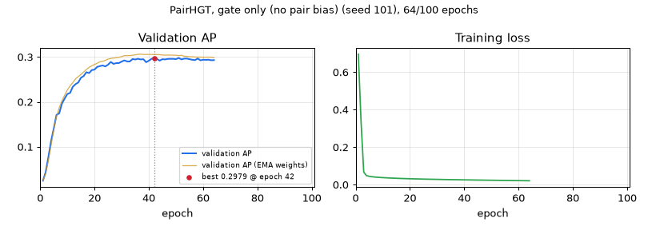

# PairHGT, gate only (no pair bias) — seed 101

[← all models](../README.md) · PairHGT notebook · ogbg-molpcba

| | |
|---|---|
| State | **running** |
| Epochs | 64 of 100 |
| Best validation AP | **0.2979** at epoch 42 |
| Best validation AP, EMA weights | 0.3064 at epoch 37 |
| Test AP | after training |
| Seed | 101 |
| Parameters | 9,751,632 |
| Minutes per epoch (last 5, incl. validation) | 4.5 |
| Training time so far | 4.8 h |
| Training time left | 2.7 h |
| Sessions (start + resumes) | 1 |
| Hottest GPU reading | 89.0 °C |
| Last update | 2026-11-14 18:05 (2 min ago) |



<details><summary>Settings of this run</summary>

| Setting | Value |
|---|---|
| Epochs (warm-up) | 100 (5) |
| Batch size | 512 |
| Learning rate, weight decay | 0.0005, 1e-05 |
| Layers × width, heads | 5 × 384, 4 |
| Dropout, attention dropout | 0.2, 0.5 |
| Pair channel | width 16, dropout 0.1, value gate True |
| Precision | fp32 (TF32 matrix products) |
| EMA decay | 0.9995 |
| Gradient clip | 1.0 |
| Protocol | v2_test_once |
| Notebook version, config hash | pairhgt-confirmatory-v2.0, 131dbd9447481a4c |

</details>

_Protocol 'test once': the test split is evaluated only after training, once per weight type._

## Every epoch (newest first)

| Epoch | Train loss | Val AP | Val AP (EMA weights) | Best so far | LR | Minutes |
|---|---|---|---|---|---|---|
| 64 | 0.0213 | 0.2932 | 0.2987 | 0.2979 (ep 42) | 1.65e-04 | 4.5 |
| 63 | 0.0215 | 0.2929 | 0.2996 | 0.2979 (ep 42) | 1.73e-04 | 4.5 |
| 62 | 0.0216 | 0.2940 | 0.2998 | 0.2979 (ep 42) | 1.81e-04 | 4.5 |
| 61 | 0.0218 | 0.2938 | 0.2997 | 0.2979 (ep 42) | 1.89e-04 | 4.5 |
| 60 | 0.0220 | 0.2940 | 0.2995 | 0.2979 (ep 42) | 1.97e-04 | 4.5 |
| 59 | 0.0222 | 0.2927 | 0.2999 | 0.2979 (ep 42) | 2.05e-04 | 4.5 |
| 58 | 0.0223 | 0.2967 | 0.2999 | 0.2979 (ep 42) | 2.13e-04 | 4.5 |
| 57 | 0.0226 | 0.2931 | 0.3001 | 0.2979 (ep 42) | 2.21e-04 | 4.5 |
| 56 | 0.0227 | 0.2940 | 0.3008 | 0.2979 (ep 42) | 2.29e-04 | 4.5 |
| 55 | 0.0229 | 0.2952 | 0.3006 | 0.2979 (ep 42) | 2.38e-04 | 4.5 |
| 54 | 0.0231 | 0.2966 | 0.3014 | 0.2979 (ep 42) | 2.46e-04 | 4.5 |
| 53 | 0.0234 | 0.2964 | 0.3019 | 0.2979 (ep 42) | 2.54e-04 | 4.5 |
| 52 | 0.0235 | 0.2947 | 0.3040 | 0.2979 (ep 42) | 2.62e-04 | 4.5 |
| 51 | 0.0238 | 0.2979 | 0.3031 | 0.2979 (ep 42) | 2.71e-04 | 4.5 |
| 50 | 0.0240 | 0.2952 | 0.3041 | 0.2979 (ep 42) | 2.79e-04 | 4.5 |
| 49 | 0.0241 | 0.2960 | 0.3040 | 0.2979 (ep 42) | 2.87e-04 | 4.5 |
| 48 | 0.0244 | 0.2960 | 0.3045 | 0.2979 (ep 42) | 2.95e-04 | 4.5 |
| 47 | 0.0246 | 0.2958 | 0.3044 | 0.2979 (ep 42) | 3.03e-04 | 4.5 |
| 46 | 0.0248 | 0.2947 | 0.3044 | 0.2979 (ep 42) | 3.11e-04 | 4.5 |
| 45 | 0.0250 | 0.2952 | 0.3046 | 0.2979 (ep 42) | 3.19e-04 | 4.5 |
| 44 | 0.0252 | 0.2920 | 0.3053 | 0.2979 (ep 42) | 3.27e-04 | 4.5 |
| 43 | 0.0254 | 0.2957 | 0.3056 | 0.2979 (ep 42) | 3.35e-04 | 4.4 |
| 42 | 0.0257 | 0.2979 ⭐ | 0.3056 | 0.2979 (ep 42) | 3.43e-04 | 4.5 |
| 41 | 0.0259 | 0.2960 | 0.3057 | 0.2961 (ep 36) | 3.50e-04 | 4.5 |
| 40 | 0.0261 | 0.2918 | 0.3058 | 0.2961 (ep 36) | 3.58e-04 | 4.5 |
| 39 | 0.0264 | 0.2885 | 0.3058 | 0.2961 (ep 36) | 3.65e-04 | 4.5 |
| 38 | 0.0266 | 0.2952 | 0.3058 | 0.2961 (ep 36) | 3.73e-04 | 4.5 |
| 37 | 0.0269 | 0.2947 | 0.3064 | 0.2961 (ep 36) | 3.80e-04 | 4.5 |
| 36 | 0.0271 | 0.2961 ⭐ | 0.3061 | 0.2961 (ep 36) | 3.87e-04 | 4.5 |
| 35 | 0.0273 | 0.2946 | 0.3049 | 0.2956 (ep 34) | 3.94e-04 | 4.5 |
| 34 | 0.0276 | 0.2956 ⭐ | 0.3040 | 0.2956 (ep 34) | 4.00e-04 | 4.5 |
| 33 | 0.0278 | 0.2902 | 0.3033 | 0.2926 (ep 31) | 4.07e-04 | 4.5 |
| 32 | 0.0281 | 0.2903 | 0.3032 | 0.2926 (ep 31) | 4.13e-04 | 4.5 |
| 31 | 0.0284 | 0.2926 ⭐ | 0.3031 | 0.2926 (ep 31) | 4.19e-04 | 4.5 |
| 30 | 0.0287 | 0.2899 ⭐ | 0.3010 | 0.2899 (ep 30) | 4.25e-04 | 4.4 |
| 29 | 0.0289 | 0.2866 | 0.2993 | 0.2891 (ep 26) | 4.31e-04 | 4.5 |
| 28 | 0.0292 | 0.2865 | 0.2986 | 0.2891 (ep 26) | 4.37e-04 | 4.5 |
| 27 | 0.0294 | 0.2848 | 0.2976 | 0.2891 (ep 26) | 4.42e-04 | 4.4 |
| 26 | 0.0297 | 0.2891 ⭐ | 0.2969 | 0.2891 (ep 26) | 4.47e-04 | 4.4 |
| 25 | 0.0301 | 0.2830 ⭐ | 0.2954 | 0.2830 (ep 25) | 4.52e-04 | 4.4 |
| 24 | 0.0305 | 0.2791 | 0.2925 | 0.2812 (ep 23) | 4.57e-04 | 4.4 |
| 23 | 0.0310 | 0.2812 ⭐ | 0.2905 | 0.2812 (ep 23) | 4.62e-04 | 4.4 |
| 22 | 0.0312 | 0.2798 ⭐ | 0.2896 | 0.2798 (ep 22) | 4.66e-04 | 4.4 |
| 21 | 0.0316 | 0.2781 ⭐ | 0.2862 | 0.2781 (ep 21) | 4.70e-04 | 4.4 |
| 20 | 0.0320 | 0.2721 ⭐ | 0.2834 | 0.2721 (ep 20) | 4.74e-04 | 4.4 |
| 19 | 0.0324 | 0.2709 ⭐ | 0.2805 | 0.2709 (ep 19) | 4.77e-04 | 4.4 |
| 18 | 0.0329 | 0.2643 | 0.2770 | 0.2662 (ep 17) | 4.81e-04 | 4.4 |
| 17 | 0.0333 | 0.2662 ⭐ | 0.2723 | 0.2662 (ep 17) | 4.84e-04 | 4.4 |
| 16 | 0.0339 | 0.2576 ⭐ | 0.2666 | 0.2576 (ep 16) | 4.86e-04 | 4.4 |
| 15 | 0.0344 | 0.2538 ⭐ | 0.2612 | 0.2538 (ep 15) | 4.89e-04 | 4.4 |
| 14 | 0.0351 | 0.2433 ⭐ | 0.2564 | 0.2433 (ep 14) | 4.91e-04 | 4.4 |
| 13 | 0.0357 | 0.2396 ⭐ | 0.2514 | 0.2396 (ep 13) | 4.93e-04 | 4.4 |
| 12 | 0.0364 | 0.2337 ⭐ | 0.2429 | 0.2337 (ep 12) | 4.95e-04 | 4.4 |
| 11 | 0.0372 | 0.2201 ⭐ | 0.2357 | 0.2201 (ep 11) | 4.97e-04 | 4.4 |
| 10 | 0.0380 | 0.2176 ⭐ | 0.2269 | 0.2176 (ep 10) | 4.98e-04 | 4.4 |
| 9 | 0.0389 | 0.2075 ⭐ | 0.2151 | 0.2075 (ep 9) | 4.99e-04 | 4.4 |
| 8 | 0.0399 | 0.1963 ⭐ | 0.2024 | 0.1963 (ep 8) | 4.99e-04 | 4.4 |
| 7 | 0.0412 | 0.1746 ⭐ | 0.1873 | 0.1746 (ep 7) | 5.00e-04 | 4.4 |
| 6 | 0.0429 | 0.1712 ⭐ | 0.1668 | 0.1712 (ep 6) | 5.00e-04 | 4.4 |
| 5 | 0.0450 | 0.1410 ⭐ | 0.1379 | 0.1410 (ep 5) | 4.00e-04 | 4.5 |
| 4 | 0.0487 | 0.1125 ⭐ | 0.1033 | 0.1125 (ep 4) | 3.00e-04 | 4.4 |
| 3 | 0.0673 | 0.0765 ⭐ | 0.0688 | 0.0765 (ep 3) | 2.00e-04 | 4.5 |
| 2 | 0.3394 | 0.0435 ⭐ | 0.0399 | 0.0435 (ep 2) | 1.00e-04 | 4.4 |
| 1 | 0.6964 | 0.0245 ⭐ | 0.0245 | 0.0245 (ep 1) | 5.00e-10 | 4.4 |

## Last 80 log lines

_The log counts epochs from 0; the tables above count from 1._

```
Dataset cache already present: /home/student/thesis/outputs/pairhgt/data/ogb/ogbg_molpcba
RWSE loaded from cache
graphs: total 437,929 | train 350,343 | val 43,793 | test 43,793 | ready in 2s
steps/epoch: train 685, val 86, test 86
--- cell 6 ---
PairHGT, gate only (no pair bias): GPS + pair channel (pair write-back (no pair bias), value gate) [arm A_gateonly_nobias]: 9,751,632 parameters = baseline 9,744,860 + 6,772 (0.07%), of which the pair channel 6,772
parameter count matches the expected 9,751,632 for arm A_gateonly_nobias
--- cell 7 ---
--- cell 9 ---
--- cell 10 ---
--- cell 12 ---
RUN_DEBUG_FIRST is False: smoke test skipped.
--- cell 14 ---
Restored 0 seed folder(s).
prereg.json written: /home/student/thesis/outputs/pairhgt/outputs/gps_conf_A_gateonly_nobias_ep100_molpcba/prereg.json  (config hash 131dbd9447481a4c, seeds [101, 202, 323, 432, 543])
[seed 101] new run | params 9,751,632 | steps/epoch 685 | PairHGT, gate only (no pair bias): GPS + pair channel (pair write-back (no pair bias), value gate) [arm A_gateonly_nobias], 100 epochs | protocol v2_test_once
[seed 101] epoch   1/100 | lr 5.00e-10 | train BCE 0.6964 | val AP 0.0245 | best val 0.0245 @ep1 | EMA val 0.0245 | 266s (train 238s, eval 28s) | GPU max 83C | ETA<= 7.3h
[seed 101] epoch   2/100 | lr 1.00e-04 | train BCE 0.3394 | val AP 0.0435 | best val 0.0435 @ep2 | EMA val 0.0399 | 266s (train 238s, eval 28s) | GPU max 84C | ETA<= 7.2h
[seed 101] epoch   3/100 | lr 2.00e-04 | train BCE 0.0673 | val AP 0.0765 | best val 0.0765 @ep3 | EMA val 0.0688 | 267s (train 239s, eval 28s) | GPU max 84C | ETA<= 7.2h
[seed 101] epoch   4/100 | lr 3.00e-04 | train BCE 0.0487 | val AP 0.1125 | best val 0.1125 @ep4 | EMA val 0.1033 | 266s (train 238s, eval 28s) | GPU max 84C | ETA<= 7.1h
[seed 101] epoch   5/100 | lr 4.00e-04 | train BCE 0.0450 | val AP 0.1410 | best val 0.1410 @ep5 | EMA val 0.1379 | 267s (train 239s, eval 28s) | GPU max 84C | ETA<= 7.0h
[seed 101] epoch   6/100 | lr 5.00e-04 | train BCE 0.0429 | val AP 0.1712 | best val 0.1712 @ep6 | EMA val 0.1668 | 266s (train 238s, eval 28s) | GPU max 84C | ETA<= 7.0h
[seed 101] epoch   7/100 | lr 5.00e-04 | train BCE 0.0412 | val AP 0.1746 | best val 0.1746 @ep7 | EMA val 0.1873 | 266s (train 238s, eval 28s) | GPU max 84C | ETA<= 6.9h
[seed 101] epoch   8/100 | lr 4.99e-04 | train BCE 0.0399 | val AP 0.1963 | best val 0.1963 @ep8 | EMA val 0.2024 | 266s (train 238s, eval 28s) | GPU max 84C | ETA<= 6.8h
[seed 101] epoch   9/100 | lr 4.99e-04 | train BCE 0.0389 | val AP 0.2075 | best val 0.2075 @ep9 | EMA val 0.2151 | 266s (train 238s, eval 28s) | GPU max 84C | ETA<= 6.7h
[seed 101] epoch  10/100 | lr 4.98e-04 | train BCE 0.0380 | val AP 0.2176 | best val 0.2176 @ep10 | EMA val 0.2269 | 266s (train 238s, eval 28s) | GPU max 84C | ETA<= 6.7h
[seed 101] epoch  11/100 | lr 4.97e-04 | train BCE 0.0372 | val AP 0.2201 | best val 0.2201 @ep11 | EMA val 0.2357 | 266s (train 238s, eval 28s) | GPU max 84C | ETA<= 6.6h
[seed 101] epoch  12/100 | lr 4.95e-04 | train BCE 0.0364 | val AP 0.2337 | best val 0.2337 @ep12 | EMA val 0.2429 | 266s (train 238s, eval 28s) | GPU max 84C | ETA<= 6.5h
[seed 101] epoch  13/100 | lr 4.93e-04 | train BCE 0.0357 | val AP 0.2396 | best val 0.2396 @ep13 | EMA val 0.2514 | 266s (train 238s, eval 28s) | GPU max 84C | ETA<= 6.4h
[seed 101] epoch  14/100 | lr 4.91e-04 | train BCE 0.0351 | val AP 0.2433 | best val 0.2433 @ep14 | EMA val 0.2564 | 266s (train 238s, eval 28s) | GPU max 84C | ETA<= 6.4h
[seed 101] epoch  15/100 | lr 4.89e-04 | train BCE 0.0344 | val AP 0.2538 | best val 0.2538 @ep15 | EMA val 0.2612 | 266s (train 238s, eval 28s) | GPU max 84C | ETA<= 6.3h
[seed 101] epoch  16/100 | lr 4.86e-04 | train BCE 0.0339 | val AP 0.2576 | best val 0.2576 @ep16 | EMA val 0.2666 | 266s (train 238s, eval 28s) | GPU max 84C | ETA<= 6.2h
[seed 101] epoch  17/100 | lr 4.84e-04 | train BCE 0.0333 | val AP 0.2662 | best val 0.2662 @ep17 | EMA val 0.2723 | 266s (train 239s, eval 28s) | GPU max 84C | ETA<= 6.1h
[seed 101] epoch  18/100 | lr 4.81e-04 | train BCE 0.0329 | val AP 0.2643 | best val 0.2662 @ep17 | EMA val 0.2770 | 266s (train 238s, eval 28s) | GPU max 84C | ETA<= 6.1h
[seed 101] epoch  19/100 | lr 4.77e-04 | train BCE 0.0324 | val AP 0.2709 | best val 0.2709 @ep19 | EMA val 0.2805 | 266s (train 238s, eval 28s) | GPU max 84C | ETA<= 6.0h
[seed 101] epoch  20/100 | lr 4.74e-04 | train BCE 0.0320 | val AP 0.2721 | best val 0.2721 @ep20 | EMA val 0.2834 | 266s (train 238s, eval 28s) | GPU max 84C | ETA<= 5.9h
[seed 101] epoch  21/100 | lr 4.70e-04 | train BCE 0.0316 | val AP 0.2781 | best val 0.2781 @ep21 | EMA val 0.2862 | 266s (train 238s, eval 28s) | GPU max 84C | ETA<= 5.8h
[seed 101] epoch  22/100 | lr 4.66e-04 | train BCE 0.0312 | val AP 0.2798 | best val 0.2798 @ep22 | EMA val 0.2896 | 266s (train 238s, eval 28s) | GPU max 84C | ETA<= 5.8h
[seed 101] epoch  23/100 | lr 4.62e-04 | train BCE 0.0310 | val AP 0.2812 | best val 0.2812 @ep23 | EMA val 0.2905 | 266s (train 238s, eval 28s) | GPU max 84C | ETA<= 5.7h
[seed 101] epoch  24/100 | lr 4.57e-04 | train BCE 0.0305 | val AP 0.2791 | best val 0.2812 @ep23 | EMA val 0.2925 | 266s (train 238s, eval 28s) | GPU max 84C | ETA<= 5.6h
[seed 101] epoch  25/100 | lr 4.52e-04 | train BCE 0.0301 | val AP 0.2830 | best val 0.2830 @ep25 | EMA val 0.2954 | 266s (train 238s, eval 28s) | GPU max 84C | ETA<= 5.5h
[seed 101] epoch  26/100 | lr 4.47e-04 | train BCE 0.0297 | val AP 0.2891 | best val 0.2891 @ep26 | EMA val 0.2969 | 266s (train 238s, eval 28s) | GPU max 85C | ETA<= 5.5h
[seed 101] epoch  27/100 | lr 4.42e-04 | train BCE 0.0294 | val AP 0.2848 | best val 0.2891 @ep26 | EMA val 0.2976 | 267s (train 239s, eval 28s) | GPU max 85C | ETA<= 5.4h
[seed 101] epoch  28/100 | lr 4.37e-04 | train BCE 0.0292 | val AP 0.2865 | best val 0.2891 @ep26 | EMA val 0.2986 | 267s (train 239s, eval 28s) | GPU max 86C | ETA<= 5.3h
[seed 101] epoch  29/100 | lr 4.31e-04 | train BCE 0.0289 | val AP 0.2866 | best val 0.2891 @ep26 | EMA val 0.2993 | 267s (train 239s, eval 28s) | GPU max 86C | ETA<= 5.3h
[seed 101] epoch  30/100 | lr 4.25e-04 | train BCE 0.0287 | val AP 0.2899 | best val 0.2899 @ep30 | EMA val 0.3010 | 267s (train 239s, eval 28s) | GPU max 86C | ETA<= 5.2h
[seed 101] epoch  31/100 | lr 4.19e-04 | train BCE 0.0284 | val AP 0.2926 | best val 0.2926 @ep31 | EMA val 0.3031 | 267s (train 239s, eval 28s) | GPU max 86C | ETA<= 5.1h
[seed 101] epoch  32/100 | lr 4.13e-04 | train BCE 0.0281 | val AP 0.2903 | best val 0.2926 @ep31 | EMA val 0.3032 | 267s (train 239s, eval 28s) | GPU max 86C | ETA<= 5.0h
[seed 101] epoch  33/100 | lr 4.07e-04 | train BCE 0.0278 | val AP 0.2902 | best val 0.2926 @ep31 | EMA val 0.3033 | 268s (train 240s, eval 28s) | GPU max 87C | ETA<= 5.0h
[seed 101] epoch  34/100 | lr 4.00e-04 | train BCE 0.0276 | val AP 0.2956 | best val 0.2956 @ep34 | EMA val 0.3040 | 268s (train 240s, eval 28s) | GPU max 87C | ETA<= 4.9h
[seed 101] epoch  35/100 | lr 3.94e-04 | train BCE 0.0273 | val AP 0.2946 | best val 0.2956 @ep34 | EMA val 0.3049 | 268s (train 240s, eval 28s) | GPU max 88C | ETA<= 4.8h
[seed 101] epoch  36/100 | lr 3.87e-04 | train BCE 0.0271 | val AP 0.2961 | best val 0.2961 @ep36 | EMA val 0.3061 | 268s (train 240s, eval 28s) | GPU max 88C | ETA<= 4.8h
[seed 101] epoch  37/100 | lr 3.80e-04 | train BCE 0.0269 | val AP 0.2947 | best val 0.2961 @ep36 | EMA val 0.3064 | 269s (train 240s, eval 28s) | GPU max 88C | ETA<= 4.7h
[seed 101] epoch  38/100 | lr 3.73e-04 | train BCE 0.0266 | val AP 0.2952 | best val 0.2961 @ep36 | EMA val 0.3058 | 268s (train 240s, eval 28s) | GPU max 88C | ETA<= 4.6h
[seed 101] epoch  39/100 | lr 3.65e-04 | train BCE 0.0264 | val AP 0.2885 | best val 0.2961 @ep36 | EMA val 0.3058 | 268s (train 240s, eval 28s) | GPU max 87C | ETA<= 4.5h
[seed 101] epoch  40/100 | lr 3.58e-04 | train BCE 0.0261 | val AP 0.2918 | best val 0.2961 @ep36 | EMA val 0.3058 | 267s (train 239s, eval 28s) | GPU max 86C | ETA<= 4.5h
[seed 101] epoch  41/100 | lr 3.50e-04 | train BCE 0.0259 | val AP 0.2960 | best val 0.2961 @ep36 | EMA val 0.3057 | 268s (train 239s, eval 28s) | GPU max 86C | ETA<= 4.4h
[seed 101] epoch  42/100 | lr 3.43e-04 | train BCE 0.0257 | val AP 0.2979 | best val 0.2979 @ep42 | EMA val 0.3056 | 267s (train 239s, eval 28s) | GPU max 86C | ETA<= 4.3h
[seed 101] epoch  43/100 | lr 3.35e-04 | train BCE 0.0254 | val AP 0.2957 | best val 0.2979 @ep42 | EMA val 0.3056 | 267s (train 239s, eval 28s) | GPU max 86C | ETA<= 4.2h
[seed 101] epoch  44/100 | lr 3.27e-04 | train BCE 0.0252 | val AP 0.2920 | best val 0.2979 @ep42 | EMA val 0.3053 | 267s (train 239s, eval 28s) | GPU max 86C | ETA<= 4.2h
[seed 101] epoch  45/100 | lr 3.19e-04 | train BCE 0.0250 | val AP 0.2952 | best val 0.2979 @ep42 | EMA val 0.3046 | 268s (train 240s, eval 28s) | GPU max 87C | ETA<= 4.1h
[seed 101] epoch  46/100 | lr 3.11e-04 | train BCE 0.0248 | val AP 0.2947 | best val 0.2979 @ep42 | EMA val 0.3044 | 268s (train 240s, eval 28s) | GPU max 88C | ETA<= 4.0h
[seed 101] epoch  47/100 | lr 3.03e-04 | train BCE 0.0246 | val AP 0.2958 | best val 0.2979 @ep42 | EMA val 0.3044 | 268s (train 240s, eval 28s) | GPU max 88C | ETA<= 3.9h
[seed 101] epoch  48/100 | lr 2.95e-04 | train BCE 0.0244 | val AP 0.2960 | best val 0.2979 @ep42 | EMA val 0.3045 | 268s (train 240s, eval 28s) | GPU max 88C | ETA<= 3.9h
[seed 101] epoch  49/100 | lr 2.87e-04 | train BCE 0.0241 | val AP 0.2960 | best val 0.2979 @ep42 | EMA val 0.3040 | 269s (train 240s, eval 28s) | GPU max 88C | ETA<= 3.8h
[seed 101] epoch  50/100 | lr 2.79e-04 | train BCE 0.0240 | val AP 0.2952 | best val 0.2979 @ep42 | EMA val 0.3041 | 269s (train 240s, eval 28s) | GPU max 88C | ETA<= 3.7h
[seed 101] epoch  51/100 | lr 2.71e-04 | train BCE 0.0238 | val AP 0.2979 | best val 0.2979 @ep42 | EMA val 0.3031 | 269s (train 240s, eval 28s) | GPU max 88C | ETA<= 3.7h
[seed 101] epoch  52/100 | lr 2.62e-04 | train BCE 0.0235 | val AP 0.2947 | best val 0.2979 @ep42 | EMA val 0.3040 | 269s (train 240s, eval 28s) | GPU max 88C | ETA<= 3.6h
[seed 101] epoch  53/100 | lr 2.54e-04 | train BCE 0.0234 | val AP 0.2964 | best val 0.2979 @ep42 | EMA val 0.3019 | 269s (train 241s, eval 28s) | GPU max 89C | ETA<= 3.5h
[seed 101] epoch  54/100 | lr 2.46e-04 | train BCE 0.0231 | val AP 0.2966 | best val 0.2979 @ep42 | EMA val 0.3014 | 269s (train 241s, eval 28s) | GPU max 89C | ETA<= 3.4h
[seed 101] epoch  55/100 | lr 2.38e-04 | train BCE 0.0229 | val AP 0.2952 | best val 0.2979 @ep42 | EMA val 0.3006 | 269s (train 241s, eval 28s) | GPU max 89C | ETA<= 3.4h
[seed 101] epoch  56/100 | lr 2.29e-04 | train BCE 0.0227 | val AP 0.2940 | best val 0.2979 @ep42 | EMA val 0.3008 | 269s (train 241s, eval 28s) | GPU max 89C | ETA<= 3.3h
[seed 101] epoch  57/100 | lr 2.21e-04 | train BCE 0.0226 | val AP 0.2931 | best val 0.2979 @ep42 | EMA val 0.3001 | 269s (train 240s, eval 28s) | GPU max 89C | ETA<= 3.2h
[seed 101] epoch  58/100 | lr 2.13e-04 | train BCE 0.0223 | val AP 0.2967 | best val 0.2979 @ep42 | EMA val 0.2999 | 269s (train 241s, eval 28s) | GPU max 89C | ETA<= 3.1h
[seed 101] epoch  59/100 | lr 2.05e-04 | train BCE 0.0222 | val AP 0.2927 | best val 0.2979 @ep42 | EMA val 0.2999 | 269s (train 240s, eval 28s) | GPU max 89C | ETA<= 3.1h
[seed 101] epoch  60/100 | lr 1.97e-04 | train BCE 0.0220 | val AP 0.2940 | best val 0.2979 @ep42 | EMA val 0.2995 | 269s (train 241s, eval 28s) | GPU max 89C | ETA<= 3.0h
[seed 101] epoch  61/100 | lr 1.89e-04 | train BCE 0.0218 | val AP 0.2938 | best val 0.2979 @ep42 | EMA val 0.2997 | 269s (train 241s, eval 28s) | GPU max 89C | ETA<= 2.9h
[seed 101] epoch  62/100 | lr 1.81e-04 | train BCE 0.0216 | val AP 0.2940 | best val 0.2979 @ep42 | EMA val 0.2998 | 269s (train 241s, eval 28s) | GPU max 89C | ETA<= 2.8h
[seed 101] epoch  63/100 | lr 1.73e-04 | train BCE 0.0215 | val AP 0.2929 | best val 0.2979 @ep42 | EMA val 0.2996 | 269s (train 241s, eval 28s) | GPU max 89C | ETA<= 2.8h
[seed 101] epoch  64/100 | lr 1.65e-04 | train BCE 0.0213 | val AP 0.2932 | best val 0.2979 @ep42 | EMA val 0.2987 | 269s (train 241s, eval 28s) | GPU max 89C | ETA<= 2.7h
```
