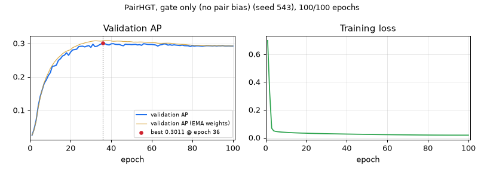

# PairHGT, gate only (no pair bias) — seed 543

[← all models](../README.md) · PairHGT notebook · ogbg-molpcba

| | |
|---|---|
| State | **finished** |
| Epochs | 100 of 100 |
| Best validation AP | **0.3011** at epoch 36 |
| Best validation AP, EMA weights | 0.3084 at epoch 37 |
| Test AP | raw 0.2921 / ema 0.2992 (final) |
| Seed | 543 |
| Parameters | 9,751,632 |
| Minutes per epoch (last 5, incl. validation) | 4.5 |
| Training time so far | 7.5 h |
| Training time left | done |
| Sessions (start + resumes) | 2 |
| Hottest GPU reading | 89.0 °C |
| Last update | 2026-11-18 07:05 (251.0 h ago) |



<details><summary>Settings of this run</summary>

| Setting | Value |
|---|---|
| Epochs (warm-up) | 100 (5) |
| Batch size | 512 |
| Learning rate, weight decay | 0.0005, 1e-05 |
| Layers × width, heads | 5 × 384, 4 |
| Dropout, attention dropout | 0.2, 0.5 |
| Pair channel | width 16, dropout 0.1, value gate True |
| Precision | fp32 (TF32 matrix products) |
| EMA decay | 0.9995 |
| Gradient clip | 1.0 |
| Protocol | v2_test_once |
| Notebook version, config hash | pairhgt-confirmatory-v2.0, 131dbd9447481a4c |

</details>

## Final test (evaluated once)

| Weights | Epoch | Validation AP | Test AP |
|---|---|---|---|
| raw | 36 | 0.3011 | 0.2921 |
| ema | 37 | 0.3084 | 0.2992 |

## Every epoch (newest first)

| Epoch | Train loss | Val AP | Val AP (EMA weights) | Best so far | LR | Minutes |
|---|---|---|---|---|---|---|
| 100 | 0.0181 | 0.2918 | 0.2921 | 0.3011 (ep 36) | 1.37e-07 | 4.5 |
| 99 | 0.0181 | 0.2918 | 0.2921 | 0.3011 (ep 36) | 5.47e-07 | 4.5 |
| 98 | 0.0181 | 0.2921 | 0.2921 | 0.3011 (ep 36) | 1.23e-06 | 4.5 |
| 97 | 0.0181 | 0.2919 | 0.2922 | 0.3011 (ep 36) | 2.18e-06 | 4.5 |
| 96 | 0.0181 | 0.2920 | 0.2923 | 0.3011 (ep 36) | 3.41e-06 | 4.5 |
| 95 | 0.0182 | 0.2931 | 0.2923 | 0.3011 (ep 36) | 4.91e-06 | 4.5 |
| 94 | 0.0181 | 0.2924 | 0.2924 | 0.3011 (ep 36) | 6.67e-06 | 4.5 |
| 93 | 0.0182 | 0.2927 | 0.2925 | 0.3011 (ep 36) | 8.70e-06 | 4.5 |
| 92 | 0.0182 | 0.2919 | 0.2925 | 0.3011 (ep 36) | 1.10e-05 | 4.5 |
| 91 | 0.0182 | 0.2929 | 0.2925 | 0.3011 (ep 36) | 1.35e-05 | 4.5 |
| 90 | 0.0182 | 0.2921 | 0.2924 | 0.3011 (ep 36) | 1.64e-05 | 4.5 |
| 89 | 0.0183 | 0.2926 | 0.2924 | 0.3011 (ep 36) | 1.94e-05 | 4.5 |
| 88 | 0.0184 | 0.2927 | 0.2930 | 0.3011 (ep 36) | 2.27e-05 | 4.5 |
| 87 | 0.0184 | 0.2929 | 0.2925 | 0.3011 (ep 36) | 2.63e-05 | 4.5 |
| 86 | 0.0184 | 0.2923 | 0.2927 | 0.3011 (ep 36) | 3.01e-05 | 4.5 |
| 85 | 0.0185 | 0.2914 | 0.2931 | 0.3011 (ep 36) | 3.42e-05 | 4.5 |
| 84 | 0.0186 | 0.2920 | 0.2933 | 0.3011 (ep 36) | 3.85e-05 | 4.5 |
| 83 | 0.0186 | 0.2925 | 0.2935 | 0.3011 (ep 36) | 4.30e-05 | 4.5 |
| 82 | 0.0188 | 0.2924 | 0.2937 | 0.3011 (ep 36) | 4.77e-05 | 4.5 |
| 81 | 0.0188 | 0.2917 | 0.2940 | 0.3011 (ep 36) | 5.27e-05 | 4.5 |
| 80 | 0.0189 | 0.2926 | 0.2944 | 0.3011 (ep 36) | 5.79e-05 | 4.5 |
| 79 | 0.0191 | 0.2906 | 0.2949 | 0.3011 (ep 36) | 6.33e-05 | 4.5 |
| 78 | 0.0191 | 0.2926 | 0.2953 | 0.3011 (ep 36) | 6.89e-05 | 4.5 |
| 77 | 0.0192 | 0.2928 | 0.2961 | 0.3011 (ep 36) | 7.47e-05 | 4.5 |
| 76 | 0.0193 | 0.2931 | 0.2967 | 0.3011 (ep 36) | 8.07e-05 | 4.5 |
| 75 | 0.0195 | 0.2948 | 0.2969 | 0.3011 (ep 36) | 8.69e-05 | 4.5 |
| 74 | 0.0196 | 0.2934 | 0.2971 | 0.3011 (ep 36) | 9.32e-05 | 4.5 |
| 73 | 0.0197 | 0.2940 | 0.2977 | 0.3011 (ep 36) | 9.97e-05 | 4.5 |
| 72 | 0.0198 | 0.2947 | 0.2982 | 0.3011 (ep 36) | 1.06e-04 | 4.5 |
| 71 | 0.0200 | 0.2955 | 0.2991 | 0.3011 (ep 36) | 1.13e-04 | 4.5 |
| 70 | 0.0201 | 0.2943 | 0.2997 | 0.3011 (ep 36) | 1.20e-04 | 4.5 |
| 69 | 0.0203 | 0.2957 | 0.3003 | 0.3011 (ep 36) | 1.27e-04 | 4.5 |
| 68 | 0.0204 | 0.2945 | 0.3005 | 0.3011 (ep 36) | 1.35e-04 | 4.5 |
| 67 | 0.0206 | 0.2977 | 0.3004 | 0.3011 (ep 36) | 1.42e-04 | 4.5 |
| 66 | 0.0208 | 0.2984 | 0.3002 | 0.3011 (ep 36) | 1.50e-04 | 4.5 |
| 65 | 0.0209 | 0.2960 | 0.3000 | 0.3011 (ep 36) | 1.57e-04 | 4.5 |
| 64 | 0.0211 | 0.2950 | 0.3000 | 0.3011 (ep 36) | 1.65e-04 | 4.5 |
| 63 | 0.0213 | 0.2918 | 0.3004 | 0.3011 (ep 36) | 1.73e-04 | 4.5 |
| 62 | 0.0214 | 0.2948 | 0.3016 | 0.3011 (ep 36) | 1.81e-04 | 4.5 |
| 61 | 0.0216 | 0.2959 | 0.3020 | 0.3011 (ep 36) | 1.89e-04 | 4.5 |
| 60 | 0.0218 | 0.2966 | 0.3022 | 0.3011 (ep 36) | 1.97e-04 | 4.5 |
| 59 | 0.0220 | 0.2967 | 0.3025 | 0.3011 (ep 36) | 2.05e-04 | 4.5 |
| 58 | 0.0222 | 0.2968 | 0.3026 | 0.3011 (ep 36) | 2.13e-04 | 4.5 |
| 57 | 0.0224 | 0.2979 | 0.3032 | 0.3011 (ep 36) | 2.21e-04 | 4.5 |
| 56 | 0.0225 | 0.2989 | 0.3036 | 0.3011 (ep 36) | 2.29e-04 | 4.5 |
| 55 | 0.0227 | 0.2940 | 0.3039 | 0.3011 (ep 36) | 2.38e-04 | 4.5 |
| 54 | 0.0229 | 0.2960 | 0.3039 | 0.3011 (ep 36) | 2.46e-04 | 4.5 |
| 53 | 0.0231 | 0.2952 | 0.3036 | 0.3011 (ep 36) | 2.54e-04 | 4.5 |
| 52 | 0.0234 | 0.2970 | 0.3038 | 0.3011 (ep 36) | 2.62e-04 | 4.5 |
| 51 | 0.0236 | 0.2965 | 0.3036 | 0.3011 (ep 36) | 2.71e-04 | 4.5 |
| 50 | 0.0238 | 0.2962 | 0.3046 | 0.3011 (ep 36) | 2.79e-04 | 4.5 |
| 49 | 0.0240 | 0.2968 | 0.3052 | 0.3011 (ep 36) | 2.87e-04 | 4.5 |
| 48 | 0.0242 | 0.2968 | 0.3050 | 0.3011 (ep 36) | 2.95e-04 | 4.5 |
| 47 | 0.0245 | 0.2975 | 0.3055 | 0.3011 (ep 36) | 3.03e-04 | 4.5 |
| 46 | 0.0246 | 0.2926 | 0.3053 | 0.3011 (ep 36) | 3.11e-04 | 4.5 |
| 45 | 0.0248 | 0.2942 | 0.3063 | 0.3011 (ep 36) | 3.19e-04 | 4.5 |
| 44 | 0.0251 | 0.2968 | 0.3066 | 0.3011 (ep 36) | 3.27e-04 | 4.5 |
| 43 | 0.0253 | 0.2966 | 0.3067 | 0.3011 (ep 36) | 3.35e-04 | 4.5 |
| 42 | 0.0256 | 0.2972 | 0.3063 | 0.3011 (ep 36) | 3.43e-04 | 4.5 |
| 41 | 0.0258 | 0.2990 | 0.3060 | 0.3011 (ep 36) | 3.50e-04 | 4.5 |
| 40 | 0.0260 | 0.2984 | 0.3071 | 0.3011 (ep 36) | 3.58e-04 | 4.5 |
| 39 | 0.0263 | 0.2950 | 0.3081 | 0.3011 (ep 36) | 3.65e-04 | 4.5 |
| 38 | 0.0265 | 0.2961 | 0.3081 | 0.3011 (ep 36) | 3.73e-04 | 4.5 |
| 37 | 0.0267 | 0.2986 | 0.3084 | 0.3011 (ep 36) | 3.80e-04 | 4.5 |
| 36 | 0.0270 | 0.3011 ⭐ | 0.3079 | 0.3011 (ep 36) | 3.87e-04 | 4.5 |
| 35 | 0.0273 | 0.2981 ⭐ | 0.3065 | 0.2981 (ep 35) | 3.94e-04 | 4.5 |
| 34 | 0.0275 | 0.2947 | 0.3068 | 0.2975 (ep 31) | 4.00e-04 | 4.5 |
| 33 | 0.0278 | 0.2913 | 0.3073 | 0.2975 (ep 31) | 4.07e-04 | 4.5 |
| 32 | 0.0281 | 0.2902 | 0.3074 | 0.2975 (ep 31) | 4.13e-04 | 4.5 |
| 31 | 0.0283 | 0.2975 ⭐ | 0.3067 | 0.2975 (ep 31) | 4.19e-04 | 4.5 |
| 30 | 0.0286 | 0.2879 | 0.3055 | 0.2931 (ep 29) | 4.25e-04 | 4.5 |
| 29 | 0.0289 | 0.2931 ⭐ | 0.3041 | 0.2931 (ep 29) | 4.31e-04 | 4.5 |
| 28 | 0.0292 | 0.2917 ⭐ | 0.3032 | 0.2917 (ep 28) | 4.37e-04 | 4.5 |
| 27 | 0.0295 | 0.2893 | 0.3013 | 0.2914 (ep 26) | 4.42e-04 | 4.5 |
| 26 | 0.0298 | 0.2914 ⭐ | 0.2992 | 0.2914 (ep 26) | 4.47e-04 | 4.5 |
| 25 | 0.0301 | 0.2911 ⭐ | 0.2980 | 0.2911 (ep 25) | 4.52e-04 | 4.5 |
| 24 | 0.0304 | 0.2902 ⭐ | 0.2954 | 0.2902 (ep 24) | 4.57e-04 | 4.5 |
| 23 | 0.0308 | 0.2825 ⭐ | 0.2925 | 0.2825 (ep 23) | 4.62e-04 | 4.5 |
| 22 | 0.0312 | 0.2812 ⭐ | 0.2898 | 0.2812 (ep 22) | 4.66e-04 | 4.5 |
| 21 | 0.0316 | 0.2801 ⭐ | 0.2869 | 0.2801 (ep 21) | 4.70e-04 | 4.5 |
| 20 | 0.0322 | 0.2738 ⭐ | 0.2810 | 0.2738 (ep 20) | 4.74e-04 | 4.5 |
| 19 | 0.0326 | 0.2642 | 0.2788 | 0.2718 (ep 18) | 4.77e-04 | 4.5 |
| 18 | 0.0329 | 0.2718 ⭐ | 0.2765 | 0.2718 (ep 18) | 4.81e-04 | 4.5 |
| 17 | 0.0334 | 0.2648 ⭐ | 0.2732 | 0.2648 (ep 17) | 4.84e-04 | 4.5 |
| 16 | 0.0339 | 0.2621 ⭐ | 0.2687 | 0.2621 (ep 16) | 4.86e-04 | 4.5 |
| 15 | 0.0345 | 0.2539 ⭐ | 0.2627 | 0.2539 (ep 15) | 4.89e-04 | 4.5 |
| 14 | 0.0351 | 0.2490 ⭐ | 0.2577 | 0.2490 (ep 14) | 4.91e-04 | 4.5 |
| 13 | 0.0358 | 0.2350 ⭐ | 0.2509 | 0.2350 (ep 13) | 4.93e-04 | 4.5 |
| 12 | 0.0366 | 0.2320 ⭐ | 0.2438 | 0.2320 (ep 12) | 4.95e-04 | 4.5 |
| 11 | 0.0373 | 0.2314 ⭐ | 0.2346 | 0.2314 (ep 11) | 4.97e-04 | 4.5 |
| 10 | 0.0381 | 0.2122 ⭐ | 0.2246 | 0.2122 (ep 10) | 4.98e-04 | 4.5 |
| 9 | 0.0391 | 0.2034 ⭐ | 0.2112 | 0.2034 (ep 9) | 4.99e-04 | 4.5 |
| 8 | 0.0400 | 0.1903 ⭐ | 0.1985 | 0.1903 (ep 8) | 4.99e-04 | 4.5 |
| 7 | 0.0413 | 0.1805 ⭐ | 0.1826 | 0.1805 (ep 7) | 5.00e-04 | 4.5 |
| 6 | 0.0429 | 0.1606 ⭐ | 0.1616 | 0.1606 (ep 6) | 5.00e-04 | 4.5 |
| 5 | 0.0450 | 0.1408 ⭐ | 0.1367 | 0.1408 (ep 5) | 4.00e-04 | 4.5 |
| 4 | 0.0488 | 0.1107 ⭐ | 0.1066 | 0.1107 (ep 4) | 3.00e-04 | 4.5 |
| 3 | 0.0680 | 0.0696 ⭐ | 0.0674 | 0.0696 (ep 3) | 2.00e-04 | 4.5 |
| 2 | 0.3277 | 0.0435 ⭐ | 0.0409 | 0.0435 (ep 2) | 1.00e-04 | 4.5 |
| 1 | 0.6983 | 0.0254 ⭐ | 0.0254 | 0.0254 (ep 1) | 5.00e-10 | 4.5 |

## Last 80 log lines

_The log counts epochs from 0; the tables above count from 1._

```
[seed 543] epoch  83/100 | lr 4.30e-05 | train BCE 0.0186 | val AP 0.2925 | best val 0.3011 @ep36 | EMA val 0.2935 | 269s (train 241s, eval 28s) | GPU max 89C | ETA<= 1.3h
[seed 543] epoch  84/100 | lr 3.85e-05 | train BCE 0.0186 | val AP 0.2920 | best val 0.3011 @ep36 | EMA val 0.2933 | 269s (train 241s, eval 28s) | GPU max 89C | ETA<= 1.2h
[seed 543] epoch  85/100 | lr 3.42e-05 | train BCE 0.0185 | val AP 0.2914 | best val 0.3011 @ep36 | EMA val 0.2931 | 269s (train 241s, eval 28s) | GPU max 89C | ETA<= 1.1h
[seed 543] epoch  86/100 | lr 3.01e-05 | train BCE 0.0184 | val AP 0.2923 | best val 0.3011 @ep36 | EMA val 0.2927 | 269s (train 241s, eval 28s) | GPU max 89C | ETA<= 1.0h
[seed 543] epoch  87/100 | lr 2.63e-05 | train BCE 0.0184 | val AP 0.2929 | best val 0.3011 @ep36 | EMA val 0.2925 | 269s (train 241s, eval 28s) | GPU max 89C | ETA<= 1.0h
[seed 543] epoch  88/100 | lr 2.27e-05 | train BCE 0.0184 | val AP 0.2927 | best val 0.3011 @ep36 | EMA val 0.2930 | 269s (train 241s, eval 28s) | GPU max 89C | ETA<= 0.9h
[seed 543] epoch  89/100 | lr 1.94e-05 | train BCE 0.0183 | val AP 0.2926 | best val 0.3011 @ep36 | EMA val 0.2924 | 270s (train 241s, eval 28s) | GPU max 89C | ETA<= 0.8h
[seed 543] epoch  90/100 | lr 1.64e-05 | train BCE 0.0182 | val AP 0.2921 | best val 0.3011 @ep36 | EMA val 0.2924 | 269s (train 241s, eval 28s) | GPU max 89C | ETA<= 0.7h
[seed 543] epoch  91/100 | lr 1.35e-05 | train BCE 0.0182 | val AP 0.2929 | best val 0.3011 @ep36 | EMA val 0.2925 | 270s (train 241s, eval 28s) | GPU max 89C | ETA<= 0.7h
[seed 543] epoch  92/100 | lr 1.10e-05 | train BCE 0.0182 | val AP 0.2919 | best val 0.3011 @ep36 | EMA val 0.2925 | 269s (train 241s, eval 28s) | GPU max 89C | ETA<= 0.6h
[seed 543] epoch  93/100 | lr 8.70e-06 | train BCE 0.0182 | val AP 0.2927 | best val 0.3011 @ep36 | EMA val 0.2925 | 270s (train 241s, eval 28s) | GPU max 89C | ETA<= 0.5h
[seed 543] epoch  94/100 | lr 6.67e-06 | train BCE 0.0181 | val AP 0.2924 | best val 0.3011 @ep36 | EMA val 0.2924 | 270s (train 241s, eval 29s) | GPU max 89C | ETA<= 0.4h
[seed 543] epoch  95/100 | lr 4.91e-06 | train BCE 0.0182 | val AP 0.2931 | best val 0.3011 @ep36 | EMA val 0.2923 | 269s (train 240s, eval 28s) | GPU max 89C | ETA<= 0.4h
[seed 543] epoch  96/100 | lr 3.41e-06 | train BCE 0.0181 | val AP 0.2920 | best val 0.3011 @ep36 | EMA val 0.2923 | 269s (train 241s, eval 28s) | GPU max 89C | ETA<= 0.3h
[seed 543] epoch  97/100 | lr 2.18e-06 | train BCE 0.0181 | val AP 0.2919 | best val 0.3011 @ep36 | EMA val 0.2922 | 269s (train 241s, eval 28s) | GPU max 89C | ETA<= 0.2h
[seed 543] epoch  98/100 | lr 1.23e-06 | train BCE 0.0181 | val AP 0.2921 | best val 0.3011 @ep36 | EMA val 0.2921 | 269s (train 241s, eval 28s) | GPU max 89C | ETA<= 0.1h
[seed 543] epoch  99/100 | lr 5.47e-07 | train BCE 0.0181 | val AP 0.2918 | best val 0.3011 @ep36 | EMA val 0.2921 | 269s (train 241s, eval 28s) | GPU max 89C | ETA<= 0.1h
[seed 543] epoch 100/100 | lr 1.37e-07 | train BCE 0.0181 | val AP 0.2918 | best val 0.3011 @ep36 | EMA val 0.2921 | 269s (train 241s, eval 28s) | GPU max 89C | ETA<= 0.0h
[seed 543] FINAL TEST (evaluated once): raw epoch 36 val 0.3011 test 0.2921 | EMA epoch 37 val 0.3084 test 0.2992
--- cell 16 ---
PairHGT, gate only (no pair bias): GPS + pair channel (pair write-back (no pair bias), value gate) [arm A_gateonly_nobias] | gps_conf_A_gateonly_nobias_ep100_molpcba
 seed  epochs  raw_epoch  raw_val  raw_test  ema_epoch  ema_val  ema_test  hours  train_s_per_epoch  total_s_per_epoch
  101 100/100         42   0.2979    0.2927         37   0.3064    0.3014 7.4450           239.8475           268.0210
  202 100/100         46   0.3018    0.2914         44   0.3087    0.3002 7.4651           240.4702           268.7450
  323 100/100         37   0.2991    0.2917         44   0.3073    0.2999 7.4666           240.5397           268.7984
  432 100/100         50   0.3032    0.2943         38   0.3097    0.3030 7.4801           240.9552           269.2836
  543 100/100         36   0.3011    0.2921         37   0.3084    0.2992 7.4781           240.8854           269.2115
mean ± sample SD (ddof=1) over 5 seed(s): raw test 0.2924 ± 0.0012 | EMA test 0.3007 ± 0.0015
A mean ± SD over fewer than 3 seeds is only a description; do not call it a confidence interval.
run manifest: 20 row(s) -> /home/student/thesis/outputs/pairhgt/outputs/confirmatory/run_manifest.csv
    model              gpu  seeds  params  train_s_per_epoch  val_eval_s_per_epoch  total_s_per_epoch  hours_per_seed  time_vs_GPS+EMA
GPS + EMA NVIDIA RTX A4000      5 9744860             160.70                 15.83             176.55            4.90             1.00
  PairHGT NVIDIA RTX A4000      5 9751972             275.33                 33.75             309.10            8.59             1.75
train = training steps incl. EMA update; val_eval = validation of raw + EMA weights; no test pass inside an epoch (protocol v2). Do not compare with timings from the exploratory runs.
--- cell 18 ---
=== PairHGT  minus  GPS + EMA   (100 epochs, matched seeds) ===
 seed  raw_val  ema_val  raw_test  ema_test
  101   0.0013   0.0027    0.0043    0.0048
  202   0.0017   0.0012    0.0067    0.0115
  323   0.0021   0.0022    0.0019    0.0056
  432   0.0017   0.0035    0.0066    0.0120
  543  -0.0012  -0.0008    0.0101    0.0068
  validation AP, raw    : mean +0.0011, sample SD 0.0013, per-seed [0.0013, 0.0017, 0.0021, 0.0017, -0.0012], all positive: False | 95% t-interval [-0.0006, +0.0028] (n=5, t=1.84)
  validation AP, EMA    : mean +0.0018, sample SD 0.0017, per-seed [0.0027, 0.0012, 0.0022, 0.0035, -0.0008], all positive: False | 95% t-interval [-0.0003, +0.0038] (n=5, t=2.38)
  test AP, raw vs raw   : mean +0.0059, sample SD 0.0031, per-seed [0.0043, 0.0067, 0.0019, 0.0066, 0.0101], all positive: True | 95% t-interval [+0.0021, +0.0097] (n=5, t=4.31)
  test AP, EMA vs EMA   : mean +0.0082, sample SD 0.0034, per-seed [0.0048, 0.0115, 0.0056, 0.012, 0.0068], all positive: True | 95% t-interval [+0.0039, +0.0124] (n=5, t=5.35)
  Reading: 5 matched seed(s). Interpret with the interval, not with a threshold.
=== PairHGT  minus  PairHGT, gate fixed at 1 (no gate)   (100 epochs, matched seeds) ===
 seed  raw_val  ema_val  raw_test  ema_test
  101   0.0083   0.0161    0.0033    0.0127
  202   0.0034   0.0018    0.0027    0.0036
  323  -0.0059  -0.0052    0.0029    0.0007
  432   0.0009   0.0018    0.0014    0.0047
  543   0.0008   0.0017    0.0055    0.0070
  validation AP, raw    : mean +0.0015, sample SD 0.0051, per-seed [0.0083, 0.0034, -0.0059, 0.0009, 0.0008], all positive: False | 95% t-interval [-0.0049, +0.0079] (n=5, t=0.65)
  validation AP, EMA    : mean +0.0032, sample SD 0.0078, per-seed [0.0161, 0.0018, -0.0052, 0.0018, 0.0017], all positive: False | 95% t-interval [-0.0064, +0.0129] (n=5, t=0.93)
  test AP, raw vs raw   : mean +0.0032, sample SD 0.0015, per-seed [0.0033, 0.0027, 0.0029, 0.0014, 0.0055], all positive: True | 95% t-interval [+0.0013, +0.0050] (n=5, t=4.79)
  test AP, EMA vs EMA   : mean +0.0057, sample SD 0.0045, per-seed [0.0127, 0.0036, 0.0007, 0.0047, 0.007], all positive: True | 95% t-interval [+0.0002, +0.0113] (n=5, t=2.86)
  Reading: 5 matched seed(s). Interpret with the interval, not with a threshold.
ABLATION RULE (PairHGT vs PairHGT, gate fixed at 1 (no gate), validation AP, margin 0.002): raw +0.0015, EMA +0.0032 -> component NOT shown to matter (lead < margin on at least one weight type)
  screening result on 1-3 seeds: it decides whether a full 100-epoch run is worth its cost, nothing more.
=== PairHGT  minus  PairHGT, gate only (no pair bias)   (100 epochs, matched seeds) ===
 seed  raw_val  ema_val  raw_test  ema_test
  101   0.0077   0.0067    0.0016    0.0028
  202   0.0018   0.0010    0.0049    0.0060
  323   0.0014  -0.0008    0.0050    0.0051
  432   0.0014   0.0021    0.0039    0.0089
  543   0.0017   0.0006    0.0041    0.0041
  validation AP, raw    : mean +0.0028, sample SD 0.0027, per-seed [0.0077, 0.0018, 0.0014, 0.0014, 0.0017], all positive: True | 95% t-interval [-0.0006, +0.0062] (n=5, t=2.29)
  validation AP, EMA    : mean +0.0019, sample SD 0.0028, per-seed [0.0067, 0.001, -0.0008, 0.0021, 0.0006], all positive: False | 95% t-interval [-0.0016, +0.0055] (n=5, t=1.51)
  test AP, raw vs raw   : mean +0.0039, sample SD 0.0014, per-seed [0.0016, 0.0049, 0.005, 0.0039, 0.0041], all positive: True | 95% t-interval [+0.0022, +0.0056] (n=5, t=6.25)
  test AP, EMA vs EMA   : mean +0.0054, sample SD 0.0023, per-seed [0.0028, 0.006, 0.0051, 0.0089, 0.0041], all positive: True | 95% t-interval [+0.0025, +0.0082] (n=5, t=5.25)
  Reading: 5 matched seed(s). Interpret with the interval, not with a threshold.
ABLATION RULE (PairHGT vs PairHGT, gate only (no pair bias), validation AP, margin 0.002): raw +0.0028, EMA +0.0019 -> component NOT shown to matter (lead < margin on at least one weight type)
  screening result on 1-3 seeds: it decides whether a full 100-epoch run is worth its cost, nothing more.
Planning table (80% power, alpha 0.05, two-sample t, test AP): smallest detectable true difference
  per-seed SD 0.003: n=3: 0.0092, n=5: 0.0061, n=10: 0.0040, n=20: 0.0027
  per-seed SD 0.0056: n=3: 0.0172, n=5: 0.0113, n=10: 0.0074, n=20: 0.0051
--- cell 20 ---
===== 2026-11-18 07:06:59 notebook turn ended (exit 0); executed notebook: /home/student/thesis/outputs/lab_runs/notebooks/pairhgt_A_gateonly_nobias_seed543_20261118-0527.ipynb =====
```
