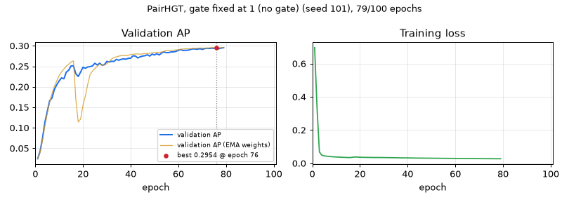

# PairHGT, gate fixed at 1 (no gate) — seed 101

[← all models](../README.md) · PairHGT notebook · ogbg-molpcba

| | |
|---|---|
| State | **paused_time_budget** |
| Epochs | 79 of 100 |
| Best validation AP | **0.2954** at epoch 76 |
| Best validation AP, EMA weights | 0.2958 at epoch 77 |
| Test AP | after training |
| Seed | 101 |
| Parameters | 9,751,632 |
| Minutes per epoch (last 5, incl. validation) | 4.5 |
| Training time so far | 5.9 h |
| Training time left | 1.6 h |
| Sessions (start + resumes) | 1 |
| Hottest GPU reading | 89.0 °C |
| Last update | 2026-11-14 05:28 (12.6 h ago) |



<details><summary>Settings of this run</summary>

| Setting | Value |
|---|---|
| Epochs (warm-up) | 100 (5) |
| Batch size | 512 |
| Learning rate, weight decay | 0.0005, 1e-05 |
| Layers × width, heads | 5 × 384, 4 |
| Dropout, attention dropout | 0.2, 0.5 |
| Pair channel | width 16, dropout 0.1, value gate False |
| Precision | fp32 (TF32 matrix products) |
| EMA decay | 0.9995 |
| Gradient clip | 1.0 |
| Protocol | v2_test_once |
| Notebook version, config hash | pairhgt-confirmatory-v2.0, f924dd96f7aefd19 |

</details>

_Protocol 'test once': the test split is evaluated only after training, once per weight type._

## Every epoch (newest first)

| Epoch | Train loss | Val AP | Val AP (EMA weights) | Best so far | LR | Minutes |
|---|---|---|---|---|---|---|
| 79 | 0.0276 | 0.2953 | 0.2956 | 0.2954 (ep 76) | 6.33e-05 | 4.5 |
| 78 | 0.0276 | 0.2946 | 0.2956 | 0.2954 (ep 76) | 6.89e-05 | 4.5 |
| 77 | 0.0276 | 0.2930 | 0.2958 | 0.2954 (ep 76) | 7.47e-05 | 4.5 |
| 76 | 0.0277 | 0.2954 ⭐ | 0.2957 | 0.2954 (ep 76) | 8.07e-05 | 4.5 |
| 75 | 0.0279 | 0.2939 | 0.2955 | 0.2943 (ep 74) | 8.69e-05 | 4.5 |
| 74 | 0.0279 | 0.2943 ⭐ | 0.2957 | 0.2943 (ep 74) | 9.32e-05 | 4.5 |
| 73 | 0.0280 | 0.2936 | 0.2950 | 0.2941 (ep 72) | 9.97e-05 | 4.5 |
| 72 | 0.0280 | 0.2941 ⭐ | 0.2946 | 0.2941 (ep 72) | 1.06e-04 | 4.5 |
| 71 | 0.0281 | 0.2932 ⭐ | 0.2944 | 0.2932 (ep 71) | 1.13e-04 | 4.5 |
| 70 | 0.0283 | 0.2912 | 0.2945 | 0.2932 (ep 69) | 1.20e-04 | 4.5 |
| 69 | 0.0283 | 0.2932 ⭐ | 0.2947 | 0.2932 (ep 69) | 1.27e-04 | 4.5 |
| 68 | 0.0285 | 0.2916 | 0.2940 | 0.2925 (ep 66) | 1.35e-04 | 4.5 |
| 67 | 0.0286 | 0.2923 | 0.2936 | 0.2925 (ep 66) | 1.42e-04 | 4.5 |
| 66 | 0.0287 | 0.2925 ⭐ | 0.2934 | 0.2925 (ep 66) | 1.50e-04 | 4.5 |
| 65 | 0.0288 | 0.2910 ⭐ | 0.2928 | 0.2910 (ep 65) | 1.57e-04 | 4.5 |
| 64 | 0.0289 | 0.2892 | 0.2930 | 0.2910 (ep 61) | 1.65e-04 | 4.5 |
| 63 | 0.0290 | 0.2892 | 0.2928 | 0.2910 (ep 61) | 1.73e-04 | 4.5 |
| 62 | 0.0292 | 0.2885 | 0.2923 | 0.2910 (ep 61) | 1.81e-04 | 4.5 |
| 61 | 0.0293 | 0.2910 ⭐ | 0.2915 | 0.2910 (ep 61) | 1.89e-04 | 4.5 |
| 60 | 0.0294 | 0.2890 ⭐ | 0.2907 | 0.2890 (ep 60) | 1.97e-04 | 4.5 |
| 59 | 0.0296 | 0.2865 ⭐ | 0.2900 | 0.2865 (ep 59) | 2.05e-04 | 4.5 |
| 58 | 0.0297 | 0.2852 | 0.2893 | 0.2852 (ep 57) | 2.13e-04 | 4.5 |
| 57 | 0.0298 | 0.2852 ⭐ | 0.2888 | 0.2852 (ep 57) | 2.21e-04 | 4.5 |
| 56 | 0.0299 | 0.2836 | 0.2894 | 0.2851 (ep 54) | 2.29e-04 | 4.5 |
| 55 | 0.0300 | 0.2833 | 0.2887 | 0.2851 (ep 54) | 2.38e-04 | 4.5 |
| 54 | 0.0302 | 0.2851 ⭐ | 0.2867 | 0.2851 (ep 54) | 2.46e-04 | 4.5 |
| 53 | 0.0304 | 0.2828 ⭐ | 0.2850 | 0.2828 (ep 53) | 2.54e-04 | 4.5 |
| 52 | 0.0304 | 0.2777 | 0.2842 | 0.2806 (ep 51) | 2.62e-04 | 4.5 |
| 51 | 0.0306 | 0.2806 ⭐ | 0.2841 | 0.2806 (ep 51) | 2.71e-04 | 4.5 |
| 50 | 0.0308 | 0.2778 | 0.2839 | 0.2798 (ep 49) | 2.79e-04 | 4.5 |
| 49 | 0.0309 | 0.2798 ⭐ | 0.2828 | 0.2798 (ep 49) | 2.87e-04 | 4.5 |
| 48 | 0.0310 | 0.2750 | 0.2822 | 0.2782 (ep 47) | 2.95e-04 | 4.5 |
| 47 | 0.0312 | 0.2782 ⭐ | 0.2811 | 0.2782 (ep 47) | 3.03e-04 | 4.5 |
| 46 | 0.0313 | 0.2759 ⭐ | 0.2811 | 0.2759 (ep 46) | 3.11e-04 | 4.5 |
| 45 | 0.0315 | 0.2751 | 0.2804 | 0.2756 (ep 41) | 3.19e-04 | 4.5 |
| 44 | 0.0316 | 0.2732 | 0.2795 | 0.2756 (ep 41) | 3.27e-04 | 4.5 |
| 43 | 0.0319 | 0.2703 | 0.2803 | 0.2756 (ep 41) | 3.35e-04 | 4.5 |
| 42 | 0.0320 | 0.2751 | 0.2800 | 0.2756 (ep 41) | 3.43e-04 | 4.5 |
| 41 | 0.0323 | 0.2756 ⭐ | 0.2795 | 0.2756 (ep 41) | 3.50e-04 | 4.5 |
| 40 | 0.0325 | 0.2697 ⭐ | 0.2786 | 0.2697 (ep 40) | 3.58e-04 | 4.5 |
| 39 | 0.0328 | 0.2694 ⭐ | 0.2772 | 0.2694 (ep 39) | 3.65e-04 | 4.5 |
| 38 | 0.0327 | 0.2674 | 0.2758 | 0.2682 (ep 37) | 3.73e-04 | 4.5 |
| 37 | 0.0329 | 0.2682 ⭐ | 0.2760 | 0.2682 (ep 37) | 3.80e-04 | 4.5 |
| 36 | 0.0332 | 0.2671 ⭐ | 0.2761 | 0.2671 (ep 36) | 3.87e-04 | 4.5 |
| 35 | 0.0336 | 0.2648 | 0.2748 | 0.2670 (ep 34) | 3.94e-04 | 4.5 |
| 34 | 0.0339 | 0.2670 ⭐ | 0.2731 | 0.2670 (ep 34) | 4.00e-04 | 4.5 |
| 33 | 0.0342 | 0.2619 | 0.2716 | 0.2623 (ep 32) | 4.07e-04 | 4.5 |
| 32 | 0.0343 | 0.2623 ⭐ | 0.2679 | 0.2623 (ep 32) | 4.13e-04 | 4.5 |
| 31 | 0.0345 | 0.2607 | 0.2617 | 0.2620 (ep 30) | 4.19e-04 | 4.5 |
| 30 | 0.0347 | 0.2620 ⭐ | 0.2564 | 0.2620 (ep 30) | 4.25e-04 | 4.5 |
| 29 | 0.0349 | 0.2543 | 0.2529 | 0.2576 (ep 27) | 4.31e-04 | 4.5 |
| 28 | 0.0350 | 0.2528 | 0.2530 | 0.2576 (ep 27) | 4.37e-04 | 4.5 |
| 27 | 0.0350 | 0.2576 ⭐ | 0.2553 | 0.2576 (ep 27) | 4.42e-04 | 4.5 |
| 26 | 0.0351 | 0.2532 | 0.2500 | 0.2575 (ep 25) | 4.47e-04 | 4.5 |
| 25 | 0.0352 | 0.2575 ⭐ | 0.2447 | 0.2575 (ep 25) | 4.52e-04 | 4.5 |
| 24 | 0.0355 | 0.2512 | 0.2386 | 0.2514 (ep 16) | 4.57e-04 | 4.5 |
| 23 | 0.0357 | 0.2493 | 0.2304 | 0.2514 (ep 16) | 4.62e-04 | 4.5 |
| 22 | 0.0361 | 0.2484 | 0.2065 | 0.2514 (ep 16) | 4.66e-04 | 4.5 |
| 21 | 0.0361 | 0.2452 | 0.1779 | 0.2514 (ep 16) | 4.70e-04 | 4.5 |
| 20 | 0.0367 | 0.2477 | 0.1550 | 0.2514 (ep 16) | 4.74e-04 | 4.5 |
| 19 | 0.0373 | 0.2360 | 0.1213 | 0.2514 (ep 16) | 4.77e-04 | 4.5 |
| 18 | 0.0381 | 0.2253 | 0.1141 | 0.2514 (ep 16) | 4.81e-04 | 4.5 |
| 17 | 0.0369 | 0.2319 | 0.1692 | 0.2514 (ep 16) | 4.84e-04 | 4.5 |
| 16 | 0.0347 | 0.2514 ⭐ | 0.2633 | 0.2514 (ep 16) | 4.86e-04 | 4.5 |
| 15 | 0.0350 | 0.2509 ⭐ | 0.2604 | 0.2509 (ep 15) | 4.89e-04 | 4.5 |
| 14 | 0.0354 | 0.2405 ⭐ | 0.2551 | 0.2405 (ep 14) | 4.91e-04 | 4.5 |
| 13 | 0.0360 | 0.2359 ⭐ | 0.2506 | 0.2359 (ep 13) | 4.93e-04 | 4.5 |
| 12 | 0.0367 | 0.2196 | 0.2434 | 0.2218 (ep 11) | 4.95e-04 | 4.5 |
| 11 | 0.0374 | 0.2218 ⭐ | 0.2365 | 0.2218 (ep 11) | 4.97e-04 | 4.5 |
| 10 | 0.0382 | 0.2144 ⭐ | 0.2271 | 0.2144 (ep 10) | 4.98e-04 | 4.5 |
| 9 | 0.0390 | 0.2051 ⭐ | 0.2147 | 0.2051 (ep 9) | 4.99e-04 | 4.5 |
| 8 | 0.0400 | 0.1934 ⭐ | 0.2011 | 0.1934 (ep 8) | 4.99e-04 | 4.5 |
| 7 | 0.0412 | 0.1729 ⭐ | 0.1837 | 0.1729 (ep 7) | 5.00e-04 | 4.5 |
| 6 | 0.0430 | 0.1657 ⭐ | 0.1622 | 0.1657 (ep 6) | 5.00e-04 | 4.5 |
| 5 | 0.0451 | 0.1392 ⭐ | 0.1344 | 0.1392 (ep 5) | 4.00e-04 | 4.5 |
| 4 | 0.0490 | 0.1129 ⭐ | 0.1040 | 0.1129 (ep 4) | 3.00e-04 | 4.5 |
| 3 | 0.0686 | 0.0734 ⭐ | 0.0681 | 0.0734 (ep 3) | 2.00e-04 | 4.5 |
| 2 | 0.3370 | 0.0425 ⭐ | 0.0397 | 0.0425 (ep 2) | 1.00e-04 | 4.5 |
| 1 | 0.6966 | 0.0245 ⭐ | 0.0245 | 0.0245 (ep 1) | 5.00e-10 | 4.5 |

## Last 80 log lines

_The log counts epochs from 0; the tables above count from 1._

```
[seed 101] epoch  32/100 | lr 4.13e-04 | train BCE 0.0343 | val AP 0.2623 | best val 0.2623 @ep32 | EMA val 0.2679 | 267s (train 239s, eval 28s) | GPU max 89C | ETA<= 5.1h
[seed 101] epoch  33/100 | lr 4.07e-04 | train BCE 0.0342 | val AP 0.2619 | best val 0.2623 @ep32 | EMA val 0.2716 | 268s (train 239s, eval 28s) | GPU max 89C | ETA<= 5.0h
[seed 101] epoch  34/100 | lr 4.00e-04 | train BCE 0.0339 | val AP 0.2670 | best val 0.2670 @ep34 | EMA val 0.2731 | 268s (train 240s, eval 28s) | GPU max 89C | ETA<= 4.9h
[seed 101] epoch  35/100 | lr 3.94e-04 | train BCE 0.0336 | val AP 0.2648 | best val 0.2670 @ep34 | EMA val 0.2748 | 268s (train 240s, eval 28s) | GPU max 89C | ETA<= 4.8h
[seed 101] epoch  36/100 | lr 3.87e-04 | train BCE 0.0332 | val AP 0.2671 | best val 0.2671 @ep36 | EMA val 0.2761 | 268s (train 239s, eval 28s) | GPU max 89C | ETA<= 4.8h
[seed 101] epoch  37/100 | lr 3.80e-04 | train BCE 0.0329 | val AP 0.2682 | best val 0.2682 @ep37 | EMA val 0.2760 | 268s (train 239s, eval 28s) | GPU max 89C | ETA<= 4.7h
[seed 101] epoch  38/100 | lr 3.73e-04 | train BCE 0.0327 | val AP 0.2674 | best val 0.2682 @ep37 | EMA val 0.2758 | 267s (train 239s, eval 28s) | GPU max 89C | ETA<= 4.6h
[seed 101] epoch  39/100 | lr 3.65e-04 | train BCE 0.0328 | val AP 0.2694 | best val 0.2694 @ep39 | EMA val 0.2772 | 268s (train 239s, eval 28s) | GPU max 89C | ETA<= 4.5h
[seed 101] epoch  40/100 | lr 3.58e-04 | train BCE 0.0325 | val AP 0.2697 | best val 0.2697 @ep40 | EMA val 0.2786 | 267s (train 239s, eval 28s) | GPU max 89C | ETA<= 4.5h
[seed 101] epoch  41/100 | lr 3.50e-04 | train BCE 0.0323 | val AP 0.2756 | best val 0.2756 @ep41 | EMA val 0.2795 | 268s (train 240s, eval 28s) | GPU max 89C | ETA<= 4.4h
[seed 101] epoch  42/100 | lr 3.43e-04 | train BCE 0.0320 | val AP 0.2751 | best val 0.2756 @ep41 | EMA val 0.2800 | 267s (train 239s, eval 28s) | GPU max 89C | ETA<= 4.3h
[seed 101] epoch  43/100 | lr 3.35e-04 | train BCE 0.0319 | val AP 0.2703 | best val 0.2756 @ep41 | EMA val 0.2803 | 267s (train 239s, eval 28s) | GPU max 89C | ETA<= 4.2h
[seed 101] epoch  44/100 | lr 3.27e-04 | train BCE 0.0316 | val AP 0.2732 | best val 0.2756 @ep41 | EMA val 0.2795 | 268s (train 239s, eval 28s) | GPU max 89C | ETA<= 4.2h
[seed 101] epoch  45/100 | lr 3.19e-04 | train BCE 0.0315 | val AP 0.2751 | best val 0.2756 @ep41 | EMA val 0.2804 | 267s (train 239s, eval 28s) | GPU max 89C | ETA<= 4.1h
[seed 101] epoch  46/100 | lr 3.11e-04 | train BCE 0.0313 | val AP 0.2759 | best val 0.2759 @ep46 | EMA val 0.2811 | 267s (train 239s, eval 28s) | GPU max 89C | ETA<= 4.0h
[seed 101] epoch  47/100 | lr 3.03e-04 | train BCE 0.0312 | val AP 0.2782 | best val 0.2782 @ep47 | EMA val 0.2811 | 267s (train 239s, eval 28s) | GPU max 89C | ETA<= 3.9h
[seed 101] epoch  48/100 | lr 2.95e-04 | train BCE 0.0310 | val AP 0.2750 | best val 0.2782 @ep47 | EMA val 0.2822 | 267s (train 239s, eval 28s) | GPU max 89C | ETA<= 3.9h
[seed 101] epoch  49/100 | lr 2.87e-04 | train BCE 0.0309 | val AP 0.2798 | best val 0.2798 @ep49 | EMA val 0.2828 | 268s (train 239s, eval 28s) | GPU max 89C | ETA<= 3.8h
[seed 101] epoch  50/100 | lr 2.79e-04 | train BCE 0.0308 | val AP 0.2778 | best val 0.2798 @ep49 | EMA val 0.2839 | 268s (train 239s, eval 28s) | GPU max 89C | ETA<= 3.7h
[seed 101] epoch  51/100 | lr 2.71e-04 | train BCE 0.0306 | val AP 0.2806 | best val 0.2806 @ep51 | EMA val 0.2841 | 268s (train 239s, eval 28s) | GPU max 89C | ETA<= 3.6h
[seed 101] epoch  52/100 | lr 2.62e-04 | train BCE 0.0304 | val AP 0.2777 | best val 0.2806 @ep51 | EMA val 0.2842 | 267s (train 239s, eval 28s) | GPU max 89C | ETA<= 3.6h
[seed 101] epoch  53/100 | lr 2.54e-04 | train BCE 0.0304 | val AP 0.2828 | best val 0.2828 @ep53 | EMA val 0.2850 | 268s (train 239s, eval 28s) | GPU max 89C | ETA<= 3.5h
[seed 101] epoch  54/100 | lr 2.46e-04 | train BCE 0.0302 | val AP 0.2851 | best val 0.2851 @ep54 | EMA val 0.2867 | 268s (train 239s, eval 28s) | GPU max 89C | ETA<= 3.4h
[seed 101] epoch  55/100 | lr 2.38e-04 | train BCE 0.0300 | val AP 0.2833 | best val 0.2851 @ep54 | EMA val 0.2887 | 268s (train 239s, eval 28s) | GPU max 89C | ETA<= 3.3h
[seed 101] epoch  56/100 | lr 2.29e-04 | train BCE 0.0299 | val AP 0.2836 | best val 0.2851 @ep54 | EMA val 0.2894 | 268s (train 239s, eval 28s) | GPU max 89C | ETA<= 3.3h
[seed 101] epoch  57/100 | lr 2.21e-04 | train BCE 0.0298 | val AP 0.2852 | best val 0.2852 @ep57 | EMA val 0.2888 | 267s (train 239s, eval 28s) | GPU max 89C | ETA<= 3.2h
[seed 101] epoch  58/100 | lr 2.13e-04 | train BCE 0.0297 | val AP 0.2852 | best val 0.2852 @ep57 | EMA val 0.2893 | 267s (train 239s, eval 28s) | GPU max 89C | ETA<= 3.1h
[seed 101] epoch  59/100 | lr 2.05e-04 | train BCE 0.0296 | val AP 0.2865 | best val 0.2865 @ep59 | EMA val 0.2900 | 267s (train 239s, eval 28s) | GPU max 89C | ETA<= 3.0h
[seed 101] epoch  60/100 | lr 1.97e-04 | train BCE 0.0294 | val AP 0.2890 | best val 0.2890 @ep60 | EMA val 0.2907 | 268s (train 239s, eval 28s) | GPU max 89C | ETA<= 3.0h
[seed 101] epoch  61/100 | lr 1.89e-04 | train BCE 0.0293 | val AP 0.2910 | best val 0.2910 @ep61 | EMA val 0.2915 | 267s (train 239s, eval 28s) | GPU max 89C | ETA<= 2.9h
[seed 101] epoch  62/100 | lr 1.81e-04 | train BCE 0.0292 | val AP 0.2885 | best val 0.2910 @ep61 | EMA val 0.2923 | 268s (train 240s, eval 28s) | GPU max 89C | ETA<= 2.8h
[seed 101] epoch  63/100 | lr 1.73e-04 | train BCE 0.0290 | val AP 0.2892 | best val 0.2910 @ep61 | EMA val 0.2928 | 267s (train 239s, eval 28s) | GPU max 89C | ETA<= 2.7h
[seed 101] epoch  64/100 | lr 1.65e-04 | train BCE 0.0289 | val AP 0.2892 | best val 0.2910 @ep61 | EMA val 0.2930 | 268s (train 239s, eval 28s) | GPU max 89C | ETA<= 2.7h
[seed 101] epoch  65/100 | lr 1.57e-04 | train BCE 0.0288 | val AP 0.2910 | best val 0.2910 @ep65 | EMA val 0.2928 | 267s (train 239s, eval 28s) | GPU max 89C | ETA<= 2.6h
[seed 101] epoch  66/100 | lr 1.50e-04 | train BCE 0.0287 | val AP 0.2925 | best val 0.2925 @ep66 | EMA val 0.2934 | 267s (train 239s, eval 28s) | GPU max 89C | ETA<= 2.5h
[seed 101] epoch  67/100 | lr 1.42e-04 | train BCE 0.0286 | val AP 0.2923 | best val 0.2925 @ep66 | EMA val 0.2936 | 268s (train 239s, eval 28s) | GPU max 89C | ETA<= 2.4h
[seed 101] epoch  68/100 | lr 1.35e-04 | train BCE 0.0285 | val AP 0.2916 | best val 0.2925 @ep66 | EMA val 0.2940 | 268s (train 239s, eval 28s) | GPU max 89C | ETA<= 2.4h
[seed 101] epoch  69/100 | lr 1.27e-04 | train BCE 0.0283 | val AP 0.2932 | best val 0.2932 @ep69 | EMA val 0.2947 | 268s (train 239s, eval 28s) | GPU max 89C | ETA<= 2.3h
[seed 101] epoch  70/100 | lr 1.20e-04 | train BCE 0.0283 | val AP 0.2912 | best val 0.2932 @ep69 | EMA val 0.2945 | 268s (train 239s, eval 28s) | GPU max 89C | ETA<= 2.2h
[seed 101] epoch  71/100 | lr 1.13e-04 | train BCE 0.0281 | val AP 0.2932 | best val 0.2932 @ep71 | EMA val 0.2944 | 267s (train 239s, eval 28s) | GPU max 89C | ETA<= 2.2h
[seed 101] epoch  72/100 | lr 1.06e-04 | train BCE 0.0280 | val AP 0.2941 | best val 0.2941 @ep72 | EMA val 0.2946 | 267s (train 239s, eval 28s) | GPU max 89C | ETA<= 2.1h
[seed 101] epoch  73/100 | lr 9.97e-05 | train BCE 0.0280 | val AP 0.2936 | best val 0.2941 @ep72 | EMA val 0.2950 | 268s (train 239s, eval 28s) | GPU max 89C | ETA<= 2.0h
[seed 101] epoch  74/100 | lr 9.32e-05 | train BCE 0.0279 | val AP 0.2943 | best val 0.2943 @ep74 | EMA val 0.2957 | 267s (train 239s, eval 28s) | GPU max 89C | ETA<= 1.9h
[seed 101] epoch  75/100 | lr 8.69e-05 | train BCE 0.0279 | val AP 0.2939 | best val 0.2943 @ep74 | EMA val 0.2955 | 268s (train 239s, eval 28s) | GPU max 89C | ETA<= 1.9h
[seed 101] epoch  76/100 | lr 8.07e-05 | train BCE 0.0277 | val AP 0.2954 | best val 0.2954 @ep76 | EMA val 0.2957 | 268s (train 239s, eval 28s) | GPU max 89C | ETA<= 1.8h
[seed 101] epoch  77/100 | lr 7.47e-05 | train BCE 0.0276 | val AP 0.2930 | best val 0.2954 @ep76 | EMA val 0.2958 | 267s (train 239s, eval 28s) | GPU max 89C | ETA<= 1.7h
[seed 101] epoch  78/100 | lr 6.89e-05 | train BCE 0.0276 | val AP 0.2946 | best val 0.2954 @ep76 | EMA val 0.2956 | 268s (train 239s, eval 28s) | GPU max 89C | ETA<= 1.6h
[seed 101] epoch  79/100 | lr 6.33e-05 | train BCE 0.0276 | val AP 0.2953 | best val 0.2954 @ep76 | EMA val 0.2956 | 268s (train 239s, eval 28s) | GPU max 89C | ETA<= 1.6h
[seed 101] time budget reached after epoch 79; rerun to continue from here.
--- cell 16 ---
PairHGT, gate fixed at 1 (no gate): GPS + pair channel (pair bias + write-back) [arm A_nogate_notrip] | gps_conf_A_nogate_notrip_ep100_molpcba
 seed epochs  raw_epoch  raw_val  raw_test  ema_epoch  ema_val  ema_test  hours  train_s_per_epoch  total_s_per_epoch
  101 79/100         76   0.2954       NaN         77   0.2958       NaN 5.8706           239.2709           267.5203
/tmp/ipykernel_583399/1726116603.py:55: UserWarning: No artists with labels found to put in legend.  Note that artists whose label start with an underscore are ignored when legend() is called with no argument.
  ax.set(title=f"seed {s} (circle = selected raw, square = selected EMA)", xlabel="epoch", ylabel="validation AP"); ax.grid(alpha=0.25); ax.legend(fontsize=7)
run manifest: 11 row(s) -> /home/student/thesis/outputs/pairhgt/outputs/confirmatory/run_manifest.csv
    model              gpu  seeds  params  train_s_per_epoch  val_eval_s_per_epoch  total_s_per_epoch  hours_per_seed  time_vs_GPS+EMA
GPS + EMA NVIDIA RTX A4000      5 9744860             160.70                 15.83             176.55            4.90             1.00
  PairHGT NVIDIA RTX A4000      5 9751972             275.34                 33.75             309.12            8.04             1.75
train = training steps incl. EMA update; val_eval = validation of raw + EMA weights; no test pass inside an epoch (protocol v2). Do not compare with timings from the exploratory runs.
--- cell 18 ---
=== PairHGT  minus  GPS + EMA   (100 epochs, matched seeds) ===
 seed  raw_val  ema_val  raw_test  ema_test
  101   0.0013   0.0027    0.0043    0.0048
  202   0.0017   0.0012    0.0067    0.0115
  323   0.0021   0.0022    0.0019    0.0056
  432   0.0017   0.0035    0.0066    0.0120
  validation AP, raw    : mean +0.0017, sample SD 0.0004, per-seed [0.0013, 0.0017, 0.0021, 0.0017], all positive: True | 95% t-interval [+0.0011, +0.0023] (n=4, t=9.44)
  validation AP, EMA    : mean +0.0024, sample SD 0.0009, per-seed [0.0027, 0.0012, 0.0022, 0.0035], all positive: True | 95% t-interval [+0.0009, +0.0039] (n=4, t=5.08)
  test AP, raw vs raw   : mean +0.0049, sample SD 0.0023, per-seed [0.0043, 0.0067, 0.0019, 0.0066], all positive: True | 95% t-interval [+0.0013, +0.0085] (n=4, t=4.30)
  test AP, EMA vs EMA   : mean +0.0085, sample SD 0.0038, per-seed [0.0048, 0.0115, 0.0056, 0.012], all positive: True | 95% t-interval [+0.0024, +0.0146] (n=4, t=4.42)
  Reading: 4 matched seed(s). The claim is limited to whether the direction of the EMA-vs-EMA difference repeats; a significance claim needs many more seeds.
=== PairHGT  minus  PairHGT, gate fixed at 1 (no gate)   (100 epochs, matched seeds) ===
  no matched finished seeds with a final test result yet
ablation A_nogate_notrip: no matched finished seeds yet
Planning table (80% power, alpha 0.05, two-sample t, test AP): smallest detectable true difference
  per-seed SD 0.003: n=3: 0.0092, n=5: 0.0061, n=10: 0.0040, n=20: 0.0027
  per-seed SD 0.0056: n=3: 0.0172, n=5: 0.0113, n=10: 0.0074, n=20: 0.0051
--- cell 20 ---
===== 2026-11-14 05:29:02 notebook turn ended (exit 0); executed notebook: /home/student/thesis/outputs/lab_runs/notebooks/pairhgt_A_nogate_notrip_seed101_20261113-2336.ipynb =====
```
