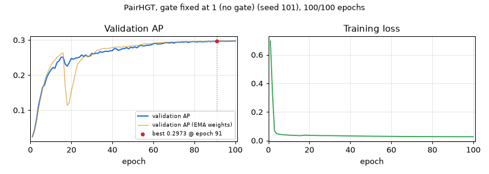

# PairHGT, gate fixed at 1 (no gate) — seed 101

[← all models](../README.md) · PairHGT notebook · ogbg-molpcba

| | |
|---|---|
| State | **finished** |
| Epochs | 100 of 100 |
| Best validation AP | **0.2973** at epoch 91 |
| Best validation AP, EMA weights | 0.2970 at epoch 92 |
| Test AP | raw 0.2909 / ema 0.2916 (final) |
| Seed | 101 |
| Parameters | 9,751,632 |
| Minutes per epoch (last 5, incl. validation) | 4.5 |
| Training time so far | 7.4 h |
| Training time left | done |
| Sessions (start + resumes) | 2 |
| Hottest GPU reading | 89.0 °C |
| Last update | 2026-11-14 20:42 (333.4 h ago) |



<details><summary>Settings of this run</summary>

| Setting | Value |
|---|---|
| Epochs (warm-up) | 100 (5) |
| Batch size | 512 |
| Learning rate, weight decay | 0.0005, 1e-05 |
| Layers × width, heads | 5 × 384, 4 |
| Dropout, attention dropout | 0.2, 0.5 |
| Pair channel | width 16, dropout 0.1, value gate False |
| Precision | fp32 (TF32 matrix products) |
| EMA decay | 0.9995 |
| Gradient clip | 1.0 |
| Protocol | v2_test_once |
| Notebook version, config hash | pairhgt-confirmatory-v2.0, f924dd96f7aefd19 |

</details>

## Final test (evaluated once)

| Weights | Epoch | Validation AP | Test AP |
|---|---|---|---|
| raw | 91 | 0.2973 | 0.2909 |
| ema | 92 | 0.2970 | 0.2916 |

## Every epoch (newest first)

| Epoch | Train loss | Val AP | Val AP (EMA weights) | Best so far | LR | Minutes |
|---|---|---|---|---|---|---|
| 100 | 0.0269 | 0.2971 | 0.2968 | 0.2973 (ep 91) | 1.37e-07 | 4.5 |
| 99 | 0.0269 | 0.2971 | 0.2968 | 0.2973 (ep 91) | 5.47e-07 | 4.4 |
| 98 | 0.0270 | 0.2968 | 0.2968 | 0.2973 (ep 91) | 1.23e-06 | 4.5 |
| 97 | 0.0270 | 0.2967 | 0.2968 | 0.2973 (ep 91) | 2.18e-06 | 4.5 |
| 96 | 0.0270 | 0.2965 | 0.2968 | 0.2973 (ep 91) | 3.41e-06 | 4.5 |
| 95 | 0.0270 | 0.2966 | 0.2970 | 0.2973 (ep 91) | 4.91e-06 | 4.5 |
| 94 | 0.0270 | 0.2966 | 0.2970 | 0.2973 (ep 91) | 6.67e-06 | 4.5 |
| 93 | 0.0270 | 0.2969 | 0.2970 | 0.2973 (ep 91) | 8.70e-06 | 4.5 |
| 92 | 0.0271 | 0.2966 | 0.2970 | 0.2973 (ep 91) | 1.10e-05 | 4.5 |
| 91 | 0.0271 | 0.2973 ⭐ | 0.2965 | 0.2973 (ep 91) | 1.35e-05 | 4.5 |
| 90 | 0.0271 | 0.2960 | 0.2965 | 0.2964 (ep 87) | 1.64e-05 | 4.5 |
| 89 | 0.0271 | 0.2964 | 0.2963 | 0.2964 (ep 87) | 1.94e-05 | 4.4 |
| 88 | 0.0272 | 0.2955 | 0.2963 | 0.2964 (ep 87) | 2.27e-05 | 4.5 |
| 87 | 0.0272 | 0.2964 ⭐ | 0.2964 | 0.2964 (ep 87) | 2.63e-05 | 4.5 |
| 86 | 0.0272 | 0.2954 | 0.2964 | 0.2956 (ep 85) | 3.01e-05 | 4.5 |
| 85 | 0.0273 | 0.2956 ⭐ | 0.2962 | 0.2956 (ep 85) | 3.42e-05 | 4.4 |
| 84 | 0.0273 | 0.2948 | 0.2961 | 0.2955 (ep 83) | 3.85e-05 | 4.5 |
| 83 | 0.0274 | 0.2955 ⭐ | 0.2966 | 0.2955 (ep 83) | 4.30e-05 | 4.5 |
| 82 | 0.0274 | 0.2951 | 0.2963 | 0.2955 (ep 80) | 4.77e-05 | 4.5 |
| 81 | 0.0274 | 0.2945 | 0.2962 | 0.2955 (ep 80) | 5.27e-05 | 4.5 |
| 80 | 0.0275 | 0.2955 ⭐ | 0.2959 | 0.2955 (ep 80) | 5.79e-05 | 4.5 |
| 79 | 0.0276 | 0.2953 | 0.2956 | 0.2954 (ep 76) | 6.33e-05 | 4.5 |
| 78 | 0.0276 | 0.2946 | 0.2956 | 0.2954 (ep 76) | 6.89e-05 | 4.5 |
| 77 | 0.0276 | 0.2930 | 0.2958 | 0.2954 (ep 76) | 7.47e-05 | 4.5 |
| 76 | 0.0277 | 0.2954 ⭐ | 0.2957 | 0.2954 (ep 76) | 8.07e-05 | 4.5 |
| 75 | 0.0279 | 0.2939 | 0.2955 | 0.2943 (ep 74) | 8.69e-05 | 4.5 |
| 74 | 0.0279 | 0.2943 ⭐ | 0.2957 | 0.2943 (ep 74) | 9.32e-05 | 4.5 |
| 73 | 0.0280 | 0.2936 | 0.2950 | 0.2941 (ep 72) | 9.97e-05 | 4.5 |
| 72 | 0.0280 | 0.2941 ⭐ | 0.2946 | 0.2941 (ep 72) | 1.06e-04 | 4.5 |
| 71 | 0.0281 | 0.2932 ⭐ | 0.2944 | 0.2932 (ep 71) | 1.13e-04 | 4.5 |
| 70 | 0.0283 | 0.2912 | 0.2945 | 0.2932 (ep 69) | 1.20e-04 | 4.5 |
| 69 | 0.0283 | 0.2932 ⭐ | 0.2947 | 0.2932 (ep 69) | 1.27e-04 | 4.5 |
| 68 | 0.0285 | 0.2916 | 0.2940 | 0.2925 (ep 66) | 1.35e-04 | 4.5 |
| 67 | 0.0286 | 0.2923 | 0.2936 | 0.2925 (ep 66) | 1.42e-04 | 4.5 |
| 66 | 0.0287 | 0.2925 ⭐ | 0.2934 | 0.2925 (ep 66) | 1.50e-04 | 4.5 |
| 65 | 0.0288 | 0.2910 ⭐ | 0.2928 | 0.2910 (ep 65) | 1.57e-04 | 4.5 |
| 64 | 0.0289 | 0.2892 | 0.2930 | 0.2910 (ep 61) | 1.65e-04 | 4.5 |
| 63 | 0.0290 | 0.2892 | 0.2928 | 0.2910 (ep 61) | 1.73e-04 | 4.5 |
| 62 | 0.0292 | 0.2885 | 0.2923 | 0.2910 (ep 61) | 1.81e-04 | 4.5 |
| 61 | 0.0293 | 0.2910 ⭐ | 0.2915 | 0.2910 (ep 61) | 1.89e-04 | 4.5 |
| 60 | 0.0294 | 0.2890 ⭐ | 0.2907 | 0.2890 (ep 60) | 1.97e-04 | 4.5 |
| 59 | 0.0296 | 0.2865 ⭐ | 0.2900 | 0.2865 (ep 59) | 2.05e-04 | 4.5 |
| 58 | 0.0297 | 0.2852 | 0.2893 | 0.2852 (ep 57) | 2.13e-04 | 4.5 |
| 57 | 0.0298 | 0.2852 ⭐ | 0.2888 | 0.2852 (ep 57) | 2.21e-04 | 4.5 |
| 56 | 0.0299 | 0.2836 | 0.2894 | 0.2851 (ep 54) | 2.29e-04 | 4.5 |
| 55 | 0.0300 | 0.2833 | 0.2887 | 0.2851 (ep 54) | 2.38e-04 | 4.5 |
| 54 | 0.0302 | 0.2851 ⭐ | 0.2867 | 0.2851 (ep 54) | 2.46e-04 | 4.5 |
| 53 | 0.0304 | 0.2828 ⭐ | 0.2850 | 0.2828 (ep 53) | 2.54e-04 | 4.5 |
| 52 | 0.0304 | 0.2777 | 0.2842 | 0.2806 (ep 51) | 2.62e-04 | 4.5 |
| 51 | 0.0306 | 0.2806 ⭐ | 0.2841 | 0.2806 (ep 51) | 2.71e-04 | 4.5 |
| 50 | 0.0308 | 0.2778 | 0.2839 | 0.2798 (ep 49) | 2.79e-04 | 4.5 |
| 49 | 0.0309 | 0.2798 ⭐ | 0.2828 | 0.2798 (ep 49) | 2.87e-04 | 4.5 |
| 48 | 0.0310 | 0.2750 | 0.2822 | 0.2782 (ep 47) | 2.95e-04 | 4.5 |
| 47 | 0.0312 | 0.2782 ⭐ | 0.2811 | 0.2782 (ep 47) | 3.03e-04 | 4.5 |
| 46 | 0.0313 | 0.2759 ⭐ | 0.2811 | 0.2759 (ep 46) | 3.11e-04 | 4.5 |
| 45 | 0.0315 | 0.2751 | 0.2804 | 0.2756 (ep 41) | 3.19e-04 | 4.5 |
| 44 | 0.0316 | 0.2732 | 0.2795 | 0.2756 (ep 41) | 3.27e-04 | 4.5 |
| 43 | 0.0319 | 0.2703 | 0.2803 | 0.2756 (ep 41) | 3.35e-04 | 4.5 |
| 42 | 0.0320 | 0.2751 | 0.2800 | 0.2756 (ep 41) | 3.43e-04 | 4.5 |
| 41 | 0.0323 | 0.2756 ⭐ | 0.2795 | 0.2756 (ep 41) | 3.50e-04 | 4.5 |
| 40 | 0.0325 | 0.2697 ⭐ | 0.2786 | 0.2697 (ep 40) | 3.58e-04 | 4.5 |
| 39 | 0.0328 | 0.2694 ⭐ | 0.2772 | 0.2694 (ep 39) | 3.65e-04 | 4.5 |
| 38 | 0.0327 | 0.2674 | 0.2758 | 0.2682 (ep 37) | 3.73e-04 | 4.5 |
| 37 | 0.0329 | 0.2682 ⭐ | 0.2760 | 0.2682 (ep 37) | 3.80e-04 | 4.5 |
| 36 | 0.0332 | 0.2671 ⭐ | 0.2761 | 0.2671 (ep 36) | 3.87e-04 | 4.5 |
| 35 | 0.0336 | 0.2648 | 0.2748 | 0.2670 (ep 34) | 3.94e-04 | 4.5 |
| 34 | 0.0339 | 0.2670 ⭐ | 0.2731 | 0.2670 (ep 34) | 4.00e-04 | 4.5 |
| 33 | 0.0342 | 0.2619 | 0.2716 | 0.2623 (ep 32) | 4.07e-04 | 4.5 |
| 32 | 0.0343 | 0.2623 ⭐ | 0.2679 | 0.2623 (ep 32) | 4.13e-04 | 4.5 |
| 31 | 0.0345 | 0.2607 | 0.2617 | 0.2620 (ep 30) | 4.19e-04 | 4.5 |
| 30 | 0.0347 | 0.2620 ⭐ | 0.2564 | 0.2620 (ep 30) | 4.25e-04 | 4.5 |
| 29 | 0.0349 | 0.2543 | 0.2529 | 0.2576 (ep 27) | 4.31e-04 | 4.5 |
| 28 | 0.0350 | 0.2528 | 0.2530 | 0.2576 (ep 27) | 4.37e-04 | 4.5 |
| 27 | 0.0350 | 0.2576 ⭐ | 0.2553 | 0.2576 (ep 27) | 4.42e-04 | 4.5 |
| 26 | 0.0351 | 0.2532 | 0.2500 | 0.2575 (ep 25) | 4.47e-04 | 4.5 |
| 25 | 0.0352 | 0.2575 ⭐ | 0.2447 | 0.2575 (ep 25) | 4.52e-04 | 4.5 |
| 24 | 0.0355 | 0.2512 | 0.2386 | 0.2514 (ep 16) | 4.57e-04 | 4.5 |
| 23 | 0.0357 | 0.2493 | 0.2304 | 0.2514 (ep 16) | 4.62e-04 | 4.5 |
| 22 | 0.0361 | 0.2484 | 0.2065 | 0.2514 (ep 16) | 4.66e-04 | 4.5 |
| 21 | 0.0361 | 0.2452 | 0.1779 | 0.2514 (ep 16) | 4.70e-04 | 4.5 |
| 20 | 0.0367 | 0.2477 | 0.1550 | 0.2514 (ep 16) | 4.74e-04 | 4.5 |
| 19 | 0.0373 | 0.2360 | 0.1213 | 0.2514 (ep 16) | 4.77e-04 | 4.5 |
| 18 | 0.0381 | 0.2253 | 0.1141 | 0.2514 (ep 16) | 4.81e-04 | 4.5 |
| 17 | 0.0369 | 0.2319 | 0.1692 | 0.2514 (ep 16) | 4.84e-04 | 4.5 |
| 16 | 0.0347 | 0.2514 ⭐ | 0.2633 | 0.2514 (ep 16) | 4.86e-04 | 4.5 |
| 15 | 0.0350 | 0.2509 ⭐ | 0.2604 | 0.2509 (ep 15) | 4.89e-04 | 4.5 |
| 14 | 0.0354 | 0.2405 ⭐ | 0.2551 | 0.2405 (ep 14) | 4.91e-04 | 4.5 |
| 13 | 0.0360 | 0.2359 ⭐ | 0.2506 | 0.2359 (ep 13) | 4.93e-04 | 4.5 |
| 12 | 0.0367 | 0.2196 | 0.2434 | 0.2218 (ep 11) | 4.95e-04 | 4.5 |
| 11 | 0.0374 | 0.2218 ⭐ | 0.2365 | 0.2218 (ep 11) | 4.97e-04 | 4.5 |
| 10 | 0.0382 | 0.2144 ⭐ | 0.2271 | 0.2144 (ep 10) | 4.98e-04 | 4.5 |
| 9 | 0.0390 | 0.2051 ⭐ | 0.2147 | 0.2051 (ep 9) | 4.99e-04 | 4.5 |
| 8 | 0.0400 | 0.1934 ⭐ | 0.2011 | 0.1934 (ep 8) | 4.99e-04 | 4.5 |
| 7 | 0.0412 | 0.1729 ⭐ | 0.1837 | 0.1729 (ep 7) | 5.00e-04 | 4.5 |
| 6 | 0.0430 | 0.1657 ⭐ | 0.1622 | 0.1657 (ep 6) | 5.00e-04 | 4.5 |
| 5 | 0.0451 | 0.1392 ⭐ | 0.1344 | 0.1392 (ep 5) | 4.00e-04 | 4.5 |
| 4 | 0.0490 | 0.1129 ⭐ | 0.1040 | 0.1129 (ep 4) | 3.00e-04 | 4.5 |
| 3 | 0.0686 | 0.0734 ⭐ | 0.0681 | 0.0734 (ep 3) | 2.00e-04 | 4.5 |
| 2 | 0.3370 | 0.0425 ⭐ | 0.0397 | 0.0425 (ep 2) | 1.00e-04 | 4.5 |
| 1 | 0.6966 | 0.0245 ⭐ | 0.0245 | 0.0245 (ep 1) | 5.00e-10 | 4.5 |

## Last 80 log lines

_The log counts epochs from 0; the tables above count from 1._

```
graphs: total 437,929 | train 350,343 | val 43,793 | test 43,793 | ready in 2s
steps/epoch: train 685, val 86, test 86
--- cell 6 ---
PairHGT, gate fixed at 1 (no gate): GPS + pair channel (pair bias + write-back) [arm A_nogate_notrip]: 9,751,632 parameters = baseline 9,744,860 + 6,772 (0.07%), of which the pair channel 6,772
parameter count matches the expected 9,751,632 for arm A_nogate_notrip
--- cell 7 ---
--- cell 9 ---
--- cell 10 ---
--- cell 12 ---
RUN_DEBUG_FIRST is False: smoke test skipped.
--- cell 14 ---
Restored 0 seed folder(s).
prereg.json checked: configuration identical (hash f924dd96f7aefd19); seeds [101, 202, 323, 432, 543]
[seed 101] RESUMED from epoch 79/100 (lr 5.79e-05, best val AP so far 0.2954)
[seed 101] epoch  80/100 | lr 5.79e-05 | train BCE 0.0275 | val AP 0.2955 | best val 0.2955 @ep80 | EMA val 0.2959 | 267s (train 239s, eval 28s) | GPU max 89C | ETA<= 1.5h
[seed 101] epoch  81/100 | lr 5.27e-05 | train BCE 0.0274 | val AP 0.2945 | best val 0.2955 @ep80 | EMA val 0.2962 | 268s (train 239s, eval 28s) | GPU max 89C | ETA<= 1.4h
[seed 101] epoch  82/100 | lr 4.77e-05 | train BCE 0.0274 | val AP 0.2951 | best val 0.2955 @ep80 | EMA val 0.2963 | 267s (train 239s, eval 28s) | GPU max 89C | ETA<= 1.3h
[seed 101] epoch  83/100 | lr 4.30e-05 | train BCE 0.0274 | val AP 0.2955 | best val 0.2955 @ep83 | EMA val 0.2966 | 267s (train 239s, eval 28s) | GPU max 89C | ETA<= 1.3h
[seed 101] epoch  84/100 | lr 3.85e-05 | train BCE 0.0273 | val AP 0.2948 | best val 0.2955 @ep83 | EMA val 0.2961 | 267s (train 239s, eval 28s) | GPU max 89C | ETA<= 1.2h
[seed 101] epoch  85/100 | lr 3.42e-05 | train BCE 0.0273 | val AP 0.2956 | best val 0.2956 @ep85 | EMA val 0.2962 | 267s (train 239s, eval 28s) | GPU max 89C | ETA<= 1.1h
[seed 101] epoch  86/100 | lr 3.01e-05 | train BCE 0.0272 | val AP 0.2954 | best val 0.2956 @ep85 | EMA val 0.2964 | 267s (train 239s, eval 28s) | GPU max 89C | ETA<= 1.0h
[seed 101] epoch  87/100 | lr 2.63e-05 | train BCE 0.0272 | val AP 0.2964 | best val 0.2964 @ep87 | EMA val 0.2964 | 267s (train 239s, eval 28s) | GPU max 89C | ETA<= 1.0h
[seed 101] epoch  88/100 | lr 2.27e-05 | train BCE 0.0272 | val AP 0.2955 | best val 0.2964 @ep87 | EMA val 0.2963 | 268s (train 240s, eval 28s) | GPU max 89C | ETA<= 0.9h
[seed 101] epoch  89/100 | lr 1.94e-05 | train BCE 0.0271 | val AP 0.2964 | best val 0.2964 @ep87 | EMA val 0.2963 | 267s (train 239s, eval 28s) | GPU max 89C | ETA<= 0.8h
[seed 101] epoch  90/100 | lr 1.64e-05 | train BCE 0.0271 | val AP 0.2960 | best val 0.2964 @ep87 | EMA val 0.2965 | 267s (train 239s, eval 28s) | GPU max 89C | ETA<= 0.7h
[seed 101] epoch  91/100 | lr 1.35e-05 | train BCE 0.0271 | val AP 0.2973 | best val 0.2973 @ep91 | EMA val 0.2965 | 267s (train 239s, eval 28s) | GPU max 89C | ETA<= 0.7h
[seed 101] epoch  92/100 | lr 1.10e-05 | train BCE 0.0271 | val AP 0.2966 | best val 0.2973 @ep91 | EMA val 0.2970 | 267s (train 239s, eval 28s) | GPU max 89C | ETA<= 0.6h
[seed 101] epoch  93/100 | lr 8.70e-06 | train BCE 0.0270 | val AP 0.2969 | best val 0.2973 @ep91 | EMA val 0.2970 | 267s (train 239s, eval 28s) | GPU max 89C | ETA<= 0.5h
[seed 101] epoch  94/100 | lr 6.67e-06 | train BCE 0.0270 | val AP 0.2966 | best val 0.2973 @ep91 | EMA val 0.2970 | 268s (train 239s, eval 28s) | GPU max 89C | ETA<= 0.4h
[seed 101] epoch  95/100 | lr 4.91e-06 | train BCE 0.0270 | val AP 0.2966 | best val 0.2973 @ep91 | EMA val 0.2970 | 267s (train 239s, eval 28s) | GPU max 89C | ETA<= 0.4h
[seed 101] epoch  96/100 | lr 3.41e-06 | train BCE 0.0270 | val AP 0.2965 | best val 0.2973 @ep91 | EMA val 0.2968 | 267s (train 239s, eval 28s) | GPU max 89C | ETA<= 0.3h
[seed 101] epoch  97/100 | lr 2.18e-06 | train BCE 0.0270 | val AP 0.2967 | best val 0.2973 @ep91 | EMA val 0.2968 | 267s (train 239s, eval 28s) | GPU max 89C | ETA<= 0.2h
[seed 101] epoch  98/100 | lr 1.23e-06 | train BCE 0.0270 | val AP 0.2968 | best val 0.2973 @ep91 | EMA val 0.2968 | 267s (train 239s, eval 28s) | GPU max 89C | ETA<= 0.1h
[seed 101] epoch  99/100 | lr 5.47e-07 | train BCE 0.0269 | val AP 0.2971 | best val 0.2973 @ep91 | EMA val 0.2968 | 267s (train 239s, eval 28s) | GPU max 89C | ETA<= 0.1h
[seed 101] epoch 100/100 | lr 1.37e-07 | train BCE 0.0269 | val AP 0.2971 | best val 0.2973 @ep91 | EMA val 0.2968 | 267s (train 239s, eval 28s) | GPU max 89C | ETA<= 0.0h
[seed 101] FINAL TEST (evaluated once): raw epoch 91 val 0.2973 test 0.2909 | EMA epoch 92 val 0.2970 test 0.2916
--- cell 16 ---
PairHGT, gate fixed at 1 (no gate): GPS + pair channel (pair bias + write-back) [arm A_nogate_notrip] | gps_conf_A_nogate_notrip_ep100_molpcba
 seed  epochs  raw_epoch  raw_val  raw_test  ema_epoch  ema_val  ema_test  hours  train_s_per_epoch  total_s_per_epoch
  101 100/100         91   0.2973    0.2909         92    0.297    0.2916 7.4298           239.2251           267.4726
mean ± sample SD (ddof=1) over 1 seed(s): raw test 0.2909 ± nan | EMA test 0.2916 ± nan
A mean ± SD over fewer than 3 seeds is only a description; do not call it a confidence interval.
/tmp/ipykernel_733914/1726116603.py:55: UserWarning: No artists with labels found to put in legend.  Note that artists whose label start with an underscore are ignored when legend() is called with no argument.
  ax.set(title=f"seed {s} (circle = selected raw, square = selected EMA)", xlabel="epoch", ylabel="validation AP"); ax.grid(alpha=0.25); ax.legend(fontsize=7)
run manifest: 12 row(s) -> /home/student/thesis/outputs/pairhgt/outputs/confirmatory/run_manifest.csv
    model              gpu  seeds  params  train_s_per_epoch  val_eval_s_per_epoch  total_s_per_epoch  hours_per_seed  time_vs_GPS+EMA
GPS + EMA NVIDIA RTX A4000      5 9744860             160.70                 15.83             176.55            4.90             1.00
  PairHGT NVIDIA RTX A4000      5 9751972             275.33                 33.75             309.10            8.59             1.75
train = training steps incl. EMA update; val_eval = validation of raw + EMA weights; no test pass inside an epoch (protocol v2). Do not compare with timings from the exploratory runs.
--- cell 18 ---
=== PairHGT  minus  GPS + EMA   (100 epochs, matched seeds) ===
 seed  raw_val  ema_val  raw_test  ema_test
  101   0.0013   0.0027    0.0043    0.0048
  202   0.0017   0.0012    0.0067    0.0115
  323   0.0021   0.0022    0.0019    0.0056
  432   0.0017   0.0035    0.0066    0.0120
  543  -0.0012  -0.0008    0.0101    0.0068
  validation AP, raw    : mean +0.0011, sample SD 0.0013, per-seed [0.0013, 0.0017, 0.0021, 0.0017, -0.0012], all positive: False | 95% t-interval [-0.0006, +0.0028] (n=5, t=1.84)
  validation AP, EMA    : mean +0.0018, sample SD 0.0017, per-seed [0.0027, 0.0012, 0.0022, 0.0035, -0.0008], all positive: False | 95% t-interval [-0.0003, +0.0038] (n=5, t=2.38)
  test AP, raw vs raw   : mean +0.0059, sample SD 0.0031, per-seed [0.0043, 0.0067, 0.0019, 0.0066, 0.0101], all positive: True | 95% t-interval [+0.0021, +0.0097] (n=5, t=4.31)
  test AP, EMA vs EMA   : mean +0.0082, sample SD 0.0034, per-seed [0.0048, 0.0115, 0.0056, 0.012, 0.0068], all positive: True | 95% t-interval [+0.0039, +0.0124] (n=5, t=5.35)
  Reading: 5 matched seed(s). Interpret with the interval, not with a threshold.
=== PairHGT  minus  PairHGT, gate fixed at 1 (no gate)   (100 epochs, matched seeds) ===
 seed  raw_val  ema_val  raw_test  ema_test
  101   0.0083   0.0161    0.0033    0.0127
  validation AP, raw    : mean +0.0083, sample SD nan, per-seed [0.0083], all positive: True | n=1: fewer than 3 matched seeds, direction only, no interval
  validation AP, EMA    : mean +0.0161, sample SD nan, per-seed [0.0161], all positive: True | n=1: fewer than 3 matched seeds, direction only, no interval
  test AP, raw vs raw   : mean +0.0033, sample SD nan, per-seed [0.0033], all positive: True | n=1: fewer than 3 matched seeds, direction only, no interval
  test AP, EMA vs EMA   : mean +0.0127, sample SD nan, per-seed [0.0127], all positive: True | n=1: fewer than 3 matched seeds, direction only, no interval
  Reading: 1 matched seed(s). The claim is limited to whether the direction of the EMA-vs-EMA difference repeats; a significance claim needs many more seeds.
ABLATION RULE (PairHGT vs PairHGT, gate fixed at 1 (no gate), validation AP, margin 0.002): raw +0.0083, EMA +0.0161 -> component RETAINED (lead on both weight types)
  screening result on 1-3 seeds: it decides whether a full 100-epoch run is worth its cost, nothing more.
=== PairHGT  minus  PairHGT, gate only (no pair bias)   (100 epochs, matched seeds) ===
  no matched finished seeds with a final test result yet
ablation A_gateonly_nobias: no matched finished seeds yet
Planning table (80% power, alpha 0.05, two-sample t, test AP): smallest detectable true difference
  per-seed SD 0.003: n=3: 0.0092, n=5: 0.0061, n=10: 0.0040, n=20: 0.0027
  per-seed SD 0.0056: n=3: 0.0172, n=5: 0.0113, n=10: 0.0074, n=20: 0.0051
--- cell 20 ---
===== 2026-11-14 20:43:05 notebook turn ended (exit 0); executed notebook: /home/student/thesis/outputs/lab_runs/notebooks/pairhgt_A_nogate_notrip_seed101_20261114-1908.ipynb =====
```
