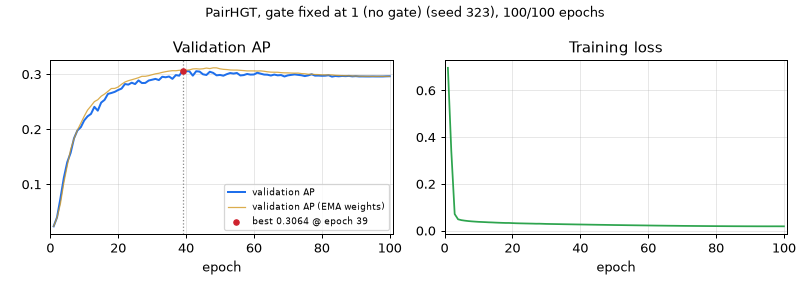

# PairHGT, gate fixed at 1 (no gate) — seed 323

[← all models](../README.md) · PairHGT notebook · ogbg-molpcba

| | |
|---|---|
| State | **finished** |
| Epochs | 100 of 100 |
| Best validation AP | **0.3064** at epoch 39 |
| Best validation AP, EMA weights | 0.3117 at epoch 48 |
| Test AP | raw 0.2938 / ema 0.3043 (final) |
| Seed | 323 |
| Parameters | 9,751,632 |
| Minutes per epoch (last 5, incl. validation) | 4.4 |
| Training time so far | 7.4 h |
| Training time left | done |
| Sessions (start + resumes) | 2 |
| Hottest GPU reading | 89.0 °C |
| Last update | 2026-11-16 12:25 (293.7 h ago) |



<details><summary>Settings of this run</summary>

| Setting | Value |
|---|---|
| Epochs (warm-up) | 100 (5) |
| Batch size | 512 |
| Learning rate, weight decay | 0.0005, 1e-05 |
| Layers × width, heads | 5 × 384, 4 |
| Dropout, attention dropout | 0.2, 0.5 |
| Pair channel | width 16, dropout 0.1, value gate False |
| Precision | fp32 (TF32 matrix products) |
| EMA decay | 0.9995 |
| Gradient clip | 1.0 |
| Protocol | v2_test_once |
| Notebook version, config hash | pairhgt-confirmatory-v2.0, f924dd96f7aefd19 |

</details>

## Final test (evaluated once)

| Weights | Epoch | Validation AP | Test AP |
|---|---|---|---|
| raw | 39 | 0.3064 | 0.2938 |
| ema | 48 | 0.3117 | 0.3043 |

## Every epoch (newest first)

| Epoch | Train loss | Val AP | Val AP (EMA weights) | Best so far | LR | Minutes |
|---|---|---|---|---|---|---|
| 100 | 0.0188 | 0.2965 | 0.2962 | 0.3064 (ep 39) | 1.37e-07 | 4.5 |
| 99 | 0.0188 | 0.2963 | 0.2962 | 0.3064 (ep 39) | 5.47e-07 | 4.4 |
| 98 | 0.0189 | 0.2960 | 0.2962 | 0.3064 (ep 39) | 1.23e-06 | 4.4 |
| 97 | 0.0189 | 0.2960 | 0.2963 | 0.3064 (ep 39) | 2.18e-06 | 4.5 |
| 96 | 0.0189 | 0.2960 | 0.2962 | 0.3064 (ep 39) | 3.41e-06 | 4.4 |
| 95 | 0.0189 | 0.2961 | 0.2963 | 0.3064 (ep 39) | 4.91e-06 | 4.4 |
| 94 | 0.0189 | 0.2960 | 0.2963 | 0.3064 (ep 39) | 6.67e-06 | 4.4 |
| 93 | 0.0189 | 0.2960 | 0.2964 | 0.3064 (ep 39) | 8.70e-06 | 4.4 |
| 92 | 0.0189 | 0.2961 | 0.2964 | 0.3064 (ep 39) | 1.10e-05 | 4.4 |
| 91 | 0.0190 | 0.2961 | 0.2966 | 0.3064 (ep 39) | 1.35e-05 | 4.5 |
| 90 | 0.0190 | 0.2967 | 0.2968 | 0.3064 (ep 39) | 1.64e-05 | 4.4 |
| 89 | 0.0191 | 0.2962 | 0.2970 | 0.3064 (ep 39) | 1.94e-05 | 4.4 |
| 88 | 0.0191 | 0.2970 | 0.2973 | 0.3064 (ep 39) | 2.27e-05 | 4.4 |
| 87 | 0.0192 | 0.2966 | 0.2974 | 0.3064 (ep 39) | 2.63e-05 | 4.4 |
| 86 | 0.0192 | 0.2970 | 0.2975 | 0.3064 (ep 39) | 3.01e-05 | 4.4 |
| 85 | 0.0193 | 0.2963 | 0.2979 | 0.3064 (ep 39) | 3.42e-05 | 4.4 |
| 84 | 0.0193 | 0.2969 | 0.2982 | 0.3064 (ep 39) | 3.85e-05 | 4.4 |
| 83 | 0.0194 | 0.2958 | 0.2989 | 0.3064 (ep 39) | 4.30e-05 | 4.4 |
| 82 | 0.0195 | 0.2983 | 0.2989 | 0.3064 (ep 39) | 4.77e-05 | 4.4 |
| 81 | 0.0196 | 0.2974 | 0.2989 | 0.3064 (ep 39) | 5.27e-05 | 4.4 |
| 80 | 0.0197 | 0.2973 | 0.2990 | 0.3064 (ep 39) | 5.79e-05 | 4.4 |
| 79 | 0.0198 | 0.2976 | 0.2994 | 0.3064 (ep 39) | 6.33e-05 | 4.5 |
| 78 | 0.0199 | 0.2976 | 0.2996 | 0.3064 (ep 39) | 6.89e-05 | 4.5 |
| 77 | 0.0200 | 0.3000 | 0.3001 | 0.3064 (ep 39) | 7.47e-05 | 4.5 |
| 76 | 0.0201 | 0.2980 | 0.3001 | 0.3064 (ep 39) | 8.07e-05 | 4.5 |
| 75 | 0.0202 | 0.2967 | 0.3010 | 0.3064 (ep 39) | 8.69e-05 | 4.5 |
| 74 | 0.0203 | 0.2982 | 0.3013 | 0.3064 (ep 39) | 9.32e-05 | 4.5 |
| 73 | 0.0204 | 0.2990 | 0.3022 | 0.3064 (ep 39) | 9.97e-05 | 4.5 |
| 72 | 0.0206 | 0.2998 | 0.3021 | 0.3064 (ep 39) | 1.06e-04 | 4.5 |
| 71 | 0.0207 | 0.2989 | 0.3022 | 0.3064 (ep 39) | 1.13e-04 | 4.5 |
| 70 | 0.0208 | 0.2980 | 0.3025 | 0.3064 (ep 39) | 1.20e-04 | 4.5 |
| 69 | 0.0210 | 0.2960 | 0.3026 | 0.3064 (ep 39) | 1.27e-04 | 4.5 |
| 68 | 0.0212 | 0.2986 | 0.3030 | 0.3064 (ep 39) | 1.35e-04 | 4.5 |
| 67 | 0.0213 | 0.2981 | 0.3037 | 0.3064 (ep 39) | 1.42e-04 | 4.5 |
| 66 | 0.0214 | 0.2994 | 0.3037 | 0.3064 (ep 39) | 1.50e-04 | 4.5 |
| 65 | 0.0216 | 0.2978 | 0.3039 | 0.3064 (ep 39) | 1.57e-04 | 4.5 |
| 64 | 0.0218 | 0.2992 | 0.3045 | 0.3064 (ep 39) | 1.65e-04 | 4.5 |
| 63 | 0.0219 | 0.2995 | 0.3055 | 0.3064 (ep 39) | 1.73e-04 | 4.5 |
| 62 | 0.0221 | 0.3011 | 0.3062 | 0.3064 (ep 39) | 1.81e-04 | 4.5 |
| 61 | 0.0223 | 0.3028 | 0.3059 | 0.3064 (ep 39) | 1.89e-04 | 4.5 |
| 60 | 0.0224 | 0.2996 | 0.3061 | 0.3064 (ep 39) | 1.97e-04 | 4.5 |
| 59 | 0.0226 | 0.2994 | 0.3062 | 0.3064 (ep 39) | 2.05e-04 | 4.5 |
| 58 | 0.0228 | 0.3006 | 0.3061 | 0.3064 (ep 39) | 2.13e-04 | 4.5 |
| 57 | 0.0230 | 0.2986 | 0.3067 | 0.3064 (ep 39) | 2.21e-04 | 4.5 |
| 56 | 0.0232 | 0.2979 | 0.3072 | 0.3064 (ep 39) | 2.29e-04 | 4.5 |
| 55 | 0.0234 | 0.3024 | 0.3077 | 0.3064 (ep 39) | 2.38e-04 | 4.5 |
| 54 | 0.0236 | 0.3013 | 0.3077 | 0.3064 (ep 39) | 2.46e-04 | 4.5 |
| 53 | 0.0238 | 0.3023 | 0.3079 | 0.3064 (ep 39) | 2.54e-04 | 4.5 |
| 52 | 0.0240 | 0.3002 | 0.3086 | 0.3064 (ep 39) | 2.62e-04 | 4.5 |
| 51 | 0.0242 | 0.2974 | 0.3090 | 0.3064 (ep 39) | 2.71e-04 | 4.5 |
| 50 | 0.0244 | 0.2988 | 0.3099 | 0.3064 (ep 39) | 2.79e-04 | 4.5 |
| 49 | 0.0246 | 0.2981 | 0.3117 | 0.3064 (ep 39) | 2.87e-04 | 4.5 |
| 48 | 0.0249 | 0.3026 | 0.3117 | 0.3064 (ep 39) | 2.95e-04 | 4.5 |
| 47 | 0.0251 | 0.3046 | 0.3104 | 0.3064 (ep 39) | 3.03e-04 | 4.5 |
| 46 | 0.0253 | 0.2987 | 0.3113 | 0.3064 (ep 39) | 3.11e-04 | 4.5 |
| 45 | 0.0255 | 0.3000 | 0.3100 | 0.3064 (ep 39) | 3.19e-04 | 4.5 |
| 44 | 0.0257 | 0.3049 | 0.3095 | 0.3064 (ep 39) | 3.27e-04 | 4.4 |
| 43 | 0.0260 | 0.3056 | 0.3101 | 0.3064 (ep 39) | 3.35e-04 | 4.5 |
| 42 | 0.0262 | 0.2975 | 0.3097 | 0.3064 (ep 39) | 3.43e-04 | 4.5 |
| 41 | 0.0265 | 0.3055 | 0.3080 | 0.3064 (ep 39) | 3.50e-04 | 4.5 |
| 40 | 0.0267 | 0.3056 | 0.3075 | 0.3064 (ep 39) | 3.58e-04 | 4.5 |
| 39 | 0.0269 | 0.3064 ⭐ | 0.3073 | 0.3064 (ep 39) | 3.65e-04 | 4.5 |
| 38 | 0.0271 | 0.2975 | 0.3072 | 0.2985 (ep 37) | 3.73e-04 | 4.5 |
| 37 | 0.0274 | 0.2985 ⭐ | 0.3065 | 0.2985 (ep 37) | 3.80e-04 | 4.5 |
| 36 | 0.0276 | 0.2917 | 0.3066 | 0.2960 (ep 35) | 3.87e-04 | 4.5 |
| 35 | 0.0279 | 0.2960 ⭐ | 0.3058 | 0.2960 (ep 35) | 3.94e-04 | 4.5 |
| 34 | 0.0281 | 0.2946 | 0.3048 | 0.2955 (ep 33) | 4.00e-04 | 4.5 |
| 33 | 0.0284 | 0.2955 ⭐ | 0.3035 | 0.2955 (ep 33) | 4.07e-04 | 4.5 |
| 32 | 0.0287 | 0.2895 | 0.3018 | 0.2916 (ep 31) | 4.13e-04 | 4.5 |
| 31 | 0.0289 | 0.2916 ⭐ | 0.3008 | 0.2916 (ep 31) | 4.19e-04 | 4.5 |
| 30 | 0.0292 | 0.2901 ⭐ | 0.2992 | 0.2901 (ep 30) | 4.25e-04 | 4.5 |
| 29 | 0.0296 | 0.2887 | 0.2975 | 0.2889 (ep 26) | 4.31e-04 | 4.5 |
| 28 | 0.0301 | 0.2843 | 0.2964 | 0.2889 (ep 26) | 4.37e-04 | 4.5 |
| 27 | 0.0300 | 0.2841 | 0.2963 | 0.2889 (ep 26) | 4.42e-04 | 4.5 |
| 26 | 0.0304 | 0.2889 ⭐ | 0.2938 | 0.2889 (ep 26) | 4.47e-04 | 4.5 |
| 25 | 0.0307 | 0.2822 | 0.2919 | 0.2847 (ep 24) | 4.52e-04 | 4.5 |
| 24 | 0.0310 | 0.2847 ⭐ | 0.2901 | 0.2847 (ep 24) | 4.57e-04 | 4.5 |
| 23 | 0.0313 | 0.2812 | 0.2883 | 0.2823 (ep 22) | 4.62e-04 | 4.5 |
| 22 | 0.0316 | 0.2823 ⭐ | 0.2859 | 0.2823 (ep 22) | 4.66e-04 | 4.5 |
| 21 | 0.0320 | 0.2740 ⭐ | 0.2818 | 0.2740 (ep 21) | 4.70e-04 | 4.5 |
| 20 | 0.0326 | 0.2714 ⭐ | 0.2769 | 0.2714 (ep 20) | 4.74e-04 | 4.5 |
| 19 | 0.0332 | 0.2681 ⭐ | 0.2744 | 0.2681 (ep 19) | 4.77e-04 | 4.5 |
| 18 | 0.0333 | 0.2660 ⭐ | 0.2742 | 0.2660 (ep 18) | 4.81e-04 | 4.5 |
| 17 | 0.0337 | 0.2644 ⭐ | 0.2690 | 0.2644 (ep 17) | 4.84e-04 | 4.5 |
| 16 | 0.0342 | 0.2535 ⭐ | 0.2641 | 0.2535 (ep 16) | 4.86e-04 | 4.5 |
| 15 | 0.0348 | 0.2486 ⭐ | 0.2601 | 0.2486 (ep 15) | 4.89e-04 | 4.5 |
| 14 | 0.0355 | 0.2339 | 0.2538 | 0.2409 (ep 13) | 4.91e-04 | 4.5 |
| 13 | 0.0360 | 0.2409 ⭐ | 0.2503 | 0.2409 (ep 13) | 4.93e-04 | 4.5 |
| 12 | 0.0367 | 0.2280 ⭐ | 0.2424 | 0.2280 (ep 12) | 4.95e-04 | 4.5 |
| 11 | 0.0374 | 0.2236 ⭐ | 0.2350 | 0.2236 (ep 11) | 4.97e-04 | 4.5 |
| 10 | 0.0380 | 0.2162 ⭐ | 0.2237 | 0.2162 (ep 10) | 4.98e-04 | 4.5 |
| 9 | 0.0390 | 0.2038 ⭐ | 0.2111 | 0.2038 (ep 9) | 4.99e-04 | 4.5 |
| 8 | 0.0401 | 0.1979 ⭐ | 0.1986 | 0.1979 (ep 8) | 4.99e-04 | 4.5 |
| 7 | 0.0413 | 0.1837 ⭐ | 0.1829 | 0.1837 (ep 7) | 5.00e-04 | 4.5 |
| 6 | 0.0431 | 0.1573 ⭐ | 0.1629 | 0.1573 (ep 6) | 5.00e-04 | 4.5 |
| 5 | 0.0452 | 0.1402 ⭐ | 0.1338 | 0.1402 (ep 5) | 4.00e-04 | 4.5 |
| 4 | 0.0488 | 0.1118 ⭐ | 0.1030 | 0.1118 (ep 4) | 3.00e-04 | 4.4 |
| 3 | 0.0713 | 0.0745 ⭐ | 0.0650 | 0.0745 (ep 3) | 2.00e-04 | 4.5 |
| 2 | 0.3417 | 0.0402 ⭐ | 0.0396 | 0.0402 (ep 2) | 1.00e-04 | 4.4 |
| 1 | 0.6968 | 0.0238 ⭐ | 0.0238 | 0.0238 (ep 1) | 5.00e-10 | 4.4 |

## Last 80 log lines

_The log counts epochs from 0; the tables above count from 1._

```
prereg.json checked: configuration identical (hash f924dd96f7aefd19); seeds [101, 202, 323, 432, 543]
[seed 323] RESUMED from epoch 79/100 (lr 5.79e-05, best val AP so far 0.3064)
[seed 323] epoch  80/100 | lr 5.79e-05 | train BCE 0.0197 | val AP 0.2973 | best val 0.3064 @ep39 | EMA val 0.2990 | 266s (train 238s, eval 28s) | GPU max 88C | ETA<= 1.5h
[seed 323] epoch  81/100 | lr 5.27e-05 | train BCE 0.0196 | val AP 0.2974 | best val 0.3064 @ep39 | EMA val 0.2989 | 267s (train 239s, eval 28s) | GPU max 88C | ETA<= 1.4h
[seed 323] epoch  82/100 | lr 4.77e-05 | train BCE 0.0195 | val AP 0.2983 | best val 0.3064 @ep39 | EMA val 0.2989 | 267s (train 239s, eval 28s) | GPU max 88C | ETA<= 1.3h
[seed 323] epoch  83/100 | lr 4.30e-05 | train BCE 0.0194 | val AP 0.2958 | best val 0.3064 @ep39 | EMA val 0.2989 | 266s (train 238s, eval 28s) | GPU max 88C | ETA<= 1.3h
[seed 323] epoch  84/100 | lr 3.85e-05 | train BCE 0.0193 | val AP 0.2969 | best val 0.3064 @ep39 | EMA val 0.2982 | 267s (train 239s, eval 28s) | GPU max 88C | ETA<= 1.2h
[seed 323] epoch  85/100 | lr 3.42e-05 | train BCE 0.0193 | val AP 0.2963 | best val 0.3064 @ep39 | EMA val 0.2979 | 267s (train 239s, eval 28s) | GPU max 89C | ETA<= 1.1h
[seed 323] epoch  86/100 | lr 3.01e-05 | train BCE 0.0192 | val AP 0.2970 | best val 0.3064 @ep39 | EMA val 0.2975 | 267s (train 239s, eval 28s) | GPU max 89C | ETA<= 1.0h
[seed 323] epoch  87/100 | lr 2.63e-05 | train BCE 0.0192 | val AP 0.2966 | best val 0.3064 @ep39 | EMA val 0.2974 | 267s (train 239s, eval 28s) | GPU max 88C | ETA<= 1.0h
[seed 323] epoch  88/100 | lr 2.27e-05 | train BCE 0.0191 | val AP 0.2970 | best val 0.3064 @ep39 | EMA val 0.2973 | 267s (train 239s, eval 28s) | GPU max 88C | ETA<= 0.9h
[seed 323] epoch  89/100 | lr 1.94e-05 | train BCE 0.0191 | val AP 0.2962 | best val 0.3064 @ep39 | EMA val 0.2970 | 267s (train 239s, eval 28s) | GPU max 88C | ETA<= 0.8h
[seed 323] epoch  90/100 | lr 1.64e-05 | train BCE 0.0190 | val AP 0.2967 | best val 0.3064 @ep39 | EMA val 0.2968 | 267s (train 238s, eval 28s) | GPU max 88C | ETA<= 0.7h
[seed 323] epoch  91/100 | lr 1.35e-05 | train BCE 0.0190 | val AP 0.2961 | best val 0.3064 @ep39 | EMA val 0.2966 | 267s (train 239s, eval 28s) | GPU max 89C | ETA<= 0.7h
[seed 323] epoch  92/100 | lr 1.10e-05 | train BCE 0.0189 | val AP 0.2961 | best val 0.3064 @ep39 | EMA val 0.2964 | 267s (train 239s, eval 28s) | GPU max 89C | ETA<= 0.6h
[seed 323] epoch  93/100 | lr 8.70e-06 | train BCE 0.0189 | val AP 0.2960 | best val 0.3064 @ep39 | EMA val 0.2964 | 267s (train 239s, eval 28s) | GPU max 89C | ETA<= 0.5h
[seed 323] epoch  94/100 | lr 6.67e-06 | train BCE 0.0189 | val AP 0.2960 | best val 0.3064 @ep39 | EMA val 0.2963 | 267s (train 239s, eval 28s) | GPU max 89C | ETA<= 0.4h
[seed 323] epoch  95/100 | lr 4.91e-06 | train BCE 0.0189 | val AP 0.2961 | best val 0.3064 @ep39 | EMA val 0.2963 | 267s (train 239s, eval 28s) | GPU max 89C | ETA<= 0.4h
[seed 323] epoch  96/100 | lr 3.41e-06 | train BCE 0.0189 | val AP 0.2960 | best val 0.3064 @ep39 | EMA val 0.2962 | 267s (train 238s, eval 28s) | GPU max 89C | ETA<= 0.3h
[seed 323] epoch  97/100 | lr 2.18e-06 | train BCE 0.0189 | val AP 0.2960 | best val 0.3064 @ep39 | EMA val 0.2963 | 267s (train 239s, eval 28s) | GPU max 89C | ETA<= 0.2h
[seed 323] epoch  98/100 | lr 1.23e-06 | train BCE 0.0189 | val AP 0.2960 | best val 0.3064 @ep39 | EMA val 0.2962 | 267s (train 239s, eval 28s) | GPU max 88C | ETA<= 0.1h
[seed 323] epoch  99/100 | lr 5.47e-07 | train BCE 0.0188 | val AP 0.2963 | best val 0.3064 @ep39 | EMA val 0.2962 | 267s (train 239s, eval 28s) | GPU max 89C | ETA<= 0.1h
[seed 323] epoch 100/100 | lr 1.37e-07 | train BCE 0.0188 | val AP 0.2965 | best val 0.3064 @ep39 | EMA val 0.2962 | 267s (train 239s, eval 28s) | GPU max 89C | ETA<= 0.0h
[seed 323] FINAL TEST (evaluated once): raw epoch 39 val 0.3064 test 0.2938 | EMA epoch 48 val 0.3117 test 0.3043
--- cell 16 ---
PairHGT, gate fixed at 1 (no gate): GPS + pair channel (pair bias + write-back) [arm A_nogate_notrip] | gps_conf_A_nogate_notrip_ep100_molpcba
 seed  epochs  raw_epoch  raw_val  raw_test  ema_epoch  ema_val  ema_test  hours  train_s_per_epoch  total_s_per_epoch
  101 100/100         91   0.2973    0.2909         92   0.2970    0.2916 7.4298           239.2251           267.4726
  202 100/100         49   0.3003    0.2936         41   0.3078    0.3026 7.4248           239.0581           267.2913
  323 100/100         39   0.3064    0.2938         48   0.3117    0.3043 7.4250           239.0676           267.2989
mean ± sample SD (ddof=1) over 3 seed(s): raw test 0.2928 ± 0.0016 | EMA test 0.2995 ± 0.0069
A mean ± SD over fewer than 3 seeds is only a description; do not call it a confidence interval.
/tmp/ipykernel_1036798/1726116603.py:55: UserWarning: No artists with labels found to put in legend.  Note that artists whose label start with an underscore are ignored when legend() is called with no argument.
  ax.set(title=f"seed {s} (circle = selected raw, square = selected EMA)", xlabel="epoch", ylabel="validation AP"); ax.grid(alpha=0.25); ax.legend(fontsize=7)
run manifest: 16 row(s) -> /home/student/thesis/outputs/pairhgt/outputs/confirmatory/run_manifest.csv
    model              gpu  seeds  params  train_s_per_epoch  val_eval_s_per_epoch  total_s_per_epoch  hours_per_seed  time_vs_GPS+EMA
GPS + EMA NVIDIA RTX A4000      5 9744860             160.70                 15.83             176.55            4.90             1.00
  PairHGT NVIDIA RTX A4000      5 9751972             275.33                 33.75             309.10            8.59             1.75
train = training steps incl. EMA update; val_eval = validation of raw + EMA weights; no test pass inside an epoch (protocol v2). Do not compare with timings from the exploratory runs.
--- cell 18 ---
=== PairHGT  minus  GPS + EMA   (100 epochs, matched seeds) ===
 seed  raw_val  ema_val  raw_test  ema_test
  101   0.0013   0.0027    0.0043    0.0048
  202   0.0017   0.0012    0.0067    0.0115
  323   0.0021   0.0022    0.0019    0.0056
  432   0.0017   0.0035    0.0066    0.0120
  543  -0.0012  -0.0008    0.0101    0.0068
  validation AP, raw    : mean +0.0011, sample SD 0.0013, per-seed [0.0013, 0.0017, 0.0021, 0.0017, -0.0012], all positive: False | 95% t-interval [-0.0006, +0.0028] (n=5, t=1.84)
  validation AP, EMA    : mean +0.0018, sample SD 0.0017, per-seed [0.0027, 0.0012, 0.0022, 0.0035, -0.0008], all positive: False | 95% t-interval [-0.0003, +0.0038] (n=5, t=2.38)
  test AP, raw vs raw   : mean +0.0059, sample SD 0.0031, per-seed [0.0043, 0.0067, 0.0019, 0.0066, 0.0101], all positive: True | 95% t-interval [+0.0021, +0.0097] (n=5, t=4.31)
  test AP, EMA vs EMA   : mean +0.0082, sample SD 0.0034, per-seed [0.0048, 0.0115, 0.0056, 0.012, 0.0068], all positive: True | 95% t-interval [+0.0039, +0.0124] (n=5, t=5.35)
  Reading: 5 matched seed(s). Interpret with the interval, not with a threshold.
=== PairHGT  minus  PairHGT, gate fixed at 1 (no gate)   (100 epochs, matched seeds) ===
 seed  raw_val  ema_val  raw_test  ema_test
  101   0.0083   0.0161    0.0033    0.0127
  202   0.0034   0.0018    0.0027    0.0036
  323  -0.0059  -0.0052    0.0029    0.0007
  validation AP, raw    : mean +0.0019, sample SD 0.0072, per-seed [0.0083, 0.0034, -0.0059], all positive: False | 95% t-interval [-0.0160, +0.0199] (n=3, t=0.46)
  validation AP, EMA    : mean +0.0042, sample SD 0.0108, per-seed [0.0161, 0.0018, -0.0052], all positive: False | 95% t-interval [-0.0227, +0.0312] (n=3, t=0.67)
  test AP, raw vs raw   : mean +0.0030, sample SD 0.0003, per-seed [0.0033, 0.0027, 0.0029], all positive: True | 95% t-interval [+0.0022, +0.0038] (n=3, t=16.90)
  test AP, EMA vs EMA   : mean +0.0057, sample SD 0.0062, per-seed [0.0127, 0.0036, 0.0007], all positive: True | 95% t-interval [-0.0098, +0.0212] (n=3, t=1.57)
  Reading: 3 matched seed(s). The claim is limited to whether the direction of the EMA-vs-EMA difference repeats; a significance claim needs many more seeds.
ABLATION RULE (PairHGT vs PairHGT, gate fixed at 1 (no gate), validation AP, margin 0.002): raw +0.0019, EMA +0.0042 -> component NOT shown to matter (lead < margin on at least one weight type)
  screening result on 1-3 seeds: it decides whether a full 100-epoch run is worth its cost, nothing more.
=== PairHGT  minus  PairHGT, gate only (no pair bias)   (100 epochs, matched seeds) ===
 seed  raw_val  ema_val  raw_test  ema_test
  101   0.0077   0.0067    0.0016    0.0028
  202   0.0018   0.0010    0.0049    0.0060
  validation AP, raw    : mean +0.0048, sample SD 0.0041, per-seed [0.0077, 0.0018], all positive: True | n=2: fewer than 3 matched seeds, direction only, no interval
  validation AP, EMA    : mean +0.0038, sample SD 0.0040, per-seed [0.0067, 0.001], all positive: True | n=2: fewer than 3 matched seeds, direction only, no interval
  test AP, raw vs raw   : mean +0.0032, sample SD 0.0024, per-seed [0.0016, 0.0049], all positive: True | n=2: fewer than 3 matched seeds, direction only, no interval
  test AP, EMA vs EMA   : mean +0.0044, sample SD 0.0022, per-seed [0.0028, 0.006], all positive: True | n=2: fewer than 3 matched seeds, direction only, no interval
  Reading: 2 matched seed(s). The claim is limited to whether the direction of the EMA-vs-EMA difference repeats; a significance claim needs many more seeds.
ABLATION RULE (PairHGT vs PairHGT, gate only (no pair bias), validation AP, margin 0.002): raw +0.0048, EMA +0.0038 -> component RETAINED (lead on both weight types)
  screening result on 1-3 seeds: it decides whether a full 100-epoch run is worth its cost, nothing more.
Planning table (80% power, alpha 0.05, two-sample t, test AP): smallest detectable true difference
  per-seed SD 0.003: n=3: 0.0092, n=5: 0.0061, n=10: 0.0040, n=20: 0.0027
  per-seed SD 0.0056: n=3: 0.0172, n=5: 0.0113, n=10: 0.0074, n=20: 0.0051
--- cell 20 ---
===== 2026-11-16 12:26:28 notebook turn ended (exit 0); executed notebook: /home/student/thesis/outputs/lab_runs/notebooks/pairhgt_A_nogate_notrip_seed323_20261116-1051.ipynb =====
```
