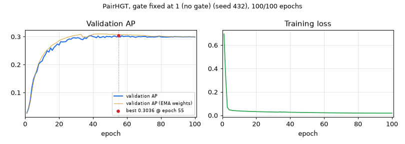

# PairHGT, gate fixed at 1 (no gate) — seed 432

[← all models](../README.md) · PairHGT notebook · ogbg-molpcba

| | |
|---|---|
| State | **finished** |
| Epochs | 100 of 100 |
| Best validation AP | **0.3036** at epoch 55 |
| Best validation AP, EMA weights | 0.3100 at epoch 45 |
| Test AP | raw 0.2968 / ema 0.3072 (final) |
| Seed | 432 |
| Parameters | 9,751,632 |
| Minutes per epoch (last 5, incl. validation) | 4.5 |
| Training time so far | 7.4 h |
| Training time left | done |
| Sessions (start + resumes) | 2 |
| Hottest GPU reading | 89.0 °C |
| Last update | 2026-11-17 09:24 (272.7 h ago) |



<details><summary>Settings of this run</summary>

| Setting | Value |
|---|---|
| Epochs (warm-up) | 100 (5) |
| Batch size | 512 |
| Learning rate, weight decay | 0.0005, 1e-05 |
| Layers × width, heads | 5 × 384, 4 |
| Dropout, attention dropout | 0.2, 0.5 |
| Pair channel | width 16, dropout 0.1, value gate False |
| Precision | fp32 (TF32 matrix products) |
| EMA decay | 0.9995 |
| Gradient clip | 1.0 |
| Protocol | v2_test_once |
| Notebook version, config hash | pairhgt-confirmatory-v2.0, f924dd96f7aefd19 |

</details>

## Final test (evaluated once)

| Weights | Epoch | Validation AP | Test AP |
|---|---|---|---|
| raw | 55 | 0.3036 | 0.2968 |
| ema | 45 | 0.3100 | 0.3072 |

## Every epoch (newest first)

| Epoch | Train loss | Val AP | Val AP (EMA weights) | Best so far | LR | Minutes |
|---|---|---|---|---|---|---|
| 100 | 0.0192 | 0.2990 | 0.2997 | 0.3036 (ep 55) | 1.37e-07 | 4.5 |
| 99 | 0.0192 | 0.2996 | 0.2997 | 0.3036 (ep 55) | 5.47e-07 | 4.5 |
| 98 | 0.0192 | 0.2993 | 0.2996 | 0.3036 (ep 55) | 1.23e-06 | 4.4 |
| 97 | 0.0192 | 0.2999 | 0.2995 | 0.3036 (ep 55) | 2.18e-06 | 4.5 |
| 96 | 0.0192 | 0.2998 | 0.2995 | 0.3036 (ep 55) | 3.41e-06 | 4.4 |
| 95 | 0.0192 | 0.2995 | 0.2996 | 0.3036 (ep 55) | 4.91e-06 | 4.5 |
| 94 | 0.0192 | 0.2996 | 0.2997 | 0.3036 (ep 55) | 6.67e-06 | 4.5 |
| 93 | 0.0193 | 0.2992 | 0.2997 | 0.3036 (ep 55) | 8.70e-06 | 4.5 |
| 92 | 0.0193 | 0.2997 | 0.2997 | 0.3036 (ep 55) | 1.10e-05 | 4.5 |
| 91 | 0.0193 | 0.2999 | 0.2998 | 0.3036 (ep 55) | 1.35e-05 | 4.5 |
| 90 | 0.0194 | 0.2999 | 0.2999 | 0.3036 (ep 55) | 1.64e-05 | 4.4 |
| 89 | 0.0194 | 0.3000 | 0.3001 | 0.3036 (ep 55) | 1.94e-05 | 4.5 |
| 88 | 0.0194 | 0.3004 | 0.2997 | 0.3036 (ep 55) | 2.27e-05 | 4.5 |
| 87 | 0.0195 | 0.2992 | 0.2998 | 0.3036 (ep 55) | 2.63e-05 | 4.5 |
| 86 | 0.0196 | 0.2999 | 0.3000 | 0.3036 (ep 55) | 3.01e-05 | 4.4 |
| 85 | 0.0196 | 0.2991 | 0.3005 | 0.3036 (ep 55) | 3.42e-05 | 4.5 |
| 84 | 0.0197 | 0.2988 | 0.3005 | 0.3036 (ep 55) | 3.85e-05 | 4.5 |
| 83 | 0.0198 | 0.2984 | 0.3009 | 0.3036 (ep 55) | 4.30e-05 | 4.5 |
| 82 | 0.0199 | 0.2990 | 0.3011 | 0.3036 (ep 55) | 4.77e-05 | 4.5 |
| 81 | 0.0199 | 0.2988 | 0.3017 | 0.3036 (ep 55) | 5.27e-05 | 4.5 |
| 80 | 0.0200 | 0.2994 | 0.3022 | 0.3036 (ep 55) | 5.79e-05 | 4.5 |
| 79 | 0.0201 | 0.3021 | 0.3021 | 0.3036 (ep 55) | 6.33e-05 | 4.4 |
| 78 | 0.0202 | 0.3002 | 0.3021 | 0.3036 (ep 55) | 6.89e-05 | 4.5 |
| 77 | 0.0203 | 0.2994 | 0.3018 | 0.3036 (ep 55) | 7.47e-05 | 4.4 |
| 76 | 0.0204 | 0.2985 | 0.3016 | 0.3036 (ep 55) | 8.07e-05 | 4.5 |
| 75 | 0.0205 | 0.2993 | 0.3013 | 0.3036 (ep 55) | 8.69e-05 | 4.5 |
| 74 | 0.0206 | 0.2990 | 0.3015 | 0.3036 (ep 55) | 9.32e-05 | 4.4 |
| 73 | 0.0207 | 0.2993 | 0.3024 | 0.3036 (ep 55) | 9.97e-05 | 4.5 |
| 72 | 0.0209 | 0.2980 | 0.3029 | 0.3036 (ep 55) | 1.06e-04 | 4.5 |
| 71 | 0.0210 | 0.3008 | 0.3037 | 0.3036 (ep 55) | 1.13e-04 | 4.5 |
| 70 | 0.0211 | 0.3010 | 0.3043 | 0.3036 (ep 55) | 1.20e-04 | 4.5 |
| 69 | 0.0213 | 0.3004 | 0.3046 | 0.3036 (ep 55) | 1.27e-04 | 4.5 |
| 68 | 0.0215 | 0.2997 | 0.3050 | 0.3036 (ep 55) | 1.35e-04 | 4.4 |
| 67 | 0.0216 | 0.3008 | 0.3052 | 0.3036 (ep 55) | 1.42e-04 | 4.5 |
| 66 | 0.0218 | 0.2995 | 0.3058 | 0.3036 (ep 55) | 1.50e-04 | 4.5 |
| 65 | 0.0219 | 0.2978 | 0.3058 | 0.3036 (ep 55) | 1.57e-04 | 4.5 |
| 64 | 0.0221 | 0.2999 | 0.3056 | 0.3036 (ep 55) | 1.65e-04 | 4.5 |
| 63 | 0.0222 | 0.3011 | 0.3058 | 0.3036 (ep 55) | 1.73e-04 | 4.5 |
| 62 | 0.0225 | 0.2988 | 0.3064 | 0.3036 (ep 55) | 1.81e-04 | 4.5 |
| 61 | 0.0226 | 0.3021 | 0.3066 | 0.3036 (ep 55) | 1.89e-04 | 4.5 |
| 60 | 0.0228 | 0.3016 | 0.3069 | 0.3036 (ep 55) | 1.97e-04 | 4.4 |
| 59 | 0.0230 | 0.3017 | 0.3072 | 0.3036 (ep 55) | 2.05e-04 | 4.4 |
| 58 | 0.0231 | 0.3004 | 0.3076 | 0.3036 (ep 55) | 2.13e-04 | 4.4 |
| 57 | 0.0233 | 0.3035 | 0.3070 | 0.3036 (ep 55) | 2.21e-04 | 4.4 |
| 56 | 0.0235 | 0.2987 | 0.3073 | 0.3036 (ep 55) | 2.29e-04 | 4.4 |
| 55 | 0.0237 | 0.3036 ⭐ | 0.3077 | 0.3036 (ep 55) | 2.38e-04 | 4.5 |
| 54 | 0.0239 | 0.2989 | 0.3080 | 0.3035 (ep 38) | 2.46e-04 | 4.5 |
| 53 | 0.0241 | 0.3024 | 0.3078 | 0.3035 (ep 38) | 2.54e-04 | 4.5 |
| 52 | 0.0243 | 0.3021 | 0.3085 | 0.3035 (ep 38) | 2.62e-04 | 4.5 |
| 51 | 0.0245 | 0.2980 | 0.3088 | 0.3035 (ep 38) | 2.71e-04 | 4.4 |
| 50 | 0.0248 | 0.3011 | 0.3084 | 0.3035 (ep 38) | 2.79e-04 | 4.5 |
| 49 | 0.0250 | 0.2999 | 0.3085 | 0.3035 (ep 38) | 2.87e-04 | 4.5 |
| 48 | 0.0252 | 0.3015 | 0.3095 | 0.3035 (ep 38) | 2.95e-04 | 4.5 |
| 47 | 0.0254 | 0.2971 | 0.3095 | 0.3035 (ep 38) | 3.03e-04 | 4.5 |
| 46 | 0.0256 | 0.3007 | 0.3099 | 0.3035 (ep 38) | 3.11e-04 | 4.5 |
| 45 | 0.0258 | 0.2981 | 0.3100 | 0.3035 (ep 38) | 3.19e-04 | 4.5 |
| 44 | 0.0260 | 0.2967 | 0.3099 | 0.3035 (ep 38) | 3.27e-04 | 4.4 |
| 43 | 0.0262 | 0.3023 | 0.3098 | 0.3035 (ep 38) | 3.35e-04 | 4.5 |
| 42 | 0.0265 | 0.2963 | 0.3096 | 0.3035 (ep 38) | 3.43e-04 | 4.5 |
| 41 | 0.0266 | 0.2991 | 0.3095 | 0.3035 (ep 38) | 3.50e-04 | 4.5 |
| 40 | 0.0269 | 0.3004 | 0.3082 | 0.3035 (ep 38) | 3.58e-04 | 4.5 |
| 39 | 0.0272 | 0.3034 | 0.3066 | 0.3035 (ep 38) | 3.65e-04 | 4.5 |
| 38 | 0.0277 | 0.3035 ⭐ | 0.3029 | 0.3035 (ep 38) | 3.73e-04 | 4.5 |
| 37 | 0.0285 | 0.2998 ⭐ | 0.2997 | 0.2998 (ep 37) | 3.80e-04 | 4.5 |
| 36 | 0.0287 | 0.2933 | 0.2985 | 0.2965 (ep 31) | 3.87e-04 | 4.5 |
| 35 | 0.0284 | 0.2964 | 0.2998 | 0.2965 (ep 31) | 3.94e-04 | 4.5 |
| 34 | 0.0296 | 0.2893 | 0.2983 | 0.2965 (ep 31) | 4.00e-04 | 4.5 |
| 33 | 0.0281 | 0.2908 | 0.3081 | 0.2965 (ep 31) | 4.07e-04 | 4.5 |
| 32 | 0.0284 | 0.2949 | 0.3076 | 0.2965 (ep 31) | 4.13e-04 | 4.4 |
| 31 | 0.0287 | 0.2965 ⭐ | 0.3056 | 0.2965 (ep 31) | 4.19e-04 | 4.5 |
| 30 | 0.0290 | 0.2948 | 0.3051 | 0.2962 (ep 29) | 4.25e-04 | 4.4 |
| 29 | 0.0293 | 0.2962 ⭐ | 0.3042 | 0.2962 (ep 29) | 4.31e-04 | 4.5 |
| 28 | 0.0296 | 0.2957 ⭐ | 0.3031 | 0.2957 (ep 28) | 4.37e-04 | 4.5 |
| 27 | 0.0298 | 0.2908 | 0.3011 | 0.2920 (ep 26) | 4.42e-04 | 4.5 |
| 26 | 0.0302 | 0.2920 ⭐ | 0.2995 | 0.2920 (ep 26) | 4.47e-04 | 4.5 |
| 25 | 0.0305 | 0.2889 ⭐ | 0.2981 | 0.2889 (ep 25) | 4.52e-04 | 4.5 |
| 24 | 0.0308 | 0.2825 ⭐ | 0.2956 | 0.2825 (ep 24) | 4.57e-04 | 4.5 |
| 23 | 0.0312 | 0.2818 | 0.2933 | 0.2825 (ep 21) | 4.62e-04 | 4.5 |
| 22 | 0.0315 | 0.2812 | 0.2913 | 0.2825 (ep 21) | 4.66e-04 | 4.5 |
| 21 | 0.0319 | 0.2825 ⭐ | 0.2893 | 0.2825 (ep 21) | 4.70e-04 | 4.5 |
| 20 | 0.0323 | 0.2701 | 0.2853 | 0.2739 (ep 19) | 4.74e-04 | 4.5 |
| 19 | 0.0328 | 0.2739 ⭐ | 0.2808 | 0.2739 (ep 19) | 4.77e-04 | 4.5 |
| 18 | 0.0332 | 0.2673 ⭐ | 0.2766 | 0.2673 (ep 18) | 4.81e-04 | 4.5 |
| 17 | 0.0337 | 0.2613 ⭐ | 0.2736 | 0.2613 (ep 17) | 4.84e-04 | 4.5 |
| 16 | 0.0342 | 0.2510 | 0.2698 | 0.2597 (ep 15) | 4.86e-04 | 4.5 |
| 15 | 0.0347 | 0.2597 ⭐ | 0.2644 | 0.2597 (ep 15) | 4.89e-04 | 4.5 |
| 14 | 0.0352 | 0.2449 | 0.2581 | 0.2500 (ep 13) | 4.91e-04 | 4.5 |
| 13 | 0.0359 | 0.2500 ⭐ | 0.2537 | 0.2500 (ep 13) | 4.93e-04 | 4.5 |
| 12 | 0.0365 | 0.2363 ⭐ | 0.2458 | 0.2363 (ep 12) | 4.95e-04 | 4.5 |
| 11 | 0.0372 | 0.2281 ⭐ | 0.2376 | 0.2281 (ep 11) | 4.97e-04 | 4.5 |
| 10 | 0.0380 | 0.2129 ⭐ | 0.2292 | 0.2129 (ep 10) | 4.98e-04 | 4.5 |
| 9 | 0.0388 | 0.2090 ⭐ | 0.2179 | 0.2090 (ep 9) | 4.99e-04 | 4.5 |
| 8 | 0.0398 | 0.2018 ⭐ | 0.2049 | 0.2018 (ep 8) | 4.99e-04 | 4.5 |
| 7 | 0.0410 | 0.1767 ⭐ | 0.1864 | 0.1767 (ep 7) | 5.00e-04 | 4.5 |
| 6 | 0.0426 | 0.1655 ⭐ | 0.1663 | 0.1655 (ep 6) | 5.00e-04 | 4.5 |
| 5 | 0.0447 | 0.1486 ⭐ | 0.1399 | 0.1486 (ep 5) | 4.00e-04 | 4.5 |
| 4 | 0.0485 | 0.1186 ⭐ | 0.1038 | 0.1186 (ep 4) | 3.00e-04 | 4.5 |
| 3 | 0.0702 | 0.0712 ⭐ | 0.0661 | 0.0712 (ep 3) | 2.00e-04 | 4.5 |
| 2 | 0.3360 | 0.0431 ⭐ | 0.0408 | 0.0431 (ep 2) | 1.00e-04 | 4.5 |
| 1 | 0.6963 | 0.0266 ⭐ | 0.0266 | 0.0266 (ep 1) | 5.00e-10 | 4.4 |

## Last 80 log lines

_The log counts epochs from 0; the tables above count from 1._

```
[seed 432] epoch  81/100 | lr 5.27e-05 | train BCE 0.0199 | val AP 0.2988 | best val 0.3036 @ep55 | EMA val 0.3017 | 267s (train 239s, eval 28s) | GPU max 89C | ETA<= 1.4h
[seed 432] epoch  82/100 | lr 4.77e-05 | train BCE 0.0199 | val AP 0.2990 | best val 0.3036 @ep55 | EMA val 0.3011 | 268s (train 239s, eval 28s) | GPU max 89C | ETA<= 1.3h
[seed 432] epoch  83/100 | lr 4.30e-05 | train BCE 0.0198 | val AP 0.2984 | best val 0.3036 @ep55 | EMA val 0.3009 | 267s (train 239s, eval 28s) | GPU max 89C | ETA<= 1.3h
[seed 432] epoch  84/100 | lr 3.85e-05 | train BCE 0.0197 | val AP 0.2988 | best val 0.3036 @ep55 | EMA val 0.3005 | 267s (train 239s, eval 28s) | GPU max 89C | ETA<= 1.2h
[seed 432] epoch  85/100 | lr 3.42e-05 | train BCE 0.0196 | val AP 0.2991 | best val 0.3036 @ep55 | EMA val 0.3005 | 267s (train 239s, eval 28s) | GPU max 89C | ETA<= 1.1h
[seed 432] epoch  86/100 | lr 3.01e-05 | train BCE 0.0196 | val AP 0.2999 | best val 0.3036 @ep55 | EMA val 0.3000 | 267s (train 239s, eval 28s) | GPU max 89C | ETA<= 1.0h
[seed 432] epoch  87/100 | lr 2.63e-05 | train BCE 0.0195 | val AP 0.2992 | best val 0.3036 @ep55 | EMA val 0.2998 | 267s (train 239s, eval 28s) | GPU max 89C | ETA<= 1.0h
[seed 432] epoch  88/100 | lr 2.27e-05 | train BCE 0.0194 | val AP 0.3004 | best val 0.3036 @ep55 | EMA val 0.2997 | 267s (train 239s, eval 28s) | GPU max 89C | ETA<= 0.9h
[seed 432] epoch  89/100 | lr 1.94e-05 | train BCE 0.0194 | val AP 0.3000 | best val 0.3036 @ep55 | EMA val 0.3001 | 267s (train 239s, eval 28s) | GPU max 89C | ETA<= 0.8h
[seed 432] epoch  90/100 | lr 1.64e-05 | train BCE 0.0194 | val AP 0.2999 | best val 0.3036 @ep55 | EMA val 0.2999 | 267s (train 238s, eval 28s) | GPU max 89C | ETA<= 0.7h
[seed 432] epoch  91/100 | lr 1.35e-05 | train BCE 0.0193 | val AP 0.2999 | best val 0.3036 @ep55 | EMA val 0.2998 | 267s (train 239s, eval 28s) | GPU max 89C | ETA<= 0.7h
[seed 432] epoch  92/100 | lr 1.10e-05 | train BCE 0.0193 | val AP 0.2997 | best val 0.3036 @ep55 | EMA val 0.2997 | 267s (train 239s, eval 28s) | GPU max 89C | ETA<= 0.6h
[seed 432] epoch  93/100 | lr 8.70e-06 | train BCE 0.0193 | val AP 0.2992 | best val 0.3036 @ep55 | EMA val 0.2997 | 267s (train 239s, eval 28s) | GPU max 89C | ETA<= 0.5h
[seed 432] epoch  94/100 | lr 6.67e-06 | train BCE 0.0192 | val AP 0.2996 | best val 0.3036 @ep55 | EMA val 0.2997 | 267s (train 239s, eval 28s) | GPU max 89C | ETA<= 0.4h
[seed 432] epoch  95/100 | lr 4.91e-06 | train BCE 0.0192 | val AP 0.2995 | best val 0.3036 @ep55 | EMA val 0.2996 | 267s (train 239s, eval 28s) | GPU max 89C | ETA<= 0.4h
[seed 432] epoch  96/100 | lr 3.41e-06 | train BCE 0.0192 | val AP 0.2998 | best val 0.3036 @ep55 | EMA val 0.2995 | 267s (train 239s, eval 28s) | GPU max 89C | ETA<= 0.3h
[seed 432] epoch  97/100 | lr 2.18e-06 | train BCE 0.0192 | val AP 0.2999 | best val 0.3036 @ep55 | EMA val 0.2995 | 267s (train 239s, eval 28s) | GPU max 89C | ETA<= 0.2h
[seed 432] epoch  98/100 | lr 1.23e-06 | train BCE 0.0192 | val AP 0.2993 | best val 0.3036 @ep55 | EMA val 0.2996 | 267s (train 239s, eval 28s) | GPU max 89C | ETA<= 0.1h
[seed 432] epoch  99/100 | lr 5.47e-07 | train BCE 0.0192 | val AP 0.2996 | best val 0.3036 @ep55 | EMA val 0.2997 | 267s (train 239s, eval 28s) | GPU max 88C | ETA<= 0.1h
[seed 432] epoch 100/100 | lr 1.37e-07 | train BCE 0.0192 | val AP 0.2990 | best val 0.3036 @ep55 | EMA val 0.2997 | 268s (train 239s, eval 28s) | GPU max 88C | ETA<= 0.0h
[seed 432] FINAL TEST (evaluated once): raw epoch 55 val 0.3036 test 0.2968 | EMA epoch 45 val 0.3100 test 0.3072
--- cell 16 ---
PairHGT, gate fixed at 1 (no gate): GPS + pair channel (pair bias + write-back) [arm A_nogate_notrip] | gps_conf_A_nogate_notrip_ep100_molpcba
 seed  epochs  raw_epoch  raw_val  raw_test  ema_epoch  ema_val  ema_test  hours  train_s_per_epoch  total_s_per_epoch
  101 100/100         91   0.2973    0.2909         92   0.2970    0.2916 7.4298           239.2251           267.4726
  202 100/100         49   0.3003    0.2936         41   0.3078    0.3026 7.4248           239.0581           267.2913
  323 100/100         39   0.3064    0.2938         48   0.3117    0.3043 7.4250           239.0676           267.2989
  432 100/100         55   0.3036    0.2968         45   0.3100    0.3072 7.4226           238.9966           267.2132
mean ± sample SD (ddof=1) over 4 seed(s): raw test 0.2938 ± 0.0024 | EMA test 0.3014 ± 0.0068
A mean ± SD over fewer than 3 seeds is only a description; do not call it a confidence interval.
/tmp/ipykernel_1195404/1726116603.py:55: UserWarning: No artists with labels found to put in legend.  Note that artists whose label start with an underscore are ignored when legend() is called with no argument.
  ax.set(title=f"seed {s} (circle = selected raw, square = selected EMA)", xlabel="epoch", ylabel="validation AP"); ax.grid(alpha=0.25); ax.legend(fontsize=7)
run manifest: 18 row(s) -> /home/student/thesis/outputs/pairhgt/outputs/confirmatory/run_manifest.csv
    model              gpu  seeds  params  train_s_per_epoch  val_eval_s_per_epoch  total_s_per_epoch  hours_per_seed  time_vs_GPS+EMA
GPS + EMA NVIDIA RTX A4000      5 9744860             160.70                 15.83             176.55            4.90             1.00
  PairHGT NVIDIA RTX A4000      5 9751972             275.33                 33.75             309.10            8.59             1.75
train = training steps incl. EMA update; val_eval = validation of raw + EMA weights; no test pass inside an epoch (protocol v2). Do not compare with timings from the exploratory runs.
--- cell 18 ---
=== PairHGT  minus  GPS + EMA   (100 epochs, matched seeds) ===
 seed  raw_val  ema_val  raw_test  ema_test
  101   0.0013   0.0027    0.0043    0.0048
  202   0.0017   0.0012    0.0067    0.0115
  323   0.0021   0.0022    0.0019    0.0056
  432   0.0017   0.0035    0.0066    0.0120
  543  -0.0012  -0.0008    0.0101    0.0068
  validation AP, raw    : mean +0.0011, sample SD 0.0013, per-seed [0.0013, 0.0017, 0.0021, 0.0017, -0.0012], all positive: False | 95% t-interval [-0.0006, +0.0028] (n=5, t=1.84)
  validation AP, EMA    : mean +0.0018, sample SD 0.0017, per-seed [0.0027, 0.0012, 0.0022, 0.0035, -0.0008], all positive: False | 95% t-interval [-0.0003, +0.0038] (n=5, t=2.38)
  test AP, raw vs raw   : mean +0.0059, sample SD 0.0031, per-seed [0.0043, 0.0067, 0.0019, 0.0066, 0.0101], all positive: True | 95% t-interval [+0.0021, +0.0097] (n=5, t=4.31)
  test AP, EMA vs EMA   : mean +0.0082, sample SD 0.0034, per-seed [0.0048, 0.0115, 0.0056, 0.012, 0.0068], all positive: True | 95% t-interval [+0.0039, +0.0124] (n=5, t=5.35)
  Reading: 5 matched seed(s). Interpret with the interval, not with a threshold.
=== PairHGT  minus  PairHGT, gate fixed at 1 (no gate)   (100 epochs, matched seeds) ===
 seed  raw_val  ema_val  raw_test  ema_test
  101   0.0083   0.0161    0.0033    0.0127
  202   0.0034   0.0018    0.0027    0.0036
  323  -0.0059  -0.0052    0.0029    0.0007
  432   0.0009   0.0018    0.0014    0.0047
  validation AP, raw    : mean +0.0017, sample SD 0.0059, per-seed [0.0083, 0.0034, -0.0059, 0.0009], all positive: False | 95% t-interval [-0.0078, +0.0111] (n=4, t=0.56)
  validation AP, EMA    : mean +0.0036, sample SD 0.0089, per-seed [0.0161, 0.0018, -0.0052, 0.0018], all positive: False | 95% t-interval [-0.0106, +0.0179] (n=4, t=0.81)
  test AP, raw vs raw   : mean +0.0026, sample SD 0.0008, per-seed [0.0033, 0.0027, 0.0029, 0.0014], all positive: True | 95% t-interval [+0.0012, +0.0039] (n=4, t=6.13)
  test AP, EMA vs EMA   : mean +0.0054, sample SD 0.0051, per-seed [0.0127, 0.0036, 0.0007, 0.0047], all positive: True | 95% t-interval [-0.0027, +0.0136] (n=4, t=2.12)
  Reading: 4 matched seed(s). The claim is limited to whether the direction of the EMA-vs-EMA difference repeats; a significance claim needs many more seeds.
ABLATION RULE (PairHGT vs PairHGT, gate fixed at 1 (no gate), validation AP, margin 0.002): raw +0.0017, EMA +0.0036 -> component NOT shown to matter (lead < margin on at least one weight type)
  screening result on 1-3 seeds: it decides whether a full 100-epoch run is worth its cost, nothing more.
=== PairHGT  minus  PairHGT, gate only (no pair bias)   (100 epochs, matched seeds) ===
 seed  raw_val  ema_val  raw_test  ema_test
  101   0.0077   0.0067    0.0016    0.0028
  202   0.0018   0.0010    0.0049    0.0060
  323   0.0014  -0.0008    0.0050    0.0051
  validation AP, raw    : mean +0.0036, sample SD 0.0035, per-seed [0.0077, 0.0018, 0.0014], all positive: True | 95% t-interval [-0.0051, +0.0124] (n=3, t=1.79)
  validation AP, EMA    : mean +0.0023, sample SD 0.0039, per-seed [0.0067, 0.001, -0.0008], all positive: False | 95% t-interval [-0.0073, +0.0120] (n=3, t=1.03)
  test AP, raw vs raw   : mean +0.0038, sample SD 0.0020, per-seed [0.0016, 0.0049, 0.005], all positive: True | 95% t-interval [-0.0011, +0.0087] (n=3, t=3.37)
  test AP, EMA vs EMA   : mean +0.0047, sample SD 0.0016, per-seed [0.0028, 0.006, 0.0051], all positive: True | 95% t-interval [+0.0006, +0.0087] (n=3, t=4.92)
  Reading: 3 matched seed(s). The claim is limited to whether the direction of the EMA-vs-EMA difference repeats; a significance claim needs many more seeds.
ABLATION RULE (PairHGT vs PairHGT, gate only (no pair bias), validation AP, margin 0.002): raw +0.0036, EMA +0.0023 -> component RETAINED (lead on both weight types)
  screening result on 1-3 seeds: it decides whether a full 100-epoch run is worth its cost, nothing more.
Planning table (80% power, alpha 0.05, two-sample t, test AP): smallest detectable true difference
  per-seed SD 0.003: n=3: 0.0092, n=5: 0.0061, n=10: 0.0040, n=20: 0.0027
  per-seed SD 0.0056: n=3: 0.0172, n=5: 0.0113, n=10: 0.0074, n=20: 0.0051
--- cell 20 ---
===== 2026-11-17 09:25:41 notebook turn ended (exit 0); executed notebook: /home/student/thesis/outputs/lab_runs/notebooks/pairhgt_A_nogate_notrip_seed432_20261117-0750.ipynb =====
```
