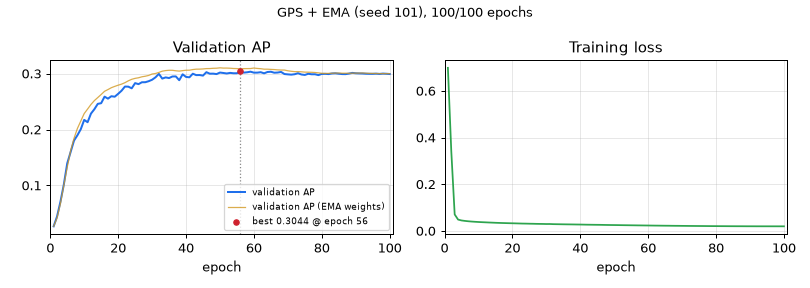

# GPS + EMA — seed 101

[← all models](../README.md) · PairHGT notebook · ogbg-molpcba

| | |
|---|---|
| State | **finished** |
| Epochs | 100 of 100 |
| Best validation AP | **0.3044** at epoch 56 |
| Best validation AP, EMA weights | 0.3103 at epoch 50 |
| Test AP | raw 0.2900 / ema 0.2995 (final) |
| Seed | 101 |
| Parameters | 9,744,860 |
| Minutes per epoch (last 5, incl. validation) | 3.0 |
| Training time so far | 4.9 h |
| Training time left | done |
| Sessions (start + resumes) | 1 |
| Hottest GPU reading | 92.0 °C |
| Last update | 2026-11-10 18:33 (95.6 h ago) |



<details><summary>Settings of this run</summary>

| Setting | Value |
|---|---|
| Epochs (warm-up) | 100 (5) |
| Batch size | 512 |
| Learning rate, weight decay | 0.0005, 1e-05 |
| Layers × width, heads | 5 × 384, 4 |
| Dropout, attention dropout | 0.2, 0.5 |
| Pair channel | no pair channel |
| Precision | fp32 (TF32 matrix products) |
| EMA decay | 0.9995 |
| Gradient clip | 1.0 |
| Protocol | v2_test_once |
| Notebook version, config hash | pairhgt-confirmatory-v2.0, 03eeeb0655c2d504 |

</details>

## Final test (evaluated once)

| Weights | Epoch | Validation AP | Test AP |
|---|---|---|---|
| raw | 56 | 0.3044 | 0.2900 |
| ema | 50 | 0.3103 | 0.2995 |

## Every epoch (newest first)

| Epoch | Train loss | Val AP | Val AP (EMA weights) | Best so far | LR | Minutes |
|---|---|---|---|---|---|---|
| 100 | 0.0197 | 0.2993 | 0.3000 | 0.3044 (ep 56) | 1.37e-07 | 3.0 |
| 99 | 0.0197 | 0.2997 | 0.3000 | 0.3044 (ep 56) | 5.47e-07 | 3.0 |
| 98 | 0.0198 | 0.3000 | 0.3000 | 0.3044 (ep 56) | 1.23e-06 | 3.0 |
| 97 | 0.0198 | 0.2994 | 0.3000 | 0.3044 (ep 56) | 2.18e-06 | 3.0 |
| 96 | 0.0198 | 0.2999 | 0.3002 | 0.3044 (ep 56) | 3.41e-06 | 3.0 |
| 95 | 0.0198 | 0.2996 | 0.3003 | 0.3044 (ep 56) | 4.91e-06 | 3.0 |
| 94 | 0.0198 | 0.2996 | 0.3004 | 0.3044 (ep 56) | 6.67e-06 | 2.9 |
| 93 | 0.0199 | 0.2998 | 0.3007 | 0.3044 (ep 56) | 8.70e-06 | 3.0 |
| 92 | 0.0198 | 0.3002 | 0.3011 | 0.3044 (ep 56) | 1.10e-05 | 3.0 |
| 91 | 0.0199 | 0.3004 | 0.3009 | 0.3044 (ep 56) | 1.35e-05 | 3.0 |
| 90 | 0.0200 | 0.3006 | 0.3009 | 0.3044 (ep 56) | 1.64e-05 | 3.0 |
| 89 | 0.0200 | 0.3013 | 0.3008 | 0.3044 (ep 56) | 1.94e-05 | 3.0 |
| 88 | 0.0201 | 0.3000 | 0.3005 | 0.3044 (ep 56) | 2.27e-05 | 3.0 |
| 87 | 0.0201 | 0.2991 | 0.3007 | 0.3044 (ep 56) | 2.63e-05 | 3.0 |
| 86 | 0.0201 | 0.2992 | 0.3007 | 0.3044 (ep 56) | 3.01e-05 | 2.9 |
| 85 | 0.0202 | 0.2998 | 0.3010 | 0.3044 (ep 56) | 3.42e-05 | 3.0 |
| 84 | 0.0202 | 0.3006 | 0.3009 | 0.3044 (ep 56) | 3.85e-05 | 3.0 |
| 83 | 0.0203 | 0.3003 | 0.3007 | 0.3044 (ep 56) | 4.30e-05 | 3.0 |
| 82 | 0.0204 | 0.2991 | 0.3004 | 0.3044 (ep 56) | 4.77e-05 | 3.0 |
| 81 | 0.0205 | 0.2996 | 0.3002 | 0.3044 (ep 56) | 5.27e-05 | 3.0 |
| 80 | 0.0206 | 0.2994 | 0.3005 | 0.3044 (ep 56) | 5.79e-05 | 3.0 |
| 79 | 0.0206 | 0.2973 | 0.3013 | 0.3044 (ep 56) | 6.33e-05 | 3.0 |
| 78 | 0.0207 | 0.2988 | 0.3020 | 0.3044 (ep 56) | 6.89e-05 | 3.0 |
| 77 | 0.0209 | 0.2988 | 0.3023 | 0.3044 (ep 56) | 7.47e-05 | 3.0 |
| 76 | 0.0210 | 0.2997 | 0.3025 | 0.3044 (ep 56) | 8.07e-05 | 2.9 |
| 75 | 0.0211 | 0.2976 | 0.3027 | 0.3044 (ep 56) | 8.69e-05 | 3.0 |
| 74 | 0.0212 | 0.2984 | 0.3032 | 0.3044 (ep 56) | 9.32e-05 | 3.0 |
| 73 | 0.0213 | 0.3007 | 0.3036 | 0.3044 (ep 56) | 9.97e-05 | 3.0 |
| 72 | 0.0214 | 0.2989 | 0.3035 | 0.3044 (ep 56) | 1.06e-04 | 3.0 |
| 71 | 0.0216 | 0.2981 | 0.3042 | 0.3044 (ep 56) | 1.13e-04 | 3.0 |
| 70 | 0.0217 | 0.2986 | 0.3051 | 0.3044 (ep 56) | 1.20e-04 | 3.0 |
| 69 | 0.0219 | 0.2992 | 0.3063 | 0.3044 (ep 56) | 1.27e-04 | 2.9 |
| 68 | 0.0220 | 0.3030 | 0.3064 | 0.3044 (ep 56) | 1.35e-04 | 3.0 |
| 67 | 0.0221 | 0.3019 | 0.3067 | 0.3044 (ep 56) | 1.42e-04 | 3.0 |
| 66 | 0.0223 | 0.3016 | 0.3072 | 0.3044 (ep 56) | 1.50e-04 | 3.0 |
| 65 | 0.0224 | 0.3033 | 0.3075 | 0.3044 (ep 56) | 1.57e-04 | 3.0 |
| 64 | 0.0226 | 0.3029 | 0.3079 | 0.3044 (ep 56) | 1.65e-04 | 3.0 |
| 63 | 0.0227 | 0.3005 | 0.3079 | 0.3044 (ep 56) | 1.73e-04 | 3.0 |
| 62 | 0.0229 | 0.3025 | 0.3088 | 0.3044 (ep 56) | 1.81e-04 | 3.0 |
| 61 | 0.0231 | 0.3017 | 0.3092 | 0.3044 (ep 56) | 1.89e-04 | 3.0 |
| 60 | 0.0233 | 0.3017 | 0.3100 | 0.3044 (ep 56) | 1.97e-04 | 3.0 |
| 59 | 0.0234 | 0.3034 | 0.3091 | 0.3044 (ep 56) | 2.05e-04 | 3.0 |
| 58 | 0.0236 | 0.3024 | 0.3090 | 0.3044 (ep 56) | 2.13e-04 | 3.0 |
| 57 | 0.0238 | 0.3018 | 0.3089 | 0.3044 (ep 56) | 2.21e-04 | 3.0 |
| 56 | 0.0240 | 0.3044 ⭐ | 0.3086 | 0.3044 (ep 56) | 2.29e-04 | 3.0 |
| 55 | 0.0242 | 0.3006 | 0.3090 | 0.3026 (ep 46) | 2.38e-04 | 3.0 |
| 54 | 0.0244 | 0.3006 | 0.3092 | 0.3026 (ep 46) | 2.46e-04 | 3.0 |
| 53 | 0.0245 | 0.3013 | 0.3096 | 0.3026 (ep 46) | 2.54e-04 | 3.0 |
| 52 | 0.0247 | 0.3002 | 0.3099 | 0.3026 (ep 46) | 2.62e-04 | 2.9 |
| 51 | 0.0250 | 0.3011 | 0.3099 | 0.3026 (ep 46) | 2.71e-04 | 3.0 |
| 50 | 0.0252 | 0.3019 | 0.3103 | 0.3026 (ep 46) | 2.79e-04 | 2.9 |
| 49 | 0.0253 | 0.2992 | 0.3097 | 0.3026 (ep 46) | 2.87e-04 | 3.0 |
| 48 | 0.0255 | 0.2999 | 0.3095 | 0.3026 (ep 46) | 2.95e-04 | 3.0 |
| 47 | 0.0258 | 0.2999 | 0.3090 | 0.3026 (ep 46) | 3.03e-04 | 3.5 |
| 46 | 0.0261 | 0.3026 ⭐ | 0.3090 | 0.3026 (ep 46) | 3.11e-04 | 3.0 |
| 45 | 0.0262 | 0.2965 | 0.3083 | 0.2998 (ep 42) | 3.19e-04 | 2.9 |
| 44 | 0.0264 | 0.2975 | 0.3080 | 0.2998 (ep 42) | 3.27e-04 | 2.9 |
| 43 | 0.0266 | 0.2973 | 0.3079 | 0.2998 (ep 42) | 3.35e-04 | 3.0 |
| 42 | 0.0268 | 0.2998 ⭐ | 0.3072 | 0.2998 (ep 42) | 3.43e-04 | 3.0 |
| 41 | 0.0271 | 0.2934 | 0.3061 | 0.2995 (ep 32) | 3.50e-04 | 2.9 |
| 40 | 0.0274 | 0.2941 | 0.3060 | 0.2995 (ep 32) | 3.58e-04 | 3.0 |
| 39 | 0.0275 | 0.2988 | 0.3053 | 0.2995 (ep 32) | 3.65e-04 | 2.9 |
| 38 | 0.0278 | 0.2882 | 0.3045 | 0.2995 (ep 32) | 3.73e-04 | 2.9 |
| 37 | 0.0280 | 0.2950 | 0.3051 | 0.2995 (ep 32) | 3.80e-04 | 2.9 |
| 36 | 0.0282 | 0.2949 | 0.3059 | 0.2995 (ep 32) | 3.87e-04 | 2.9 |
| 35 | 0.0284 | 0.2921 | 0.3060 | 0.2995 (ep 32) | 3.94e-04 | 2.9 |
| 34 | 0.0286 | 0.2932 | 0.3054 | 0.2995 (ep 32) | 4.00e-04 | 2.9 |
| 33 | 0.0288 | 0.2911 | 0.3044 | 0.2995 (ep 32) | 4.07e-04 | 2.9 |
| 32 | 0.0291 | 0.2995 ⭐ | 0.3021 | 0.2995 (ep 32) | 4.13e-04 | 2.9 |
| 31 | 0.0297 | 0.2933 ⭐ | 0.3002 | 0.2933 (ep 31) | 4.19e-04 | 2.9 |
| 30 | 0.0296 | 0.2890 ⭐ | 0.2993 | 0.2890 (ep 30) | 4.25e-04 | 2.9 |
| 29 | 0.0299 | 0.2864 ⭐ | 0.2967 | 0.2864 (ep 29) | 4.31e-04 | 2.9 |
| 28 | 0.0301 | 0.2846 ⭐ | 0.2953 | 0.2846 (ep 28) | 4.37e-04 | 2.9 |
| 27 | 0.0304 | 0.2845 ⭐ | 0.2943 | 0.2845 (ep 27) | 4.42e-04 | 2.9 |
| 26 | 0.0308 | 0.2812 | 0.2925 | 0.2830 (ep 25) | 4.47e-04 | 2.9 |
| 25 | 0.0310 | 0.2830 ⭐ | 0.2915 | 0.2830 (ep 25) | 4.52e-04 | 2.9 |
| 24 | 0.0313 | 0.2737 | 0.2898 | 0.2769 (ep 22) | 4.57e-04 | 2.9 |
| 23 | 0.0316 | 0.2767 | 0.2871 | 0.2769 (ep 22) | 4.62e-04 | 2.9 |
| 22 | 0.0319 | 0.2769 ⭐ | 0.2837 | 0.2769 (ep 22) | 4.66e-04 | 2.9 |
| 21 | 0.0324 | 0.2694 ⭐ | 0.2812 | 0.2694 (ep 21) | 4.70e-04 | 2.9 |
| 20 | 0.0328 | 0.2639 ⭐ | 0.2793 | 0.2639 (ep 20) | 4.74e-04 | 2.9 |
| 19 | 0.0331 | 0.2587 | 0.2772 | 0.2596 (ep 18) | 4.77e-04 | 2.9 |
| 18 | 0.0335 | 0.2596 ⭐ | 0.2748 | 0.2596 (ep 18) | 4.81e-04 | 2.9 |
| 17 | 0.0339 | 0.2553 | 0.2715 | 0.2588 (ep 16) | 4.84e-04 | 2.9 |
| 16 | 0.0344 | 0.2588 ⭐ | 0.2684 | 0.2588 (ep 16) | 4.86e-04 | 2.9 |
| 15 | 0.0349 | 0.2471 ⭐ | 0.2627 | 0.2471 (ep 15) | 4.89e-04 | 2.9 |
| 14 | 0.0356 | 0.2459 ⭐ | 0.2572 | 0.2459 (ep 14) | 4.91e-04 | 2.9 |
| 13 | 0.0362 | 0.2364 ⭐ | 0.2517 | 0.2364 (ep 13) | 4.93e-04 | 2.9 |
| 12 | 0.0369 | 0.2286 ⭐ | 0.2449 | 0.2286 (ep 12) | 4.95e-04 | 2.9 |
| 11 | 0.0375 | 0.2131 | 0.2366 | 0.2173 (ep 10) | 4.97e-04 | 2.9 |
| 10 | 0.0383 | 0.2173 ⭐ | 0.2286 | 0.2173 (ep 10) | 4.98e-04 | 2.9 |
| 9 | 0.0392 | 0.2007 ⭐ | 0.2153 | 0.2007 (ep 9) | 4.99e-04 | 2.9 |
| 8 | 0.0402 | 0.1897 ⭐ | 0.2019 | 0.1897 (ep 8) | 4.99e-04 | 2.9 |
| 7 | 0.0414 | 0.1803 ⭐ | 0.1843 | 0.1803 (ep 7) | 5.00e-04 | 2.9 |
| 6 | 0.0430 | 0.1598 ⭐ | 0.1618 | 0.1598 (ep 6) | 5.00e-04 | 2.9 |
| 5 | 0.0449 | 0.1395 ⭐ | 0.1326 | 0.1395 (ep 5) | 4.00e-04 | 2.9 |
| 4 | 0.0486 | 0.1017 ⭐ | 0.1003 | 0.1017 (ep 4) | 3.00e-04 | 2.9 |
| 3 | 0.0706 | 0.0709 ⭐ | 0.0676 | 0.0709 (ep 3) | 2.00e-04 | 2.9 |
| 2 | 0.3416 | 0.0445 ⭐ | 0.0419 | 0.0445 (ep 2) | 1.00e-04 | 3.0 |
| 1 | 0.6988 | 0.0270 ⭐ | 0.0270 | 0.0270 (ep 1) | 5.00e-10 | 2.9 |

## Last 80 log lines

_The log counts epochs from 0; the tables above count from 1._

```
[seed 101] epoch  42/100 | lr 3.43e-04 | train BCE 0.0268 | val AP 0.2998 | best val 0.2998 @ep42 | EMA val 0.3072 | 179s (train 162s, eval 17s) | GPU max 91C | ETA<= 2.9h
[seed 101] epoch  43/100 | lr 3.35e-04 | train BCE 0.0266 | val AP 0.2973 | best val 0.2998 @ep42 | EMA val 0.3079 | 179s (train 162s, eval 17s) | GPU max 91C | ETA<= 2.8h
[seed 101] epoch  44/100 | lr 3.27e-04 | train BCE 0.0264 | val AP 0.2975 | best val 0.2998 @ep42 | EMA val 0.3080 | 175s (train 159s, eval 16s) | GPU max 91C | ETA<= 2.8h
[seed 101] epoch  45/100 | lr 3.19e-04 | train BCE 0.0262 | val AP 0.2965 | best val 0.2998 @ep42 | EMA val 0.3083 | 175s (train 159s, eval 16s) | GPU max 91C | ETA<= 2.7h
[seed 101] epoch  46/100 | lr 3.11e-04 | train BCE 0.0261 | val AP 0.3026 | best val 0.3026 @ep46 | EMA val 0.3090 | 183s (train 164s, eval 19s) | GPU max 91C | ETA<= 2.6h
[seed 101] epoch  47/100 | lr 3.03e-04 | train BCE 0.0258 | val AP 0.2999 | best val 0.3026 @ep46 | EMA val 0.3090 | 211s (train 192s, eval 20s) | GPU max 91C | ETA<= 2.7h
[seed 101] epoch  48/100 | lr 2.95e-04 | train BCE 0.0255 | val AP 0.2999 | best val 0.3026 @ep46 | EMA val 0.3095 | 177s (train 160s, eval 17s) | GPU max 92C | ETA<= 2.6h
[seed 101] epoch  49/100 | lr 2.87e-04 | train BCE 0.0253 | val AP 0.2992 | best val 0.3026 @ep46 | EMA val 0.3097 | 179s (train 161s, eval 17s) | GPU max 91C | ETA<= 2.5h
[seed 101] epoch  50/100 | lr 2.79e-04 | train BCE 0.0252 | val AP 0.3019 | best val 0.3026 @ep46 | EMA val 0.3103 | 176s (train 160s, eval 16s) | GPU max 91C | ETA<= 2.5h
[seed 101] epoch  51/100 | lr 2.71e-04 | train BCE 0.0250 | val AP 0.3011 | best val 0.3026 @ep46 | EMA val 0.3099 | 179s (train 161s, eval 17s) | GPU max 91C | ETA<= 2.4h
[seed 101] epoch  52/100 | lr 2.62e-04 | train BCE 0.0247 | val AP 0.3002 | best val 0.3026 @ep46 | EMA val 0.3099 | 174s (train 158s, eval 16s) | GPU max 91C | ETA<= 2.3h
[seed 101] epoch  53/100 | lr 2.54e-04 | train BCE 0.0245 | val AP 0.3013 | best val 0.3026 @ep46 | EMA val 0.3096 | 179s (train 161s, eval 18s) | GPU max 91C | ETA<= 2.3h
[seed 101] epoch  54/100 | lr 2.46e-04 | train BCE 0.0244 | val AP 0.3006 | best val 0.3026 @ep46 | EMA val 0.3092 | 182s (train 164s, eval 18s) | GPU max 86C | ETA<= 2.3h
[seed 101] epoch  55/100 | lr 2.38e-04 | train BCE 0.0242 | val AP 0.3006 | best val 0.3026 @ep46 | EMA val 0.3090 | 181s (train 164s, eval 17s) | GPU max 87C | ETA<= 2.3h
[seed 101] epoch  56/100 | lr 2.29e-04 | train BCE 0.0240 | val AP 0.3044 | best val 0.3044 @ep56 | EMA val 0.3086 | 181s (train 163s, eval 18s) | GPU max 87C | ETA<= 2.2h
[seed 101] epoch  57/100 | lr 2.21e-04 | train BCE 0.0238 | val AP 0.3018 | best val 0.3044 @ep56 | EMA val 0.3089 | 181s (train 164s, eval 17s) | GPU max 86C | ETA<= 2.2h
[seed 101] epoch  58/100 | lr 2.13e-04 | train BCE 0.0236 | val AP 0.3024 | best val 0.3044 @ep56 | EMA val 0.3090 | 182s (train 164s, eval 18s) | GPU max 86C | ETA<= 2.1h
[seed 101] epoch  59/100 | lr 2.05e-04 | train BCE 0.0234 | val AP 0.3034 | best val 0.3044 @ep56 | EMA val 0.3091 | 180s (train 164s, eval 16s) | GPU max 87C | ETA<= 2.1h
[seed 101] epoch  60/100 | lr 1.97e-04 | train BCE 0.0233 | val AP 0.3017 | best val 0.3044 @ep56 | EMA val 0.3100 | 180s (train 163s, eval 17s) | GPU max 88C | ETA<= 2.0h
[seed 101] epoch  61/100 | lr 1.89e-04 | train BCE 0.0231 | val AP 0.3017 | best val 0.3044 @ep56 | EMA val 0.3092 | 179s (train 162s, eval 16s) | GPU max 87C | ETA<= 1.9h
[seed 101] epoch  62/100 | lr 1.81e-04 | train BCE 0.0229 | val AP 0.3025 | best val 0.3044 @ep56 | EMA val 0.3088 | 180s (train 162s, eval 18s) | GPU max 87C | ETA<= 1.9h
[seed 101] epoch  63/100 | lr 1.73e-04 | train BCE 0.0227 | val AP 0.3005 | best val 0.3044 @ep56 | EMA val 0.3079 | 179s (train 163s, eval 17s) | GPU max 88C | ETA<= 1.8h
[seed 101] epoch  64/100 | lr 1.65e-04 | train BCE 0.0226 | val AP 0.3029 | best val 0.3044 @ep56 | EMA val 0.3079 | 179s (train 161s, eval 17s) | GPU max 86C | ETA<= 1.8h
[seed 101] epoch  65/100 | lr 1.57e-04 | train BCE 0.0224 | val AP 0.3033 | best val 0.3044 @ep56 | EMA val 0.3075 | 181s (train 162s, eval 19s) | GPU max 86C | ETA<= 1.7h
[seed 101] epoch  66/100 | lr 1.50e-04 | train BCE 0.0223 | val AP 0.3016 | best val 0.3044 @ep56 | EMA val 0.3072 | 181s (train 163s, eval 17s) | GPU max 87C | ETA<= 1.7h
[seed 101] epoch  67/100 | lr 1.42e-04 | train BCE 0.0221 | val AP 0.3019 | best val 0.3044 @ep56 | EMA val 0.3067 | 179s (train 161s, eval 18s) | GPU max 87C | ETA<= 1.7h
[seed 101] epoch  68/100 | lr 1.35e-04 | train BCE 0.0220 | val AP 0.3030 | best val 0.3044 @ep56 | EMA val 0.3064 | 181s (train 163s, eval 18s) | GPU max 88C | ETA<= 1.6h
[seed 101] epoch  69/100 | lr 1.27e-04 | train BCE 0.0219 | val AP 0.2992 | best val 0.3044 @ep56 | EMA val 0.3063 | 176s (train 161s, eval 16s) | GPU max 88C | ETA<= 1.5h
[seed 101] epoch  70/100 | lr 1.20e-04 | train BCE 0.0217 | val AP 0.2986 | best val 0.3044 @ep56 | EMA val 0.3051 | 181s (train 163s, eval 17s) | GPU max 88C | ETA<= 1.5h
[seed 101] epoch  71/100 | lr 1.13e-04 | train BCE 0.0216 | val AP 0.2981 | best val 0.3044 @ep56 | EMA val 0.3042 | 178s (train 162s, eval 16s) | GPU max 87C | ETA<= 1.4h
[seed 101] epoch  72/100 | lr 1.06e-04 | train BCE 0.0214 | val AP 0.2989 | best val 0.3044 @ep56 | EMA val 0.3035 | 178s (train 161s, eval 17s) | GPU max 88C | ETA<= 1.4h
[seed 101] epoch  73/100 | lr 9.97e-05 | train BCE 0.0213 | val AP 0.3007 | best val 0.3044 @ep56 | EMA val 0.3036 | 180s (train 163s, eval 17s) | GPU max 89C | ETA<= 1.3h
[seed 101] epoch  74/100 | lr 9.32e-05 | train BCE 0.0212 | val AP 0.2984 | best val 0.3044 @ep56 | EMA val 0.3032 | 179s (train 163s, eval 16s) | GPU max 87C | ETA<= 1.3h
[seed 101] epoch  75/100 | lr 8.69e-05 | train BCE 0.0211 | val AP 0.2976 | best val 0.3044 @ep56 | EMA val 0.3027 | 179s (train 162s, eval 17s) | GPU max 86C | ETA<= 1.2h
[seed 101] epoch  76/100 | lr 8.07e-05 | train BCE 0.0210 | val AP 0.2997 | best val 0.3044 @ep56 | EMA val 0.3025 | 176s (train 160s, eval 16s) | GPU max 87C | ETA<= 1.2h
[seed 101] epoch  77/100 | lr 7.47e-05 | train BCE 0.0209 | val AP 0.2988 | best val 0.3044 @ep56 | EMA val 0.3023 | 178s (train 162s, eval 16s) | GPU max 87C | ETA<= 1.1h
[seed 101] epoch  78/100 | lr 6.89e-05 | train BCE 0.0207 | val AP 0.2988 | best val 0.3044 @ep56 | EMA val 0.3020 | 178s (train 161s, eval 17s) | GPU max 88C | ETA<= 1.1h
[seed 101] epoch  79/100 | lr 6.33e-05 | train BCE 0.0206 | val AP 0.2973 | best val 0.3044 @ep56 | EMA val 0.3013 | 177s (train 161s, eval 17s) | GPU max 87C | ETA<= 1.0h
[seed 101] epoch  80/100 | lr 5.79e-05 | train BCE 0.0206 | val AP 0.2994 | best val 0.3044 @ep56 | EMA val 0.3005 | 180s (train 162s, eval 18s) | GPU max 87C | ETA<= 1.0h
[seed 101] epoch  81/100 | lr 5.27e-05 | train BCE 0.0205 | val AP 0.2996 | best val 0.3044 @ep56 | EMA val 0.3002 | 178s (train 161s, eval 17s) | GPU max 87C | ETA<= 0.9h
[seed 101] epoch  82/100 | lr 4.77e-05 | train BCE 0.0204 | val AP 0.2991 | best val 0.3044 @ep56 | EMA val 0.3004 | 179s (train 162s, eval 18s) | GPU max 87C | ETA<= 0.9h
[seed 101] epoch  83/100 | lr 4.30e-05 | train BCE 0.0203 | val AP 0.3003 | best val 0.3044 @ep56 | EMA val 0.3007 | 178s (train 161s, eval 16s) | GPU max 88C | ETA<= 0.8h
[seed 101] epoch  84/100 | lr 3.85e-05 | train BCE 0.0202 | val AP 0.3006 | best val 0.3044 @ep56 | EMA val 0.3009 | 178s (train 161s, eval 17s) | GPU max 88C | ETA<= 0.8h
[seed 101] epoch  85/100 | lr 3.42e-05 | train BCE 0.0202 | val AP 0.2998 | best val 0.3044 @ep56 | EMA val 0.3010 | 178s (train 160s, eval 18s) | GPU max 87C | ETA<= 0.7h
[seed 101] epoch  86/100 | lr 3.01e-05 | train BCE 0.0201 | val AP 0.2992 | best val 0.3044 @ep56 | EMA val 0.3007 | 177s (train 161s, eval 16s) | GPU max 87C | ETA<= 0.7h
[seed 101] epoch  87/100 | lr 2.63e-05 | train BCE 0.0201 | val AP 0.2991 | best val 0.3044 @ep56 | EMA val 0.3007 | 177s (train 161s, eval 16s) | GPU max 87C | ETA<= 0.6h
[seed 101] epoch  88/100 | lr 2.27e-05 | train BCE 0.0201 | val AP 0.3000 | best val 0.3044 @ep56 | EMA val 0.3005 | 181s (train 164s, eval 17s) | GPU max 87C | ETA<= 0.6h
[seed 101] epoch  89/100 | lr 1.94e-05 | train BCE 0.0200 | val AP 0.3013 | best val 0.3044 @ep56 | EMA val 0.3008 | 180s (train 163s, eval 18s) | GPU max 87C | ETA<= 0.6h
[seed 101] epoch  90/100 | lr 1.64e-05 | train BCE 0.0200 | val AP 0.3006 | best val 0.3044 @ep56 | EMA val 0.3009 | 178s (train 162s, eval 16s) | GPU max 88C | ETA<= 0.5h
[seed 101] epoch  91/100 | lr 1.35e-05 | train BCE 0.0199 | val AP 0.3004 | best val 0.3044 @ep56 | EMA val 0.3009 | 181s (train 162s, eval 18s) | GPU max 89C | ETA<= 0.5h
[seed 101] epoch  92/100 | lr 1.10e-05 | train BCE 0.0198 | val AP 0.3002 | best val 0.3044 @ep56 | EMA val 0.3011 | 181s (train 165s, eval 16s) | GPU max 87C | ETA<= 0.4h
[seed 101] epoch  93/100 | lr 8.70e-06 | train BCE 0.0199 | val AP 0.2998 | best val 0.3044 @ep56 | EMA val 0.3007 | 179s (train 163s, eval 17s) | GPU max 87C | ETA<= 0.4h
[seed 101] epoch  94/100 | lr 6.67e-06 | train BCE 0.0198 | val AP 0.2996 | best val 0.3044 @ep56 | EMA val 0.3004 | 177s (train 161s, eval 16s) | GPU max 87C | ETA<= 0.3h
[seed 101] epoch  95/100 | lr 4.91e-06 | train BCE 0.0198 | val AP 0.2996 | best val 0.3044 @ep56 | EMA val 0.3003 | 180s (train 162s, eval 18s) | GPU max 87C | ETA<= 0.2h
[seed 101] epoch  96/100 | lr 3.41e-06 | train BCE 0.0198 | val AP 0.2999 | best val 0.3044 @ep56 | EMA val 0.3002 | 178s (train 162s, eval 16s) | GPU max 87C | ETA<= 0.2h
[seed 101] epoch  97/100 | lr 2.18e-06 | train BCE 0.0198 | val AP 0.2994 | best val 0.3044 @ep56 | EMA val 0.3000 | 179s (train 163s, eval 17s) | GPU max 88C | ETA<= 0.1h
[seed 101] epoch  98/100 | lr 1.23e-06 | train BCE 0.0198 | val AP 0.3000 | best val 0.3044 @ep56 | EMA val 0.3000 | 179s (train 162s, eval 16s) | GPU max 87C | ETA<= 0.1h
[seed 101] epoch  99/100 | lr 5.47e-07 | train BCE 0.0197 | val AP 0.2997 | best val 0.3044 @ep56 | EMA val 0.3000 | 181s (train 163s, eval 17s) | GPU max 87C | ETA<= 0.0h
[seed 101] epoch 100/100 | lr 1.37e-07 | train BCE 0.0197 | val AP 0.2993 | best val 0.3044 @ep56 | EMA val 0.3000 | 178s (train 162s, eval 16s) | GPU max 87C | ETA<= 0.0h
[seed 101] FINAL TEST (evaluated once): raw epoch 56 val 0.3044 test 0.2900 | EMA epoch 50 val 0.3103 test 0.2995
--- cell 16 ---
GPS (plain) + EMA [arm GPS_ema] | gps_conf_GPS_ema_ep100_molpcba
 seed  epochs  raw_epoch  raw_val  raw_test  ema_epoch  ema_val  ema_test  hours  train_s_per_epoch  total_s_per_epoch
  101 100/100         56   0.3044      0.29         50   0.3103    0.2995 4.9304           160.8465           177.4936
mean ± sample SD (ddof=1) over 1 seed(s): raw test 0.2900 ± nan | EMA test 0.2995 ± nan
A mean ± SD over fewer than 3 seeds is only a description; do not call it a confidence interval.
/tmp/ipykernel_20616/1726116603.py:55: UserWarning: No artists with labels found to put in legend.  Note that artists whose label start with an underscore are ignored when legend() is called with no argument.
  ax.set(title=f"seed {s} (circle = selected raw, square = selected EMA)", xlabel="epoch", ylabel="validation AP"); ax.grid(alpha=0.25); ax.legend(fontsize=7)
run manifest: 1 row(s) -> /home/student/thesis/outputs/pairhgt/outputs/confirmatory/run_manifest.csv
    model              gpu  seeds  params  train_s_per_epoch  val_eval_s_per_epoch  total_s_per_epoch  hours_per_seed  time_vs_GPS+EMA
GPS + EMA NVIDIA RTX A4000      1 9744860             160.85                 16.63             177.49            4.93              1.0
train = training steps incl. EMA update; val_eval = validation of raw + EMA weights; no test pass inside an epoch (protocol v2). Do not compare with timings from the exploratory runs.
--- cell 18 ---
=== PairHGT  minus  GPS + EMA   (100 epochs, matched seeds) ===
  no matched finished seeds with a final test result yet
Planning table (80% power, alpha 0.05, two-sample t, test AP): smallest detectable true difference
  per-seed SD 0.003: n=3: 0.0092, n=5: 0.0061, n=10: 0.0040, n=20: 0.0027
  per-seed SD 0.0056: n=3: 0.0172, n=5: 0.0113, n=10: 0.0074, n=20: 0.0051
--- cell 20 ---
===== 2026-11-10 18:33:54 notebook turn ended (exit 0); executed notebook: /home/student/thesis/outputs/lab_runs/notebooks/pairhgt_GPS_ema_seed101_20261110-1336.ipynb =====
```
