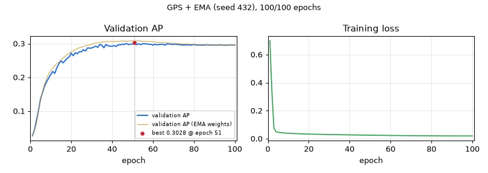

# GPS + EMA — seed 432

[← all models](../README.md) · PairHGT notebook · ogbg-molpcba

| | |
|---|---|
| State | **finished** |
| Epochs | 100 of 100 |
| Best validation AP | **0.3028** at epoch 51 |
| Best validation AP, EMA weights | 0.3083 at epoch 50 |
| Test AP | raw 0.2916 / ema 0.2998 (final) |
| Seed | 432 |
| Parameters | 9,744,860 |
| Minutes per epoch (last 5, incl. validation) | 2.9 |
| Training time so far | 4.9 h |
| Training time left | done |
| Sessions (start + resumes) | 1 |
| Hottest GPU reading | 89.0 °C |
| Last update | 2026-11-12 19:24 (46.7 h ago) |



<details><summary>Settings of this run</summary>

| Setting | Value |
|---|---|
| Epochs (warm-up) | 100 (5) |
| Batch size | 512 |
| Learning rate, weight decay | 0.0005, 1e-05 |
| Layers × width, heads | 5 × 384, 4 |
| Dropout, attention dropout | 0.2, 0.5 |
| Pair channel | no pair channel |
| Precision | fp32 (TF32 matrix products) |
| EMA decay | 0.9995 |
| Gradient clip | 1.0 |
| Protocol | v2_test_once |
| Notebook version, config hash | pairhgt-confirmatory-v2.0, 03eeeb0655c2d504 |

</details>

## Final test (evaluated once)

| Weights | Epoch | Validation AP | Test AP |
|---|---|---|---|
| raw | 51 | 0.3028 | 0.2916 |
| ema | 50 | 0.3083 | 0.2998 |

## Every epoch (newest first)

| Epoch | Train loss | Val AP | Val AP (EMA weights) | Best so far | LR | Minutes |
|---|---|---|---|---|---|---|
| 100 | 0.0193 | 0.2956 | 0.2955 | 0.3028 (ep 51) | 1.37e-07 | 2.9 |
| 99 | 0.0193 | 0.2954 | 0.2955 | 0.3028 (ep 51) | 5.47e-07 | 2.9 |
| 98 | 0.0193 | 0.2959 | 0.2955 | 0.3028 (ep 51) | 1.23e-06 | 2.9 |
| 97 | 0.0193 | 0.2957 | 0.2957 | 0.3028 (ep 51) | 2.18e-06 | 2.9 |
| 96 | 0.0193 | 0.2946 | 0.2958 | 0.3028 (ep 51) | 3.41e-06 | 2.9 |
| 95 | 0.0193 | 0.2956 | 0.2959 | 0.3028 (ep 51) | 4.91e-06 | 2.9 |
| 94 | 0.0194 | 0.2955 | 0.2959 | 0.3028 (ep 51) | 6.67e-06 | 2.9 |
| 93 | 0.0194 | 0.2961 | 0.2957 | 0.3028 (ep 51) | 8.70e-06 | 2.9 |
| 92 | 0.0194 | 0.2956 | 0.2956 | 0.3028 (ep 51) | 1.10e-05 | 2.9 |
| 91 | 0.0194 | 0.2951 | 0.2957 | 0.3028 (ep 51) | 1.35e-05 | 2.9 |
| 90 | 0.0195 | 0.2961 | 0.2961 | 0.3028 (ep 51) | 1.64e-05 | 2.9 |
| 89 | 0.0195 | 0.2952 | 0.2963 | 0.3028 (ep 51) | 1.94e-05 | 2.9 |
| 88 | 0.0196 | 0.2956 | 0.2966 | 0.3028 (ep 51) | 2.27e-05 | 2.9 |
| 87 | 0.0196 | 0.2960 | 0.2968 | 0.3028 (ep 51) | 2.63e-05 | 2.9 |
| 86 | 0.0197 | 0.2966 | 0.2965 | 0.3028 (ep 51) | 3.01e-05 | 2.9 |
| 85 | 0.0197 | 0.2951 | 0.2970 | 0.3028 (ep 51) | 3.42e-05 | 2.9 |
| 84 | 0.0198 | 0.2956 | 0.2969 | 0.3028 (ep 51) | 3.85e-05 | 2.9 |
| 83 | 0.0199 | 0.2956 | 0.2970 | 0.3028 (ep 51) | 4.30e-05 | 2.9 |
| 82 | 0.0199 | 0.2958 | 0.2969 | 0.3028 (ep 51) | 4.77e-05 | 2.9 |
| 81 | 0.0200 | 0.2957 | 0.2971 | 0.3028 (ep 51) | 5.27e-05 | 2.9 |
| 80 | 0.0201 | 0.2972 | 0.2975 | 0.3028 (ep 51) | 5.79e-05 | 2.9 |
| 79 | 0.0202 | 0.2955 | 0.2974 | 0.3028 (ep 51) | 6.33e-05 | 2.9 |
| 78 | 0.0203 | 0.2959 | 0.2981 | 0.3028 (ep 51) | 6.89e-05 | 2.9 |
| 77 | 0.0204 | 0.2964 | 0.2986 | 0.3028 (ep 51) | 7.47e-05 | 2.9 |
| 76 | 0.0205 | 0.2959 | 0.2987 | 0.3028 (ep 51) | 8.07e-05 | 2.9 |
| 75 | 0.0206 | 0.2961 | 0.2987 | 0.3028 (ep 51) | 8.69e-05 | 2.9 |
| 74 | 0.0208 | 0.2957 | 0.2993 | 0.3028 (ep 51) | 9.32e-05 | 2.9 |
| 73 | 0.0209 | 0.2968 | 0.2997 | 0.3028 (ep 51) | 9.97e-05 | 2.9 |
| 72 | 0.0210 | 0.2974 | 0.2999 | 0.3028 (ep 51) | 1.06e-04 | 2.9 |
| 71 | 0.0211 | 0.2983 | 0.3005 | 0.3028 (ep 51) | 1.13e-04 | 2.9 |
| 70 | 0.0213 | 0.2976 | 0.3007 | 0.3028 (ep 51) | 1.20e-04 | 2.9 |
| 69 | 0.0214 | 0.2980 | 0.3011 | 0.3028 (ep 51) | 1.27e-04 | 2.9 |
| 68 | 0.0216 | 0.2983 | 0.3013 | 0.3028 (ep 51) | 1.35e-04 | 2.9 |
| 67 | 0.0217 | 0.2992 | 0.3020 | 0.3028 (ep 51) | 1.42e-04 | 3.0 |
| 66 | 0.0219 | 0.2956 | 0.3022 | 0.3028 (ep 51) | 1.50e-04 | 2.9 |
| 65 | 0.0220 | 0.2973 | 0.3028 | 0.3028 (ep 51) | 1.57e-04 | 2.9 |
| 64 | 0.0222 | 0.2979 | 0.3027 | 0.3028 (ep 51) | 1.65e-04 | 3.0 |
| 63 | 0.0223 | 0.2971 | 0.3030 | 0.3028 (ep 51) | 1.73e-04 | 2.9 |
| 62 | 0.0226 | 0.2961 | 0.3036 | 0.3028 (ep 51) | 1.81e-04 | 2.9 |
| 61 | 0.0227 | 0.2983 | 0.3048 | 0.3028 (ep 51) | 1.89e-04 | 2.9 |
| 60 | 0.0229 | 0.2955 | 0.3052 | 0.3028 (ep 51) | 1.97e-04 | 2.9 |
| 59 | 0.0231 | 0.2979 | 0.3055 | 0.3028 (ep 51) | 2.05e-04 | 2.9 |
| 58 | 0.0232 | 0.2976 | 0.3064 | 0.3028 (ep 51) | 2.13e-04 | 2.9 |
| 57 | 0.0234 | 0.2992 | 0.3065 | 0.3028 (ep 51) | 2.21e-04 | 2.9 |
| 56 | 0.0236 | 0.2991 | 0.3065 | 0.3028 (ep 51) | 2.29e-04 | 2.9 |
| 55 | 0.0238 | 0.2993 | 0.3070 | 0.3028 (ep 51) | 2.38e-04 | 2.9 |
| 54 | 0.0240 | 0.2968 | 0.3075 | 0.3028 (ep 51) | 2.46e-04 | 2.9 |
| 53 | 0.0242 | 0.2993 | 0.3083 | 0.3028 (ep 51) | 2.54e-04 | 2.9 |
| 52 | 0.0244 | 0.2965 | 0.3076 | 0.3028 (ep 51) | 2.62e-04 | 2.9 |
| 51 | 0.0246 | 0.3028 ⭐ | 0.3077 | 0.3028 (ep 51) | 2.71e-04 | 2.9 |
| 50 | 0.0248 | 0.2984 | 0.3083 | 0.3002 (ep 47) | 2.79e-04 | 2.9 |
| 49 | 0.0250 | 0.2980 | 0.3077 | 0.3002 (ep 47) | 2.87e-04 | 2.9 |
| 48 | 0.0253 | 0.2973 | 0.3074 | 0.3002 (ep 47) | 2.95e-04 | 2.9 |
| 47 | 0.0254 | 0.3002 ⭐ | 0.3069 | 0.3002 (ep 47) | 3.03e-04 | 2.9 |
| 46 | 0.0256 | 0.2971 | 0.3076 | 0.2983 (ep 45) | 3.11e-04 | 2.9 |
| 45 | 0.0259 | 0.2983 ⭐ | 0.3074 | 0.2983 (ep 45) | 3.19e-04 | 2.9 |
| 44 | 0.0261 | 0.2960 | 0.3072 | 0.2976 (ep 34) | 3.27e-04 | 2.9 |
| 43 | 0.0263 | 0.2964 | 0.3066 | 0.2976 (ep 34) | 3.35e-04 | 2.9 |
| 42 | 0.0265 | 0.2913 | 0.3068 | 0.2976 (ep 34) | 3.43e-04 | 2.9 |
| 41 | 0.0268 | 0.2936 | 0.3060 | 0.2976 (ep 34) | 3.50e-04 | 2.9 |
| 40 | 0.0270 | 0.2922 | 0.3065 | 0.2976 (ep 34) | 3.58e-04 | 2.9 |
| 39 | 0.0272 | 0.2925 | 0.3064 | 0.2976 (ep 34) | 3.65e-04 | 2.9 |
| 38 | 0.0275 | 0.2932 | 0.3060 | 0.2976 (ep 34) | 3.73e-04 | 2.9 |
| 37 | 0.0277 | 0.2974 | 0.3051 | 0.2976 (ep 34) | 3.80e-04 | 2.9 |
| 36 | 0.0280 | 0.2875 | 0.3052 | 0.2976 (ep 34) | 3.87e-04 | 2.9 |
| 35 | 0.0281 | 0.2951 | 0.3039 | 0.2976 (ep 34) | 3.94e-04 | 2.9 |
| 34 | 0.0284 | 0.2976 ⭐ | 0.3033 | 0.2976 (ep 34) | 4.00e-04 | 2.9 |
| 33 | 0.0287 | 0.2888 | 0.3022 | 0.2924 (ep 32) | 4.07e-04 | 2.9 |
| 32 | 0.0288 | 0.2924 ⭐ | 0.3018 | 0.2924 (ep 32) | 4.13e-04 | 2.9 |
| 31 | 0.0291 | 0.2893 ⭐ | 0.2999 | 0.2893 (ep 31) | 4.19e-04 | 2.9 |
| 30 | 0.0294 | 0.2868 | 0.2981 | 0.2870 (ep 28) | 4.25e-04 | 2.9 |
| 29 | 0.0298 | 0.2864 | 0.2957 | 0.2870 (ep 28) | 4.31e-04 | 2.9 |
| 28 | 0.0300 | 0.2870 ⭐ | 0.2943 | 0.2870 (ep 28) | 4.37e-04 | 2.9 |
| 27 | 0.0303 | 0.2779 | 0.2930 | 0.2819 (ep 26) | 4.42e-04 | 2.9 |
| 26 | 0.0306 | 0.2819 ⭐ | 0.2914 | 0.2819 (ep 26) | 4.47e-04 | 2.9 |
| 25 | 0.0309 | 0.2757 | 0.2895 | 0.2759 (ep 24) | 4.52e-04 | 2.9 |
| 24 | 0.0312 | 0.2759 ⭐ | 0.2873 | 0.2759 (ep 24) | 4.57e-04 | 2.9 |
| 23 | 0.0316 | 0.2698 | 0.2850 | 0.2730 (ep 22) | 4.62e-04 | 2.9 |
| 22 | 0.0319 | 0.2730 ⭐ | 0.2818 | 0.2730 (ep 22) | 4.66e-04 | 2.9 |
| 21 | 0.0323 | 0.2640 | 0.2783 | 0.2716 (ep 20) | 4.70e-04 | 2.9 |
| 20 | 0.0328 | 0.2716 ⭐ | 0.2755 | 0.2716 (ep 20) | 4.74e-04 | 2.9 |
| 19 | 0.0332 | 0.2602 ⭐ | 0.2712 | 0.2602 (ep 19) | 4.77e-04 | 2.9 |
| 18 | 0.0336 | 0.2565 ⭐ | 0.2670 | 0.2565 (ep 18) | 4.81e-04 | 2.9 |
| 17 | 0.0341 | 0.2491 | 0.2615 | 0.2493 (ep 15) | 4.84e-04 | 2.9 |
| 16 | 0.0347 | 0.2427 | 0.2569 | 0.2493 (ep 15) | 4.86e-04 | 2.9 |
| 15 | 0.0351 | 0.2493 ⭐ | 0.2505 | 0.2493 (ep 15) | 4.89e-04 | 2.9 |
| 14 | 0.0357 | 0.2400 ⭐ | 0.2450 | 0.2400 (ep 14) | 4.91e-04 | 2.9 |
| 13 | 0.0364 | 0.2289 ⭐ | 0.2406 | 0.2289 (ep 13) | 4.93e-04 | 2.9 |
| 12 | 0.0370 | 0.2116 | 0.2345 | 0.2174 (ep 11) | 4.95e-04 | 2.9 |
| 11 | 0.0377 | 0.2174 ⭐ | 0.2263 | 0.2174 (ep 11) | 4.97e-04 | 2.9 |
| 10 | 0.0385 | 0.2086 ⭐ | 0.2188 | 0.2086 (ep 10) | 4.98e-04 | 2.9 |
| 9 | 0.0394 | 0.1975 ⭐ | 0.2105 | 0.1975 (ep 9) | 4.99e-04 | 2.9 |
| 8 | 0.0405 | 0.1870 ⭐ | 0.1958 | 0.1870 (ep 8) | 4.99e-04 | 2.9 |
| 7 | 0.0417 | 0.1741 ⭐ | 0.1805 | 0.1741 (ep 7) | 5.00e-04 | 2.9 |
| 6 | 0.0435 | 0.1550 ⭐ | 0.1577 | 0.1550 (ep 6) | 5.00e-04 | 2.9 |
| 5 | 0.0455 | 0.1354 ⭐ | 0.1303 | 0.1354 (ep 5) | 4.00e-04 | 2.9 |
| 4 | 0.0495 | 0.1013 ⭐ | 0.0976 | 0.1013 (ep 4) | 3.00e-04 | 2.9 |
| 3 | 0.0757 | 0.0718 ⭐ | 0.0629 | 0.0718 (ep 3) | 2.00e-04 | 2.9 |
| 2 | 0.3400 | 0.0425 ⭐ | 0.0410 | 0.0425 (ep 2) | 1.00e-04 | 2.9 |
| 1 | 0.6987 | 0.0264 ⭐ | 0.0262 | 0.0264 (ep 1) | 5.00e-10 | 2.9 |

## Last 80 log lines

_The log counts epochs from 0; the tables above count from 1._

```
[seed 432] epoch  53/100 | lr 2.54e-04 | train BCE 0.0242 | val AP 0.2993 | best val 0.3028 @ep51 | EMA val 0.3083 | 176s (train 161s, eval 16s) | GPU max 88C | ETA<= 2.3h
[seed 432] epoch  54/100 | lr 2.46e-04 | train BCE 0.0240 | val AP 0.2968 | best val 0.3028 @ep51 | EMA val 0.3075 | 175s (train 160s, eval 16s) | GPU max 88C | ETA<= 2.2h
[seed 432] epoch  55/100 | lr 2.38e-04 | train BCE 0.0238 | val AP 0.2993 | best val 0.3028 @ep51 | EMA val 0.3070 | 176s (train 160s, eval 16s) | GPU max 88C | ETA<= 2.2h
[seed 432] epoch  56/100 | lr 2.29e-04 | train BCE 0.0236 | val AP 0.2991 | best val 0.3028 @ep51 | EMA val 0.3065 | 177s (train 161s, eval 16s) | GPU max 88C | ETA<= 2.2h
[seed 432] epoch  57/100 | lr 2.21e-04 | train BCE 0.0234 | val AP 0.2992 | best val 0.3028 @ep51 | EMA val 0.3065 | 176s (train 161s, eval 16s) | GPU max 88C | ETA<= 2.1h
[seed 432] epoch  58/100 | lr 2.13e-04 | train BCE 0.0232 | val AP 0.2976 | best val 0.3028 @ep51 | EMA val 0.3064 | 176s (train 160s, eval 16s) | GPU max 89C | ETA<= 2.1h
[seed 432] epoch  59/100 | lr 2.05e-04 | train BCE 0.0231 | val AP 0.2979 | best val 0.3028 @ep51 | EMA val 0.3055 | 176s (train 160s, eval 16s) | GPU max 89C | ETA<= 2.0h
[seed 432] epoch  60/100 | lr 1.97e-04 | train BCE 0.0229 | val AP 0.2955 | best val 0.3028 @ep51 | EMA val 0.3052 | 176s (train 160s, eval 16s) | GPU max 89C | ETA<= 2.0h
[seed 432] epoch  61/100 | lr 1.89e-04 | train BCE 0.0227 | val AP 0.2983 | best val 0.3028 @ep51 | EMA val 0.3048 | 176s (train 161s, eval 16s) | GPU max 89C | ETA<= 1.9h
[seed 432] epoch  62/100 | lr 1.81e-04 | train BCE 0.0226 | val AP 0.2961 | best val 0.3028 @ep51 | EMA val 0.3036 | 176s (train 161s, eval 16s) | GPU max 89C | ETA<= 1.9h
[seed 432] epoch  63/100 | lr 1.73e-04 | train BCE 0.0223 | val AP 0.2971 | best val 0.3028 @ep51 | EMA val 0.3030 | 176s (train 160s, eval 16s) | GPU max 89C | ETA<= 1.8h
[seed 432] epoch  64/100 | lr 1.65e-04 | train BCE 0.0222 | val AP 0.2979 | best val 0.3028 @ep51 | EMA val 0.3027 | 177s (train 161s, eval 16s) | GPU max 89C | ETA<= 1.8h
[seed 432] epoch  65/100 | lr 1.57e-04 | train BCE 0.0220 | val AP 0.2973 | best val 0.3028 @ep51 | EMA val 0.3028 | 176s (train 161s, eval 16s) | GPU max 89C | ETA<= 1.7h
[seed 432] epoch  66/100 | lr 1.50e-04 | train BCE 0.0219 | val AP 0.2956 | best val 0.3028 @ep51 | EMA val 0.3022 | 176s (train 161s, eval 16s) | GPU max 89C | ETA<= 1.7h
[seed 432] epoch  67/100 | lr 1.42e-04 | train BCE 0.0217 | val AP 0.2992 | best val 0.3028 @ep51 | EMA val 0.3020 | 177s (train 161s, eval 16s) | GPU max 89C | ETA<= 1.6h
[seed 432] epoch  68/100 | lr 1.35e-04 | train BCE 0.0216 | val AP 0.2983 | best val 0.3028 @ep51 | EMA val 0.3013 | 176s (train 161s, eval 16s) | GPU max 89C | ETA<= 1.6h
[seed 432] epoch  69/100 | lr 1.27e-04 | train BCE 0.0214 | val AP 0.2980 | best val 0.3028 @ep51 | EMA val 0.3011 | 177s (train 161s, eval 16s) | GPU max 89C | ETA<= 1.5h
[seed 432] epoch  70/100 | lr 1.20e-04 | train BCE 0.0213 | val AP 0.2976 | best val 0.3028 @ep51 | EMA val 0.3007 | 176s (train 161s, eval 16s) | GPU max 89C | ETA<= 1.5h
[seed 432] epoch  71/100 | lr 1.13e-04 | train BCE 0.0211 | val AP 0.2983 | best val 0.3028 @ep51 | EMA val 0.3005 | 177s (train 161s, eval 16s) | GPU max 89C | ETA<= 1.4h
[seed 432] epoch  72/100 | lr 1.06e-04 | train BCE 0.0210 | val AP 0.2974 | best val 0.3028 @ep51 | EMA val 0.2999 | 177s (train 161s, eval 16s) | GPU max 89C | ETA<= 1.4h
[seed 432] epoch  73/100 | lr 9.97e-05 | train BCE 0.0209 | val AP 0.2968 | best val 0.3028 @ep51 | EMA val 0.2997 | 177s (train 161s, eval 16s) | GPU max 89C | ETA<= 1.3h
[seed 432] epoch  74/100 | lr 9.32e-05 | train BCE 0.0208 | val AP 0.2957 | best val 0.3028 @ep51 | EMA val 0.2993 | 176s (train 161s, eval 16s) | GPU max 89C | ETA<= 1.3h
[seed 432] epoch  75/100 | lr 8.69e-05 | train BCE 0.0206 | val AP 0.2961 | best val 0.3028 @ep51 | EMA val 0.2987 | 176s (train 160s, eval 16s) | GPU max 88C | ETA<= 1.2h
[seed 432] epoch  76/100 | lr 8.07e-05 | train BCE 0.0205 | val AP 0.2959 | best val 0.3028 @ep51 | EMA val 0.2987 | 176s (train 161s, eval 16s) | GPU max 88C | ETA<= 1.2h
[seed 432] epoch  77/100 | lr 7.47e-05 | train BCE 0.0204 | val AP 0.2964 | best val 0.3028 @ep51 | EMA val 0.2986 | 177s (train 161s, eval 16s) | GPU max 88C | ETA<= 1.1h
[seed 432] epoch  78/100 | lr 6.89e-05 | train BCE 0.0203 | val AP 0.2959 | best val 0.3028 @ep51 | EMA val 0.2981 | 176s (train 161s, eval 16s) | GPU max 88C | ETA<= 1.1h
[seed 432] epoch  79/100 | lr 6.33e-05 | train BCE 0.0202 | val AP 0.2955 | best val 0.3028 @ep51 | EMA val 0.2974 | 176s (train 161s, eval 16s) | GPU max 88C | ETA<= 1.0h
[seed 432] epoch  80/100 | lr 5.79e-05 | train BCE 0.0201 | val AP 0.2972 | best val 0.3028 @ep51 | EMA val 0.2975 | 177s (train 161s, eval 16s) | GPU max 88C | ETA<= 1.0h
[seed 432] epoch  81/100 | lr 5.27e-05 | train BCE 0.0200 | val AP 0.2957 | best val 0.3028 @ep51 | EMA val 0.2971 | 176s (train 161s, eval 16s) | GPU max 88C | ETA<= 0.9h
[seed 432] epoch  82/100 | lr 4.77e-05 | train BCE 0.0199 | val AP 0.2958 | best val 0.3028 @ep51 | EMA val 0.2969 | 177s (train 161s, eval 16s) | GPU max 88C | ETA<= 0.9h
[seed 432] epoch  83/100 | lr 4.30e-05 | train BCE 0.0199 | val AP 0.2956 | best val 0.3028 @ep51 | EMA val 0.2970 | 176s (train 160s, eval 16s) | GPU max 88C | ETA<= 0.8h
[seed 432] epoch  84/100 | lr 3.85e-05 | train BCE 0.0198 | val AP 0.2956 | best val 0.3028 @ep51 | EMA val 0.2969 | 176s (train 161s, eval 16s) | GPU max 88C | ETA<= 0.8h
[seed 432] epoch  85/100 | lr 3.42e-05 | train BCE 0.0197 | val AP 0.2951 | best val 0.3028 @ep51 | EMA val 0.2970 | 176s (train 161s, eval 16s) | GPU max 88C | ETA<= 0.7h
[seed 432] epoch  86/100 | lr 3.01e-05 | train BCE 0.0197 | val AP 0.2966 | best val 0.3028 @ep51 | EMA val 0.2965 | 176s (train 160s, eval 16s) | GPU max 88C | ETA<= 0.7h
[seed 432] epoch  87/100 | lr 2.63e-05 | train BCE 0.0196 | val AP 0.2960 | best val 0.3028 @ep51 | EMA val 0.2968 | 176s (train 160s, eval 16s) | GPU max 88C | ETA<= 0.6h
[seed 432] epoch  88/100 | lr 2.27e-05 | train BCE 0.0196 | val AP 0.2956 | best val 0.3028 @ep51 | EMA val 0.2966 | 176s (train 160s, eval 16s) | GPU max 88C | ETA<= 0.6h
[seed 432] epoch  89/100 | lr 1.94e-05 | train BCE 0.0195 | val AP 0.2952 | best val 0.3028 @ep51 | EMA val 0.2963 | 176s (train 160s, eval 16s) | GPU max 88C | ETA<= 0.5h
[seed 432] epoch  90/100 | lr 1.64e-05 | train BCE 0.0195 | val AP 0.2961 | best val 0.3028 @ep51 | EMA val 0.2961 | 176s (train 160s, eval 16s) | GPU max 88C | ETA<= 0.5h
[seed 432] epoch  91/100 | lr 1.35e-05 | train BCE 0.0194 | val AP 0.2951 | best val 0.3028 @ep51 | EMA val 0.2957 | 177s (train 161s, eval 16s) | GPU max 88C | ETA<= 0.4h
[seed 432] epoch  92/100 | lr 1.10e-05 | train BCE 0.0194 | val AP 0.2956 | best val 0.3028 @ep51 | EMA val 0.2956 | 176s (train 160s, eval 16s) | GPU max 89C | ETA<= 0.4h
[seed 432] epoch  93/100 | lr 8.70e-06 | train BCE 0.0194 | val AP 0.2961 | best val 0.3028 @ep51 | EMA val 0.2957 | 176s (train 161s, eval 16s) | GPU max 88C | ETA<= 0.3h
[seed 432] epoch  94/100 | lr 6.67e-06 | train BCE 0.0194 | val AP 0.2955 | best val 0.3028 @ep51 | EMA val 0.2959 | 177s (train 161s, eval 16s) | GPU max 89C | ETA<= 0.3h
[seed 432] epoch  95/100 | lr 4.91e-06 | train BCE 0.0193 | val AP 0.2956 | best val 0.3028 @ep51 | EMA val 0.2959 | 177s (train 161s, eval 16s) | GPU max 89C | ETA<= 0.2h
[seed 432] epoch  96/100 | lr 3.41e-06 | train BCE 0.0193 | val AP 0.2946 | best val 0.3028 @ep51 | EMA val 0.2958 | 177s (train 161s, eval 16s) | GPU max 88C | ETA<= 0.2h
[seed 432] epoch  97/100 | lr 2.18e-06 | train BCE 0.0193 | val AP 0.2957 | best val 0.3028 @ep51 | EMA val 0.2957 | 176s (train 161s, eval 16s) | GPU max 89C | ETA<= 0.1h
[seed 432] epoch  98/100 | lr 1.23e-06 | train BCE 0.0193 | val AP 0.2959 | best val 0.3028 @ep51 | EMA val 0.2955 | 177s (train 161s, eval 16s) | GPU max 89C | ETA<= 0.1h
[seed 432] epoch  99/100 | lr 5.47e-07 | train BCE 0.0193 | val AP 0.2954 | best val 0.3028 @ep51 | EMA val 0.2955 | 176s (train 161s, eval 16s) | GPU max 89C | ETA<= 0.0h
[seed 432] epoch 100/100 | lr 1.37e-07 | train BCE 0.0193 | val AP 0.2956 | best val 0.3028 @ep51 | EMA val 0.2955 | 176s (train 161s, eval 16s) | GPU max 89C | ETA<= 0.0h
[seed 432] FINAL TEST (evaluated once): raw epoch 51 val 0.3028 test 0.2916 | EMA epoch 50 val 0.3083 test 0.2998
--- cell 16 ---
GPS (plain) + EMA [arm GPS_ema] | gps_conf_GPS_ema_ep100_molpcba
 seed  epochs  raw_epoch  raw_val  raw_test  ema_epoch  ema_val  ema_test  hours  train_s_per_epoch  total_s_per_epoch
  101 100/100         56   0.3044    0.2900         50   0.3103    0.2995 4.9304           160.8465           177.4936
  202 100/100         51   0.3020    0.2897         46   0.3085    0.2947 4.8991           160.7075           176.3669
  323 100/100         53   0.2984    0.2948         37   0.3043    0.2994 4.9005           160.7710           176.4181
  432 100/100         51   0.3028    0.2916         50   0.3083    0.2998 4.8893           160.4000           176.0137
mean ± sample SD (ddof=1) over 4 seed(s): raw test 0.2915 ± 0.0024 | EMA test 0.2983 ± 0.0025
A mean ± SD over fewer than 3 seeds is only a description; do not call it a confidence interval.
/tmp/ipykernel_331775/1726116603.py:55: UserWarning: No artists with labels found to put in legend.  Note that artists whose label start with an underscore are ignored when legend() is called with no argument.
  ax.set(title=f"seed {s} (circle = selected raw, square = selected EMA)", xlabel="epoch", ylabel="validation AP"); ax.grid(alpha=0.25); ax.legend(fontsize=7)
run manifest: 7 row(s) -> /home/student/thesis/outputs/pairhgt/outputs/confirmatory/run_manifest.csv
    model              gpu  seeds  params  train_s_per_epoch  val_eval_s_per_epoch  total_s_per_epoch  hours_per_seed  time_vs_GPS+EMA
GPS + EMA NVIDIA RTX A4000      4 9744860             160.68                 15.87             176.57            4.90             1.00
  PairHGT NVIDIA RTX A4000      3 9751972             275.32                 33.80             309.15            7.67             1.75
train = training steps incl. EMA update; val_eval = validation of raw + EMA weights; no test pass inside an epoch (protocol v2). Do not compare with timings from the exploratory runs.
--- cell 18 ---
=== PairHGT  minus  GPS + EMA   (100 epochs, matched seeds) ===
 seed  raw_val  ema_val  raw_test  ema_test
  101   0.0013   0.0027    0.0043    0.0048
  202   0.0017   0.0012    0.0067    0.0115
  validation AP, raw    : mean +0.0015, sample SD 0.0003, per-seed [0.0013, 0.0017], all positive: True | n=2: fewer than 3 matched seeds, direction only, no interval
  validation AP, EMA    : mean +0.0020, sample SD 0.0011, per-seed [0.0027, 0.0012], all positive: True | n=2: fewer than 3 matched seeds, direction only, no interval
  test AP, raw vs raw   : mean +0.0055, sample SD 0.0017, per-seed [0.0043, 0.0067], all positive: True | n=2: fewer than 3 matched seeds, direction only, no interval
  test AP, EMA vs EMA   : mean +0.0082, sample SD 0.0048, per-seed [0.0048, 0.0115], all positive: True | n=2: fewer than 3 matched seeds, direction only, no interval
  Reading: 2 matched seed(s). The claim is limited to whether the direction of the EMA-vs-EMA difference repeats; a significance claim needs many more seeds.
Planning table (80% power, alpha 0.05, two-sample t, test AP): smallest detectable true difference
  per-seed SD 0.003: n=3: 0.0092, n=5: 0.0061, n=10: 0.0040, n=20: 0.0027
  per-seed SD 0.0056: n=3: 0.0172, n=5: 0.0113, n=10: 0.0074, n=20: 0.0051
--- cell 20 ---
===== 2026-11-12 19:25:14 notebook turn ended (exit 0); executed notebook: /home/student/thesis/outputs/lab_runs/notebooks/pairhgt_GPS_ema_seed432_20261112-1430.ipynb =====
```
