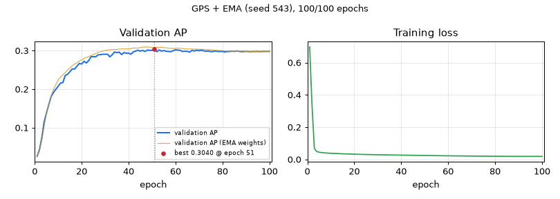

# GPS + EMA — seed 543

[← all models](../README.md) · PairHGT notebook · ogbg-molpcba

| | |
|---|---|
| State | **finished** |
| Epochs | 100 of 100 |
| Best validation AP | **0.3040** at epoch 51 |
| Best validation AP, EMA weights | 0.3098 at epoch 48 |
| Test AP | raw 0.2861 / ema 0.2964 (final) |
| Seed | 543 |
| Parameters | 9,744,860 |
| Minutes per epoch (last 5, incl. validation) | 2.9 |
| Training time so far | 4.9 h |
| Training time left | done |
| Sessions (start + resumes) | 1 |
| Hottest GPU reading | 89.0 °C |
| Last update | 2026-11-13 08:57 (33.2 h ago) |



<details><summary>Settings of this run</summary>

| Setting | Value |
|---|---|
| Epochs (warm-up) | 100 (5) |
| Batch size | 512 |
| Learning rate, weight decay | 0.0005, 1e-05 |
| Layers × width, heads | 5 × 384, 4 |
| Dropout, attention dropout | 0.2, 0.5 |
| Pair channel | no pair channel |
| Precision | fp32 (TF32 matrix products) |
| EMA decay | 0.9995 |
| Gradient clip | 1.0 |
| Protocol | v2_test_once |
| Notebook version, config hash | pairhgt-confirmatory-v2.0, 03eeeb0655c2d504 |

</details>

## Final test (evaluated once)

| Weights | Epoch | Validation AP | Test AP |
|---|---|---|---|
| raw | 51 | 0.3040 | 0.2861 |
| ema | 48 | 0.3098 | 0.2964 |

## Every epoch (newest first)

| Epoch | Train loss | Val AP | Val AP (EMA weights) | Best so far | LR | Minutes |
|---|---|---|---|---|---|---|
| 100 | 0.0191 | 0.2981 | 0.2978 | 0.3040 (ep 51) | 1.37e-07 | 2.9 |
| 99 | 0.0191 | 0.2980 | 0.2977 | 0.3040 (ep 51) | 5.47e-07 | 2.9 |
| 98 | 0.0192 | 0.2980 | 0.2978 | 0.3040 (ep 51) | 1.23e-06 | 2.9 |
| 97 | 0.0191 | 0.2980 | 0.2978 | 0.3040 (ep 51) | 2.18e-06 | 2.9 |
| 96 | 0.0191 | 0.2976 | 0.2978 | 0.3040 (ep 51) | 3.41e-06 | 2.9 |
| 95 | 0.0192 | 0.2980 | 0.2978 | 0.3040 (ep 51) | 4.91e-06 | 2.9 |
| 94 | 0.0192 | 0.2978 | 0.2978 | 0.3040 (ep 51) | 6.67e-06 | 2.9 |
| 93 | 0.0192 | 0.2980 | 0.2979 | 0.3040 (ep 51) | 8.70e-06 | 2.9 |
| 92 | 0.0192 | 0.2973 | 0.2978 | 0.3040 (ep 51) | 1.10e-05 | 2.9 |
| 91 | 0.0192 | 0.2975 | 0.2982 | 0.3040 (ep 51) | 1.35e-05 | 2.9 |
| 90 | 0.0193 | 0.2982 | 0.2982 | 0.3040 (ep 51) | 1.64e-05 | 2.9 |
| 89 | 0.0193 | 0.2975 | 0.2988 | 0.3040 (ep 51) | 1.94e-05 | 2.9 |
| 88 | 0.0194 | 0.2975 | 0.2989 | 0.3040 (ep 51) | 2.27e-05 | 2.9 |
| 87 | 0.0194 | 0.2981 | 0.2985 | 0.3040 (ep 51) | 2.63e-05 | 2.9 |
| 86 | 0.0195 | 0.2991 | 0.2987 | 0.3040 (ep 51) | 3.01e-05 | 2.9 |
| 85 | 0.0196 | 0.2980 | 0.2986 | 0.3040 (ep 51) | 3.42e-05 | 2.9 |
| 84 | 0.0197 | 0.2987 | 0.2988 | 0.3040 (ep 51) | 3.85e-05 | 2.9 |
| 83 | 0.0197 | 0.2977 | 0.2988 | 0.3040 (ep 51) | 4.30e-05 | 2.9 |
| 82 | 0.0198 | 0.2979 | 0.2991 | 0.3040 (ep 51) | 4.77e-05 | 2.9 |
| 81 | 0.0199 | 0.2964 | 0.2995 | 0.3040 (ep 51) | 5.27e-05 | 3.0 |
| 80 | 0.0200 | 0.2983 | 0.2999 | 0.3040 (ep 51) | 5.79e-05 | 3.0 |
| 79 | 0.0201 | 0.2977 | 0.3005 | 0.3040 (ep 51) | 6.33e-05 | 2.9 |
| 78 | 0.0202 | 0.2980 | 0.3007 | 0.3040 (ep 51) | 6.89e-05 | 2.9 |
| 77 | 0.0203 | 0.2991 | 0.3011 | 0.3040 (ep 51) | 7.47e-05 | 2.9 |
| 76 | 0.0204 | 0.2977 | 0.3015 | 0.3040 (ep 51) | 8.07e-05 | 2.9 |
| 75 | 0.0205 | 0.2973 | 0.3019 | 0.3040 (ep 51) | 8.69e-05 | 2.9 |
| 74 | 0.0206 | 0.2994 | 0.3025 | 0.3040 (ep 51) | 9.32e-05 | 2.9 |
| 73 | 0.0207 | 0.2984 | 0.3027 | 0.3040 (ep 51) | 9.97e-05 | 2.9 |
| 72 | 0.0209 | 0.2996 | 0.3031 | 0.3040 (ep 51) | 1.06e-04 | 2.9 |
| 71 | 0.0210 | 0.3011 | 0.3034 | 0.3040 (ep 51) | 1.13e-04 | 2.9 |
| 70 | 0.0212 | 0.2999 | 0.3037 | 0.3040 (ep 51) | 1.20e-04 | 3.0 |
| 69 | 0.0213 | 0.3009 | 0.3039 | 0.3040 (ep 51) | 1.27e-04 | 2.9 |
| 68 | 0.0214 | 0.2992 | 0.3041 | 0.3040 (ep 51) | 1.35e-04 | 2.9 |
| 67 | 0.0216 | 0.3007 | 0.3044 | 0.3040 (ep 51) | 1.42e-04 | 2.9 |
| 66 | 0.0217 | 0.2960 | 0.3043 | 0.3040 (ep 51) | 1.50e-04 | 3.0 |
| 65 | 0.0219 | 0.2983 | 0.3046 | 0.3040 (ep 51) | 1.57e-04 | 2.9 |
| 64 | 0.0221 | 0.2985 | 0.3046 | 0.3040 (ep 51) | 1.65e-04 | 2.9 |
| 63 | 0.0222 | 0.2978 | 0.3054 | 0.3040 (ep 51) | 1.73e-04 | 2.9 |
| 62 | 0.0224 | 0.3008 | 0.3063 | 0.3040 (ep 51) | 1.81e-04 | 2.9 |
| 61 | 0.0226 | 0.3015 | 0.3064 | 0.3040 (ep 51) | 1.89e-04 | 2.9 |
| 60 | 0.0228 | 0.3021 | 0.3056 | 0.3040 (ep 51) | 1.97e-04 | 2.9 |
| 59 | 0.0229 | 0.2999 | 0.3055 | 0.3040 (ep 51) | 2.05e-04 | 2.9 |
| 58 | 0.0231 | 0.2975 | 0.3060 | 0.3040 (ep 51) | 2.13e-04 | 2.9 |
| 57 | 0.0233 | 0.2978 | 0.3064 | 0.3040 (ep 51) | 2.21e-04 | 2.9 |
| 56 | 0.0235 | 0.2986 | 0.3074 | 0.3040 (ep 51) | 2.29e-04 | 3.0 |
| 55 | 0.0237 | 0.3004 | 0.3079 | 0.3040 (ep 51) | 2.38e-04 | 2.9 |
| 54 | 0.0239 | 0.2987 | 0.3087 | 0.3040 (ep 51) | 2.46e-04 | 2.9 |
| 53 | 0.0241 | 0.3018 | 0.3081 | 0.3040 (ep 51) | 2.54e-04 | 2.9 |
| 52 | 0.0243 | 0.2972 | 0.3085 | 0.3040 (ep 51) | 2.62e-04 | 2.9 |
| 51 | 0.0245 | 0.3040 ⭐ | 0.3084 | 0.3040 (ep 51) | 2.71e-04 | 3.0 |
| 50 | 0.0247 | 0.3009 | 0.3081 | 0.3015 (ep 48) | 2.79e-04 | 2.9 |
| 49 | 0.0249 | 0.3008 | 0.3090 | 0.3015 (ep 48) | 2.87e-04 | 2.9 |
| 48 | 0.0251 | 0.3015 ⭐ | 0.3098 | 0.3015 (ep 48) | 2.95e-04 | 2.9 |
| 47 | 0.0253 | 0.2979 | 0.3093 | 0.3011 (ep 44) | 3.03e-04 | 2.9 |
| 46 | 0.0256 | 0.3006 | 0.3094 | 0.3011 (ep 44) | 3.11e-04 | 2.9 |
| 45 | 0.0258 | 0.2988 | 0.3082 | 0.3011 (ep 44) | 3.19e-04 | 2.9 |
| 44 | 0.0260 | 0.3011 ⭐ | 0.3065 | 0.3011 (ep 44) | 3.27e-04 | 2.9 |
| 43 | 0.0262 | 0.2990 ⭐ | 0.3069 | 0.2990 (ep 43) | 3.35e-04 | 2.9 |
| 42 | 0.0264 | 0.2968 ⭐ | 0.3067 | 0.2968 (ep 42) | 3.43e-04 | 2.9 |
| 41 | 0.0267 | 0.2907 | 0.3053 | 0.2966 (ep 34) | 3.50e-04 | 2.9 |
| 40 | 0.0269 | 0.2936 | 0.3046 | 0.2966 (ep 34) | 3.58e-04 | 2.9 |
| 39 | 0.0271 | 0.2934 | 0.3049 | 0.2966 (ep 34) | 3.65e-04 | 2.9 |
| 38 | 0.0274 | 0.2950 | 0.3045 | 0.2966 (ep 34) | 3.73e-04 | 2.9 |
| 37 | 0.0276 | 0.2898 | 0.3046 | 0.2966 (ep 34) | 3.80e-04 | 2.9 |
| 36 | 0.0279 | 0.2962 | 0.3039 | 0.2966 (ep 34) | 3.87e-04 | 2.9 |
| 35 | 0.0281 | 0.2949 | 0.3031 | 0.2966 (ep 34) | 3.94e-04 | 2.9 |
| 34 | 0.0284 | 0.2966 ⭐ | 0.3032 | 0.2966 (ep 34) | 4.00e-04 | 2.9 |
| 33 | 0.0286 | 0.2892 | 0.3029 | 0.2909 (ep 31) | 4.07e-04 | 2.9 |
| 32 | 0.0289 | 0.2840 | 0.3022 | 0.2909 (ep 31) | 4.13e-04 | 3.0 |
| 31 | 0.0292 | 0.2909 ⭐ | 0.3015 | 0.2909 (ep 31) | 4.19e-04 | 2.9 |
| 30 | 0.0295 | 0.2907 | 0.3003 | 0.2907 (ep 29) | 4.25e-04 | 2.9 |
| 29 | 0.0298 | 0.2907 ⭐ | 0.2989 | 0.2907 (ep 29) | 4.31e-04 | 2.9 |
| 28 | 0.0300 | 0.2896 ⭐ | 0.2971 | 0.2896 (ep 28) | 4.37e-04 | 2.9 |
| 27 | 0.0303 | 0.2892 ⭐ | 0.2956 | 0.2892 (ep 27) | 4.42e-04 | 2.9 |
| 26 | 0.0306 | 0.2841 | 0.2924 | 0.2844 (ep 25) | 4.47e-04 | 2.9 |
| 25 | 0.0309 | 0.2844 ⭐ | 0.2900 | 0.2844 (ep 25) | 4.52e-04 | 3.0 |
| 24 | 0.0313 | 0.2844 ⭐ | 0.2874 | 0.2844 (ep 24) | 4.57e-04 | 2.9 |
| 23 | 0.0316 | 0.2742 ⭐ | 0.2848 | 0.2742 (ep 23) | 4.62e-04 | 2.9 |
| 22 | 0.0320 | 0.2680 | 0.2824 | 0.2726 (ep 21) | 4.66e-04 | 2.9 |
| 21 | 0.0324 | 0.2726 ⭐ | 0.2804 | 0.2726 (ep 21) | 4.70e-04 | 2.9 |
| 20 | 0.0328 | 0.2653 | 0.2761 | 0.2669 (ep 19) | 4.74e-04 | 2.9 |
| 19 | 0.0333 | 0.2669 ⭐ | 0.2732 | 0.2669 (ep 19) | 4.77e-04 | 2.9 |
| 18 | 0.0337 | 0.2596 ⭐ | 0.2684 | 0.2596 (ep 18) | 4.81e-04 | 2.9 |
| 17 | 0.0342 | 0.2524 | 0.2654 | 0.2528 (ep 16) | 4.84e-04 | 2.9 |
| 16 | 0.0346 | 0.2528 ⭐ | 0.2610 | 0.2528 (ep 16) | 4.86e-04 | 2.9 |
| 15 | 0.0352 | 0.2455 ⭐ | 0.2550 | 0.2455 (ep 15) | 4.89e-04 | 2.9 |
| 14 | 0.0358 | 0.2385 ⭐ | 0.2501 | 0.2385 (ep 14) | 4.91e-04 | 2.9 |
| 13 | 0.0368 | 0.2358 ⭐ | 0.2429 | 0.2358 (ep 13) | 4.93e-04 | 3.0 |
| 12 | 0.0372 | 0.2171 ⭐ | 0.2372 | 0.2171 (ep 12) | 4.95e-04 | 2.9 |
| 11 | 0.0376 | 0.2160 ⭐ | 0.2318 | 0.2160 (ep 11) | 4.97e-04 | 2.9 |
| 10 | 0.0384 | 0.2078 ⭐ | 0.2240 | 0.2078 (ep 10) | 4.98e-04 | 2.9 |
| 9 | 0.0393 | 0.2001 ⭐ | 0.2120 | 0.2001 (ep 9) | 4.99e-04 | 2.9 |
| 8 | 0.0402 | 0.1915 ⭐ | 0.1990 | 0.1915 (ep 8) | 4.99e-04 | 3.0 |
| 7 | 0.0414 | 0.1812 ⭐ | 0.1835 | 0.1812 (ep 7) | 5.00e-04 | 2.9 |
| 6 | 0.0431 | 0.1604 ⭐ | 0.1605 | 0.1604 (ep 6) | 5.00e-04 | 2.9 |
| 5 | 0.0451 | 0.1384 ⭐ | 0.1369 | 0.1384 (ep 5) | 4.00e-04 | 2.9 |
| 4 | 0.0491 | 0.1150 ⭐ | 0.1027 | 0.1150 (ep 4) | 3.00e-04 | 2.9 |
| 3 | 0.0688 | 0.0733 ⭐ | 0.0673 | 0.0733 (ep 3) | 2.00e-04 | 3.0 |
| 2 | 0.3390 | 0.0429 ⭐ | 0.0398 | 0.0429 (ep 2) | 1.00e-04 | 2.9 |
| 1 | 0.6979 | 0.0257 ⭐ | 0.0258 | 0.0257 (ep 1) | 5.00e-10 | 2.9 |

## Last 80 log lines

_The log counts epochs from 0; the tables above count from 1._

```
[seed 543] epoch  53/100 | lr 2.54e-04 | train BCE 0.0241 | val AP 0.3018 | best val 0.3040 @ep51 | EMA val 0.3081 | 176s (train 160s, eval 16s) | GPU max 89C | ETA<= 2.3h
[seed 543] epoch  54/100 | lr 2.46e-04 | train BCE 0.0239 | val AP 0.2987 | best val 0.3040 @ep51 | EMA val 0.3087 | 176s (train 160s, eval 16s) | GPU max 89C | ETA<= 2.3h
[seed 543] epoch  55/100 | lr 2.38e-04 | train BCE 0.0237 | val AP 0.3004 | best val 0.3040 @ep51 | EMA val 0.3079 | 176s (train 160s, eval 16s) | GPU max 89C | ETA<= 2.2h
[seed 543] epoch  56/100 | lr 2.29e-04 | train BCE 0.0235 | val AP 0.2986 | best val 0.3040 @ep51 | EMA val 0.3074 | 177s (train 161s, eval 16s) | GPU max 89C | ETA<= 2.2h
[seed 543] epoch  57/100 | lr 2.21e-04 | train BCE 0.0233 | val AP 0.2978 | best val 0.3040 @ep51 | EMA val 0.3064 | 177s (train 161s, eval 16s) | GPU max 89C | ETA<= 2.1h
[seed 543] epoch  58/100 | lr 2.13e-04 | train BCE 0.0231 | val AP 0.2975 | best val 0.3040 @ep51 | EMA val 0.3060 | 176s (train 161s, eval 16s) | GPU max 89C | ETA<= 2.1h
[seed 543] epoch  59/100 | lr 2.05e-04 | train BCE 0.0229 | val AP 0.2999 | best val 0.3040 @ep51 | EMA val 0.3055 | 177s (train 161s, eval 16s) | GPU max 89C | ETA<= 2.0h
[seed 543] epoch  60/100 | lr 1.97e-04 | train BCE 0.0228 | val AP 0.3021 | best val 0.3040 @ep51 | EMA val 0.3056 | 176s (train 161s, eval 16s) | GPU max 89C | ETA<= 2.0h
[seed 543] epoch  61/100 | lr 1.89e-04 | train BCE 0.0226 | val AP 0.3015 | best val 0.3040 @ep51 | EMA val 0.3064 | 176s (train 161s, eval 16s) | GPU max 89C | ETA<= 1.9h
[seed 543] epoch  62/100 | lr 1.81e-04 | train BCE 0.0224 | val AP 0.3008 | best val 0.3040 @ep51 | EMA val 0.3063 | 177s (train 161s, eval 16s) | GPU max 89C | ETA<= 1.9h
[seed 543] epoch  63/100 | lr 1.73e-04 | train BCE 0.0222 | val AP 0.2978 | best val 0.3040 @ep51 | EMA val 0.3054 | 176s (train 160s, eval 16s) | GPU max 89C | ETA<= 1.8h
[seed 543] epoch  64/100 | lr 1.65e-04 | train BCE 0.0221 | val AP 0.2985 | best val 0.3040 @ep51 | EMA val 0.3046 | 176s (train 160s, eval 16s) | GPU max 89C | ETA<= 1.8h
[seed 543] epoch  65/100 | lr 1.57e-04 | train BCE 0.0219 | val AP 0.2983 | best val 0.3040 @ep51 | EMA val 0.3046 | 177s (train 161s, eval 16s) | GPU max 89C | ETA<= 1.7h
[seed 543] epoch  66/100 | lr 1.50e-04 | train BCE 0.0217 | val AP 0.2960 | best val 0.3040 @ep51 | EMA val 0.3043 | 177s (train 162s, eval 16s) | GPU max 89C | ETA<= 1.7h
[seed 543] epoch  67/100 | lr 1.42e-04 | train BCE 0.0216 | val AP 0.3007 | best val 0.3040 @ep51 | EMA val 0.3044 | 176s (train 160s, eval 16s) | GPU max 89C | ETA<= 1.6h
[seed 543] epoch  68/100 | lr 1.35e-04 | train BCE 0.0214 | val AP 0.2992 | best val 0.3040 @ep51 | EMA val 0.3041 | 177s (train 161s, eval 16s) | GPU max 89C | ETA<= 1.6h
[seed 543] epoch  69/100 | lr 1.27e-04 | train BCE 0.0213 | val AP 0.3009 | best val 0.3040 @ep51 | EMA val 0.3039 | 177s (train 161s, eval 16s) | GPU max 89C | ETA<= 1.5h
[seed 543] epoch  70/100 | lr 1.20e-04 | train BCE 0.0212 | val AP 0.2999 | best val 0.3040 @ep51 | EMA val 0.3037 | 177s (train 161s, eval 16s) | GPU max 89C | ETA<= 1.5h
[seed 543] epoch  71/100 | lr 1.13e-04 | train BCE 0.0210 | val AP 0.3011 | best val 0.3040 @ep51 | EMA val 0.3034 | 176s (train 160s, eval 16s) | GPU max 89C | ETA<= 1.4h
[seed 543] epoch  72/100 | lr 1.06e-04 | train BCE 0.0209 | val AP 0.2996 | best val 0.3040 @ep51 | EMA val 0.3031 | 177s (train 161s, eval 16s) | GPU max 89C | ETA<= 1.4h
[seed 543] epoch  73/100 | lr 9.97e-05 | train BCE 0.0207 | val AP 0.2984 | best val 0.3040 @ep51 | EMA val 0.3027 | 177s (train 161s, eval 16s) | GPU max 89C | ETA<= 1.3h
[seed 543] epoch  74/100 | lr 9.32e-05 | train BCE 0.0206 | val AP 0.2994 | best val 0.3040 @ep51 | EMA val 0.3025 | 176s (train 161s, eval 16s) | GPU max 89C | ETA<= 1.3h
[seed 543] epoch  75/100 | lr 8.69e-05 | train BCE 0.0205 | val AP 0.2973 | best val 0.3040 @ep51 | EMA val 0.3019 | 176s (train 160s, eval 16s) | GPU max 89C | ETA<= 1.2h
[seed 543] epoch  76/100 | lr 8.07e-05 | train BCE 0.0204 | val AP 0.2977 | best val 0.3040 @ep51 | EMA val 0.3015 | 176s (train 161s, eval 16s) | GPU max 89C | ETA<= 1.2h
[seed 543] epoch  77/100 | lr 7.47e-05 | train BCE 0.0203 | val AP 0.2991 | best val 0.3040 @ep51 | EMA val 0.3011 | 176s (train 161s, eval 16s) | GPU max 89C | ETA<= 1.1h
[seed 543] epoch  78/100 | lr 6.89e-05 | train BCE 0.0202 | val AP 0.2980 | best val 0.3040 @ep51 | EMA val 0.3007 | 176s (train 161s, eval 16s) | GPU max 89C | ETA<= 1.1h
[seed 543] epoch  79/100 | lr 6.33e-05 | train BCE 0.0201 | val AP 0.2977 | best val 0.3040 @ep51 | EMA val 0.3005 | 177s (train 161s, eval 16s) | GPU max 89C | ETA<= 1.0h
[seed 543] epoch  80/100 | lr 5.79e-05 | train BCE 0.0200 | val AP 0.2983 | best val 0.3040 @ep51 | EMA val 0.2999 | 177s (train 161s, eval 16s) | GPU max 89C | ETA<= 1.0h
[seed 543] epoch  81/100 | lr 5.27e-05 | train BCE 0.0199 | val AP 0.2964 | best val 0.3040 @ep51 | EMA val 0.2995 | 178s (train 161s, eval 16s) | GPU max 89C | ETA<= 0.9h
[seed 543] epoch  82/100 | lr 4.77e-05 | train BCE 0.0198 | val AP 0.2979 | best val 0.3040 @ep51 | EMA val 0.2991 | 176s (train 160s, eval 16s) | GPU max 89C | ETA<= 0.9h
[seed 543] epoch  83/100 | lr 4.30e-05 | train BCE 0.0197 | val AP 0.2977 | best val 0.3040 @ep51 | EMA val 0.2988 | 177s (train 161s, eval 16s) | GPU max 89C | ETA<= 0.8h
[seed 543] epoch  84/100 | lr 3.85e-05 | train BCE 0.0197 | val AP 0.2987 | best val 0.3040 @ep51 | EMA val 0.2988 | 177s (train 161s, eval 16s) | GPU max 89C | ETA<= 0.8h
[seed 543] epoch  85/100 | lr 3.42e-05 | train BCE 0.0196 | val AP 0.2980 | best val 0.3040 @ep51 | EMA val 0.2986 | 176s (train 161s, eval 16s) | GPU max 89C | ETA<= 0.7h
[seed 543] epoch  86/100 | lr 3.01e-05 | train BCE 0.0195 | val AP 0.2991 | best val 0.3040 @ep51 | EMA val 0.2987 | 176s (train 161s, eval 16s) | GPU max 89C | ETA<= 0.7h
[seed 543] epoch  87/100 | lr 2.63e-05 | train BCE 0.0194 | val AP 0.2981 | best val 0.3040 @ep51 | EMA val 0.2985 | 176s (train 160s, eval 16s) | GPU max 89C | ETA<= 0.6h
[seed 543] epoch  88/100 | lr 2.27e-05 | train BCE 0.0194 | val AP 0.2975 | best val 0.3040 @ep51 | EMA val 0.2989 | 176s (train 161s, eval 16s) | GPU max 89C | ETA<= 0.6h
[seed 543] epoch  89/100 | lr 1.94e-05 | train BCE 0.0193 | val AP 0.2975 | best val 0.3040 @ep51 | EMA val 0.2988 | 177s (train 161s, eval 16s) | GPU max 89C | ETA<= 0.5h
[seed 543] epoch  90/100 | lr 1.64e-05 | train BCE 0.0193 | val AP 0.2982 | best val 0.3040 @ep51 | EMA val 0.2982 | 177s (train 161s, eval 16s) | GPU max 89C | ETA<= 0.5h
[seed 543] epoch  91/100 | lr 1.35e-05 | train BCE 0.0192 | val AP 0.2975 | best val 0.3040 @ep51 | EMA val 0.2982 | 176s (train 160s, eval 16s) | GPU max 89C | ETA<= 0.4h
[seed 543] epoch  92/100 | lr 1.10e-05 | train BCE 0.0192 | val AP 0.2973 | best val 0.3040 @ep51 | EMA val 0.2978 | 177s (train 161s, eval 16s) | GPU max 89C | ETA<= 0.4h
[seed 543] epoch  93/100 | lr 8.70e-06 | train BCE 0.0192 | val AP 0.2980 | best val 0.3040 @ep51 | EMA val 0.2979 | 176s (train 161s, eval 16s) | GPU max 89C | ETA<= 0.3h
[seed 543] epoch  94/100 | lr 6.67e-06 | train BCE 0.0192 | val AP 0.2978 | best val 0.3040 @ep51 | EMA val 0.2978 | 176s (train 161s, eval 16s) | GPU max 89C | ETA<= 0.3h
[seed 543] epoch  95/100 | lr 4.91e-06 | train BCE 0.0192 | val AP 0.2980 | best val 0.3040 @ep51 | EMA val 0.2978 | 176s (train 161s, eval 16s) | GPU max 89C | ETA<= 0.2h
[seed 543] epoch  96/100 | lr 3.41e-06 | train BCE 0.0191 | val AP 0.2976 | best val 0.3040 @ep51 | EMA val 0.2978 | 176s (train 161s, eval 16s) | GPU max 89C | ETA<= 0.2h
[seed 543] epoch  97/100 | lr 2.18e-06 | train BCE 0.0191 | val AP 0.2980 | best val 0.3040 @ep51 | EMA val 0.2978 | 176s (train 161s, eval 16s) | GPU max 89C | ETA<= 0.1h
[seed 543] epoch  98/100 | lr 1.23e-06 | train BCE 0.0192 | val AP 0.2980 | best val 0.3040 @ep51 | EMA val 0.2978 | 176s (train 161s, eval 16s) | GPU max 89C | ETA<= 0.1h
[seed 543] epoch  99/100 | lr 5.47e-07 | train BCE 0.0191 | val AP 0.2980 | best val 0.3040 @ep51 | EMA val 0.2977 | 176s (train 161s, eval 16s) | GPU max 89C | ETA<= 0.0h
[seed 543] epoch 100/100 | lr 1.37e-07 | train BCE 0.0191 | val AP 0.2981 | best val 0.3040 @ep51 | EMA val 0.2978 | 176s (train 160s, eval 16s) | GPU max 89C | ETA<= 0.0h
[seed 543] FINAL TEST (evaluated once): raw epoch 51 val 0.3040 test 0.2861 | EMA epoch 48 val 0.3098 test 0.2964
--- cell 16 ---
GPS (plain) + EMA [arm GPS_ema] | gps_conf_GPS_ema_ep100_molpcba
 seed  epochs  raw_epoch  raw_val  raw_test  ema_epoch  ema_val  ema_test  hours  train_s_per_epoch  total_s_per_epoch
  101 100/100         56   0.3044    0.2900         50   0.3103    0.2995 4.9304           160.8465           177.4936
  202 100/100         51   0.3020    0.2897         46   0.3085    0.2947 4.8991           160.7075           176.3669
  323 100/100         53   0.2984    0.2948         37   0.3043    0.2994 4.9005           160.7710           176.4181
  432 100/100         51   0.3028    0.2916         50   0.3083    0.2998 4.8893           160.4000           176.0137
  543 100/100         51   0.3040    0.2861         48   0.3098    0.2964 4.9011           160.7779           176.4388
mean ± sample SD (ddof=1) over 5 seed(s): raw test 0.2904 ± 0.0032 | EMA test 0.2980 ± 0.0023
A mean ± SD over fewer than 3 seeds is only a description; do not call it a confidence interval.
run manifest: 9 row(s) -> /home/student/thesis/outputs/pairhgt/outputs/confirmatory/run_manifest.csv
    model              gpu  seeds  params  train_s_per_epoch  val_eval_s_per_epoch  total_s_per_epoch  hours_per_seed  time_vs_GPS+EMA
GPS + EMA NVIDIA RTX A4000      5 9744860             160.70                 15.83             176.55             4.9             1.00
  PairHGT NVIDIA RTX A4000      4 9751972             275.32                 33.77             309.10             7.9             1.75
train = training steps incl. EMA update; val_eval = validation of raw + EMA weights; no test pass inside an epoch (protocol v2). Do not compare with timings from the exploratory runs.
--- cell 18 ---
=== PairHGT  minus  GPS + EMA   (100 epochs, matched seeds) ===
 seed  raw_val  ema_val  raw_test  ema_test
  101   0.0013   0.0027    0.0043    0.0048
  202   0.0017   0.0012    0.0067    0.0115
  323   0.0021   0.0022    0.0019    0.0056
  validation AP, raw    : mean +0.0017, sample SD 0.0004, per-seed [0.0013, 0.0017, 0.0021], all positive: True | 95% t-interval [+0.0006, +0.0028] (n=3, t=6.67)
  validation AP, EMA    : mean +0.0020, sample SD 0.0008, per-seed [0.0027, 0.0012, 0.0022], all positive: True | 95% t-interval [+0.0002, +0.0039] (n=3, t=4.65)
  test AP, raw vs raw   : mean +0.0043, sample SD 0.0024, per-seed [0.0043, 0.0067, 0.0019], all positive: True | 95% t-interval [-0.0016, +0.0102] (n=3, t=3.11)
  test AP, EMA vs EMA   : mean +0.0073, sample SD 0.0037, per-seed [0.0048, 0.0115, 0.0056], all positive: True | 95% t-interval [-0.0019, +0.0165] (n=3, t=3.42)
  Reading: 3 matched seed(s). The claim is limited to whether the direction of the EMA-vs-EMA difference repeats; a significance claim needs many more seeds.
Planning table (80% power, alpha 0.05, two-sample t, test AP): smallest detectable true difference
  per-seed SD 0.003: n=3: 0.0092, n=5: 0.0061, n=10: 0.0040, n=20: 0.0027
  per-seed SD 0.0056: n=3: 0.0172, n=5: 0.0113, n=10: 0.0074, n=20: 0.0051
--- cell 20 ---
===== 2026-11-13 08:57:59 notebook turn ended (exit 0); executed notebook: /home/student/thesis/outputs/lab_runs/notebooks/pairhgt_GPS_ema_seed543_20261113-0402.ipynb =====
```
