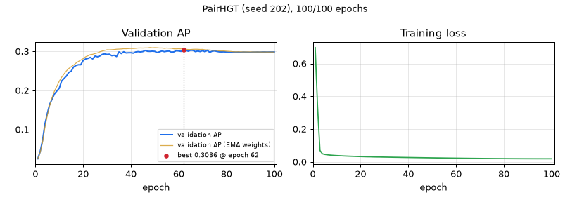

# PairHGT — seed 202

[← all models](../README.md) · PairHGT notebook · ogbg-molpcba

| | |
|---|---|
| State | **finished** |
| Epochs | 100 of 100 |
| Best validation AP | **0.3036** at epoch 62 |
| Best validation AP, EMA weights | 0.3097 at epoch 48 |
| Test AP | raw 0.2963 / ema 0.3062 (final) |
| Seed | 202 |
| Parameters | 9,751,972 |
| Minutes per epoch (last 5, incl. validation) | 5.1 |
| Training time so far | 8.6 h |
| Training time left | done |
| Sessions (start + resumes) | 2 |
| Hottest GPU reading | 89.0 °C |
| Last update | 2026-11-12 08:29 (57.6 h ago) |



<details><summary>Settings of this run</summary>

| Setting | Value |
|---|---|
| Epochs (warm-up) | 100 (5) |
| Batch size | 512 |
| Learning rate, weight decay | 0.0005, 1e-05 |
| Layers × width, heads | 5 × 384, 4 |
| Dropout, attention dropout | 0.2, 0.5 |
| Pair channel | width 16, dropout 0.1, value gate True |
| Precision | fp32 (TF32 matrix products) |
| EMA decay | 0.9995 |
| Gradient clip | 1.0 |
| Protocol | v2_test_once |
| Notebook version, config hash | pairhgt-confirmatory-v2.0, 9171049c2c7acf57 |

</details>

## Final test (evaluated once)

| Weights | Epoch | Validation AP | Test AP |
|---|---|---|---|
| raw | 62 | 0.3036 | 0.2963 |
| ema | 48 | 0.3097 | 0.3062 |

## Every epoch (newest first)

| Epoch | Train loss | Val AP | Val AP (EMA weights) | Best so far | LR | Minutes |
|---|---|---|---|---|---|---|
| 100 | 0.0187 | 0.2985 | 0.2983 | 0.3036 (ep 62) | 1.37e-07 | 5.1 |
| 99 | 0.0187 | 0.2983 | 0.2982 | 0.3036 (ep 62) | 5.47e-07 | 5.1 |
| 98 | 0.0187 | 0.2983 | 0.2983 | 0.3036 (ep 62) | 1.23e-06 | 5.1 |
| 97 | 0.0187 | 0.2981 | 0.2983 | 0.3036 (ep 62) | 2.18e-06 | 5.2 |
| 96 | 0.0187 | 0.2984 | 0.2984 | 0.3036 (ep 62) | 3.41e-06 | 5.1 |
| 95 | 0.0188 | 0.2983 | 0.2982 | 0.3036 (ep 62) | 4.91e-06 | 5.1 |
| 94 | 0.0187 | 0.2979 | 0.2985 | 0.3036 (ep 62) | 6.67e-06 | 5.1 |
| 93 | 0.0188 | 0.2982 | 0.2985 | 0.3036 (ep 62) | 8.70e-06 | 5.1 |
| 92 | 0.0188 | 0.2980 | 0.2984 | 0.3036 (ep 62) | 1.10e-05 | 5.1 |
| 91 | 0.0188 | 0.2980 | 0.2985 | 0.3036 (ep 62) | 1.35e-05 | 5.1 |
| 90 | 0.0189 | 0.2973 | 0.2987 | 0.3036 (ep 62) | 1.64e-05 | 5.1 |
| 89 | 0.0189 | 0.2977 | 0.2986 | 0.3036 (ep 62) | 1.94e-05 | 5.2 |
| 88 | 0.0190 | 0.2978 | 0.2985 | 0.3036 (ep 62) | 2.27e-05 | 5.1 |
| 87 | 0.0190 | 0.2981 | 0.2985 | 0.3036 (ep 62) | 2.63e-05 | 5.1 |
| 86 | 0.0191 | 0.2973 | 0.2988 | 0.3036 (ep 62) | 3.01e-05 | 5.1 |
| 85 | 0.0191 | 0.2979 | 0.2989 | 0.3036 (ep 62) | 3.42e-05 | 5.1 |
| 84 | 0.0192 | 0.2977 | 0.2987 | 0.3036 (ep 62) | 3.85e-05 | 5.1 |
| 83 | 0.0193 | 0.2981 | 0.2989 | 0.3036 (ep 62) | 4.30e-05 | 5.1 |
| 82 | 0.0193 | 0.2974 | 0.2997 | 0.3036 (ep 62) | 4.77e-05 | 5.1 |
| 81 | 0.0194 | 0.2975 | 0.3001 | 0.3036 (ep 62) | 5.27e-05 | 5.1 |
| 80 | 0.0195 | 0.2982 | 0.3005 | 0.3036 (ep 62) | 5.79e-05 | 5.1 |
| 79 | 0.0196 | 0.2989 | 0.3010 | 0.3036 (ep 62) | 6.33e-05 | 5.1 |
| 78 | 0.0197 | 0.2986 | 0.3011 | 0.3036 (ep 62) | 6.89e-05 | 5.1 |
| 77 | 0.0198 | 0.2987 | 0.3011 | 0.3036 (ep 62) | 7.47e-05 | 5.2 |
| 76 | 0.0199 | 0.2998 | 0.3025 | 0.3036 (ep 62) | 8.07e-05 | 5.1 |
| 75 | 0.0200 | 0.3013 | 0.3025 | 0.3036 (ep 62) | 8.69e-05 | 5.1 |
| 74 | 0.0202 | 0.3004 | 0.3025 | 0.3036 (ep 62) | 9.32e-05 | 5.1 |
| 73 | 0.0203 | 0.2975 | 0.3034 | 0.3036 (ep 62) | 9.97e-05 | 5.1 |
| 72 | 0.0204 | 0.3027 | 0.3037 | 0.3036 (ep 62) | 1.06e-04 | 5.1 |
| 71 | 0.0206 | 0.2991 | 0.3040 | 0.3036 (ep 62) | 1.13e-04 | 5.1 |
| 70 | 0.0207 | 0.3018 | 0.3050 | 0.3036 (ep 62) | 1.20e-04 | 5.2 |
| 69 | 0.0208 | 0.2994 | 0.3048 | 0.3036 (ep 62) | 1.27e-04 | 5.1 |
| 68 | 0.0210 | 0.3010 | 0.3053 | 0.3036 (ep 62) | 1.35e-04 | 5.1 |
| 67 | 0.0211 | 0.2993 | 0.3053 | 0.3036 (ep 62) | 1.42e-04 | 5.1 |
| 66 | 0.0213 | 0.3024 | 0.3052 | 0.3036 (ep 62) | 1.50e-04 | 5.1 |
| 65 | 0.0214 | 0.3030 | 0.3046 | 0.3036 (ep 62) | 1.57e-04 | 5.1 |
| 64 | 0.0216 | 0.3003 | 0.3046 | 0.3036 (ep 62) | 1.65e-04 | 5.1 |
| 63 | 0.0218 | 0.3029 | 0.3053 | 0.3036 (ep 62) | 1.73e-04 | 5.1 |
| 62 | 0.0220 | 0.3036 ⭐ | 0.3062 | 0.3036 (ep 62) | 1.81e-04 | 5.1 |
| 61 | 0.0221 | 0.2999 | 0.3063 | 0.3024 (ep 46) | 1.89e-04 | 5.1 |
| 60 | 0.0223 | 0.3011 | 0.3067 | 0.3024 (ep 46) | 1.97e-04 | 5.1 |
| 59 | 0.0225 | 0.3017 | 0.3063 | 0.3024 (ep 46) | 2.05e-04 | 5.1 |
| 58 | 0.0227 | 0.2987 | 0.3065 | 0.3024 (ep 46) | 2.13e-04 | 5.1 |
| 57 | 0.0228 | 0.2979 | 0.3078 | 0.3024 (ep 46) | 2.21e-04 | 5.1 |
| 56 | 0.0230 | 0.3007 | 0.3080 | 0.3024 (ep 46) | 2.29e-04 | 5.1 |
| 55 | 0.0233 | 0.3003 | 0.3085 | 0.3024 (ep 46) | 2.38e-04 | 5.1 |
| 54 | 0.0235 | 0.2992 | 0.3077 | 0.3024 (ep 46) | 2.46e-04 | 5.1 |
| 53 | 0.0237 | 0.3010 | 0.3086 | 0.3024 (ep 46) | 2.54e-04 | 5.1 |
| 52 | 0.0238 | 0.2989 | 0.3085 | 0.3024 (ep 46) | 2.62e-04 | 5.1 |
| 51 | 0.0241 | 0.2968 | 0.3092 | 0.3024 (ep 46) | 2.71e-04 | 5.1 |
| 50 | 0.0243 | 0.2999 | 0.3094 | 0.3024 (ep 46) | 2.79e-04 | 5.1 |
| 49 | 0.0245 | 0.3005 | 0.3090 | 0.3024 (ep 46) | 2.87e-04 | 5.1 |
| 48 | 0.0247 | 0.2999 | 0.3097 | 0.3024 (ep 46) | 2.95e-04 | 5.1 |
| 47 | 0.0249 | 0.3001 | 0.3087 | 0.3024 (ep 46) | 3.03e-04 | 5.1 |
| 46 | 0.0251 | 0.3024 ⭐ | 0.3087 | 0.3024 (ep 46) | 3.11e-04 | 5.1 |
| 45 | 0.0253 | 0.2994 ⭐ | 0.3084 | 0.2994 (ep 45) | 3.19e-04 | 5.1 |
| 44 | 0.0255 | 0.2985 | 0.3086 | 0.2993 (ep 43) | 3.27e-04 | 5.1 |
| 43 | 0.0258 | 0.2993 ⭐ | 0.3085 | 0.2993 (ep 43) | 3.35e-04 | 5.1 |
| 42 | 0.0260 | 0.2985 | 0.3077 | 0.2990 (ep 37) | 3.43e-04 | 5.1 |
| 41 | 0.0262 | 0.2954 | 0.3073 | 0.2990 (ep 37) | 3.50e-04 | 5.1 |
| 40 | 0.0265 | 0.2965 | 0.3074 | 0.2990 (ep 37) | 3.58e-04 | 5.1 |
| 39 | 0.0267 | 0.2964 | 0.3070 | 0.2990 (ep 37) | 3.65e-04 | 5.1 |
| 38 | 0.0269 | 0.2960 | 0.3066 | 0.2990 (ep 37) | 3.73e-04 | 5.1 |
| 37 | 0.0271 | 0.2990 ⭐ | 0.3068 | 0.2990 (ep 37) | 3.80e-04 | 5.2 |
| 36 | 0.0275 | 0.2944 | 0.3061 | 0.2986 (ep 35) | 3.87e-04 | 5.2 |
| 35 | 0.0277 | 0.2986 ⭐ | 0.3057 | 0.2986 (ep 35) | 3.94e-04 | 5.2 |
| 34 | 0.0279 | 0.2867 | 0.3054 | 0.2936 (ep 29) | 4.00e-04 | 5.1 |
| 33 | 0.0282 | 0.2901 | 0.3046 | 0.2936 (ep 29) | 4.07e-04 | 5.1 |
| 32 | 0.0284 | 0.2889 | 0.3042 | 0.2936 (ep 29) | 4.13e-04 | 5.1 |
| 31 | 0.0287 | 0.2928 | 0.3038 | 0.2936 (ep 29) | 4.19e-04 | 5.1 |
| 30 | 0.0289 | 0.2922 | 0.3040 | 0.2936 (ep 29) | 4.25e-04 | 5.2 |
| 29 | 0.0292 | 0.2936 ⭐ | 0.3023 | 0.2936 (ep 29) | 4.31e-04 | 5.1 |
| 28 | 0.0296 | 0.2923 ⭐ | 0.3008 | 0.2923 (ep 28) | 4.37e-04 | 5.1 |
| 27 | 0.0297 | 0.2882 ⭐ | 0.2988 | 0.2882 (ep 27) | 4.42e-04 | 5.1 |
| 26 | 0.0299 | 0.2861 | 0.2961 | 0.2879 (ep 25) | 4.47e-04 | 5.1 |
| 25 | 0.0303 | 0.2879 ⭐ | 0.2945 | 0.2879 (ep 25) | 4.52e-04 | 5.2 |
| 24 | 0.0309 | 0.2806 | 0.2926 | 0.2845 (ep 23) | 4.57e-04 | 5.1 |
| 23 | 0.0309 | 0.2845 ⭐ | 0.2917 | 0.2845 (ep 23) | 4.62e-04 | 5.2 |
| 22 | 0.0313 | 0.2819 ⭐ | 0.2887 | 0.2819 (ep 22) | 4.66e-04 | 5.1 |
| 21 | 0.0318 | 0.2805 ⭐ | 0.2860 | 0.2805 (ep 21) | 4.70e-04 | 5.1 |
| 20 | 0.0322 | 0.2765 ⭐ | 0.2813 | 0.2765 (ep 20) | 4.74e-04 | 5.2 |
| 19 | 0.0326 | 0.2657 | 0.2778 | 0.2657 (ep 18) | 4.77e-04 | 5.1 |
| 18 | 0.0331 | 0.2657 ⭐ | 0.2740 | 0.2657 (ep 18) | 4.81e-04 | 5.1 |
| 17 | 0.0336 | 0.2638 ⭐ | 0.2699 | 0.2638 (ep 17) | 4.84e-04 | 5.1 |
| 16 | 0.0341 | 0.2601 ⭐ | 0.2649 | 0.2601 (ep 16) | 4.86e-04 | 5.1 |
| 15 | 0.0346 | 0.2492 ⭐ | 0.2607 | 0.2492 (ep 15) | 4.89e-04 | 5.2 |
| 14 | 0.0353 | 0.2462 ⭐ | 0.2562 | 0.2462 (ep 14) | 4.91e-04 | 5.1 |
| 13 | 0.0359 | 0.2368 ⭐ | 0.2500 | 0.2368 (ep 13) | 4.93e-04 | 5.2 |
| 12 | 0.0367 | 0.2305 ⭐ | 0.2422 | 0.2305 (ep 12) | 4.95e-04 | 5.2 |
| 11 | 0.0374 | 0.2243 ⭐ | 0.2337 | 0.2243 (ep 11) | 4.97e-04 | 5.2 |
| 10 | 0.0382 | 0.2054 ⭐ | 0.2235 | 0.2054 (ep 10) | 4.98e-04 | 5.1 |
| 9 | 0.0391 | 0.1984 ⭐ | 0.2105 | 0.1984 (ep 9) | 4.99e-04 | 5.1 |
| 8 | 0.0402 | 0.1909 ⭐ | 0.1981 | 0.1909 (ep 8) | 4.99e-04 | 5.2 |
| 7 | 0.0414 | 0.1775 ⭐ | 0.1818 | 0.1775 (ep 7) | 5.00e-04 | 5.1 |
| 6 | 0.0432 | 0.1647 ⭐ | 0.1611 | 0.1647 (ep 6) | 5.00e-04 | 5.2 |
| 5 | 0.0452 | 0.1410 ⭐ | 0.1357 | 0.1410 (ep 5) | 4.00e-04 | 5.1 |
| 4 | 0.0491 | 0.1138 ⭐ | 0.1048 | 0.1138 (ep 4) | 3.00e-04 | 5.2 |
| 3 | 0.0696 | 0.0717 ⭐ | 0.0668 | 0.0717 (ep 3) | 2.00e-04 | 5.1 |
| 2 | 0.3356 | 0.0430 ⭐ | 0.0410 | 0.0430 (ep 2) | 1.00e-04 | 5.2 |
| 1 | 0.6978 | 0.0251 ⭐ | 0.0251 | 0.0251 (ep 1) | 5.00e-10 | 5.1 |

## Last 80 log lines

_The log counts epochs from 0; the tables above count from 1._

```
--- cell 5 ---
Dataset cache already present: /home/student/thesis/outputs/pairhgt/data/ogb/ogbg_molpcba
RWSE loaded from cache
graphs: total 437,929 | train 350,343 | val 43,793 | test 43,793 | ready in 2s
steps/epoch: train 685, val 86, test 86
--- cell 6 ---
PairHGT: GPS + pair channel (pair bias + write-back, value gate) [arm PairHGT]: 9,751,972 parameters = baseline 9,744,860 + 7,112 (0.07%), of which the pair channel 7,112
parameter count matches the expected 9,751,972 for arm PairHGT
--- cell 7 ---
--- cell 9 ---
--- cell 10 ---
--- cell 12 ---
RUN_DEBUG_FIRST is False: smoke test skipped.
--- cell 14 ---
Restored 0 seed folder(s).
prereg.json checked: configuration identical (hash 9171049c2c7acf57); seeds [101, 202, 323, 432, 543]
[seed 202] RESUMED from epoch 68/100 (lr 1.27e-04, best val AP so far 0.3036)
[seed 202] epoch  69/100 | lr 1.27e-04 | train BCE 0.0208 | val AP 0.2994 | best val 0.3036 @ep62 | EMA val 0.3048 | 308s (train 274s, eval 34s) | GPU max 89C | ETA<= 2.6h
[seed 202] epoch  70/100 | lr 1.20e-04 | train BCE 0.0207 | val AP 0.3018 | best val 0.3036 @ep62 | EMA val 0.3050 | 309s (train 275s, eval 34s) | GPU max 89C | ETA<= 2.6h
[seed 202] epoch  71/100 | lr 1.13e-04 | train BCE 0.0206 | val AP 0.2991 | best val 0.3036 @ep62 | EMA val 0.3040 | 309s (train 275s, eval 34s) | GPU max 89C | ETA<= 2.5h
[seed 202] epoch  72/100 | lr 1.06e-04 | train BCE 0.0204 | val AP 0.3027 | best val 0.3036 @ep62 | EMA val 0.3037 | 309s (train 275s, eval 34s) | GPU max 89C | ETA<= 2.4h
[seed 202] epoch  73/100 | lr 9.97e-05 | train BCE 0.0203 | val AP 0.2975 | best val 0.3036 @ep62 | EMA val 0.3034 | 309s (train 275s, eval 34s) | GPU max 89C | ETA<= 2.3h
[seed 202] epoch  74/100 | lr 9.32e-05 | train BCE 0.0202 | val AP 0.3004 | best val 0.3036 @ep62 | EMA val 0.3025 | 309s (train 275s, eval 34s) | GPU max 89C | ETA<= 2.2h
[seed 202] epoch  75/100 | lr 8.69e-05 | train BCE 0.0200 | val AP 0.3013 | best val 0.3036 @ep62 | EMA val 0.3025 | 309s (train 275s, eval 34s) | GPU max 89C | ETA<= 2.1h
[seed 202] epoch  76/100 | lr 8.07e-05 | train BCE 0.0199 | val AP 0.2998 | best val 0.3036 @ep62 | EMA val 0.3025 | 308s (train 274s, eval 34s) | GPU max 89C | ETA<= 2.1h
[seed 202] epoch  77/100 | lr 7.47e-05 | train BCE 0.0198 | val AP 0.2987 | best val 0.3036 @ep62 | EMA val 0.3011 | 309s (train 275s, eval 34s) | GPU max 89C | ETA<= 2.0h
[seed 202] epoch  78/100 | lr 6.89e-05 | train BCE 0.0197 | val AP 0.2986 | best val 0.3036 @ep62 | EMA val 0.3011 | 309s (train 275s, eval 34s) | GPU max 89C | ETA<= 1.9h
[seed 202] epoch  79/100 | lr 6.33e-05 | train BCE 0.0196 | val AP 0.2989 | best val 0.3036 @ep62 | EMA val 0.3010 | 308s (train 275s, eval 34s) | GPU max 89C | ETA<= 1.8h
[seed 202] epoch  80/100 | lr 5.79e-05 | train BCE 0.0195 | val AP 0.2982 | best val 0.3036 @ep62 | EMA val 0.3005 | 308s (train 275s, eval 34s) | GPU max 89C | ETA<= 1.7h
[seed 202] epoch  81/100 | lr 5.27e-05 | train BCE 0.0194 | val AP 0.2975 | best val 0.3036 @ep62 | EMA val 0.3001 | 309s (train 275s, eval 34s) | GPU max 89C | ETA<= 1.6h
[seed 202] epoch  82/100 | lr 4.77e-05 | train BCE 0.0193 | val AP 0.2974 | best val 0.3036 @ep62 | EMA val 0.2997 | 308s (train 274s, eval 34s) | GPU max 89C | ETA<= 1.5h
[seed 202] epoch  83/100 | lr 4.30e-05 | train BCE 0.0193 | val AP 0.2981 | best val 0.3036 @ep62 | EMA val 0.2989 | 308s (train 275s, eval 34s) | GPU max 89C | ETA<= 1.5h
[seed 202] epoch  84/100 | lr 3.85e-05 | train BCE 0.0192 | val AP 0.2977 | best val 0.3036 @ep62 | EMA val 0.2987 | 309s (train 275s, eval 34s) | GPU max 89C | ETA<= 1.4h
[seed 202] epoch  85/100 | lr 3.42e-05 | train BCE 0.0191 | val AP 0.2979 | best val 0.3036 @ep62 | EMA val 0.2989 | 308s (train 274s, eval 34s) | GPU max 89C | ETA<= 1.3h
[seed 202] epoch  86/100 | lr 3.01e-05 | train BCE 0.0191 | val AP 0.2973 | best val 0.3036 @ep62 | EMA val 0.2988 | 308s (train 275s, eval 34s) | GPU max 89C | ETA<= 1.2h
[seed 202] epoch  87/100 | lr 2.63e-05 | train BCE 0.0190 | val AP 0.2981 | best val 0.3036 @ep62 | EMA val 0.2985 | 308s (train 275s, eval 34s) | GPU max 89C | ETA<= 1.1h
[seed 202] epoch  88/100 | lr 2.27e-05 | train BCE 0.0190 | val AP 0.2978 | best val 0.3036 @ep62 | EMA val 0.2985 | 308s (train 275s, eval 34s) | GPU max 89C | ETA<= 1.0h
[seed 202] epoch  89/100 | lr 1.94e-05 | train BCE 0.0189 | val AP 0.2977 | best val 0.3036 @ep62 | EMA val 0.2986 | 309s (train 276s, eval 34s) | GPU max 89C | ETA<= 0.9h
[seed 202] epoch  90/100 | lr 1.64e-05 | train BCE 0.0189 | val AP 0.2973 | best val 0.3036 @ep62 | EMA val 0.2987 | 308s (train 275s, eval 34s) | GPU max 89C | ETA<= 0.9h
[seed 202] epoch  91/100 | lr 1.35e-05 | train BCE 0.0188 | val AP 0.2980 | best val 0.3036 @ep62 | EMA val 0.2985 | 308s (train 275s, eval 34s) | GPU max 89C | ETA<= 0.8h
[seed 202] epoch  92/100 | lr 1.10e-05 | train BCE 0.0188 | val AP 0.2980 | best val 0.3036 @ep62 | EMA val 0.2984 | 309s (train 275s, eval 34s) | GPU max 89C | ETA<= 0.7h
[seed 202] epoch  93/100 | lr 8.70e-06 | train BCE 0.0188 | val AP 0.2982 | best val 0.3036 @ep62 | EMA val 0.2985 | 309s (train 275s, eval 34s) | GPU max 89C | ETA<= 0.6h
[seed 202] epoch  94/100 | lr 6.67e-06 | train BCE 0.0187 | val AP 0.2979 | best val 0.3036 @ep62 | EMA val 0.2985 | 308s (train 274s, eval 34s) | GPU max 89C | ETA<= 0.5h
[seed 202] epoch  95/100 | lr 4.91e-06 | train BCE 0.0188 | val AP 0.2983 | best val 0.3036 @ep62 | EMA val 0.2982 | 309s (train 275s, eval 34s) | GPU max 89C | ETA<= 0.4h
[seed 202] epoch  96/100 | lr 3.41e-06 | train BCE 0.0187 | val AP 0.2984 | best val 0.3036 @ep62 | EMA val 0.2984 | 308s (train 274s, eval 34s) | GPU max 89C | ETA<= 0.3h
[seed 202] epoch  97/100 | lr 2.18e-06 | train BCE 0.0187 | val AP 0.2981 | best val 0.3036 @ep62 | EMA val 0.2983 | 309s (train 275s, eval 34s) | GPU max 89C | ETA<= 0.3h
[seed 202] epoch  98/100 | lr 1.23e-06 | train BCE 0.0187 | val AP 0.2983 | best val 0.3036 @ep62 | EMA val 0.2983 | 308s (train 275s, eval 34s) | GPU max 89C | ETA<= 0.2h
[seed 202] epoch  99/100 | lr 5.47e-07 | train BCE 0.0187 | val AP 0.2983 | best val 0.3036 @ep62 | EMA val 0.2982 | 309s (train 275s, eval 34s) | GPU max 89C | ETA<= 0.1h
[seed 202] epoch 100/100 | lr 1.37e-07 | train BCE 0.0187 | val AP 0.2985 | best val 0.3036 @ep62 | EMA val 0.2983 | 308s (train 274s, eval 34s) | GPU max 89C | ETA<= 0.0h
[seed 202] FINAL TEST (evaluated once): raw epoch 62 val 0.3036 test 0.2963 | EMA epoch 48 val 0.3097 test 0.3062
--- cell 16 ---
PairHGT: GPS + pair channel (pair bias + write-back, value gate) [arm PairHGT] | gps_conf_PairHGT_ep100_molpcba
 seed  epochs  raw_epoch  raw_val  raw_test  ema_epoch  ema_val  ema_test  hours  train_s_per_epoch  total_s_per_epoch
  101 100/100         39   0.3056    0.2943         40   0.3131    0.3043 8.6342           276.5795           310.8298
  202 100/100         62   0.3036    0.2963         48   0.3097    0.3062 8.5534           274.3556           307.9222
  323  68/100         50   0.3005       NaN         45   0.3065       NaN 5.8308           275.0367           308.6872
mean ± sample SD (ddof=1) over 2 seed(s): raw test 0.2953 ± 0.0015 | EMA test 0.3052 ± 0.0014
A mean ± SD over fewer than 3 seeds is only a description; do not call it a confidence interval.
/tmp/ipykernel_276570/1726116603.py:55: UserWarning: No artists with labels found to put in legend.  Note that artists whose label start with an underscore are ignored when legend() is called with no argument.
  ax.set(title=f"seed {s} (circle = selected raw, square = selected EMA)", xlabel="epoch", ylabel="validation AP"); ax.grid(alpha=0.25); ax.legend(fontsize=7)
run manifest: 6 row(s) -> /home/student/thesis/outputs/pairhgt/outputs/confirmatory/run_manifest.csv
    model              gpu  seeds  params  train_s_per_epoch  val_eval_s_per_epoch  total_s_per_epoch  hours_per_seed  time_vs_GPS+EMA
GPS + EMA NVIDIA RTX A4000      3 9744860             160.78                 15.96             176.76            4.91             1.00
  PairHGT NVIDIA RTX A4000      3 9751972             275.32                 33.80             309.15            7.67             1.75
train = training steps incl. EMA update; val_eval = validation of raw + EMA weights; no test pass inside an epoch (protocol v2). Do not compare with timings from the exploratory runs.
--- cell 18 ---
=== PairHGT  minus  GPS + EMA   (100 epochs, matched seeds) ===
 seed  raw_val  ema_val  raw_test  ema_test
  101   0.0013   0.0027    0.0043    0.0048
  202   0.0017   0.0012    0.0067    0.0115
  validation AP, raw    : mean +0.0015, sample SD 0.0003, per-seed [0.0013, 0.0017], all positive: True | n=2: fewer than 3 matched seeds, direction only, no interval
  validation AP, EMA    : mean +0.0020, sample SD 0.0011, per-seed [0.0027, 0.0012], all positive: True | n=2: fewer than 3 matched seeds, direction only, no interval
  test AP, raw vs raw   : mean +0.0055, sample SD 0.0017, per-seed [0.0043, 0.0067], all positive: True | n=2: fewer than 3 matched seeds, direction only, no interval
  test AP, EMA vs EMA   : mean +0.0082, sample SD 0.0048, per-seed [0.0048, 0.0115], all positive: True | n=2: fewer than 3 matched seeds, direction only, no interval
  Reading: 2 matched seed(s). The claim is limited to whether the direction of the EMA-vs-EMA difference repeats; a significance claim needs many more seeds.
Planning table (80% power, alpha 0.05, two-sample t, test AP): smallest detectable true difference
  per-seed SD 0.003: n=3: 0.0092, n=5: 0.0061, n=10: 0.0040, n=20: 0.0027
  per-seed SD 0.0056: n=3: 0.0172, n=5: 0.0113, n=10: 0.0074, n=20: 0.0051
--- cell 20 ---
===== 2026-11-12 08:30:44 notebook turn ended (exit 0); executed notebook: /home/student/thesis/outputs/lab_runs/notebooks/pairhgt_PairHGT_seed202_20261112-0544.ipynb =====
```
