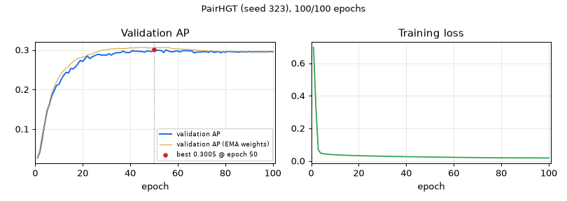

# PairHGT — seed 323

[← all models](../README.md) · PairHGT notebook · ogbg-molpcba

| | |
|---|---|
| State | **finished** |
| Epochs | 100 of 100 |
| Best validation AP | **0.3005** at epoch 50 |
| Best validation AP, EMA weights | 0.3065 at epoch 45 |
| Test AP | raw 0.2967 / ema 0.3050 (final) |
| Seed | 323 |
| Parameters | 9,751,972 |
| Minutes per epoch (last 5, incl. validation) | 5.1 |
| Training time so far | 8.6 h |
| Training time left | done |
| Sessions (start + resumes) | 2 |
| Hottest GPU reading | 89.0 °C |
| Last update | 2026-11-13 04:01 (38.1 h ago) |



<details><summary>Settings of this run</summary>

| Setting | Value |
|---|---|
| Epochs (warm-up) | 100 (5) |
| Batch size | 512 |
| Learning rate, weight decay | 0.0005, 1e-05 |
| Layers × width, heads | 5 × 384, 4 |
| Dropout, attention dropout | 0.2, 0.5 |
| Pair channel | width 16, dropout 0.1, value gate True |
| Precision | fp32 (TF32 matrix products) |
| EMA decay | 0.9995 |
| Gradient clip | 1.0 |
| Protocol | v2_test_once |
| Notebook version, config hash | pairhgt-confirmatory-v2.0, 9171049c2c7acf57 |

</details>

## Final test (evaluated once)

| Weights | Epoch | Validation AP | Test AP |
|---|---|---|---|
| raw | 50 | 0.3005 | 0.2967 |
| ema | 45 | 0.3065 | 0.3050 |

## Every epoch (newest first)

| Epoch | Train loss | Val AP | Val AP (EMA weights) | Best so far | LR | Minutes |
|---|---|---|---|---|---|---|
| 100 | 0.0183 | 0.2952 | 0.2954 | 0.3005 (ep 50) | 1.37e-07 | 5.1 |
| 99 | 0.0183 | 0.2958 | 0.2955 | 0.3005 (ep 50) | 5.47e-07 | 5.2 |
| 98 | 0.0183 | 0.2953 | 0.2955 | 0.3005 (ep 50) | 1.23e-06 | 5.1 |
| 97 | 0.0183 | 0.2952 | 0.2956 | 0.3005 (ep 50) | 2.18e-06 | 5.1 |
| 96 | 0.0183 | 0.2950 | 0.2955 | 0.3005 (ep 50) | 3.41e-06 | 5.1 |
| 95 | 0.0183 | 0.2955 | 0.2953 | 0.3005 (ep 50) | 4.91e-06 | 5.1 |
| 94 | 0.0184 | 0.2952 | 0.2954 | 0.3005 (ep 50) | 6.67e-06 | 5.1 |
| 93 | 0.0184 | 0.2951 | 0.2955 | 0.3005 (ep 50) | 8.70e-06 | 5.1 |
| 92 | 0.0184 | 0.2952 | 0.2956 | 0.3005 (ep 50) | 1.10e-05 | 5.1 |
| 91 | 0.0184 | 0.2948 | 0.2952 | 0.3005 (ep 50) | 1.35e-05 | 5.2 |
| 90 | 0.0185 | 0.2958 | 0.2951 | 0.3005 (ep 50) | 1.64e-05 | 5.1 |
| 89 | 0.0185 | 0.2946 | 0.2952 | 0.3005 (ep 50) | 1.94e-05 | 5.1 |
| 88 | 0.0186 | 0.2953 | 0.2956 | 0.3005 (ep 50) | 2.27e-05 | 5.1 |
| 87 | 0.0186 | 0.2954 | 0.2960 | 0.3005 (ep 50) | 2.63e-05 | 5.1 |
| 86 | 0.0187 | 0.2946 | 0.2961 | 0.3005 (ep 50) | 3.01e-05 | 5.2 |
| 85 | 0.0187 | 0.2944 | 0.2960 | 0.3005 (ep 50) | 3.42e-05 | 5.1 |
| 84 | 0.0188 | 0.2955 | 0.2963 | 0.3005 (ep 50) | 3.85e-05 | 5.1 |
| 83 | 0.0189 | 0.2950 | 0.2957 | 0.3005 (ep 50) | 4.30e-05 | 5.1 |
| 82 | 0.0189 | 0.2957 | 0.2955 | 0.3005 (ep 50) | 4.77e-05 | 5.1 |
| 81 | 0.0190 | 0.2957 | 0.2958 | 0.3005 (ep 50) | 5.27e-05 | 5.1 |
| 80 | 0.0191 | 0.2941 | 0.2958 | 0.3005 (ep 50) | 5.79e-05 | 5.1 |
| 79 | 0.0193 | 0.2951 | 0.2956 | 0.3005 (ep 50) | 6.33e-05 | 5.1 |
| 78 | 0.0193 | 0.2930 | 0.2957 | 0.3005 (ep 50) | 6.89e-05 | 5.1 |
| 77 | 0.0194 | 0.2959 | 0.2963 | 0.3005 (ep 50) | 7.47e-05 | 5.1 |
| 76 | 0.0195 | 0.2940 | 0.2967 | 0.3005 (ep 50) | 8.07e-05 | 5.2 |
| 75 | 0.0197 | 0.2943 | 0.2969 | 0.3005 (ep 50) | 8.69e-05 | 5.2 |
| 74 | 0.0198 | 0.2973 | 0.2971 | 0.3005 (ep 50) | 9.32e-05 | 5.1 |
| 73 | 0.0199 | 0.2936 | 0.2974 | 0.3005 (ep 50) | 9.97e-05 | 5.1 |
| 72 | 0.0200 | 0.2955 | 0.2978 | 0.3005 (ep 50) | 1.06e-04 | 5.1 |
| 71 | 0.0202 | 0.2957 | 0.2977 | 0.3005 (ep 50) | 1.13e-04 | 5.1 |
| 70 | 0.0203 | 0.2946 | 0.2988 | 0.3005 (ep 50) | 1.20e-04 | 5.1 |
| 69 | 0.0205 | 0.2949 | 0.2988 | 0.3005 (ep 50) | 1.27e-04 | 5.1 |
| 68 | 0.0206 | 0.2944 | 0.2996 | 0.3005 (ep 50) | 1.35e-04 | 5.1 |
| 67 | 0.0208 | 0.2927 | 0.3003 | 0.3005 (ep 50) | 1.42e-04 | 5.1 |
| 66 | 0.0209 | 0.2972 | 0.3005 | 0.3005 (ep 50) | 1.50e-04 | 5.1 |
| 65 | 0.0211 | 0.2977 | 0.3016 | 0.3005 (ep 50) | 1.57e-04 | 5.1 |
| 64 | 0.0213 | 0.2982 | 0.3012 | 0.3005 (ep 50) | 1.65e-04 | 5.1 |
| 63 | 0.0215 | 0.2979 | 0.3016 | 0.3005 (ep 50) | 1.73e-04 | 5.1 |
| 62 | 0.0216 | 0.2983 | 0.3020 | 0.3005 (ep 50) | 1.81e-04 | 5.1 |
| 61 | 0.0218 | 0.2949 | 0.3024 | 0.3005 (ep 50) | 1.89e-04 | 5.1 |
| 60 | 0.0220 | 0.2973 | 0.3029 | 0.3005 (ep 50) | 1.97e-04 | 5.1 |
| 59 | 0.0222 | 0.2973 | 0.3033 | 0.3005 (ep 50) | 2.05e-04 | 5.1 |
| 58 | 0.0224 | 0.2950 | 0.3028 | 0.3005 (ep 50) | 2.13e-04 | 5.1 |
| 57 | 0.0226 | 0.2955 | 0.3044 | 0.3005 (ep 50) | 2.21e-04 | 5.1 |
| 56 | 0.0228 | 0.2976 | 0.3061 | 0.3005 (ep 50) | 2.29e-04 | 5.1 |
| 55 | 0.0230 | 0.2999 | 0.3059 | 0.3005 (ep 50) | 2.38e-04 | 5.1 |
| 54 | 0.0231 | 0.2936 | 0.3060 | 0.3005 (ep 50) | 2.46e-04 | 5.1 |
| 53 | 0.0234 | 0.2988 | 0.3060 | 0.3005 (ep 50) | 2.54e-04 | 5.1 |
| 52 | 0.0236 | 0.2990 | 0.3055 | 0.3005 (ep 50) | 2.62e-04 | 5.1 |
| 51 | 0.0238 | 0.2989 | 0.3059 | 0.3005 (ep 50) | 2.71e-04 | 5.1 |
| 50 | 0.0240 | 0.3005 ⭐ | 0.3049 | 0.3005 (ep 50) | 2.79e-04 | 5.1 |
| 49 | 0.0242 | 0.2962 | 0.3051 | 0.2986 (ep 41) | 2.87e-04 | 5.1 |
| 48 | 0.0244 | 0.2967 | 0.3049 | 0.2986 (ep 41) | 2.95e-04 | 5.1 |
| 47 | 0.0246 | 0.2975 | 0.3057 | 0.2986 (ep 41) | 3.03e-04 | 5.2 |
| 46 | 0.0249 | 0.2941 | 0.3064 | 0.2986 (ep 41) | 3.11e-04 | 5.1 |
| 45 | 0.0251 | 0.2962 | 0.3065 | 0.2986 (ep 41) | 3.19e-04 | 5.1 |
| 44 | 0.0253 | 0.2962 | 0.3060 | 0.2986 (ep 41) | 3.27e-04 | 5.1 |
| 43 | 0.0256 | 0.2968 | 0.3056 | 0.2986 (ep 41) | 3.35e-04 | 5.1 |
| 42 | 0.0258 | 0.2965 | 0.3051 | 0.2986 (ep 41) | 3.43e-04 | 5.1 |
| 41 | 0.0260 | 0.2986 ⭐ | 0.3051 | 0.2986 (ep 41) | 3.50e-04 | 5.1 |
| 40 | 0.0262 | 0.2941 | 0.3051 | 0.2969 (ep 37) | 3.58e-04 | 5.1 |
| 39 | 0.0265 | 0.2929 | 0.3044 | 0.2969 (ep 37) | 3.65e-04 | 5.1 |
| 38 | 0.0267 | 0.2939 | 0.3035 | 0.2969 (ep 37) | 3.73e-04 | 5.1 |
| 37 | 0.0270 | 0.2969 ⭐ | 0.3033 | 0.2969 (ep 37) | 3.80e-04 | 5.1 |
| 36 | 0.0272 | 0.2935 ⭐ | 0.3034 | 0.2935 (ep 36) | 3.87e-04 | 5.1 |
| 35 | 0.0275 | 0.2928 ⭐ | 0.3041 | 0.2928 (ep 35) | 3.94e-04 | 5.1 |
| 34 | 0.0277 | 0.2927 ⭐ | 0.3034 | 0.2927 (ep 34) | 4.00e-04 | 5.1 |
| 33 | 0.0281 | 0.2905 | 0.3029 | 0.2906 (ep 31) | 4.07e-04 | 5.1 |
| 32 | 0.0283 | 0.2869 | 0.3026 | 0.2906 (ep 31) | 4.13e-04 | 5.1 |
| 31 | 0.0286 | 0.2906 ⭐ | 0.3015 | 0.2906 (ep 31) | 4.19e-04 | 5.1 |
| 30 | 0.0288 | 0.2863 | 0.3007 | 0.2887 (ep 27) | 4.25e-04 | 5.1 |
| 29 | 0.0291 | 0.2877 | 0.3000 | 0.2887 (ep 27) | 4.31e-04 | 5.1 |
| 28 | 0.0294 | 0.2865 | 0.2991 | 0.2887 (ep 27) | 4.37e-04 | 5.1 |
| 27 | 0.0296 | 0.2887 ⭐ | 0.2969 | 0.2887 (ep 27) | 4.42e-04 | 5.1 |
| 26 | 0.0300 | 0.2882 ⭐ | 0.2946 | 0.2882 (ep 26) | 4.47e-04 | 5.2 |
| 25 | 0.0302 | 0.2851 ⭐ | 0.2934 | 0.2851 (ep 25) | 4.52e-04 | 5.1 |
| 24 | 0.0307 | 0.2827 | 0.2900 | 0.2848 (ep 22) | 4.57e-04 | 5.2 |
| 23 | 0.0314 | 0.2780 | 0.2886 | 0.2848 (ep 22) | 4.62e-04 | 5.2 |
| 22 | 0.0313 | 0.2848 ⭐ | 0.2870 | 0.2848 (ep 22) | 4.66e-04 | 5.1 |
| 21 | 0.0319 | 0.2783 ⭐ | 0.2834 | 0.2783 (ep 21) | 4.70e-04 | 5.1 |
| 20 | 0.0328 | 0.2708 | 0.2813 | 0.2735 (ep 19) | 4.74e-04 | 5.1 |
| 19 | 0.0324 | 0.2735 ⭐ | 0.2805 | 0.2735 (ep 19) | 4.77e-04 | 5.1 |
| 18 | 0.0329 | 0.2653 ⭐ | 0.2783 | 0.2653 (ep 18) | 4.81e-04 | 5.1 |
| 17 | 0.0334 | 0.2575 ⭐ | 0.2753 | 0.2575 (ep 17) | 4.84e-04 | 5.1 |
| 16 | 0.0339 | 0.2520 | 0.2698 | 0.2532 (ep 15) | 4.86e-04 | 5.1 |
| 15 | 0.0345 | 0.2532 ⭐ | 0.2647 | 0.2532 (ep 15) | 4.89e-04 | 5.1 |
| 14 | 0.0351 | 0.2415 | 0.2585 | 0.2434 (ep 13) | 4.91e-04 | 5.1 |
| 13 | 0.0358 | 0.2434 ⭐ | 0.2535 | 0.2434 (ep 13) | 4.93e-04 | 5.2 |
| 12 | 0.0364 | 0.2360 ⭐ | 0.2480 | 0.2360 (ep 12) | 4.95e-04 | 5.1 |
| 11 | 0.0371 | 0.2254 ⭐ | 0.2407 | 0.2254 (ep 11) | 4.97e-04 | 5.2 |
| 10 | 0.0379 | 0.2128 ⭐ | 0.2304 | 0.2128 (ep 10) | 4.98e-04 | 5.1 |
| 9 | 0.0388 | 0.2107 ⭐ | 0.2198 | 0.2107 (ep 9) | 4.99e-04 | 5.1 |
| 8 | 0.0398 | 0.1969 ⭐ | 0.2067 | 0.1969 (ep 8) | 4.99e-04 | 5.1 |
| 7 | 0.0410 | 0.1841 ⭐ | 0.1915 | 0.1841 (ep 7) | 5.00e-04 | 5.2 |
| 6 | 0.0427 | 0.1633 ⭐ | 0.1661 | 0.1633 (ep 6) | 5.00e-04 | 5.2 |
| 5 | 0.0448 | 0.1451 ⭐ | 0.1406 | 0.1451 (ep 5) | 4.00e-04 | 5.2 |
| 4 | 0.0479 | 0.1127 ⭐ | 0.1109 | 0.1127 (ep 4) | 3.00e-04 | 5.1 |
| 3 | 0.0682 | 0.0790 ⭐ | 0.0690 | 0.0790 (ep 3) | 2.00e-04 | 5.1 |
| 2 | 0.3290 | 0.0425 ⭐ | 0.0406 | 0.0425 (ep 2) | 1.00e-04 | 5.1 |
| 1 | 0.6971 | 0.0271 ⭐ | 0.0271 | 0.0271 (ep 1) | 5.00e-10 | 5.1 |

## Last 80 log lines

_The log counts epochs from 0; the tables above count from 1._

```
RWSE loaded from cache
graphs: total 437,929 | train 350,343 | val 43,793 | test 43,793 | ready in 2s
steps/epoch: train 685, val 86, test 86
--- cell 6 ---
PairHGT: GPS + pair channel (pair bias + write-back, value gate) [arm PairHGT]: 9,751,972 parameters = baseline 9,744,860 + 7,112 (0.07%), of which the pair channel 7,112
parameter count matches the expected 9,751,972 for arm PairHGT
--- cell 7 ---
--- cell 9 ---
--- cell 10 ---
--- cell 12 ---
RUN_DEBUG_FIRST is False: smoke test skipped.
--- cell 14 ---
Restored 0 seed folder(s).
prereg.json checked: configuration identical (hash 9171049c2c7acf57); seeds [101, 202, 323, 432, 543]
[seed 323] RESUMED from epoch 68/100 (lr 1.27e-04, best val AP so far 0.3005)
[seed 323] epoch  69/100 | lr 1.27e-04 | train BCE 0.0205 | val AP 0.2949 | best val 0.3005 @ep50 | EMA val 0.2988 | 308s (train 274s, eval 34s) | GPU max 89C | ETA<= 2.7h
[seed 323] epoch  70/100 | lr 1.20e-04 | train BCE 0.0203 | val AP 0.2946 | best val 0.3005 @ep50 | EMA val 0.2988 | 309s (train 275s, eval 34s) | GPU max 89C | ETA<= 2.6h
[seed 323] epoch  71/100 | lr 1.13e-04 | train BCE 0.0202 | val AP 0.2957 | best val 0.3005 @ep50 | EMA val 0.2977 | 308s (train 275s, eval 34s) | GPU max 89C | ETA<= 2.5h
[seed 323] epoch  72/100 | lr 1.06e-04 | train BCE 0.0200 | val AP 0.2955 | best val 0.3005 @ep50 | EMA val 0.2978 | 308s (train 275s, eval 34s) | GPU max 89C | ETA<= 2.4h
[seed 323] epoch  73/100 | lr 9.97e-05 | train BCE 0.0199 | val AP 0.2936 | best val 0.3005 @ep50 | EMA val 0.2974 | 309s (train 275s, eval 34s) | GPU max 89C | ETA<= 2.3h
[seed 323] epoch  74/100 | lr 9.32e-05 | train BCE 0.0198 | val AP 0.2973 | best val 0.3005 @ep50 | EMA val 0.2971 | 309s (train 275s, eval 34s) | GPU max 89C | ETA<= 2.2h
[seed 323] epoch  75/100 | lr 8.69e-05 | train BCE 0.0197 | val AP 0.2943 | best val 0.3005 @ep50 | EMA val 0.2969 | 309s (train 275s, eval 34s) | GPU max 89C | ETA<= 2.1h
[seed 323] epoch  76/100 | lr 8.07e-05 | train BCE 0.0195 | val AP 0.2940 | best val 0.3005 @ep50 | EMA val 0.2967 | 309s (train 275s, eval 34s) | GPU max 89C | ETA<= 2.1h
[seed 323] epoch  77/100 | lr 7.47e-05 | train BCE 0.0194 | val AP 0.2959 | best val 0.3005 @ep50 | EMA val 0.2963 | 309s (train 275s, eval 34s) | GPU max 89C | ETA<= 2.0h
[seed 323] epoch  78/100 | lr 6.89e-05 | train BCE 0.0193 | val AP 0.2930 | best val 0.3005 @ep50 | EMA val 0.2957 | 309s (train 275s, eval 34s) | GPU max 89C | ETA<= 1.9h
[seed 323] epoch  79/100 | lr 6.33e-05 | train BCE 0.0193 | val AP 0.2951 | best val 0.3005 @ep50 | EMA val 0.2956 | 309s (train 275s, eval 34s) | GPU max 89C | ETA<= 1.8h
[seed 323] epoch  80/100 | lr 5.79e-05 | train BCE 0.0191 | val AP 0.2941 | best val 0.3005 @ep50 | EMA val 0.2958 | 309s (train 275s, eval 34s) | GPU max 89C | ETA<= 1.7h
[seed 323] epoch  81/100 | lr 5.27e-05 | train BCE 0.0190 | val AP 0.2957 | best val 0.3005 @ep50 | EMA val 0.2958 | 309s (train 275s, eval 34s) | GPU max 89C | ETA<= 1.6h
[seed 323] epoch  82/100 | lr 4.77e-05 | train BCE 0.0189 | val AP 0.2957 | best val 0.3005 @ep50 | EMA val 0.2955 | 309s (train 275s, eval 34s) | GPU max 89C | ETA<= 1.5h
[seed 323] epoch  83/100 | lr 4.30e-05 | train BCE 0.0189 | val AP 0.2950 | best val 0.3005 @ep50 | EMA val 0.2957 | 308s (train 275s, eval 34s) | GPU max 89C | ETA<= 1.5h
[seed 323] epoch  84/100 | lr 3.85e-05 | train BCE 0.0188 | val AP 0.2955 | best val 0.3005 @ep50 | EMA val 0.2963 | 308s (train 275s, eval 34s) | GPU max 89C | ETA<= 1.4h
[seed 323] epoch  85/100 | lr 3.42e-05 | train BCE 0.0187 | val AP 0.2944 | best val 0.3005 @ep50 | EMA val 0.2960 | 309s (train 275s, eval 34s) | GPU max 89C | ETA<= 1.3h
[seed 323] epoch  86/100 | lr 3.01e-05 | train BCE 0.0187 | val AP 0.2946 | best val 0.3005 @ep50 | EMA val 0.2961 | 309s (train 275s, eval 34s) | GPU max 89C | ETA<= 1.2h
[seed 323] epoch  87/100 | lr 2.63e-05 | train BCE 0.0186 | val AP 0.2954 | best val 0.3005 @ep50 | EMA val 0.2960 | 309s (train 275s, eval 34s) | GPU max 89C | ETA<= 1.1h
[seed 323] epoch  88/100 | lr 2.27e-05 | train BCE 0.0186 | val AP 0.2953 | best val 0.3005 @ep50 | EMA val 0.2956 | 309s (train 275s, eval 34s) | GPU max 89C | ETA<= 1.0h
[seed 323] epoch  89/100 | lr 1.94e-05 | train BCE 0.0185 | val AP 0.2946 | best val 0.3005 @ep50 | EMA val 0.2952 | 309s (train 275s, eval 34s) | GPU max 89C | ETA<= 0.9h
[seed 323] epoch  90/100 | lr 1.64e-05 | train BCE 0.0185 | val AP 0.2958 | best val 0.3005 @ep50 | EMA val 0.2951 | 309s (train 275s, eval 34s) | GPU max 89C | ETA<= 0.9h
[seed 323] epoch  91/100 | lr 1.35e-05 | train BCE 0.0184 | val AP 0.2948 | best val 0.3005 @ep50 | EMA val 0.2952 | 309s (train 275s, eval 34s) | GPU max 89C | ETA<= 0.8h
[seed 323] epoch  92/100 | lr 1.10e-05 | train BCE 0.0184 | val AP 0.2952 | best val 0.3005 @ep50 | EMA val 0.2956 | 309s (train 275s, eval 34s) | GPU max 89C | ETA<= 0.7h
[seed 323] epoch  93/100 | lr 8.70e-06 | train BCE 0.0184 | val AP 0.2951 | best val 0.3005 @ep50 | EMA val 0.2955 | 308s (train 275s, eval 34s) | GPU max 89C | ETA<= 0.6h
[seed 323] epoch  94/100 | lr 6.67e-06 | train BCE 0.0184 | val AP 0.2952 | best val 0.3005 @ep50 | EMA val 0.2954 | 309s (train 275s, eval 34s) | GPU max 89C | ETA<= 0.5h
[seed 323] epoch  95/100 | lr 4.91e-06 | train BCE 0.0183 | val AP 0.2955 | best val 0.3005 @ep50 | EMA val 0.2953 | 309s (train 275s, eval 34s) | GPU max 89C | ETA<= 0.4h
[seed 323] epoch  96/100 | lr 3.41e-06 | train BCE 0.0183 | val AP 0.2950 | best val 0.3005 @ep50 | EMA val 0.2955 | 308s (train 274s, eval 34s) | GPU max 89C | ETA<= 0.3h
[seed 323] epoch  97/100 | lr 2.18e-06 | train BCE 0.0183 | val AP 0.2952 | best val 0.3005 @ep50 | EMA val 0.2956 | 308s (train 275s, eval 34s) | GPU max 89C | ETA<= 0.3h
[seed 323] epoch  98/100 | lr 1.23e-06 | train BCE 0.0183 | val AP 0.2953 | best val 0.3005 @ep50 | EMA val 0.2955 | 309s (train 275s, eval 34s) | GPU max 89C | ETA<= 0.2h
[seed 323] epoch  99/100 | lr 5.47e-07 | train BCE 0.0183 | val AP 0.2958 | best val 0.3005 @ep50 | EMA val 0.2955 | 309s (train 275s, eval 34s) | GPU max 89C | ETA<= 0.1h
[seed 323] epoch 100/100 | lr 1.37e-07 | train BCE 0.0183 | val AP 0.2952 | best val 0.3005 @ep50 | EMA val 0.2954 | 308s (train 275s, eval 34s) | GPU max 89C | ETA<= 0.0h
[seed 323] FINAL TEST (evaluated once): raw epoch 50 val 0.3005 test 0.2967 | EMA epoch 45 val 0.3065 test 0.3050
--- cell 16 ---
PairHGT: GPS + pair channel (pair bias + write-back, value gate) [arm PairHGT] | gps_conf_PairHGT_ep100_molpcba
 seed  epochs  raw_epoch  raw_val  raw_test  ema_epoch  ema_val  ema_test  hours  train_s_per_epoch  total_s_per_epoch
  101 100/100         39   0.3056    0.2943         40   0.3131    0.3043 8.6342           276.5795           310.8298
  202 100/100         62   0.3036    0.2963         48   0.3097    0.3062 8.5534           274.3556           307.9222
  323 100/100         50   0.3005    0.2967         45   0.3065    0.3050 8.5744           275.0306           308.6781
  432  68/100         48   0.3045       NaN         41   0.3118       NaN 5.8363           275.2987           308.9816
mean ± sample SD (ddof=1) over 3 seed(s): raw test 0.2958 ± 0.0013 | EMA test 0.3051 ± 0.0010
A mean ± SD over fewer than 3 seeds is only a description; do not call it a confidence interval.
/tmp/ipykernel_413057/1726116603.py:55: UserWarning: No artists with labels found to put in legend.  Note that artists whose label start with an underscore are ignored when legend() is called with no argument.
  ax.set(title=f"seed {s} (circle = selected raw, square = selected EMA)", xlabel="epoch", ylabel="validation AP"); ax.grid(alpha=0.25); ax.legend(fontsize=7)
run manifest: 8 row(s) -> /home/student/thesis/outputs/pairhgt/outputs/confirmatory/run_manifest.csv
    model              gpu  seeds  params  train_s_per_epoch  val_eval_s_per_epoch  total_s_per_epoch  hours_per_seed  time_vs_GPS+EMA
GPS + EMA NVIDIA RTX A4000      4 9744860             160.68                 15.87             176.57             4.9             1.00
  PairHGT NVIDIA RTX A4000      4 9751972             275.32                 33.77             309.10             7.9             1.75
train = training steps incl. EMA update; val_eval = validation of raw + EMA weights; no test pass inside an epoch (protocol v2). Do not compare with timings from the exploratory runs.
--- cell 18 ---
=== PairHGT  minus  GPS + EMA   (100 epochs, matched seeds) ===
 seed  raw_val  ema_val  raw_test  ema_test
  101   0.0013   0.0027    0.0043    0.0048
  202   0.0017   0.0012    0.0067    0.0115
  323   0.0021   0.0022    0.0019    0.0056
  validation AP, raw    : mean +0.0017, sample SD 0.0004, per-seed [0.0013, 0.0017, 0.0021], all positive: True | 95% t-interval [+0.0006, +0.0028] (n=3, t=6.67)
  validation AP, EMA    : mean +0.0020, sample SD 0.0008, per-seed [0.0027, 0.0012, 0.0022], all positive: True | 95% t-interval [+0.0002, +0.0039] (n=3, t=4.65)
  test AP, raw vs raw   : mean +0.0043, sample SD 0.0024, per-seed [0.0043, 0.0067, 0.0019], all positive: True | 95% t-interval [-0.0016, +0.0102] (n=3, t=3.11)
  test AP, EMA vs EMA   : mean +0.0073, sample SD 0.0037, per-seed [0.0048, 0.0115, 0.0056], all positive: True | 95% t-interval [-0.0019, +0.0165] (n=3, t=3.42)
  Reading: 3 matched seed(s). The claim is limited to whether the direction of the EMA-vs-EMA difference repeats; a significance claim needs many more seeds.
Planning table (80% power, alpha 0.05, two-sample t, test AP): smallest detectable true difference
  per-seed SD 0.003: n=3: 0.0092, n=5: 0.0061, n=10: 0.0040, n=20: 0.0027
  per-seed SD 0.0056: n=3: 0.0172, n=5: 0.0113, n=10: 0.0074, n=20: 0.0051
--- cell 20 ---
===== 2026-11-13 04:02:20 notebook turn ended (exit 0); executed notebook: /home/student/thesis/outputs/lab_runs/notebooks/pairhgt_PairHGT_seed323_20261113-0116.ipynb =====
```
