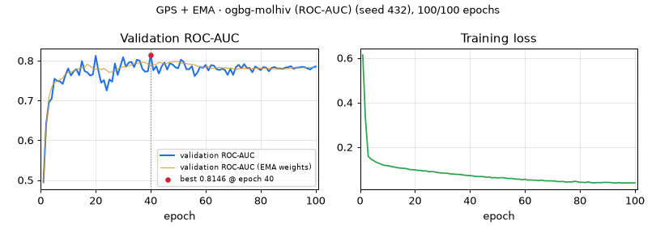

# GPS + EMA · ogbg-molhiv (ROC-AUC) — seed 432

[← all models](../README.md) · PairHGT notebook · ogbg-molhiv

| | |
|---|---|
| State | **finished** |
| Epochs | 100 of 100 |
| Best validation ROC-AUC | **0.8146** at epoch 40 |
| Best validation ROC-AUC, EMA weights | 0.7987 at epoch 49 |
| Test ROC-AUC | raw 0.7984 / ema 0.8011 (final) |
| Seed | 432 |
| Parameters | 558,673 |
| Minutes per epoch (last 5, incl. validation) | 0.8 |
| Training time so far | 1.4 h |
| Training time left | done |
| Sessions (start + resumes) | 1 |
| Hottest GPU reading | 53.0 °C |
| Last update | 2026-11-23 07:04 (131.0 h ago) |



<details><summary>Settings of this run</summary>

| Setting | Value |
|---|---|
| Epochs (warm-up) | 100 (5) |
| Batch size | 32 |
| Learning rate, weight decay | 0.0001, 1e-05 |
| Layers × width, heads | 10 × 64, 4 |
| Dropout, attention dropout | 0.05, 0.5 |
| Pair channel | no pair channel |
| Precision | fp32 (TF32 matrix products) |
| EMA decay | 0.9996632505026597 |
| Gradient clip | 1.0 |
| Protocol | v2_test_once |
| Notebook version, config hash | pairhgt-generalization-v1.0, 7b53e24f167e1773 |

</details>

## Final test (evaluated once)

| Weights | Epoch | Validation ROC-AUC | Test ROC-AUC |
|---|---|---|---|
| raw | 40 | 0.8146 | 0.7984 |
| ema | 49 | 0.7987 | 0.8011 |

## Every epoch (newest first)

| Epoch | Train loss | Val ROC-AUC | Val ROC-AUC (EMA weights) | Best so far | LR | Minutes |
|---|---|---|---|---|---|---|
| 100 | 0.0401 | 0.7854 | 0.7827 | 0.8146 (ep 40) | 2.73e-08 | 0.8 |
| 99 | 0.0398 | 0.7829 | 0.7828 | 0.8146 (ep 40) | 1.09e-07 | 0.8 |
| 98 | 0.0399 | 0.7777 | 0.7828 | 0.8146 (ep 40) | 2.46e-07 | 0.8 |
| 97 | 0.0397 | 0.7807 | 0.7828 | 0.8146 (ep 40) | 4.37e-07 | 0.8 |
| 96 | 0.0395 | 0.7836 | 0.7825 | 0.8146 (ep 40) | 6.82e-07 | 0.8 |
| 95 | 0.0396 | 0.7846 | 0.7821 | 0.8146 (ep 40) | 9.81e-07 | 0.8 |
| 94 | 0.0414 | 0.7828 | 0.7820 | 0.8146 (ep 40) | 1.33e-06 | 0.8 |
| 93 | 0.0390 | 0.7826 | 0.7821 | 0.8146 (ep 40) | 1.74e-06 | 0.8 |
| 92 | 0.0403 | 0.7795 | 0.7821 | 0.8146 (ep 40) | 2.20e-06 | 0.8 |
| 91 | 0.0418 | 0.7862 | 0.7815 | 0.8146 (ep 40) | 2.71e-06 | 0.8 |
| 90 | 0.0419 | 0.7836 | 0.7805 | 0.8146 (ep 40) | 3.27e-06 | 0.8 |
| 89 | 0.0424 | 0.7826 | 0.7796 | 0.8146 (ep 40) | 3.89e-06 | 0.8 |
| 88 | 0.0412 | 0.7792 | 0.7797 | 0.8146 (ep 40) | 4.55e-06 | 0.8 |
| 87 | 0.0411 | 0.7807 | 0.7800 | 0.8146 (ep 40) | 5.26e-06 | 0.8 |
| 86 | 0.0412 | 0.7802 | 0.7802 | 0.8146 (ep 40) | 6.03e-06 | 0.8 |
| 85 | 0.0401 | 0.7843 | 0.7798 | 0.8146 (ep 40) | 6.84e-06 | 0.8 |
| 84 | 0.0414 | 0.7820 | 0.7798 | 0.8146 (ep 40) | 7.70e-06 | 0.8 |
| 83 | 0.0445 | 0.7733 | 0.7808 | 0.8146 (ep 40) | 8.60e-06 | 0.8 |
| 82 | 0.0416 | 0.7827 | 0.7813 | 0.8146 (ep 40) | 9.55e-06 | 0.8 |
| 81 | 0.0426 | 0.7837 | 0.7807 | 0.8146 (ep 40) | 1.05e-05 | 0.8 |
| 80 | 0.0426 | 0.7763 | 0.7809 | 0.8146 (ep 40) | 1.16e-05 | 0.8 |
| 79 | 0.0454 | 0.7812 | 0.7812 | 0.8146 (ep 40) | 1.27e-05 | 0.8 |
| 78 | 0.0470 | 0.7853 | 0.7808 | 0.8146 (ep 40) | 1.38e-05 | 0.8 |
| 77 | 0.0439 | 0.7708 | 0.7800 | 0.8146 (ep 40) | 1.49e-05 | 0.8 |
| 76 | 0.0446 | 0.7814 | 0.7796 | 0.8146 (ep 40) | 1.61e-05 | 0.8 |
| 75 | 0.0436 | 0.7817 | 0.7801 | 0.8146 (ep 40) | 1.74e-05 | 0.8 |
| 74 | 0.0461 | 0.7914 | 0.7804 | 0.8146 (ep 40) | 1.86e-05 | 0.8 |
| 73 | 0.0461 | 0.7808 | 0.7809 | 0.8146 (ep 40) | 1.99e-05 | 0.8 |
| 72 | 0.0456 | 0.7898 | 0.7799 | 0.8146 (ep 40) | 2.13e-05 | 0.8 |
| 71 | 0.0481 | 0.7834 | 0.7778 | 0.8146 (ep 40) | 2.27e-05 | 0.8 |
| 70 | 0.0487 | 0.7644 | 0.7796 | 0.8146 (ep 40) | 2.41e-05 | 0.8 |
| 69 | 0.0491 | 0.7792 | 0.7816 | 0.8146 (ep 40) | 2.55e-05 | 0.8 |
| 68 | 0.0493 | 0.7643 | 0.7810 | 0.8146 (ep 40) | 2.69e-05 | 0.8 |
| 67 | 0.0496 | 0.7768 | 0.7822 | 0.8146 (ep 40) | 2.84e-05 | 0.8 |
| 66 | 0.0523 | 0.7797 | 0.7816 | 0.8146 (ep 40) | 2.99e-05 | 0.8 |
| 65 | 0.0502 | 0.7763 | 0.7831 | 0.8146 (ep 40) | 3.14e-05 | 0.8 |
| 64 | 0.0520 | 0.7786 | 0.7818 | 0.8146 (ep 40) | 3.30e-05 | 0.8 |
| 63 | 0.0522 | 0.7875 | 0.7813 | 0.8146 (ep 40) | 3.45e-05 | 0.8 |
| 62 | 0.0532 | 0.7889 | 0.7806 | 0.8146 (ep 40) | 3.61e-05 | 0.8 |
| 61 | 0.0525 | 0.7754 | 0.7849 | 0.8146 (ep 40) | 3.77e-05 | 0.8 |
| 60 | 0.0567 | 0.7893 | 0.7841 | 0.8146 (ep 40) | 3.93e-05 | 0.8 |
| 59 | 0.0539 | 0.7817 | 0.7820 | 0.8146 (ep 40) | 4.10e-05 | 0.8 |
| 58 | 0.0568 | 0.7846 | 0.7836 | 0.8146 (ep 40) | 4.26e-05 | 0.8 |
| 57 | 0.0565 | 0.7701 | 0.7861 | 0.8146 (ep 40) | 4.42e-05 | 0.8 |
| 56 | 0.0584 | 0.7614 | 0.7896 | 0.8146 (ep 40) | 4.59e-05 | 0.8 |
| 55 | 0.0602 | 0.7865 | 0.7905 | 0.8146 (ep 40) | 4.75e-05 | 0.8 |
| 54 | 0.0595 | 0.7785 | 0.7916 | 0.8146 (ep 40) | 4.92e-05 | 0.8 |
| 53 | 0.0614 | 0.7786 | 0.7923 | 0.8146 (ep 40) | 5.08e-05 | 0.8 |
| 52 | 0.0633 | 0.7970 | 0.7933 | 0.8146 (ep 40) | 5.25e-05 | 0.8 |
| 51 | 0.0632 | 0.8024 | 0.7943 | 0.8146 (ep 40) | 5.41e-05 | 0.8 |
| 50 | 0.0621 | 0.7807 | 0.7975 | 0.8146 (ep 40) | 5.58e-05 | 0.8 |
| 49 | 0.0636 | 0.7835 | 0.7987 | 0.8146 (ep 40) | 5.74e-05 | 0.8 |
| 48 | 0.0627 | 0.7901 | 0.7968 | 0.8146 (ep 40) | 5.90e-05 | 0.8 |
| 47 | 0.0662 | 0.7935 | 0.7962 | 0.8146 (ep 40) | 6.07e-05 | 0.8 |
| 46 | 0.0654 | 0.7776 | 0.7937 | 0.8146 (ep 40) | 6.23e-05 | 0.8 |
| 45 | 0.0676 | 0.7953 | 0.7913 | 0.8146 (ep 40) | 6.39e-05 | 0.8 |
| 44 | 0.0686 | 0.7854 | 0.7943 | 0.8146 (ep 40) | 6.55e-05 | 0.8 |
| 43 | 0.0682 | 0.7676 | 0.7959 | 0.8146 (ep 40) | 6.70e-05 | 0.8 |
| 42 | 0.0689 | 0.7861 | 0.7905 | 0.8146 (ep 40) | 6.86e-05 | 0.8 |
| 41 | 0.0713 | 0.7758 | 0.7900 | 0.8146 (ep 40) | 7.01e-05 | 0.8 |
| 40 | 0.0731 | 0.8146 ⭐ | 0.7885 | 0.8146 (ep 40) | 7.16e-05 | 0.8 |
| 39 | 0.0734 | 0.7736 | 0.7915 | 0.8124 (ep 20) | 7.31e-05 | 0.8 |
| 38 | 0.0746 | 0.7722 | 0.7954 | 0.8124 (ep 20) | 7.45e-05 | 0.8 |
| 37 | 0.0768 | 0.7793 | 0.7956 | 0.8124 (ep 20) | 7.59e-05 | 0.8 |
| 36 | 0.0780 | 0.8000 | 0.7956 | 0.8124 (ep 20) | 7.73e-05 | 0.8 |
| 35 | 0.0783 | 0.8023 | 0.7930 | 0.8124 (ep 20) | 7.87e-05 | 0.8 |
| 34 | 0.0796 | 0.7839 | 0.7936 | 0.8124 (ep 20) | 8.01e-05 | 0.8 |
| 33 | 0.0800 | 0.7970 | 0.7900 | 0.8124 (ep 20) | 8.14e-05 | 0.8 |
| 32 | 0.0826 | 0.7950 | 0.7866 | 0.8124 (ep 20) | 8.26e-05 | 0.8 |
| 31 | 0.0834 | 0.7845 | 0.7855 | 0.8124 (ep 20) | 8.39e-05 | 0.8 |
| 30 | 0.0842 | 0.8087 | 0.7845 | 0.8124 (ep 20) | 8.51e-05 | 0.8 |
| 29 | 0.0852 | 0.7864 | 0.7824 | 0.8124 (ep 20) | 8.62e-05 | 0.8 |
| 28 | 0.0865 | 0.7640 | 0.7794 | 0.8124 (ep 20) | 8.73e-05 | 0.8 |
| 27 | 0.0897 | 0.7931 | 0.7736 | 0.8124 (ep 20) | 8.84e-05 | 0.8 |
| 26 | 0.0906 | 0.7472 | 0.7720 | 0.8124 (ep 20) | 8.95e-05 | 0.8 |
| 25 | 0.0902 | 0.7528 | 0.7706 | 0.8124 (ep 20) | 9.05e-05 | 0.8 |
| 24 | 0.0936 | 0.7250 | 0.7756 | 0.8124 (ep 20) | 9.14e-05 | 0.8 |
| 23 | 0.0938 | 0.7511 | 0.7804 | 0.8124 (ep 20) | 9.23e-05 | 0.8 |
| 22 | 0.0959 | 0.7446 | 0.7776 | 0.8124 (ep 20) | 9.32e-05 | 0.8 |
| 21 | 0.0961 | 0.7745 | 0.7805 | 0.8124 (ep 20) | 9.40e-05 | 0.9 |
| 20 | 0.0984 | 0.8124 ⭐ | 0.7784 | 0.8124 (ep 20) | 9.47e-05 | 0.8 |
| 19 | 0.0992 | 0.7655 | 0.7813 | 0.7989 (ep 15) | 9.55e-05 | 0.8 |
| 18 | 0.0999 | 0.7627 | 0.7862 | 0.7989 (ep 15) | 9.61e-05 | 0.8 |
| 17 | 0.1036 | 0.7705 | 0.7910 | 0.7989 (ep 15) | 9.67e-05 | 0.8 |
| 16 | 0.1051 | 0.7736 | 0.7842 | 0.7989 (ep 15) | 9.73e-05 | 0.8 |
| 15 | 0.1059 | 0.7989 ⭐ | 0.7824 | 0.7989 (ep 15) | 9.78e-05 | 0.8 |
| 14 | 0.1073 | 0.7634 | 0.7796 | 0.7805 (ep 10) | 9.83e-05 | 0.8 |
| 13 | 0.1095 | 0.7789 | 0.7774 | 0.7805 (ep 10) | 9.87e-05 | 0.8 |
| 12 | 0.1120 | 0.7731 | 0.7734 | 0.7805 (ep 10) | 9.90e-05 | 0.8 |
| 11 | 0.1148 | 0.7628 | 0.7714 | 0.7805 (ep 10) | 9.93e-05 | 0.8 |
| 10 | 0.1172 | 0.7805 ⭐ | 0.7700 | 0.7805 (ep 10) | 9.96e-05 | 0.8 |
| 9 | 0.1185 | 0.7635 ⭐ | 0.7666 | 0.7635 (ep 9) | 9.98e-05 | 0.8 |
| 8 | 0.1218 | 0.7415 | 0.7562 | 0.7547 (ep 5) | 9.99e-05 | 0.8 |
| 7 | 0.1273 | 0.7481 | 0.7522 | 0.7547 (ep 5) | 1.00e-04 | 0.8 |
| 6 | 0.1320 | 0.7492 | 0.7489 | 0.7547 (ep 5) | 1.00e-04 | 0.8 |
| 5 | 0.1393 | 0.7547 ⭐ | 0.7453 | 0.7547 (ep 5) | 8.00e-05 | 0.8 |
| 4 | 0.1462 | 0.7048 ⭐ | 0.7332 | 0.7048 (ep 4) | 6.00e-05 | 0.8 |
| 3 | 0.1594 | 0.6955 ⭐ | 0.7084 | 0.6955 (ep 3) | 4.00e-05 | 0.8 |
| 2 | 0.3224 | 0.6420 ⭐ | 0.6306 | 0.6420 (ep 2) | 2.00e-05 | 0.8 |
| 1 | 0.6140 | 0.4950 ⭐ | 0.4925 | 0.4950 (ep 1) | 1.00e-10 | 0.8 |

## Last 80 log lines

_The log counts epochs from 0; the tables above count from 1._

```
[seed 543] epoch  53/100 | lr 5.08e-05 | train loss 0.0619 | val ROC-AUC 0.7807 | best val 0.8255 @ep14 | EMA val 0.7975 | 49s (train 44s, eval 5s) | GPU max 53C | ETA<= 0.6h
[seed 543] epoch  54/100 | lr 4.92e-05 | train loss 0.0639 | val ROC-AUC 0.8055 | best val 0.8255 @ep14 | EMA val 0.7990 | 49s (train 45s, eval 5s) | GPU max 52C | ETA<= 0.6h
[seed 543] epoch  55/100 | lr 4.75e-05 | train loss 0.0613 | val ROC-AUC 0.8022 | best val 0.8255 @ep14 | EMA val 0.7997 | 49s (train 44s, eval 5s) | GPU max 52C | ETA<= 0.6h
[seed 543] epoch  56/100 | lr 4.59e-05 | train loss 0.0594 | val ROC-AUC 0.8053 | best val 0.8255 @ep14 | EMA val 0.8021 | 48s (train 44s, eval 5s) | GPU max 53C | ETA<= 0.6h
[seed 543] epoch  57/100 | lr 4.42e-05 | train loss 0.0599 | val ROC-AUC 0.8019 | best val 0.8255 @ep14 | EMA val 0.8031 | 49s (train 44s, eval 5s) | GPU max 53C | ETA<= 0.6h
[seed 543] epoch  58/100 | lr 4.26e-05 | train loss 0.0577 | val ROC-AUC 0.7892 | best val 0.8255 @ep14 | EMA val 0.8039 | 49s (train 44s, eval 5s) | GPU max 53C | ETA<= 0.6h
[seed 543] epoch  59/100 | lr 4.10e-05 | train loss 0.0567 | val ROC-AUC 0.7819 | best val 0.8255 @ep14 | EMA val 0.8027 | 49s (train 44s, eval 5s) | GPU max 53C | ETA<= 0.6h
[seed 543] epoch  60/100 | lr 3.93e-05 | train loss 0.0584 | val ROC-AUC 0.7979 | best val 0.8255 @ep14 | EMA val 0.7990 | 49s (train 44s, eval 5s) | GPU max 52C | ETA<= 0.5h
[seed 543] epoch  61/100 | lr 3.77e-05 | train loss 0.0546 | val ROC-AUC 0.7868 | best val 0.8255 @ep14 | EMA val 0.7975 | 49s (train 44s, eval 5s) | GPU max 52C | ETA<= 0.5h
[seed 543] epoch  62/100 | lr 3.61e-05 | train loss 0.0584 | val ROC-AUC 0.8034 | best val 0.8255 @ep14 | EMA val 0.7959 | 48s (train 44s, eval 5s) | GPU max 53C | ETA<= 0.5h
[seed 543] epoch  63/100 | lr 3.45e-05 | train loss 0.0551 | val ROC-AUC 0.8015 | best val 0.8255 @ep14 | EMA val 0.7996 | 49s (train 45s, eval 5s) | GPU max 52C | ETA<= 0.5h
[seed 543] epoch  64/100 | lr 3.30e-05 | train loss 0.0542 | val ROC-AUC 0.8041 | best val 0.8255 @ep14 | EMA val 0.8018 | 49s (train 45s, eval 5s) | GPU max 52C | ETA<= 0.5h
[seed 543] epoch  65/100 | lr 3.14e-05 | train loss 0.0527 | val ROC-AUC 0.7985 | best val 0.8255 @ep14 | EMA val 0.8032 | 49s (train 44s, eval 5s) | GPU max 52C | ETA<= 0.5h
[seed 543] epoch  66/100 | lr 2.99e-05 | train loss 0.0539 | val ROC-AUC 0.7842 | best val 0.8255 @ep14 | EMA val 0.8028 | 48s (train 44s, eval 5s) | GPU max 52C | ETA<= 0.5h
[seed 543] epoch  67/100 | lr 2.84e-05 | train loss 0.0522 | val ROC-AUC 0.8026 | best val 0.8255 @ep14 | EMA val 0.8011 | 48s (train 44s, eval 5s) | GPU max 52C | ETA<= 0.4h
[seed 543] epoch  68/100 | lr 2.69e-05 | train loss 0.0527 | val ROC-AUC 0.7861 | best val 0.8255 @ep14 | EMA val 0.8001 | 48s (train 43s, eval 5s) | GPU max 52C | ETA<= 0.4h
[seed 543] epoch  69/100 | lr 2.55e-05 | train loss 0.0511 | val ROC-AUC 0.7961 | best val 0.8255 @ep14 | EMA val 0.7970 | 49s (train 44s, eval 5s) | GPU max 52C | ETA<= 0.4h
[seed 543] epoch  70/100 | lr 2.41e-05 | train loss 0.0497 | val ROC-AUC 0.7761 | best val 0.8255 @ep14 | EMA val 0.7950 | 49s (train 45s, eval 5s) | GPU max 52C | ETA<= 0.4h
[seed 543] epoch  71/100 | lr 2.27e-05 | train loss 0.0519 | val ROC-AUC 0.7851 | best val 0.8255 @ep14 | EMA val 0.7911 | 49s (train 45s, eval 5s) | GPU max 52C | ETA<= 0.4h
[seed 543] epoch  72/100 | lr 2.13e-05 | train loss 0.0496 | val ROC-AUC 0.7949 | best val 0.8255 @ep14 | EMA val 0.7913 | 49s (train 45s, eval 5s) | GPU max 52C | ETA<= 0.4h
[seed 543] epoch  73/100 | lr 1.99e-05 | train loss 0.0478 | val ROC-AUC 0.7848 | best val 0.8255 @ep14 | EMA val 0.7916 | 48s (train 44s, eval 5s) | GPU max 52C | ETA<= 0.4h
[seed 543] epoch  74/100 | lr 1.86e-05 | train loss 0.0482 | val ROC-AUC 0.8026 | best val 0.8255 @ep14 | EMA val 0.7940 | 49s (train 44s, eval 5s) | GPU max 52C | ETA<= 0.4h
[seed 543] epoch  75/100 | lr 1.74e-05 | train loss 0.0487 | val ROC-AUC 0.7921 | best val 0.8255 @ep14 | EMA val 0.7954 | 49s (train 44s, eval 5s) | GPU max 52C | ETA<= 0.3h
[seed 543] epoch  76/100 | lr 1.61e-05 | train loss 0.0480 | val ROC-AUC 0.7895 | best val 0.8255 @ep14 | EMA val 0.7944 | 49s (train 44s, eval 5s) | GPU max 52C | ETA<= 0.3h
[seed 543] epoch  77/100 | lr 1.49e-05 | train loss 0.0481 | val ROC-AUC 0.7917 | best val 0.8255 @ep14 | EMA val 0.7946 | 50s (train 45s, eval 5s) | GPU max 51C | ETA<= 0.3h
[seed 543] epoch  78/100 | lr 1.38e-05 | train loss 0.0455 | val ROC-AUC 0.7907 | best val 0.8255 @ep14 | EMA val 0.7948 | 49s (train 44s, eval 5s) | GPU max 51C | ETA<= 0.3h
[seed 543] epoch  79/100 | lr 1.27e-05 | train loss 0.0461 | val ROC-AUC 0.7950 | best val 0.8255 @ep14 | EMA val 0.7953 | 49s (train 44s, eval 5s) | GPU max 51C | ETA<= 0.3h
[seed 543] epoch  80/100 | lr 1.16e-05 | train loss 0.0484 | val ROC-AUC 0.7942 | best val 0.8255 @ep14 | EMA val 0.7960 | 49s (train 44s, eval 5s) | GPU max 51C | ETA<= 0.3h
[seed 543] epoch  81/100 | lr 1.05e-05 | train loss 0.0439 | val ROC-AUC 0.7920 | best val 0.8255 @ep14 | EMA val 0.7956 | 49s (train 44s, eval 5s) | GPU max 51C | ETA<= 0.3h
[seed 543] epoch  82/100 | lr 9.55e-06 | train loss 0.0469 | val ROC-AUC 0.7921 | best val 0.8255 @ep14 | EMA val 0.7954 | 49s (train 44s, eval 5s) | GPU max 51C | ETA<= 0.2h
[seed 543] epoch  83/100 | lr 8.60e-06 | train loss 0.0474 | val ROC-AUC 0.7953 | best val 0.8255 @ep14 | EMA val 0.7959 | 49s (train 45s, eval 5s) | GPU max 51C | ETA<= 0.2h
[seed 543] epoch  84/100 | lr 7.70e-06 | train loss 0.0439 | val ROC-AUC 0.7962 | best val 0.8255 @ep14 | EMA val 0.7962 | 49s (train 44s, eval 5s) | GPU max 51C | ETA<= 0.2h
[seed 543] epoch  85/100 | lr 6.84e-06 | train loss 0.0438 | val ROC-AUC 0.7982 | best val 0.8255 @ep14 | EMA val 0.7958 | 49s (train 45s, eval 5s) | GPU max 51C | ETA<= 0.2h
[seed 543] epoch  86/100 | lr 6.03e-06 | train loss 0.0428 | val ROC-AUC 0.7977 | best val 0.8255 @ep14 | EMA val 0.7964 | 49s (train 44s, eval 5s) | GPU max 51C | ETA<= 0.2h
[seed 543] epoch  87/100 | lr 5.26e-06 | train loss 0.0444 | val ROC-AUC 0.7922 | best val 0.8255 @ep14 | EMA val 0.7966 | 48s (train 44s, eval 5s) | GPU max 51C | ETA<= 0.2h
[seed 543] epoch  88/100 | lr 4.55e-06 | train loss 0.0442 | val ROC-AUC 0.7931 | best val 0.8255 @ep14 | EMA val 0.7974 | 49s (train 44s, eval 5s) | GPU max 51C | ETA<= 0.2h
[seed 543] epoch  89/100 | lr 3.89e-06 | train loss 0.0422 | val ROC-AUC 0.7985 | best val 0.8255 @ep14 | EMA val 0.7977 | 49s (train 44s, eval 5s) | GPU max 51C | ETA<= 0.1h
[seed 543] epoch  90/100 | lr 3.27e-06 | train loss 0.0440 | val ROC-AUC 0.7935 | best val 0.8255 @ep14 | EMA val 0.7978 | 49s (train 44s, eval 5s) | GPU max 51C | ETA<= 0.1h
[seed 543] epoch  91/100 | lr 2.71e-06 | train loss 0.0447 | val ROC-AUC 0.7965 | best val 0.8255 @ep14 | EMA val 0.7977 | 49s (train 45s, eval 5s) | GPU max 51C | ETA<= 0.1h
[seed 543] epoch  92/100 | lr 2.20e-06 | train loss 0.0440 | val ROC-AUC 0.7926 | best val 0.8255 @ep14 | EMA val 0.7975 | 49s (train 45s, eval 5s) | GPU max 51C | ETA<= 0.1h
[seed 543] epoch  93/100 | lr 1.74e-06 | train loss 0.0433 | val ROC-AUC 0.7877 | best val 0.8255 @ep14 | EMA val 0.7971 | 49s (train 44s, eval 5s) | GPU max 51C | ETA<= 0.1h
[seed 543] epoch  94/100 | lr 1.33e-06 | train loss 0.0429 | val ROC-AUC 0.7989 | best val 0.8255 @ep14 | EMA val 0.7970 | 48s (train 44s, eval 5s) | GPU max 51C | ETA<= 0.1h
[seed 543] epoch  95/100 | lr 9.81e-07 | train loss 0.0431 | val ROC-AUC 0.7956 | best val 0.8255 @ep14 | EMA val 0.7968 | 49s (train 44s, eval 5s) | GPU max 51C | ETA<= 0.1h
[seed 543] epoch  96/100 | lr 6.82e-07 | train loss 0.0426 | val ROC-AUC 0.7962 | best val 0.8255 @ep14 | EMA val 0.7966 | 49s (train 44s, eval 5s) | GPU max 51C | ETA<= 0.1h
[seed 543] epoch  97/100 | lr 4.37e-07 | train loss 0.0420 | val ROC-AUC 0.7894 | best val 0.8255 @ep14 | EMA val 0.7966 | 49s (train 45s, eval 5s) | GPU max 51C | ETA<= 0.0h
[seed 543] epoch  98/100 | lr 2.46e-07 | train loss 0.0427 | val ROC-AUC 0.7940 | best val 0.8255 @ep14 | EMA val 0.7965 | 49s (train 44s, eval 5s) | GPU max 51C | ETA<= 0.0h
[seed 543] epoch  99/100 | lr 1.09e-07 | train loss 0.0415 | val ROC-AUC 0.7991 | best val 0.8255 @ep14 | EMA val 0.7965 | 49s (train 44s, eval 5s) | GPU max 51C | ETA<= 0.0h
[seed 543] epoch 100/100 | lr 2.73e-08 | train loss 0.0424 | val ROC-AUC 0.7915 | best val 0.8255 @ep14 | EMA val 0.7964 | 49s (train 44s, eval 5s) | GPU max 51C | ETA<= 0.0h
[seed 543] FINAL TEST (evaluated once): raw epoch 14 val 0.8255 test 0.7734 | EMA epoch 20 val 0.8219 test 0.7782 (ROC-AUC, higher is better)
--- cell 17 ---
GPS + EMA | gps_conf_GPS_ema_ep100_molhiv | ROC-AUC (higher is better)
 seed  epochs  raw_epoch  raw_val  raw_test  ema_epoch  ema_val  ema_test  hours  train_s_per_epoch  total_s_per_epoch
  101 100/100         30   0.8225    0.7840         38   0.8111    0.7927 1.3385            43.6222            48.1855
  202 100/100         15   0.8166    0.7669         16   0.8085    0.7774 1.3481            43.9524            48.5310
  323 100/100         24   0.8175    0.7644         21   0.7994    0.7783 1.3530            44.1291            48.7094
  432 100/100         40   0.8146    0.7984         49   0.7987    0.8011 1.3573            44.2799            48.8643
  543 100/100         14   0.8255    0.7734         20   0.8219    0.7782 1.3555            44.2190            48.7997
mean ± sample SD (ddof=1) over 5 seed(s): raw test 0.7774 ± 0.0140 | EMA test 0.7855 ± 0.0108
A mean ± SD over fewer than 3 seeds is only a description; do not call it a confidence interval.
run manifest: 5 row(s) -> /home/student/thesis/outputs/pairhgt/outputs/confirmatory_molhiv/run_manifest.csv
    model              gpu  seeds  params  train_s_per_epoch  val_eval_s_per_epoch  total_s_per_epoch  hours_per_seed  time_vs_GPS+EMA
GPS + EMA NVIDIA RTX A4000      5  558673              44.04                  4.56              48.62            1.35              1.0
train = training steps incl. EMA update; val_eval = validation of raw + EMA weights; no test pass inside an epoch (protocol v2). For the thesis cost table use only seeds that had the GPU alone.
--- cell 19 ---
=== PairHGT  minus  GPS + EMA   (ogbg-molhiv, ROC-AUC, higher is better; matched seeds) ===
  no matched finished seeds with a final test result yet
GPS sanity line (ogbg-molhiv, raw weights, 5 seed(s)): ours 0.7774 ± 0.0140 vs published 0.7880 ± 0.0101 (10 seeds): gap -0.0106 = -1.05 published SDs  (within 2 published SDs)
--- cell 21 ---
        dataset  metric weights  n_seeds  gps_mean  pairhgt_mean  diff_mean  ci_lo  ci_hi  seeds_in_favour  diff_in_published_sd
   ogbg-molpcba      AP     raw        5    0.2904        0.2963     0.0059 0.0021 0.0097              5.0                2.1143
   ogbg-molpcba      AP     EMA        5    0.2980        0.3061     0.0082 0.0039 0.0124              5.0                2.9111
  Peptides-func      AP     raw        0       NaN           NaN        NaN    NaN    NaN              NaN                   NaN
  Peptides-func      AP     EMA        0       NaN           NaN        NaN    NaN    NaN              NaN                   NaN
Peptides-struct     MAE     raw        0       NaN           NaN        NaN    NaN    NaN              NaN                   NaN
Peptides-struct     MAE     EMA        0       NaN           NaN        NaN    NaN    NaN              NaN                   NaN
    ogbg-molhiv ROC-AUC     raw        0       NaN           NaN        NaN    NaN    NaN              NaN                   NaN
    ogbg-molhiv ROC-AUC     EMA        0       NaN           NaN        NaN    NaN    NaN              NaN                   NaN
-> /home/student/thesis/outputs/pairhgt/outputs/confirmatory_all_datasets/summary_all_datasets.csv and .tex (molpcba read from /home/student/thesis/outputs/pairhgt/checkpoints, read only)
--- cell 23 ---
===== 2026-11-23 08:26:47 notebook run ended (exit 0); executed notebook: /home/student/thesis/outputs/lab_runs/notebooks_gen/molhiv_GPS_ema_20261123_014004.ipynb =====
```
