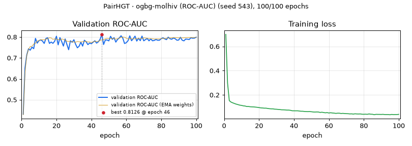

# PairHGT · ogbg-molhiv (ROC-AUC) — seed 543

[← all models](../README.md) · PairHGT notebook · ogbg-molhiv

| | |
|---|---|
| State | **finished** |
| Epochs | 100 of 100 |
| Best validation ROC-AUC | **0.8126** at epoch 46 |
| Best validation ROC-AUC, EMA weights | 0.7998 at epoch 58 |
| Test ROC-AUC | raw 0.7899 / ema 0.7921 (final) |
| Seed | 543 |
| Parameters | 572,545 |
| Minutes per epoch (last 5, incl. validation) | 1.8 |
| Training time so far | 3.0 h |
| Training time left | done |
| Sessions (start + resumes) | 1 |
| Hottest GPU reading | 90.0 °C |
| Last update | 2026-11-23 23:32 (114.6 h ago) |



<details><summary>Settings of this run</summary>

| Setting | Value |
|---|---|
| Epochs (warm-up) | 100 (5) |
| Batch size | 32 |
| Learning rate, weight decay | 0.0001, 1e-05 |
| Layers × width, heads | 10 × 64, 4 |
| Dropout, attention dropout | 0.05, 0.5 |
| Pair channel | width 16, dropout 0.1, value gate True |
| Precision | fp32 (TF32 matrix products) |
| EMA decay | 0.9996632505026597 |
| Gradient clip | 1.0 |
| Protocol | v2_test_once |
| Notebook version, config hash | pairhgt-generalization-v1.0, 564c4603a85f49d5 |

</details>

## Final test (evaluated once)

| Weights | Epoch | Validation ROC-AUC | Test ROC-AUC |
|---|---|---|---|
| raw | 46 | 0.8126 | 0.7899 |
| ema | 58 | 0.7998 | 0.7921 |

## Every epoch (newest first)

| Epoch | Train loss | Val ROC-AUC | Val ROC-AUC (EMA weights) | Best so far | LR | Minutes |
|---|---|---|---|---|---|---|
| 100 | 0.0404 | 0.7990 | 0.7977 | 0.8126 (ep 46) | 2.73e-08 | 1.8 |
| 99 | 0.0385 | 0.7946 | 0.7977 | 0.8126 (ep 46) | 1.09e-07 | 1.8 |
| 98 | 0.0386 | 0.7941 | 0.7977 | 0.8126 (ep 46) | 2.46e-07 | 1.8 |
| 97 | 0.0381 | 0.7963 | 0.7976 | 0.8126 (ep 46) | 4.37e-07 | 1.8 |
| 96 | 0.0397 | 0.7881 | 0.7975 | 0.8126 (ep 46) | 6.82e-07 | 1.8 |
| 95 | 0.0372 | 0.7895 | 0.7974 | 0.8126 (ep 46) | 9.81e-07 | 1.8 |
| 94 | 0.0384 | 0.7904 | 0.7969 | 0.8126 (ep 46) | 1.33e-06 | 1.8 |
| 93 | 0.0385 | 0.7817 | 0.7962 | 0.8126 (ep 46) | 1.74e-06 | 1.8 |
| 92 | 0.0385 | 0.7847 | 0.7961 | 0.8126 (ep 46) | 2.20e-06 | 1.8 |
| 91 | 0.0404 | 0.7987 | 0.7960 | 0.8126 (ep 46) | 2.71e-06 | 1.8 |
| 90 | 0.0395 | 0.7857 | 0.7961 | 0.8126 (ep 46) | 3.27e-06 | 1.8 |
| 89 | 0.0399 | 0.7847 | 0.7966 | 0.8126 (ep 46) | 3.89e-06 | 1.8 |
| 88 | 0.0400 | 0.7918 | 0.7973 | 0.8126 (ep 46) | 4.55e-06 | 1.8 |
| 87 | 0.0404 | 0.7952 | 0.7970 | 0.8126 (ep 46) | 5.26e-06 | 1.8 |
| 86 | 0.0374 | 0.7894 | 0.7962 | 0.8126 (ep 46) | 6.03e-06 | 1.8 |
| 85 | 0.0409 | 0.7919 | 0.7956 | 0.8126 (ep 46) | 6.84e-06 | 1.8 |
| 84 | 0.0415 | 0.7992 | 0.7948 | 0.8126 (ep 46) | 7.70e-06 | 1.8 |
| 83 | 0.0438 | 0.7875 | 0.7943 | 0.8126 (ep 46) | 8.60e-06 | 1.8 |
| 82 | 0.0406 | 0.7913 | 0.7931 | 0.8126 (ep 46) | 9.55e-06 | 1.8 |
| 81 | 0.0417 | 0.7960 | 0.7932 | 0.8126 (ep 46) | 1.05e-05 | 1.8 |
| 80 | 0.0409 | 0.7923 | 0.7923 | 0.8126 (ep 46) | 1.16e-05 | 1.8 |
| 79 | 0.0414 | 0.7848 | 0.7911 | 0.8126 (ep 46) | 1.27e-05 | 1.8 |
| 78 | 0.0438 | 0.7844 | 0.7914 | 0.8126 (ep 46) | 1.38e-05 | 1.8 |
| 77 | 0.0433 | 0.7881 | 0.7913 | 0.8126 (ep 46) | 1.49e-05 | 1.8 |
| 76 | 0.0437 | 0.7837 | 0.7909 | 0.8126 (ep 46) | 1.61e-05 | 1.8 |
| 75 | 0.0450 | 0.7820 | 0.7919 | 0.8126 (ep 46) | 1.74e-05 | 1.8 |
| 74 | 0.0425 | 0.7912 | 0.7919 | 0.8126 (ep 46) | 1.86e-05 | 1.8 |
| 73 | 0.0446 | 0.7818 | 0.7932 | 0.8126 (ep 46) | 1.99e-05 | 1.8 |
| 72 | 0.0440 | 0.7930 | 0.7942 | 0.8126 (ep 46) | 2.13e-05 | 1.8 |
| 71 | 0.0457 | 0.7878 | 0.7954 | 0.8126 (ep 46) | 2.27e-05 | 1.8 |
| 70 | 0.0462 | 0.7819 | 0.7961 | 0.8126 (ep 46) | 2.41e-05 | 1.8 |
| 69 | 0.0469 | 0.8044 | 0.7930 | 0.8126 (ep 46) | 2.55e-05 | 1.8 |
| 68 | 0.0485 | 0.7826 | 0.7929 | 0.8126 (ep 46) | 2.69e-05 | 1.8 |
| 67 | 0.0472 | 0.7939 | 0.7925 | 0.8126 (ep 46) | 2.84e-05 | 1.8 |
| 66 | 0.0498 | 0.7807 | 0.7922 | 0.8126 (ep 46) | 2.99e-05 | 1.8 |
| 65 | 0.0498 | 0.8042 | 0.7912 | 0.8126 (ep 46) | 3.14e-05 | 1.8 |
| 64 | 0.0481 | 0.7919 | 0.7916 | 0.8126 (ep 46) | 3.30e-05 | 1.8 |
| 63 | 0.0504 | 0.7824 | 0.7919 | 0.8126 (ep 46) | 3.45e-05 | 1.8 |
| 62 | 0.0516 | 0.8055 | 0.7910 | 0.8126 (ep 46) | 3.61e-05 | 1.8 |
| 61 | 0.0537 | 0.7824 | 0.7914 | 0.8126 (ep 46) | 3.77e-05 | 1.8 |
| 60 | 0.0515 | 0.7728 | 0.7944 | 0.8126 (ep 46) | 3.93e-05 | 1.8 |
| 59 | 0.0548 | 0.7690 | 0.7989 | 0.8126 (ep 46) | 4.10e-05 | 1.8 |
| 58 | 0.0531 | 0.7950 | 0.7998 | 0.8126 (ep 46) | 4.26e-05 | 1.8 |
| 57 | 0.0554 | 0.8059 | 0.7977 | 0.8126 (ep 46) | 4.42e-05 | 1.8 |
| 56 | 0.0579 | 0.7955 | 0.7950 | 0.8126 (ep 46) | 4.59e-05 | 1.8 |
| 55 | 0.0560 | 0.7885 | 0.7919 | 0.8126 (ep 46) | 4.75e-05 | 1.8 |
| 54 | 0.0597 | 0.7757 | 0.7905 | 0.8126 (ep 46) | 4.92e-05 | 1.8 |
| 53 | 0.0601 | 0.7967 | 0.7930 | 0.8126 (ep 46) | 5.08e-05 | 1.8 |
| 52 | 0.0593 | 0.7890 | 0.7932 | 0.8126 (ep 46) | 5.25e-05 | 1.8 |
| 51 | 0.0599 | 0.8034 | 0.7919 | 0.8126 (ep 46) | 5.41e-05 | 1.8 |
| 50 | 0.0620 | 0.7815 | 0.7931 | 0.8126 (ep 46) | 5.58e-05 | 1.8 |
| 49 | 0.0633 | 0.7858 | 0.7938 | 0.8126 (ep 46) | 5.74e-05 | 1.8 |
| 48 | 0.0628 | 0.7859 | 0.7916 | 0.8126 (ep 46) | 5.90e-05 | 1.8 |
| 47 | 0.0631 | 0.7642 | 0.7879 | 0.8126 (ep 46) | 6.07e-05 | 1.8 |
| 46 | 0.0641 | 0.8126 ⭐ | 0.7856 | 0.8126 (ep 46) | 6.23e-05 | 1.8 |
| 45 | 0.0658 | 0.7890 | 0.7841 | 0.8039 (ep 20) | 6.39e-05 | 1.8 |
| 44 | 0.0659 | 0.7773 | 0.7791 | 0.8039 (ep 20) | 6.55e-05 | 1.8 |
| 43 | 0.0680 | 0.7709 | 0.7791 | 0.8039 (ep 20) | 6.70e-05 | 1.8 |
| 42 | 0.0697 | 0.7820 | 0.7793 | 0.8039 (ep 20) | 6.86e-05 | 1.8 |
| 41 | 0.0695 | 0.7753 | 0.7771 | 0.8039 (ep 20) | 7.01e-05 | 1.8 |
| 40 | 0.0698 | 0.7680 | 0.7734 | 0.8039 (ep 20) | 7.16e-05 | 1.8 |
| 39 | 0.0699 | 0.7710 | 0.7765 | 0.8039 (ep 20) | 7.31e-05 | 1.8 |
| 38 | 0.0736 | 0.7636 | 0.7763 | 0.8039 (ep 20) | 7.45e-05 | 1.8 |
| 37 | 0.0754 | 0.7776 | 0.7793 | 0.8039 (ep 20) | 7.59e-05 | 1.8 |
| 36 | 0.0753 | 0.7847 | 0.7791 | 0.8039 (ep 20) | 7.73e-05 | 1.8 |
| 35 | 0.0768 | 0.7565 | 0.7776 | 0.8039 (ep 20) | 7.87e-05 | 1.8 |
| 34 | 0.0776 | 0.7753 | 0.7765 | 0.8039 (ep 20) | 8.01e-05 | 1.8 |
| 33 | 0.0778 | 0.7561 | 0.7771 | 0.8039 (ep 20) | 8.14e-05 | 1.8 |
| 32 | 0.0798 | 0.7485 | 0.7789 | 0.8039 (ep 20) | 8.26e-05 | 1.8 |
| 31 | 0.0808 | 0.7651 | 0.7751 | 0.8039 (ep 20) | 8.39e-05 | 1.8 |
| 30 | 0.0823 | 0.7871 | 0.7756 | 0.8039 (ep 20) | 8.51e-05 | 1.8 |
| 29 | 0.0831 | 0.7749 | 0.7777 | 0.8039 (ep 20) | 8.62e-05 | 1.8 |
| 28 | 0.0856 | 0.7820 | 0.7783 | 0.8039 (ep 20) | 8.73e-05 | 1.8 |
| 27 | 0.0858 | 0.7393 | 0.7788 | 0.8039 (ep 20) | 8.84e-05 | 1.8 |
| 26 | 0.0870 | 0.7647 | 0.7799 | 0.8039 (ep 20) | 8.95e-05 | 1.8 |
| 25 | 0.0889 | 0.7908 | 0.7852 | 0.8039 (ep 20) | 9.05e-05 | 1.8 |
| 24 | 0.0913 | 0.7567 | 0.7890 | 0.8039 (ep 20) | 9.14e-05 | 1.8 |
| 23 | 0.0913 | 0.7789 | 0.7908 | 0.8039 (ep 20) | 9.23e-05 | 1.8 |
| 22 | 0.0930 | 0.7971 | 0.7862 | 0.8039 (ep 20) | 9.32e-05 | 1.8 |
| 21 | 0.0938 | 0.7626 | 0.7888 | 0.8039 (ep 20) | 9.40e-05 | 1.8 |
| 20 | 0.0963 | 0.8039 ⭐ | 0.7894 | 0.8039 (ep 20) | 9.47e-05 | 1.8 |
| 19 | 0.0982 | 0.7800 | 0.7916 | 0.7963 (ep 15) | 9.55e-05 | 1.8 |
| 18 | 0.1000 | 0.7698 | 0.7888 | 0.7963 (ep 15) | 9.61e-05 | 1.8 |
| 17 | 0.1016 | 0.7759 | 0.7957 | 0.7963 (ep 15) | 9.67e-05 | 1.8 |
| 16 | 0.1021 | 0.7694 | 0.7965 | 0.7963 (ep 15) | 9.73e-05 | 1.8 |
| 15 | 0.1029 | 0.7963 ⭐ | 0.7926 | 0.7963 (ep 15) | 9.78e-05 | 1.8 |
| 14 | 0.1052 | 0.7933 | 0.7896 | 0.7936 (ep 8) | 9.83e-05 | 1.8 |
| 13 | 0.1049 | 0.7694 | 0.7866 | 0.7936 (ep 8) | 9.87e-05 | 1.8 |
| 12 | 0.1090 | 0.7810 | 0.7872 | 0.7936 (ep 8) | 9.90e-05 | 1.8 |
| 11 | 0.1106 | 0.7862 | 0.7868 | 0.7936 (ep 8) | 9.93e-05 | 1.8 |
| 10 | 0.1141 | 0.7826 | 0.7829 | 0.7936 (ep 8) | 9.96e-05 | 1.8 |
| 9 | 0.1162 | 0.7708 | 0.7809 | 0.7936 (ep 8) | 9.98e-05 | 1.8 |
| 8 | 0.1205 | 0.7936 ⭐ | 0.7698 | 0.7936 (ep 8) | 9.99e-05 | 1.8 |
| 7 | 0.1244 | 0.7443 | 0.7668 | 0.7518 (ep 6) | 1.00e-04 | 1.8 |
| 6 | 0.1294 | 0.7518 ⭐ | 0.7558 | 0.7518 (ep 6) | 1.00e-04 | 1.8 |
| 5 | 0.1350 | 0.7371 | 0.7547 | 0.7436 (ep 4) | 8.00e-05 | 1.8 |
| 4 | 0.1414 | 0.7436 ⭐ | 0.7407 | 0.7436 (ep 4) | 6.00e-05 | 1.8 |
| 3 | 0.1531 | 0.7137 ⭐ | 0.7114 | 0.7137 (ep 3) | 4.00e-05 | 1.8 |
| 2 | 0.2986 | 0.6516 ⭐ | 0.6280 | 0.6516 (ep 2) | 2.00e-05 | 1.8 |
| 1 | 0.6990 | 0.4314 ⭐ | 0.4287 | 0.4314 (ep 1) | 1.00e-10 | 1.8 |

## Last 80 log lines

_The log counts epochs from 0; the tables above count from 1._

```
[seed 543] epoch  65/100 | lr 3.14e-05 | train loss 0.0498 | val ROC-AUC 0.8042 | best val 0.8126 @ep46 | EMA val 0.7912 | 108s (train 97s, eval 11s) | GPU max 90C | ETA<= 1.1h
[seed 543] epoch  66/100 | lr 2.99e-05 | train loss 0.0498 | val ROC-AUC 0.7807 | best val 0.8126 @ep46 | EMA val 0.7922 | 109s (train 98s, eval 11s) | GPU max 90C | ETA<= 1.0h
[seed 543] epoch  67/100 | lr 2.84e-05 | train loss 0.0472 | val ROC-AUC 0.7939 | best val 0.8126 @ep46 | EMA val 0.7925 | 109s (train 98s, eval 11s) | GPU max 90C | ETA<= 1.0h
[seed 543] epoch  68/100 | lr 2.69e-05 | train loss 0.0485 | val ROC-AUC 0.7826 | best val 0.8126 @ep46 | EMA val 0.7929 | 108s (train 97s, eval 11s) | GPU max 90C | ETA<= 1.0h
[seed 543] epoch  69/100 | lr 2.55e-05 | train loss 0.0469 | val ROC-AUC 0.8044 | best val 0.8126 @ep46 | EMA val 0.7930 | 109s (train 98s, eval 11s) | GPU max 90C | ETA<= 0.9h
[seed 543] epoch  70/100 | lr 2.41e-05 | train loss 0.0462 | val ROC-AUC 0.7819 | best val 0.8126 @ep46 | EMA val 0.7961 | 109s (train 98s, eval 11s) | GPU max 90C | ETA<= 0.9h
[seed 543] epoch  71/100 | lr 2.27e-05 | train loss 0.0457 | val ROC-AUC 0.7878 | best val 0.8126 @ep46 | EMA val 0.7954 | 109s (train 98s, eval 11s) | GPU max 90C | ETA<= 0.9h
[seed 543] epoch  72/100 | lr 2.13e-05 | train loss 0.0440 | val ROC-AUC 0.7930 | best val 0.8126 @ep46 | EMA val 0.7942 | 108s (train 97s, eval 11s) | GPU max 90C | ETA<= 0.8h
[seed 543] epoch  73/100 | lr 1.99e-05 | train loss 0.0446 | val ROC-AUC 0.7818 | best val 0.8126 @ep46 | EMA val 0.7932 | 109s (train 98s, eval 11s) | GPU max 90C | ETA<= 0.8h
[seed 543] epoch  74/100 | lr 1.86e-05 | train loss 0.0425 | val ROC-AUC 0.7912 | best val 0.8126 @ep46 | EMA val 0.7919 | 109s (train 98s, eval 11s) | GPU max 90C | ETA<= 0.8h
[seed 543] epoch  75/100 | lr 1.74e-05 | train loss 0.0450 | val ROC-AUC 0.7820 | best val 0.8126 @ep46 | EMA val 0.7919 | 109s (train 98s, eval 11s) | GPU max 90C | ETA<= 0.8h
[seed 543] epoch  76/100 | lr 1.61e-05 | train loss 0.0437 | val ROC-AUC 0.7837 | best val 0.8126 @ep46 | EMA val 0.7909 | 109s (train 98s, eval 11s) | GPU max 90C | ETA<= 0.7h
[seed 543] epoch  77/100 | lr 1.49e-05 | train loss 0.0433 | val ROC-AUC 0.7881 | best val 0.8126 @ep46 | EMA val 0.7913 | 108s (train 97s, eval 11s) | GPU max 90C | ETA<= 0.7h
[seed 543] epoch  78/100 | lr 1.38e-05 | train loss 0.0438 | val ROC-AUC 0.7844 | best val 0.8126 @ep46 | EMA val 0.7914 | 110s (train 98s, eval 11s) | GPU max 90C | ETA<= 0.7h
[seed 543] epoch  79/100 | lr 1.27e-05 | train loss 0.0414 | val ROC-AUC 0.7848 | best val 0.8126 @ep46 | EMA val 0.7911 | 109s (train 98s, eval 11s) | GPU max 90C | ETA<= 0.6h
[seed 543] epoch  80/100 | lr 1.16e-05 | train loss 0.0409 | val ROC-AUC 0.7923 | best val 0.8126 @ep46 | EMA val 0.7923 | 108s (train 97s, eval 11s) | GPU max 90C | ETA<= 0.6h
[seed 543] epoch  81/100 | lr 1.05e-05 | train loss 0.0417 | val ROC-AUC 0.7960 | best val 0.8126 @ep46 | EMA val 0.7932 | 109s (train 98s, eval 11s) | GPU max 90C | ETA<= 0.6h
[seed 543] epoch  82/100 | lr 9.55e-06 | train loss 0.0406 | val ROC-AUC 0.7913 | best val 0.8126 @ep46 | EMA val 0.7931 | 109s (train 98s, eval 11s) | GPU max 90C | ETA<= 0.5h
[seed 543] epoch  83/100 | lr 8.60e-06 | train loss 0.0438 | val ROC-AUC 0.7875 | best val 0.8126 @ep46 | EMA val 0.7943 | 108s (train 97s, eval 11s) | GPU max 90C | ETA<= 0.5h
[seed 543] epoch  84/100 | lr 7.70e-06 | train loss 0.0415 | val ROC-AUC 0.7992 | best val 0.8126 @ep46 | EMA val 0.7948 | 109s (train 98s, eval 11s) | GPU max 90C | ETA<= 0.5h
[seed 543] epoch  85/100 | lr 6.84e-06 | train loss 0.0409 | val ROC-AUC 0.7919 | best val 0.8126 @ep46 | EMA val 0.7956 | 109s (train 98s, eval 11s) | GPU max 90C | ETA<= 0.5h
[seed 543] epoch  86/100 | lr 6.03e-06 | train loss 0.0374 | val ROC-AUC 0.7894 | best val 0.8126 @ep46 | EMA val 0.7962 | 109s (train 97s, eval 11s) | GPU max 90C | ETA<= 0.4h
[seed 543] epoch  87/100 | lr 5.26e-06 | train loss 0.0404 | val ROC-AUC 0.7952 | best val 0.8126 @ep46 | EMA val 0.7970 | 108s (train 97s, eval 11s) | GPU max 90C | ETA<= 0.4h
[seed 543] epoch  88/100 | lr 4.55e-06 | train loss 0.0400 | val ROC-AUC 0.7918 | best val 0.8126 @ep46 | EMA val 0.7973 | 109s (train 98s, eval 11s) | GPU max 90C | ETA<= 0.4h
[seed 543] epoch  89/100 | lr 3.89e-06 | train loss 0.0399 | val ROC-AUC 0.7847 | best val 0.8126 @ep46 | EMA val 0.7966 | 108s (train 97s, eval 11s) | GPU max 90C | ETA<= 0.3h
[seed 543] epoch  90/100 | lr 3.27e-06 | train loss 0.0395 | val ROC-AUC 0.7857 | best val 0.8126 @ep46 | EMA val 0.7961 | 108s (train 96s, eval 11s) | GPU max 90C | ETA<= 0.3h
[seed 543] epoch  91/100 | lr 2.71e-06 | train loss 0.0404 | val ROC-AUC 0.7987 | best val 0.8126 @ep46 | EMA val 0.7960 | 109s (train 98s, eval 11s) | GPU max 90C | ETA<= 0.3h
[seed 543] epoch  92/100 | lr 2.20e-06 | train loss 0.0385 | val ROC-AUC 0.7847 | best val 0.8126 @ep46 | EMA val 0.7961 | 109s (train 98s, eval 11s) | GPU max 90C | ETA<= 0.2h
[seed 543] epoch  93/100 | lr 1.74e-06 | train loss 0.0385 | val ROC-AUC 0.7817 | best val 0.8126 @ep46 | EMA val 0.7962 | 109s (train 98s, eval 11s) | GPU max 90C | ETA<= 0.2h
[seed 543] epoch  94/100 | lr 1.33e-06 | train loss 0.0384 | val ROC-AUC 0.7904 | best val 0.8126 @ep46 | EMA val 0.7969 | 109s (train 98s, eval 11s) | GPU max 90C | ETA<= 0.2h
[seed 543] epoch  95/100 | lr 9.81e-07 | train loss 0.0372 | val ROC-AUC 0.7895 | best val 0.8126 @ep46 | EMA val 0.7974 | 108s (train 97s, eval 11s) | GPU max 90C | ETA<= 0.2h
[seed 543] epoch  96/100 | lr 6.82e-07 | train loss 0.0397 | val ROC-AUC 0.7881 | best val 0.8126 @ep46 | EMA val 0.7975 | 110s (train 99s, eval 11s) | GPU max 90C | ETA<= 0.1h
[seed 543] epoch  97/100 | lr 4.37e-07 | train loss 0.0381 | val ROC-AUC 0.7963 | best val 0.8126 @ep46 | EMA val 0.7976 | 109s (train 98s, eval 11s) | GPU max 90C | ETA<= 0.1h
[seed 543] epoch  98/100 | lr 2.46e-07 | train loss 0.0386 | val ROC-AUC 0.7941 | best val 0.8126 @ep46 | EMA val 0.7977 | 109s (train 98s, eval 11s) | GPU max 90C | ETA<= 0.1h
[seed 543] epoch  99/100 | lr 1.09e-07 | train loss 0.0385 | val ROC-AUC 0.7946 | best val 0.8126 @ep46 | EMA val 0.7977 | 109s (train 98s, eval 11s) | GPU max 90C | ETA<= 0.0h
[seed 543] epoch 100/100 | lr 2.73e-08 | train loss 0.0404 | val ROC-AUC 0.7990 | best val 0.8126 @ep46 | EMA val 0.7977 | 109s (train 97s, eval 11s) | GPU max 90C | ETA<= 0.0h
[seed 543] FINAL TEST (evaluated once): raw epoch 46 val 0.8126 test 0.7899 | EMA epoch 58 val 0.7998 test 0.7921 (ROC-AUC, higher is better)
--- cell 17 ---
PairHGT | gps_conf_PairHGT_ep100_molhiv | ROC-AUC (higher is better)
 seed  epochs  raw_epoch  raw_val  raw_test  ema_epoch  ema_val  ema_test  hours  train_s_per_epoch  total_s_per_epoch
  101 100/100         72   0.8125    0.7892         87   0.8080    0.7894 2.9940            96.7322           107.7854
  202 100/100         29   0.8287    0.7701         26   0.8198    0.7943 3.0012            96.9590           108.0422
  323 100/100         84   0.8082    0.7982         89   0.7977    0.7982 3.0041            97.0669           108.1485
  432 100/100         22   0.8436    0.7739         23   0.8378    0.8088 3.0029            97.0208           108.1055
  543 100/100         46   0.8126    0.7899         58   0.7998    0.7921 3.0233            97.6662           108.8378
mean ± sample SD (ddof=1) over 5 seed(s): raw test 0.7842 ± 0.0118 | EMA test 0.7966 ± 0.0076
A mean ± SD over fewer than 3 seeds is only a description; do not call it a confidence interval.
run manifest: 10 row(s) -> /home/student/thesis/outputs/pairhgt/outputs/confirmatory_molhiv/run_manifest.csv
    model              gpu  seeds  params  train_s_per_epoch  val_eval_s_per_epoch  total_s_per_epoch  hours_per_seed  time_vs_GPS+EMA
GPS + EMA NVIDIA RTX A4000      5  558673              44.04                  4.56              48.62            1.35             1.00
  PairHGT NVIDIA RTX A4000      5  572545              97.09                 11.07             108.18            3.01             2.23
train = training steps incl. EMA update; val_eval = validation of raw + EMA weights; no test pass inside an epoch (protocol v2). For the thesis cost table use only seeds that had the GPU alone.
--- cell 19 ---
=== PairHGT  minus  GPS + EMA   (ogbg-molhiv, ROC-AUC, higher is better; matched seeds) ===
 seed  raw_val  ema_val  raw_test  ema_test
  101  -0.0099  -0.0031    0.0052   -0.0033
  202   0.0121   0.0114    0.0032    0.0169
  323  -0.0093  -0.0017    0.0338    0.0199
  432   0.0290   0.0391   -0.0245    0.0077
  543  -0.0129  -0.0222    0.0164    0.0139
  validation ROC-AUC, raw   : mean +0.0018, sample SD 0.0182, per-seed [-0.0099, 0.0121, -0.0093, 0.029, -0.0129], seeds in favour of PairHGT: 2/5 | 95% t-interval [-0.0208, +0.0244] (n=5, df=4, t=0.22, p=0.836)
  validation ROC-AUC, EMA   : mean +0.0047, sample SD 0.0226, per-seed [-0.0031, 0.0114, -0.0017, 0.0391, -0.0222], seeds in favour of PairHGT: 2/5 | 95% t-interval [-0.0234, +0.0328] (n=5, df=4, t=0.46, p=0.667)
  test ROC-AUC, raw vs raw  : mean +0.0068, sample SD 0.0213, per-seed [0.0052, 0.0032, 0.0338, -0.0245, 0.0164], seeds in favour of PairHGT: 4/5 | 95% t-interval [-0.0196, +0.0333] (n=5, df=4, t=0.72, p=0.513)
  test ROC-AUC, EMA vs EMA  : mean +0.0110, sample SD 0.0092, per-seed [-0.0033, 0.0169, 0.0199, 0.0077, 0.0139], seeds in favour of PairHGT: 4/5 | 95% t-interval [-0.0004, +0.0224] (n=5, df=4, t=2.68, p=0.055)
  Reading: interpret with the interval and the number of seeds in favour, not with a threshold. 'Significant' only for a stated test.
GPS sanity line (ogbg-molhiv, raw weights, 5 seed(s)): ours 0.7774 ± 0.0140 vs published 0.7880 ± 0.0101 (10 seeds): gap -0.0106 = -1.05 published SDs  (within 2 published SDs)
Planning (80% power, alpha 0.05, paired t, observed SD of the EMA test differences 0.0092): smallest detectable true difference n=3: 0.0300, n=5: 0.0155, n=10: 0.0092, n=20: 0.0061
--- cell 21 ---
        dataset  metric weights  n_seeds  gps_mean  pairhgt_mean  diff_mean   ci_lo  ci_hi  seeds_in_favour  diff_in_published_sd
   ogbg-molpcba      AP     raw        5    0.2904        0.2963     0.0059  0.0021 0.0097              5.0                2.1143
   ogbg-molpcba      AP     EMA        5    0.2980        0.3061     0.0082  0.0039 0.0124              5.0                2.9111
  Peptides-func      AP     raw        0       NaN           NaN        NaN     NaN    NaN              NaN                   NaN
  Peptides-func      AP     EMA        0       NaN           NaN        NaN     NaN    NaN              NaN                   NaN
Peptides-struct     MAE     raw        0       NaN           NaN        NaN     NaN    NaN              NaN                   NaN
Peptides-struct     MAE     EMA        0       NaN           NaN        NaN     NaN    NaN              NaN                   NaN
    ogbg-molhiv ROC-AUC     raw        5    0.7774        0.7842     0.0068 -0.0196 0.0333              4.0                0.6759
    ogbg-molhiv ROC-AUC     EMA        5    0.7855        0.7966     0.0110 -0.0004 0.0224              4.0                1.0909
-> /home/student/thesis/outputs/pairhgt/outputs/confirmatory_all_datasets/summary_all_datasets.csv and .tex (molpcba read from /home/student/thesis/outputs/pairhgt/checkpoints, read only)
--- cell 23 ---
===== 2026-11-23 23:32:41 notebook run ended (exit 0); executed notebook: /home/student/thesis/outputs/lab_runs/notebooks_gen/molhiv_PairHGT_20261123_202113.ipynb =====
```
