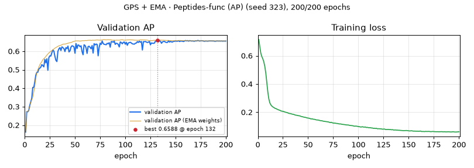

# GPS + EMA · Peptides-func (AP) — seed 323

[← all models](../README.md) · PairHGT notebook · peptides-func

| | |
|---|---|
| State | **finished** |
| Epochs | 200 of 200 |
| Best validation AP | **0.6588** at epoch 132 |
| Best validation AP, EMA weights | 0.6632 at epoch 79 |
| Test AP | raw 0.6690 / ema 0.6637 (final) |
| Seed | 323 |
| Parameters | 504,442 |
| Minutes per epoch (last 5, incl. validation) | 0.2 |
| Training time so far | 38 min |
| Training time left | done |
| Sessions (start + resumes) | 1 |
| Hottest GPU reading | 89.0 °C |
| Last update | 2026-11-22 21:13 (140.9 h ago) |



<details><summary>Settings of this run</summary>

| Setting | Value |
|---|---|
| Epochs (warm-up) | 200 (10) |
| Batch size | 128 |
| Learning rate, weight decay | 0.0003, 0.0 |
| Layers × width, heads | 4 × 96, 4 |
| Dropout, attention dropout | 0.0, 0.5 |
| Pair channel | no pair channel |
| Precision | fp32 (TF32 matrix products) |
| EMA decay | 0.995930964693756 |
| Gradient clip | 1.0 |
| Protocol | v2_test_once |
| Notebook version, config hash | pairhgt-generalization-v1.0, 88c803ae6f150d3a |

</details>

## Final test (evaluated once)

| Weights | Epoch | Validation AP | Test AP |
|---|---|---|---|
| raw | 132 | 0.6588 | 0.6690 |
| ema | 79 | 0.6632 | 0.6637 |

## Every epoch (newest first)

| Epoch | Train loss | Val AP | Val AP (EMA weights) | Best so far | LR | Minutes |
|---|---|---|---|---|---|---|
| 200 | 0.0620 | 0.6551 | 0.6554 | 0.6588 (ep 132) | 2.05e-08 | 0.2 |
| 199 | 0.0611 | 0.6545 | 0.6554 | 0.6588 (ep 132) | 8.20e-08 | 0.2 |
| 198 | 0.0606 | 0.6553 | 0.6556 | 0.6588 (ep 132) | 1.85e-07 | 0.2 |
| 197 | 0.0601 | 0.6541 | 0.6557 | 0.6588 (ep 132) | 3.28e-07 | 0.2 |
| 196 | 0.0602 | 0.6555 | 0.6557 | 0.6588 (ep 132) | 5.12e-07 | 0.2 |
| 195 | 0.0612 | 0.6548 | 0.6557 | 0.6588 (ep 132) | 7.38e-07 | 0.2 |
| 194 | 0.0620 | 0.6551 | 0.6557 | 0.6588 (ep 132) | 1.00e-06 | 0.2 |
| 193 | 0.0607 | 0.6550 | 0.6557 | 0.6588 (ep 132) | 1.31e-06 | 0.2 |
| 192 | 0.0605 | 0.6551 | 0.6556 | 0.6588 (ep 132) | 1.66e-06 | 0.2 |
| 191 | 0.0608 | 0.6555 | 0.6556 | 0.6588 (ep 132) | 2.05e-06 | 0.2 |
| 190 | 0.0618 | 0.6542 | 0.6558 | 0.6588 (ep 132) | 2.47e-06 | 0.2 |
| 189 | 0.0614 | 0.6540 | 0.6558 | 0.6588 (ep 132) | 2.94e-06 | 0.2 |
| 188 | 0.0613 | 0.6553 | 0.6561 | 0.6588 (ep 132) | 3.45e-06 | 0.2 |
| 187 | 0.0607 | 0.6552 | 0.6562 | 0.6588 (ep 132) | 4.00e-06 | 0.2 |
| 186 | 0.0620 | 0.6557 | 0.6561 | 0.6588 (ep 132) | 4.59e-06 | 0.2 |
| 185 | 0.0618 | 0.6556 | 0.6563 | 0.6588 (ep 132) | 5.22e-06 | 0.2 |
| 184 | 0.0613 | 0.6558 | 0.6561 | 0.6588 (ep 132) | 5.89e-06 | 0.2 |
| 183 | 0.0628 | 0.6553 | 0.6561 | 0.6588 (ep 132) | 6.59e-06 | 0.2 |
| 182 | 0.0620 | 0.6545 | 0.6555 | 0.6588 (ep 132) | 7.34e-06 | 0.2 |
| 181 | 0.0620 | 0.6547 | 0.6556 | 0.6588 (ep 132) | 8.13e-06 | 0.2 |
| 180 | 0.0617 | 0.6555 | 0.6553 | 0.6588 (ep 132) | 8.95e-06 | 0.2 |
| 179 | 0.0624 | 0.6538 | 0.6556 | 0.6588 (ep 132) | 9.82e-06 | 0.2 |
| 178 | 0.0625 | 0.6547 | 0.6565 | 0.6588 (ep 132) | 1.07e-05 | 0.2 |
| 177 | 0.0622 | 0.6561 | 0.6565 | 0.6588 (ep 132) | 1.17e-05 | 0.2 |
| 176 | 0.0627 | 0.6565 | 0.6562 | 0.6588 (ep 132) | 1.26e-05 | 0.2 |
| 175 | 0.0633 | 0.6567 | 0.6560 | 0.6588 (ep 132) | 1.36e-05 | 0.2 |
| 174 | 0.0641 | 0.6548 | 0.6565 | 0.6588 (ep 132) | 1.47e-05 | 0.2 |
| 173 | 0.0633 | 0.6571 | 0.6565 | 0.6588 (ep 132) | 1.58e-05 | 0.2 |
| 172 | 0.0625 | 0.6582 | 0.6565 | 0.6588 (ep 132) | 1.69e-05 | 0.2 |
| 171 | 0.0638 | 0.6555 | 0.6565 | 0.6588 (ep 132) | 1.81e-05 | 0.2 |
| 170 | 0.0644 | 0.6566 | 0.6565 | 0.6588 (ep 132) | 1.93e-05 | 0.2 |
| 169 | 0.0640 | 0.6543 | 0.6562 | 0.6588 (ep 132) | 2.05e-05 | 0.2 |
| 168 | 0.0637 | 0.6544 | 0.6563 | 0.6588 (ep 132) | 2.18e-05 | 0.2 |
| 167 | 0.0646 | 0.6556 | 0.6565 | 0.6588 (ep 132) | 2.31e-05 | 0.2 |
| 166 | 0.0632 | 0.6550 | 0.6565 | 0.6588 (ep 132) | 2.44e-05 | 0.2 |
| 165 | 0.0637 | 0.6560 | 0.6564 | 0.6588 (ep 132) | 2.58e-05 | 0.2 |
| 164 | 0.0641 | 0.6573 | 0.6564 | 0.6588 (ep 132) | 2.72e-05 | 0.2 |
| 163 | 0.0635 | 0.6545 | 0.6565 | 0.6588 (ep 132) | 2.86e-05 | 0.2 |
| 162 | 0.0668 | 0.6575 | 0.6568 | 0.6588 (ep 132) | 3.01e-05 | 0.2 |
| 161 | 0.0661 | 0.6559 | 0.6575 | 0.6588 (ep 132) | 3.16e-05 | 0.2 |
| 160 | 0.0654 | 0.6579 | 0.6574 | 0.6588 (ep 132) | 3.32e-05 | 0.2 |
| 159 | 0.0661 | 0.6559 | 0.6574 | 0.6588 (ep 132) | 3.47e-05 | 0.2 |
| 158 | 0.0660 | 0.6524 | 0.6575 | 0.6588 (ep 132) | 3.63e-05 | 0.2 |
| 157 | 0.0661 | 0.6541 | 0.6576 | 0.6588 (ep 132) | 3.80e-05 | 0.2 |
| 156 | 0.0667 | 0.6545 | 0.6575 | 0.6588 (ep 132) | 3.96e-05 | 0.2 |
| 155 | 0.0664 | 0.6553 | 0.6578 | 0.6588 (ep 132) | 4.13e-05 | 0.2 |
| 154 | 0.0674 | 0.6525 | 0.6583 | 0.6588 (ep 132) | 4.31e-05 | 0.2 |
| 153 | 0.0690 | 0.6567 | 0.6579 | 0.6588 (ep 132) | 4.48e-05 | 0.2 |
| 152 | 0.0682 | 0.6542 | 0.6576 | 0.6588 (ep 132) | 4.66e-05 | 0.2 |
| 151 | 0.0677 | 0.6542 | 0.6570 | 0.6588 (ep 132) | 4.84e-05 | 0.2 |
| 150 | 0.0688 | 0.6552 | 0.6574 | 0.6588 (ep 132) | 5.02e-05 | 0.2 |
| 149 | 0.0696 | 0.6537 | 0.6572 | 0.6588 (ep 132) | 5.21e-05 | 0.2 |
| 148 | 0.0707 | 0.6539 | 0.6564 | 0.6588 (ep 132) | 5.40e-05 | 0.2 |
| 147 | 0.0705 | 0.6500 | 0.6572 | 0.6588 (ep 132) | 5.59e-05 | 0.2 |
| 146 | 0.0700 | 0.6502 | 0.6575 | 0.6588 (ep 132) | 5.79e-05 | 0.2 |
| 145 | 0.0698 | 0.6538 | 0.6571 | 0.6588 (ep 132) | 5.98e-05 | 0.2 |
| 144 | 0.0708 | 0.6496 | 0.6576 | 0.6588 (ep 132) | 6.18e-05 | 0.2 |
| 143 | 0.0709 | 0.6569 | 0.6583 | 0.6588 (ep 132) | 6.39e-05 | 0.2 |
| 142 | 0.0714 | 0.6478 | 0.6585 | 0.6588 (ep 132) | 6.59e-05 | 0.2 |
| 141 | 0.0724 | 0.6474 | 0.6583 | 0.6588 (ep 132) | 6.80e-05 | 0.2 |
| 140 | 0.0725 | 0.6492 | 0.6589 | 0.6588 (ep 132) | 7.00e-05 | 0.2 |
| 139 | 0.0735 | 0.6529 | 0.6591 | 0.6588 (ep 132) | 7.22e-05 | 0.2 |
| 138 | 0.0735 | 0.6529 | 0.6599 | 0.6588 (ep 132) | 7.43e-05 | 0.2 |
| 137 | 0.0746 | 0.6507 | 0.6597 | 0.6588 (ep 132) | 7.64e-05 | 0.2 |
| 136 | 0.0745 | 0.6431 | 0.6600 | 0.6588 (ep 132) | 7.86e-05 | 0.2 |
| 135 | 0.0743 | 0.6537 | 0.6603 | 0.6588 (ep 132) | 8.08e-05 | 0.2 |
| 134 | 0.0771 | 0.6565 | 0.6615 | 0.6588 (ep 132) | 8.30e-05 | 0.2 |
| 133 | 0.0759 | 0.6509 | 0.6606 | 0.6588 (ep 132) | 8.52e-05 | 0.2 |
| 132 | 0.0776 | 0.6588 ⭐ | 0.6607 | 0.6588 (ep 132) | 8.75e-05 | 0.2 |
| 131 | 0.0772 | 0.6552 | 0.6599 | 0.6554 (ep 77) | 8.97e-05 | 0.2 |
| 130 | 0.0782 | 0.6548 | 0.6595 | 0.6554 (ep 77) | 9.20e-05 | 0.2 |
| 129 | 0.0785 | 0.6442 | 0.6591 | 0.6554 (ep 77) | 9.43e-05 | 0.2 |
| 128 | 0.0783 | 0.6426 | 0.6588 | 0.6554 (ep 77) | 9.66e-05 | 0.2 |
| 127 | 0.0781 | 0.6435 | 0.6577 | 0.6554 (ep 77) | 9.90e-05 | 0.2 |
| 126 | 0.0812 | 0.6448 | 0.6573 | 0.6554 (ep 77) | 1.01e-04 | 0.2 |
| 125 | 0.0809 | 0.6346 | 0.6574 | 0.6554 (ep 77) | 1.04e-04 | 0.2 |
| 124 | 0.0799 | 0.6531 | 0.6571 | 0.6554 (ep 77) | 1.06e-04 | 0.2 |
| 123 | 0.0822 | 0.6491 | 0.6582 | 0.6554 (ep 77) | 1.08e-04 | 0.2 |
| 122 | 0.0820 | 0.6473 | 0.6600 | 0.6554 (ep 77) | 1.11e-04 | 0.2 |
| 121 | 0.0830 | 0.6496 | 0.6604 | 0.6554 (ep 77) | 1.13e-04 | 0.2 |
| 120 | 0.0836 | 0.6527 | 0.6611 | 0.6554 (ep 77) | 1.16e-04 | 0.2 |
| 119 | 0.0829 | 0.6517 | 0.6611 | 0.6554 (ep 77) | 1.18e-04 | 0.2 |
| 118 | 0.0864 | 0.6519 | 0.6615 | 0.6554 (ep 77) | 1.20e-04 | 0.2 |
| 117 | 0.0850 | 0.6066 | 0.6614 | 0.6554 (ep 77) | 1.23e-04 | 0.2 |
| 116 | 0.0868 | 0.6529 | 0.6614 | 0.6554 (ep 77) | 1.25e-04 | 0.2 |
| 115 | 0.0859 | 0.6486 | 0.6617 | 0.6554 (ep 77) | 1.28e-04 | 0.2 |
| 114 | 0.0885 | 0.6546 | 0.6602 | 0.6554 (ep 77) | 1.30e-04 | 0.2 |
| 113 | 0.0888 | 0.6474 | 0.6595 | 0.6554 (ep 77) | 1.33e-04 | 0.2 |
| 112 | 0.0905 | 0.6522 | 0.6594 | 0.6554 (ep 77) | 1.35e-04 | 0.2 |
| 111 | 0.0905 | 0.6443 | 0.6593 | 0.6554 (ep 77) | 1.38e-04 | 0.2 |
| 110 | 0.0909 | 0.6432 | 0.6598 | 0.6554 (ep 77) | 1.40e-04 | 0.2 |
| 109 | 0.0932 | 0.6382 | 0.6601 | 0.6554 (ep 77) | 1.43e-04 | 0.2 |
| 108 | 0.0920 | 0.6392 | 0.6610 | 0.6554 (ep 77) | 1.45e-04 | 0.2 |
| 107 | 0.0957 | 0.6400 | 0.6613 | 0.6554 (ep 77) | 1.48e-04 | 0.2 |
| 106 | 0.0949 | 0.6447 | 0.6613 | 0.6554 (ep 77) | 1.50e-04 | 0.2 |
| 105 | 0.0954 | 0.6484 | 0.6616 | 0.6554 (ep 77) | 1.52e-04 | 0.2 |
| 104 | 0.0977 | 0.6467 | 0.6618 | 0.6554 (ep 77) | 1.55e-04 | 0.2 |
| 103 | 0.0956 | 0.6448 | 0.6612 | 0.6554 (ep 77) | 1.57e-04 | 0.2 |
| 102 | 0.0959 | 0.6320 | 0.6613 | 0.6554 (ep 77) | 1.60e-04 | 0.2 |
| 101 | 0.0982 | 0.6485 | 0.6607 | 0.6554 (ep 77) | 1.62e-04 | 0.2 |
| 100 | 0.0985 | 0.6381 | 0.6601 | 0.6554 (ep 77) | 1.65e-04 | 0.2 |
| 99 | 0.1006 | 0.6501 | 0.6598 | 0.6554 (ep 77) | 1.67e-04 | 0.2 |
| 98 | 0.1016 | 0.6480 | 0.6608 | 0.6554 (ep 77) | 1.70e-04 | 0.2 |
| 97 | 0.1020 | 0.6400 | 0.6623 | 0.6554 (ep 77) | 1.72e-04 | 0.2 |
| 96 | 0.1013 | 0.6472 | 0.6618 | 0.6554 (ep 77) | 1.75e-04 | 0.2 |
| 95 | 0.1036 | 0.6503 | 0.6609 | 0.6554 (ep 77) | 1.77e-04 | 0.2 |
| 94 | 0.1053 | 0.6231 | 0.6598 | 0.6554 (ep 77) | 1.80e-04 | 0.2 |
| 93 | 0.1060 | 0.6369 | 0.6598 | 0.6554 (ep 77) | 1.82e-04 | 0.2 |
| 92 | 0.1065 | 0.6419 | 0.6598 | 0.6554 (ep 77) | 1.84e-04 | 0.2 |
| 91 | 0.1078 | 0.6430 | 0.6601 | 0.6554 (ep 77) | 1.87e-04 | 0.2 |
| 90 | 0.1099 | 0.6371 | 0.6588 | 0.6554 (ep 77) | 1.89e-04 | 0.2 |
| 89 | 0.1099 | 0.6554 | 0.6602 | 0.6554 (ep 77) | 1.92e-04 | 0.2 |
| 88 | 0.1105 | 0.6486 | 0.6596 | 0.6554 (ep 77) | 1.94e-04 | 0.2 |
| 87 | 0.1115 | 0.6518 | 0.6599 | 0.6554 (ep 77) | 1.96e-04 | 0.2 |
| 86 | 0.1128 | 0.6520 | 0.6615 | 0.6554 (ep 77) | 1.99e-04 | 0.2 |
| 85 | 0.1137 | 0.6219 | 0.6617 | 0.6554 (ep 77) | 2.01e-04 | 0.2 |
| 84 | 0.1145 | 0.6463 | 0.6622 | 0.6554 (ep 77) | 2.03e-04 | 0.2 |
| 83 | 0.1160 | 0.6403 | 0.6625 | 0.6554 (ep 77) | 2.06e-04 | 0.2 |
| 82 | 0.1177 | 0.6429 | 0.6624 | 0.6554 (ep 77) | 2.08e-04 | 0.2 |
| 81 | 0.1172 | 0.6352 | 0.6613 | 0.6554 (ep 77) | 2.10e-04 | 0.2 |
| 80 | 0.1192 | 0.6366 | 0.6624 | 0.6554 (ep 77) | 2.13e-04 | 0.2 |
| 79 | 0.1206 | 0.6374 | 0.6632 | 0.6554 (ep 77) | 2.15e-04 | 0.2 |
| 78 | 0.1212 | 0.6412 | 0.6626 | 0.6554 (ep 77) | 2.17e-04 | 0.2 |
| 77 | 0.1229 | 0.6554 ⭐ | 0.6612 | 0.6554 (ep 77) | 2.19e-04 | 0.2 |
| 76 | 0.1233 | 0.6366 | 0.6607 | 0.6434 (ep 75) | 2.21e-04 | 0.2 |
| 75 | 0.1235 | 0.6434 ⭐ | 0.6601 | 0.6434 (ep 75) | 2.24e-04 | 0.2 |
| 74 | 0.1259 | 0.6206 | 0.6601 | 0.6415 (ep 51) | 2.26e-04 | 0.2 |
| 73 | 0.1291 | 0.5752 | 0.6604 | 0.6415 (ep 51) | 2.28e-04 | 0.2 |
| 72 | 0.1268 | 0.6368 | 0.6612 | 0.6415 (ep 51) | 2.30e-04 | 0.2 |
| 71 | 0.1297 | 0.6390 | 0.6603 | 0.6415 (ep 51) | 2.32e-04 | 0.2 |
| 70 | 0.1317 | 0.6341 | 0.6598 | 0.6415 (ep 51) | 2.34e-04 | 0.2 |
| 69 | 0.1332 | 0.6410 | 0.6592 | 0.6415 (ep 51) | 2.36e-04 | 0.2 |
| 68 | 0.1335 | 0.5901 | 0.6598 | 0.6415 (ep 51) | 2.38e-04 | 0.2 |
| 67 | 0.1345 | 0.6309 | 0.6594 | 0.6415 (ep 51) | 2.40e-04 | 0.2 |
| 66 | 0.1359 | 0.6133 | 0.6581 | 0.6415 (ep 51) | 2.42e-04 | 0.2 |
| 65 | 0.1369 | 0.6211 | 0.6599 | 0.6415 (ep 51) | 2.44e-04 | 0.2 |
| 64 | 0.1394 | 0.6269 | 0.6591 | 0.6415 (ep 51) | 2.46e-04 | 0.2 |
| 63 | 0.1401 | 0.6253 | 0.6594 | 0.6415 (ep 51) | 2.48e-04 | 0.2 |
| 62 | 0.1409 | 0.5881 | 0.6578 | 0.6415 (ep 51) | 2.50e-04 | 0.2 |
| 61 | 0.1433 | 0.6180 | 0.6580 | 0.6415 (ep 51) | 2.52e-04 | 0.2 |
| 60 | 0.1450 | 0.6310 | 0.6579 | 0.6415 (ep 51) | 2.53e-04 | 0.2 |
| 59 | 0.1453 | 0.6349 | 0.6567 | 0.6415 (ep 51) | 2.55e-04 | 0.2 |
| 58 | 0.1462 | 0.5810 | 0.6575 | 0.6415 (ep 51) | 2.57e-04 | 0.2 |
| 57 | 0.1489 | 0.5987 | 0.6563 | 0.6415 (ep 51) | 2.59e-04 | 0.2 |
| 56 | 0.1502 | 0.6294 | 0.6556 | 0.6415 (ep 51) | 2.60e-04 | 0.2 |
| 55 | 0.1507 | 0.6242 | 0.6548 | 0.6415 (ep 51) | 2.62e-04 | 0.2 |
| 54 | 0.1538 | 0.6321 | 0.6554 | 0.6415 (ep 51) | 2.64e-04 | 0.2 |
| 53 | 0.1522 | 0.6343 | 0.6563 | 0.6415 (ep 51) | 2.65e-04 | 0.2 |
| 52 | 0.1556 | 0.6145 | 0.6555 | 0.6415 (ep 51) | 2.67e-04 | 0.2 |
| 51 | 0.1576 | 0.6415 ⭐ | 0.6563 | 0.6415 (ep 51) | 2.68e-04 | 0.2 |
| 50 | 0.1590 | 0.5891 | 0.6547 | 0.6295 (ep 47) | 2.70e-04 | 0.2 |
| 49 | 0.1599 | 0.6232 | 0.6534 | 0.6295 (ep 47) | 2.71e-04 | 0.2 |
| 48 | 0.1625 | 0.6279 | 0.6519 | 0.6295 (ep 47) | 2.73e-04 | 0.2 |
| 47 | 0.1644 | 0.6295 ⭐ | 0.6490 | 0.6295 (ep 47) | 2.74e-04 | 0.2 |
| 46 | 0.1651 | 0.6225 | 0.6473 | 0.6278 (ep 43) | 2.76e-04 | 0.2 |
| 45 | 0.1674 | 0.6020 | 0.6459 | 0.6278 (ep 43) | 2.77e-04 | 0.2 |
| 44 | 0.1692 | 0.5964 | 0.6449 | 0.6278 (ep 43) | 2.78e-04 | 0.2 |
| 43 | 0.1702 | 0.6278 ⭐ | 0.6432 | 0.6278 (ep 43) | 2.79e-04 | 0.2 |
| 42 | 0.1740 | 0.6141 | 0.6420 | 0.6239 (ep 37) | 2.81e-04 | 0.2 |
| 41 | 0.1751 | 0.6200 | 0.6401 | 0.6239 (ep 37) | 2.82e-04 | 0.2 |
| 40 | 0.1763 | 0.5980 | 0.6386 | 0.6239 (ep 37) | 2.83e-04 | 0.2 |
| 39 | 0.1782 | 0.6141 | 0.6388 | 0.6239 (ep 37) | 2.84e-04 | 0.2 |
| 38 | 0.1791 | 0.6191 | 0.6380 | 0.6239 (ep 37) | 2.85e-04 | 0.2 |
| 37 | 0.1808 | 0.6239 ⭐ | 0.6353 | 0.6239 (ep 37) | 2.86e-04 | 0.2 |
| 36 | 0.1842 | 0.6036 | 0.6326 | 0.6196 (ep 35) | 2.87e-04 | 0.2 |
| 35 | 0.1855 | 0.6196 ⭐ | 0.6310 | 0.6196 (ep 35) | 2.88e-04 | 0.2 |
| 34 | 0.1870 | 0.6132 ⭐ | 0.6294 | 0.6132 (ep 34) | 2.89e-04 | 0.2 |
| 33 | 0.1895 | 0.5997 | 0.6265 | 0.6069 (ep 28) | 2.90e-04 | 0.2 |
| 32 | 0.1908 | 0.5441 | 0.6235 | 0.6069 (ep 28) | 2.91e-04 | 0.2 |
| 31 | 0.1920 | 0.5509 | 0.6200 | 0.6069 (ep 28) | 2.92e-04 | 0.2 |
| 30 | 0.1952 | 0.5728 | 0.6167 | 0.6069 (ep 28) | 2.93e-04 | 0.2 |
| 29 | 0.1981 | 0.6004 | 0.6123 | 0.6069 (ep 28) | 2.93e-04 | 0.2 |
| 28 | 0.1993 | 0.6069 ⭐ | 0.6073 | 0.6069 (ep 28) | 2.94e-04 | 0.2 |
| 27 | 0.2015 | 0.5927 ⭐ | 0.6033 | 0.5927 (ep 27) | 2.95e-04 | 0.2 |
| 26 | 0.2046 | 0.5740 | 0.6002 | 0.5753 (ep 25) | 2.95e-04 | 0.2 |
| 25 | 0.2064 | 0.5753 ⭐ | 0.5950 | 0.5753 (ep 25) | 2.96e-04 | 0.2 |
| 24 | 0.2079 | 0.5658 ⭐ | 0.5915 | 0.5658 (ep 24) | 2.97e-04 | 0.2 |
| 23 | 0.2094 | 0.4968 | 0.5849 | 0.5591 (ep 22) | 2.97e-04 | 0.2 |
| 22 | 0.2139 | 0.5591 ⭐ | 0.5784 | 0.5591 (ep 22) | 2.98e-04 | 0.2 |
| 21 | 0.2159 | 0.5373 | 0.5721 | 0.5562 (ep 20) | 2.98e-04 | 0.2 |
| 20 | 0.2189 | 0.5562 ⭐ | 0.5647 | 0.5562 (ep 20) | 2.98e-04 | 0.2 |
| 19 | 0.2220 | 0.5155 | 0.5598 | 0.5276 (ep 17) | 2.99e-04 | 0.2 |
| 18 | 0.2264 | 0.5227 | 0.5541 | 0.5276 (ep 17) | 2.99e-04 | 0.2 |
| 17 | 0.2282 | 0.5276 ⭐ | 0.5440 | 0.5276 (ep 17) | 2.99e-04 | 0.2 |
| 16 | 0.2334 | 0.5140 ⭐ | 0.5358 | 0.5140 (ep 16) | 2.99e-04 | 0.2 |
| 15 | 0.2376 | 0.5085 ⭐ | 0.5267 | 0.5085 (ep 15) | 3.00e-04 | 0.2 |
| 14 | 0.2436 | 0.5042 ⭐ | 0.5132 | 0.5042 (ep 14) | 3.00e-04 | 0.2 |
| 13 | 0.2523 | 0.4863 ⭐ | 0.4992 | 0.4863 (ep 13) | 3.00e-04 | 0.2 |
| 12 | 0.2663 | 0.4854 ⭐ | 0.4819 | 0.4854 (ep 12) | 3.00e-04 | 0.2 |
| 11 | 0.2943 | 0.4704 ⭐ | 0.4516 | 0.4704 (ep 11) | 3.00e-04 | 0.2 |
| 10 | 0.3429 | 0.4337 ⭐ | 0.4100 | 0.4337 (ep 10) | 2.70e-04 | 0.2 |
| 9 | 0.4090 | 0.4040 | 0.3794 | 0.4045 (ep 8) | 2.40e-04 | 0.2 |
| 8 | 0.4763 | 0.4045 ⭐ | 0.3520 | 0.4045 (ep 8) | 2.10e-04 | 0.2 |
| 7 | 0.5245 | 0.3456 ⭐ | 0.3374 | 0.3456 (ep 7) | 1.80e-04 | 0.2 |
| 6 | 0.5571 | 0.3256 ⭐ | 0.3216 | 0.3256 (ep 6) | 1.50e-04 | 0.2 |
| 5 | 0.5783 | 0.3065 ⭐ | 0.2973 | 0.3065 (ep 5) | 1.20e-04 | 0.2 |
| 4 | 0.5944 | 0.2799 ⭐ | 0.2804 | 0.2799 (ep 4) | 9.00e-05 | 0.2 |
| 3 | 0.6186 | 0.2722 | 0.2738 | 0.2731 (ep 2) | 6.00e-05 | 0.2 |
| 2 | 0.6645 | 0.2731 ⭐ | 0.2733 | 0.2731 (ep 2) | 3.00e-05 | 0.2 |
| 1 | 0.7143 | 0.1628 ⭐ | 0.1634 | 0.1628 (ep 1) | 3.00e-10 | 0.2 |

## Last 80 log lines

_The log counts epochs from 0; the tables above count from 1._

```
[seed 543] epoch 153/200 | lr 4.48e-05 | train loss 0.0718 | val AP 0.6702 | best val 0.6737 @ep149 | EMA val 0.6707 | 11s (train 10s, eval 1s) | GPU max 88C | ETA<= 0.1h
[seed 543] epoch 154/200 | lr 4.31e-05 | train loss 0.0716 | val AP 0.6689 | best val 0.6737 @ep149 | EMA val 0.6708 | 11s (train 10s, eval 1s) | GPU max 88C | ETA<= 0.1h
[seed 543] epoch 155/200 | lr 4.13e-05 | train loss 0.0716 | val AP 0.6692 | best val 0.6737 @ep149 | EMA val 0.6705 | 11s (train 10s, eval 1s) | GPU max 88C | ETA<= 0.1h
[seed 543] epoch 156/200 | lr 3.96e-05 | train loss 0.0716 | val AP 0.6718 | best val 0.6737 @ep149 | EMA val 0.6707 | 11s (train 10s, eval 1s) | GPU max 88C | ETA<= 0.1h
[seed 543] epoch 157/200 | lr 3.80e-05 | train loss 0.0714 | val AP 0.6693 | best val 0.6737 @ep149 | EMA val 0.6714 | 11s (train 10s, eval 1s) | GPU max 88C | ETA<= 0.1h
[seed 543] epoch 158/200 | lr 3.63e-05 | train loss 0.0707 | val AP 0.6700 | best val 0.6737 @ep149 | EMA val 0.6713 | 11s (train 10s, eval 1s) | GPU max 88C | ETA<= 0.1h
[seed 543] epoch 159/200 | lr 3.47e-05 | train loss 0.0702 | val AP 0.6698 | best val 0.6737 @ep149 | EMA val 0.6715 | 11s (train 10s, eval 1s) | GPU max 88C | ETA<= 0.1h
[seed 543] epoch 160/200 | lr 3.32e-05 | train loss 0.0692 | val AP 0.6706 | best val 0.6737 @ep149 | EMA val 0.6717 | 11s (train 10s, eval 1s) | GPU max 88C | ETA<= 0.1h
[seed 543] epoch 161/200 | lr 3.16e-05 | train loss 0.0703 | val AP 0.6699 | best val 0.6737 @ep149 | EMA val 0.6719 | 11s (train 10s, eval 1s) | GPU max 88C | ETA<= 0.1h
[seed 543] epoch 162/200 | lr 3.01e-05 | train loss 0.0688 | val AP 0.6698 | best val 0.6737 @ep149 | EMA val 0.6718 | 11s (train 10s, eval 1s) | GPU max 88C | ETA<= 0.1h
[seed 543] epoch 163/200 | lr 2.86e-05 | train loss 0.0688 | val AP 0.6715 | best val 0.6737 @ep149 | EMA val 0.6719 | 11s (train 10s, eval 1s) | GPU max 88C | ETA<= 0.1h
[seed 543] epoch 164/200 | lr 2.72e-05 | train loss 0.0690 | val AP 0.6721 | best val 0.6737 @ep149 | EMA val 0.6722 | 11s (train 10s, eval 1s) | GPU max 88C | ETA<= 0.1h
[seed 543] epoch 165/200 | lr 2.58e-05 | train loss 0.0684 | val AP 0.6702 | best val 0.6737 @ep149 | EMA val 0.6723 | 11s (train 10s, eval 1s) | GPU max 88C | ETA<= 0.1h
[seed 543] epoch 166/200 | lr 2.44e-05 | train loss 0.0685 | val AP 0.6709 | best val 0.6737 @ep149 | EMA val 0.6721 | 11s (train 10s, eval 1s) | GPU max 88C | ETA<= 0.1h
[seed 543] epoch 167/200 | lr 2.31e-05 | train loss 0.0681 | val AP 0.6711 | best val 0.6737 @ep149 | EMA val 0.6717 | 11s (train 10s, eval 1s) | GPU max 88C | ETA<= 0.1h
[seed 543] epoch 168/200 | lr 2.18e-05 | train loss 0.0692 | val AP 0.6715 | best val 0.6737 @ep149 | EMA val 0.6717 | 11s (train 10s, eval 1s) | GPU max 88C | ETA<= 0.1h
[seed 543] epoch 169/200 | lr 2.05e-05 | train loss 0.0668 | val AP 0.6710 | best val 0.6737 @ep149 | EMA val 0.6717 | 11s (train 10s, eval 1s) | GPU max 88C | ETA<= 0.1h
[seed 543] epoch 170/200 | lr 1.93e-05 | train loss 0.0674 | val AP 0.6710 | best val 0.6737 @ep149 | EMA val 0.6714 | 11s (train 10s, eval 1s) | GPU max 88C | ETA<= 0.1h
[seed 543] epoch 171/200 | lr 1.81e-05 | train loss 0.0676 | val AP 0.6697 | best val 0.6737 @ep149 | EMA val 0.6713 | 11s (train 10s, eval 1s) | GPU max 88C | ETA<= 0.1h
[seed 543] epoch 172/200 | lr 1.69e-05 | train loss 0.0659 | val AP 0.6699 | best val 0.6737 @ep149 | EMA val 0.6708 | 11s (train 10s, eval 1s) | GPU max 88C | ETA<= 0.1h
[seed 543] epoch 173/200 | lr 1.58e-05 | train loss 0.0673 | val AP 0.6717 | best val 0.6737 @ep149 | EMA val 0.6710 | 11s (train 10s, eval 1s) | GPU max 88C | ETA<= 0.1h
[seed 543] epoch 174/200 | lr 1.47e-05 | train loss 0.0660 | val AP 0.6716 | best val 0.6737 @ep149 | EMA val 0.6713 | 11s (train 10s, eval 1s) | GPU max 88C | ETA<= 0.1h
[seed 543] epoch 175/200 | lr 1.36e-05 | train loss 0.0666 | val AP 0.6702 | best val 0.6737 @ep149 | EMA val 0.6713 | 11s (train 10s, eval 1s) | GPU max 88C | ETA<= 0.1h
[seed 543] epoch 176/200 | lr 1.26e-05 | train loss 0.0668 | val AP 0.6705 | best val 0.6737 @ep149 | EMA val 0.6714 | 11s (train 10s, eval 1s) | GPU max 88C | ETA<= 0.1h
[seed 543] epoch 177/200 | lr 1.17e-05 | train loss 0.0662 | val AP 0.6718 | best val 0.6737 @ep149 | EMA val 0.6714 | 11s (train 10s, eval 1s) | GPU max 88C | ETA<= 0.1h
[seed 543] epoch 178/200 | lr 1.07e-05 | train loss 0.0667 | val AP 0.6719 | best val 0.6737 @ep149 | EMA val 0.6716 | 11s (train 10s, eval 1s) | GPU max 88C | ETA<= 0.1h
[seed 543] epoch 179/200 | lr 9.82e-06 | train loss 0.0663 | val AP 0.6711 | best val 0.6737 @ep149 | EMA val 0.6715 | 11s (train 10s, eval 1s) | GPU max 88C | ETA<= 0.1h
[seed 543] epoch 180/200 | lr 8.95e-06 | train loss 0.0671 | val AP 0.6703 | best val 0.6737 @ep149 | EMA val 0.6712 | 11s (train 10s, eval 1s) | GPU max 88C | ETA<= 0.1h
[seed 543] epoch 181/200 | lr 8.13e-06 | train loss 0.0671 | val AP 0.6714 | best val 0.6737 @ep149 | EMA val 0.6712 | 11s (train 10s, eval 1s) | GPU max 88C | ETA<= 0.1h
[seed 543] epoch 182/200 | lr 7.34e-06 | train loss 0.0655 | val AP 0.6711 | best val 0.6737 @ep149 | EMA val 0.6712 | 11s (train 10s, eval 1s) | GPU max 88C | ETA<= 0.1h
[seed 543] epoch 183/200 | lr 6.59e-06 | train loss 0.0668 | val AP 0.6726 | best val 0.6737 @ep149 | EMA val 0.6709 | 11s (train 10s, eval 1s) | GPU max 88C | ETA<= 0.1h
[seed 543] epoch 184/200 | lr 5.89e-06 | train loss 0.0656 | val AP 0.6711 | best val 0.6737 @ep149 | EMA val 0.6711 | 11s (train 10s, eval 1s) | GPU max 88C | ETA<= 0.1h
[seed 543] epoch 185/200 | lr 5.22e-06 | train loss 0.0657 | val AP 0.6705 | best val 0.6737 @ep149 | EMA val 0.6711 | 11s (train 10s, eval 1s) | GPU max 88C | ETA<= 0.0h
[seed 543] epoch 186/200 | lr 4.59e-06 | train loss 0.0663 | val AP 0.6706 | best val 0.6737 @ep149 | EMA val 0.6710 | 11s (train 10s, eval 1s) | GPU max 88C | ETA<= 0.0h
[seed 543] epoch 187/200 | lr 4.00e-06 | train loss 0.0655 | val AP 0.6705 | best val 0.6737 @ep149 | EMA val 0.6710 | 12s (train 10s, eval 1s) | GPU max 88C | ETA<= 0.0h
[seed 543] epoch 188/200 | lr 3.45e-06 | train loss 0.0655 | val AP 0.6710 | best val 0.6737 @ep149 | EMA val 0.6710 | 11s (train 10s, eval 1s) | GPU max 88C | ETA<= 0.0h
[seed 543] epoch 189/200 | lr 2.94e-06 | train loss 0.0655 | val AP 0.6715 | best val 0.6737 @ep149 | EMA val 0.6712 | 11s (train 10s, eval 1s) | GPU max 88C | ETA<= 0.0h
[seed 543] epoch 190/200 | lr 2.47e-06 | train loss 0.0655 | val AP 0.6714 | best val 0.6737 @ep149 | EMA val 0.6711 | 11s (train 10s, eval 1s) | GPU max 88C | ETA<= 0.0h
[seed 543] epoch 191/200 | lr 2.05e-06 | train loss 0.0658 | val AP 0.6709 | best val 0.6737 @ep149 | EMA val 0.6712 | 11s (train 10s, eval 1s) | GPU max 88C | ETA<= 0.0h
[seed 543] epoch 192/200 | lr 1.66e-06 | train loss 0.0655 | val AP 0.6704 | best val 0.6737 @ep149 | EMA val 0.6712 | 11s (train 10s, eval 1s) | GPU max 88C | ETA<= 0.0h
[seed 543] epoch 193/200 | lr 1.31e-06 | train loss 0.0641 | val AP 0.6721 | best val 0.6737 @ep149 | EMA val 0.6712 | 11s (train 10s, eval 1s) | GPU max 88C | ETA<= 0.0h
[seed 543] epoch 194/200 | lr 1.00e-06 | train loss 0.0659 | val AP 0.6709 | best val 0.6737 @ep149 | EMA val 0.6713 | 11s (train 10s, eval 1s) | GPU max 88C | ETA<= 0.0h
[seed 543] epoch 195/200 | lr 7.38e-07 | train loss 0.0648 | val AP 0.6716 | best val 0.6737 @ep149 | EMA val 0.6713 | 11s (train 10s, eval 1s) | GPU max 88C | ETA<= 0.0h
[seed 543] epoch 196/200 | lr 5.12e-07 | train loss 0.0654 | val AP 0.6716 | best val 0.6737 @ep149 | EMA val 0.6713 | 11s (train 10s, eval 1s) | GPU max 88C | ETA<= 0.0h
[seed 543] epoch 197/200 | lr 3.28e-07 | train loss 0.0660 | val AP 0.6709 | best val 0.6737 @ep149 | EMA val 0.6712 | 11s (train 10s, eval 1s) | GPU max 88C | ETA<= 0.0h
[seed 543] epoch 198/200 | lr 1.85e-07 | train loss 0.0653 | val AP 0.6710 | best val 0.6737 @ep149 | EMA val 0.6712 | 11s (train 10s, eval 1s) | GPU max 88C | ETA<= 0.0h
[seed 543] epoch 199/200 | lr 8.20e-08 | train loss 0.0653 | val AP 0.6719 | best val 0.6737 @ep149 | EMA val 0.6713 | 11s (train 10s, eval 1s) | GPU max 88C | ETA<= 0.0h
[seed 543] epoch 200/200 | lr 2.05e-08 | train loss 0.0646 | val AP 0.6717 | best val 0.6737 @ep149 | EMA val 0.6712 | 11s (train 10s, eval 1s) | GPU max 89C | ETA<= 0.0h
[seed 543] FINAL TEST (evaluated once): raw epoch 149 val 0.6737 test 0.6502 | EMA epoch 109 val 0.6762 test 0.6537 (AP, higher is better)
--- cell 17 ---
GPS + EMA | gps_conf_GPS_ema_ep200_peptides_func | AP (higher is better)
 seed  epochs  raw_epoch  raw_val  raw_test  ema_epoch  ema_val  ema_test  hours  train_s_per_epoch  total_s_per_epoch
  101 200/200        133   0.6627    0.6561         98   0.6687    0.6682 0.6243             9.9196            11.2371
  202 200/200        147   0.6560    0.6497        106   0.6608    0.6540 0.6278             9.9837            11.3009
  323 200/200        132   0.6588    0.6690         79   0.6632    0.6637 0.6282             9.9890            11.3074
  432 200/200        165   0.6687    0.6569         76   0.6765    0.6518 0.6281             9.9887            11.3051
  543 200/200        149   0.6737    0.6502        109   0.6762    0.6537 0.6287            10.0001            11.3166
mean ± sample SD (ddof=1) over 5 seed(s): raw test 0.6564 ± 0.0078 | EMA test 0.6583 ± 0.0072
A mean ± SD over fewer than 3 seeds is only a description; do not call it a confidence interval.
run manifest: 5 row(s) -> /home/student/thesis/outputs/pairhgt/outputs/confirmatory_peptides_func/run_manifest.csv
    model              gpu  seeds  params  train_s_per_epoch  val_eval_s_per_epoch  total_s_per_epoch  hours_per_seed  time_vs_GPS+EMA
GPS + EMA NVIDIA RTX A4000      5  504442               9.98                   1.3              11.29            0.63              1.0
train = training steps incl. EMA update; val_eval = validation of raw + EMA weights; no test pass inside an epoch (protocol v2). For the thesis cost table use only seeds that had the GPU alone.
--- cell 19 ---
=== PairHGT  minus  GPS + EMA   (peptides-func, AP, higher is better; matched seeds) ===
  no matched finished seeds with a final test result yet
GPS sanity line (peptides-func, raw weights, 5 seed(s)): ours 0.6564 ± 0.0078 vs published 0.6535 ± 0.0041 (4 seeds): gap +0.0029 = +0.70 published SDs  (within 2 published SDs)
--- cell 21 ---
        dataset  metric weights  n_seeds  gps_mean  pairhgt_mean  diff_mean  ci_lo  ci_hi  seeds_in_favour  diff_in_published_sd
   ogbg-molpcba      AP     raw        5    0.2904        0.2963     0.0059 0.0021 0.0097              5.0                2.1143
   ogbg-molpcba      AP     EMA        5    0.2980        0.3061     0.0082 0.0039 0.0124              5.0                2.9111
  Peptides-func      AP     raw        0       NaN           NaN        NaN    NaN    NaN              NaN                   NaN
  Peptides-func      AP     EMA        0       NaN           NaN        NaN    NaN    NaN              NaN                   NaN
Peptides-struct     MAE     raw        0       NaN           NaN        NaN    NaN    NaN              NaN                   NaN
Peptides-struct     MAE     EMA        0       NaN           NaN        NaN    NaN    NaN              NaN                   NaN
    ogbg-molhiv ROC-AUC     raw        0       NaN           NaN        NaN    NaN    NaN              NaN                   NaN
    ogbg-molhiv ROC-AUC     EMA        0       NaN           NaN        NaN    NaN    NaN              NaN                   NaN
-> /home/student/thesis/outputs/pairhgt/outputs/confirmatory_all_datasets/summary_all_datasets.csv and .tex (molpcba read from /home/student/thesis/outputs/pairhgt/checkpoints, read only)
--- cell 23 ---
===== 2026-11-22 22:29:29 notebook run ended (exit 0); executed notebook: /home/student/thesis/outputs/lab_runs/notebooks_gen/peptides_func_GPS_ema_20261122_192002.ipynb =====
```
