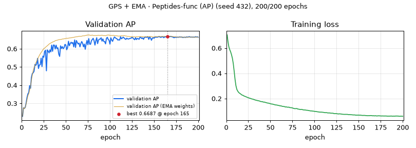

# GPS + EMA · Peptides-func (AP) — seed 432

[← all models](../README.md) · PairHGT notebook · peptides-func

| | |
|---|---|
| State | **finished** |
| Epochs | 200 of 200 |
| Best validation AP | **0.6687** at epoch 165 |
| Best validation AP, EMA weights | 0.6765 at epoch 76 |
| Test AP | raw 0.6569 / ema 0.6518 (final) |
| Seed | 432 |
| Parameters | 504,442 |
| Minutes per epoch (last 5, incl. validation) | 0.2 |
| Training time so far | 38 min |
| Training time left | done |
| Sessions (start + resumes) | 1 |
| Hottest GPU reading | 89.0 °C |
| Last update | 2026-11-22 21:51 (140.3 h ago) |



<details><summary>Settings of this run</summary>

| Setting | Value |
|---|---|
| Epochs (warm-up) | 200 (10) |
| Batch size | 128 |
| Learning rate, weight decay | 0.0003, 0.0 |
| Layers × width, heads | 4 × 96, 4 |
| Dropout, attention dropout | 0.0, 0.5 |
| Pair channel | no pair channel |
| Precision | fp32 (TF32 matrix products) |
| EMA decay | 0.995930964693756 |
| Gradient clip | 1.0 |
| Protocol | v2_test_once |
| Notebook version, config hash | pairhgt-generalization-v1.0, 88c803ae6f150d3a |

</details>

## Final test (evaluated once)

| Weights | Epoch | Validation AP | Test AP |
|---|---|---|---|
| raw | 165 | 0.6687 | 0.6569 |
| ema | 76 | 0.6765 | 0.6518 |

## Every epoch (newest first)

| Epoch | Train loss | Val AP | Val AP (EMA weights) | Best so far | LR | Minutes |
|---|---|---|---|---|---|---|
| 200 | 0.0593 | 0.6634 | 0.6639 | 0.6687 (ep 165) | 2.05e-08 | 0.2 |
| 199 | 0.0602 | 0.6656 | 0.6640 | 0.6687 (ep 165) | 8.20e-08 | 0.2 |
| 198 | 0.0600 | 0.6641 | 0.6641 | 0.6687 (ep 165) | 1.85e-07 | 0.2 |
| 197 | 0.0600 | 0.6663 | 0.6638 | 0.6687 (ep 165) | 3.28e-07 | 0.2 |
| 196 | 0.0594 | 0.6635 | 0.6640 | 0.6687 (ep 165) | 5.12e-07 | 0.2 |
| 195 | 0.0611 | 0.6644 | 0.6642 | 0.6687 (ep 165) | 7.38e-07 | 0.2 |
| 194 | 0.0612 | 0.6635 | 0.6642 | 0.6687 (ep 165) | 1.00e-06 | 0.2 |
| 193 | 0.0614 | 0.6646 | 0.6643 | 0.6687 (ep 165) | 1.31e-06 | 0.2 |
| 192 | 0.0616 | 0.6640 | 0.6644 | 0.6687 (ep 165) | 1.66e-06 | 0.2 |
| 191 | 0.0601 | 0.6641 | 0.6645 | 0.6687 (ep 165) | 2.05e-06 | 0.2 |
| 190 | 0.0611 | 0.6666 | 0.6642 | 0.6687 (ep 165) | 2.47e-06 | 0.2 |
| 189 | 0.0601 | 0.6653 | 0.6639 | 0.6687 (ep 165) | 2.94e-06 | 0.2 |
| 188 | 0.0605 | 0.6633 | 0.6641 | 0.6687 (ep 165) | 3.45e-06 | 0.2 |
| 187 | 0.0616 | 0.6655 | 0.6636 | 0.6687 (ep 165) | 4.00e-06 | 0.2 |
| 186 | 0.0613 | 0.6624 | 0.6636 | 0.6687 (ep 165) | 4.59e-06 | 0.2 |
| 185 | 0.0605 | 0.6637 | 0.6633 | 0.6687 (ep 165) | 5.22e-06 | 0.2 |
| 184 | 0.0608 | 0.6632 | 0.6636 | 0.6687 (ep 165) | 5.89e-06 | 0.2 |
| 183 | 0.0603 | 0.6625 | 0.6638 | 0.6687 (ep 165) | 6.59e-06 | 0.2 |
| 182 | 0.0613 | 0.6627 | 0.6647 | 0.6687 (ep 165) | 7.34e-06 | 0.2 |
| 181 | 0.0616 | 0.6648 | 0.6645 | 0.6687 (ep 165) | 8.13e-06 | 0.2 |
| 180 | 0.0620 | 0.6639 | 0.6638 | 0.6687 (ep 165) | 8.95e-06 | 0.2 |
| 179 | 0.0616 | 0.6653 | 0.6645 | 0.6687 (ep 165) | 9.82e-06 | 0.2 |
| 178 | 0.0620 | 0.6634 | 0.6644 | 0.6687 (ep 165) | 1.07e-05 | 0.2 |
| 177 | 0.0622 | 0.6636 | 0.6643 | 0.6687 (ep 165) | 1.17e-05 | 0.2 |
| 176 | 0.0619 | 0.6637 | 0.6645 | 0.6687 (ep 165) | 1.26e-05 | 0.2 |
| 175 | 0.0622 | 0.6625 | 0.6649 | 0.6687 (ep 165) | 1.36e-05 | 0.2 |
| 174 | 0.0628 | 0.6645 | 0.6658 | 0.6687 (ep 165) | 1.47e-05 | 0.2 |
| 173 | 0.0635 | 0.6611 | 0.6661 | 0.6687 (ep 165) | 1.58e-05 | 0.2 |
| 172 | 0.0631 | 0.6618 | 0.6669 | 0.6687 (ep 165) | 1.69e-05 | 0.2 |
| 171 | 0.0623 | 0.6655 | 0.6668 | 0.6687 (ep 165) | 1.81e-05 | 0.2 |
| 170 | 0.0625 | 0.6661 | 0.6673 | 0.6687 (ep 165) | 1.93e-05 | 0.2 |
| 169 | 0.0641 | 0.6681 | 0.6691 | 0.6687 (ep 165) | 2.05e-05 | 0.2 |
| 168 | 0.0626 | 0.6666 | 0.6684 | 0.6687 (ep 165) | 2.18e-05 | 0.2 |
| 167 | 0.0640 | 0.6676 | 0.6682 | 0.6687 (ep 165) | 2.31e-05 | 0.2 |
| 166 | 0.0632 | 0.6657 | 0.6681 | 0.6687 (ep 165) | 2.44e-05 | 0.2 |
| 165 | 0.0646 | 0.6687 ⭐ | 0.6679 | 0.6687 (ep 165) | 2.58e-05 | 0.2 |
| 164 | 0.0652 | 0.6646 | 0.6684 | 0.6673 (ep 156) | 2.72e-05 | 0.2 |
| 163 | 0.0652 | 0.6660 | 0.6681 | 0.6673 (ep 156) | 2.86e-05 | 0.2 |
| 162 | 0.0639 | 0.6654 | 0.6682 | 0.6673 (ep 156) | 3.01e-05 | 0.2 |
| 161 | 0.0645 | 0.6610 | 0.6686 | 0.6673 (ep 156) | 3.16e-05 | 0.2 |
| 160 | 0.0639 | 0.6658 | 0.6675 | 0.6673 (ep 156) | 3.32e-05 | 0.2 |
| 159 | 0.0647 | 0.6664 | 0.6679 | 0.6673 (ep 156) | 3.47e-05 | 0.2 |
| 158 | 0.0653 | 0.6631 | 0.6681 | 0.6673 (ep 156) | 3.63e-05 | 0.2 |
| 157 | 0.0660 | 0.6632 | 0.6675 | 0.6673 (ep 156) | 3.80e-05 | 0.2 |
| 156 | 0.0668 | 0.6673 ⭐ | 0.6671 | 0.6673 (ep 156) | 3.96e-05 | 0.2 |
| 155 | 0.0659 | 0.6664 ⭐ | 0.6672 | 0.6664 (ep 155) | 4.13e-05 | 0.2 |
| 154 | 0.0667 | 0.6639 | 0.6665 | 0.6660 (ep 112) | 4.31e-05 | 0.2 |
| 153 | 0.0672 | 0.6637 | 0.6665 | 0.6660 (ep 112) | 4.48e-05 | 0.2 |
| 152 | 0.0684 | 0.6636 | 0.6676 | 0.6660 (ep 112) | 4.66e-05 | 0.2 |
| 151 | 0.0681 | 0.6641 | 0.6664 | 0.6660 (ep 112) | 4.84e-05 | 0.2 |
| 150 | 0.0688 | 0.6579 | 0.6656 | 0.6660 (ep 112) | 5.02e-05 | 0.2 |
| 149 | 0.0682 | 0.6609 | 0.6641 | 0.6660 (ep 112) | 5.21e-05 | 0.2 |
| 148 | 0.0690 | 0.6580 | 0.6654 | 0.6660 (ep 112) | 5.40e-05 | 0.2 |
| 147 | 0.0678 | 0.6469 | 0.6671 | 0.6660 (ep 112) | 5.59e-05 | 0.2 |
| 146 | 0.0699 | 0.6592 | 0.6678 | 0.6660 (ep 112) | 5.79e-05 | 0.2 |
| 145 | 0.0704 | 0.6652 | 0.6674 | 0.6660 (ep 112) | 5.98e-05 | 0.2 |
| 144 | 0.0702 | 0.6516 | 0.6659 | 0.6660 (ep 112) | 6.18e-05 | 0.2 |
| 143 | 0.0708 | 0.6657 | 0.6679 | 0.6660 (ep 112) | 6.39e-05 | 0.2 |
| 142 | 0.0720 | 0.6644 | 0.6670 | 0.6660 (ep 112) | 6.59e-05 | 0.2 |
| 141 | 0.0718 | 0.6626 | 0.6658 | 0.6660 (ep 112) | 6.80e-05 | 0.2 |
| 140 | 0.0731 | 0.6652 | 0.6668 | 0.6660 (ep 112) | 7.00e-05 | 0.2 |
| 139 | 0.0720 | 0.6618 | 0.6653 | 0.6660 (ep 112) | 7.22e-05 | 0.2 |
| 138 | 0.0735 | 0.6521 | 0.6657 | 0.6660 (ep 112) | 7.43e-05 | 0.2 |
| 137 | 0.0749 | 0.6602 | 0.6668 | 0.6660 (ep 112) | 7.64e-05 | 0.2 |
| 136 | 0.0745 | 0.6563 | 0.6664 | 0.6660 (ep 112) | 7.86e-05 | 0.2 |
| 135 | 0.0749 | 0.6622 | 0.6670 | 0.6660 (ep 112) | 8.08e-05 | 0.2 |
| 134 | 0.0745 | 0.6634 | 0.6673 | 0.6660 (ep 112) | 8.30e-05 | 0.2 |
| 133 | 0.0751 | 0.6519 | 0.6668 | 0.6660 (ep 112) | 8.52e-05 | 0.2 |
| 132 | 0.0754 | 0.6553 | 0.6662 | 0.6660 (ep 112) | 8.75e-05 | 0.2 |
| 131 | 0.0767 | 0.6568 | 0.6660 | 0.6660 (ep 112) | 8.97e-05 | 0.2 |
| 130 | 0.0774 | 0.6506 | 0.6666 | 0.6660 (ep 112) | 9.20e-05 | 0.2 |
| 129 | 0.0786 | 0.6610 | 0.6647 | 0.6660 (ep 112) | 9.43e-05 | 0.2 |
| 128 | 0.0791 | 0.6498 | 0.6654 | 0.6660 (ep 112) | 9.66e-05 | 0.2 |
| 127 | 0.0778 | 0.6539 | 0.6665 | 0.6660 (ep 112) | 9.90e-05 | 0.2 |
| 126 | 0.0793 | 0.6596 | 0.6651 | 0.6660 (ep 112) | 1.01e-04 | 0.2 |
| 125 | 0.0806 | 0.6635 | 0.6668 | 0.6660 (ep 112) | 1.04e-04 | 0.2 |
| 124 | 0.0800 | 0.6581 | 0.6657 | 0.6660 (ep 112) | 1.06e-04 | 0.2 |
| 123 | 0.0805 | 0.6574 | 0.6668 | 0.6660 (ep 112) | 1.08e-04 | 0.2 |
| 122 | 0.0806 | 0.6557 | 0.6673 | 0.6660 (ep 112) | 1.11e-04 | 0.2 |
| 121 | 0.0841 | 0.6536 | 0.6680 | 0.6660 (ep 112) | 1.13e-04 | 0.2 |
| 120 | 0.0836 | 0.6548 | 0.6679 | 0.6660 (ep 112) | 1.16e-04 | 0.2 |
| 119 | 0.0840 | 0.6581 | 0.6695 | 0.6660 (ep 112) | 1.18e-04 | 0.2 |
| 118 | 0.0847 | 0.6516 | 0.6703 | 0.6660 (ep 112) | 1.20e-04 | 0.2 |
| 117 | 0.0862 | 0.6545 | 0.6714 | 0.6660 (ep 112) | 1.23e-04 | 0.2 |
| 116 | 0.0860 | 0.6596 | 0.6725 | 0.6660 (ep 112) | 1.25e-04 | 0.2 |
| 115 | 0.0861 | 0.6637 | 0.6715 | 0.6660 (ep 112) | 1.28e-04 | 0.2 |
| 114 | 0.0882 | 0.6591 | 0.6710 | 0.6660 (ep 112) | 1.30e-04 | 0.2 |
| 113 | 0.0886 | 0.6550 | 0.6715 | 0.6660 (ep 112) | 1.33e-04 | 0.2 |
| 112 | 0.0881 | 0.6660 ⭐ | 0.6707 | 0.6660 (ep 112) | 1.35e-04 | 0.2 |
| 111 | 0.0895 | 0.6478 | 0.6700 | 0.6648 (ep 105) | 1.38e-04 | 0.2 |
| 110 | 0.0907 | 0.6500 | 0.6696 | 0.6648 (ep 105) | 1.40e-04 | 0.2 |
| 109 | 0.0916 | 0.6478 | 0.6697 | 0.6648 (ep 105) | 1.43e-04 | 0.2 |
| 108 | 0.0923 | 0.6548 | 0.6718 | 0.6648 (ep 105) | 1.45e-04 | 0.2 |
| 107 | 0.0926 | 0.6566 | 0.6714 | 0.6648 (ep 105) | 1.48e-04 | 0.2 |
| 106 | 0.0925 | 0.6614 | 0.6721 | 0.6648 (ep 105) | 1.50e-04 | 0.2 |
| 105 | 0.0938 | 0.6648 ⭐ | 0.6726 | 0.6648 (ep 105) | 1.52e-04 | 0.2 |
| 104 | 0.0947 | 0.6547 | 0.6740 | 0.6629 (ep 97) | 1.55e-04 | 0.2 |
| 103 | 0.0957 | 0.6409 | 0.6729 | 0.6629 (ep 97) | 1.57e-04 | 0.2 |
| 102 | 0.0973 | 0.6475 | 0.6735 | 0.6629 (ep 97) | 1.60e-04 | 0.2 |
| 101 | 0.0980 | 0.6602 | 0.6730 | 0.6629 (ep 97) | 1.62e-04 | 0.2 |
| 100 | 0.0981 | 0.6258 | 0.6737 | 0.6629 (ep 97) | 1.65e-04 | 0.2 |
| 99 | 0.1002 | 0.6468 | 0.6754 | 0.6629 (ep 97) | 1.67e-04 | 0.2 |
| 98 | 0.1002 | 0.6518 | 0.6757 | 0.6629 (ep 97) | 1.70e-04 | 0.2 |
| 97 | 0.1020 | 0.6629 ⭐ | 0.6751 | 0.6629 (ep 97) | 1.72e-04 | 0.2 |
| 96 | 0.1019 | 0.6570 | 0.6737 | 0.6608 (ep 85) | 1.75e-04 | 0.2 |
| 95 | 0.1029 | 0.6271 | 0.6715 | 0.6608 (ep 85) | 1.77e-04 | 0.2 |
| 94 | 0.1046 | 0.6395 | 0.6730 | 0.6608 (ep 85) | 1.80e-04 | 0.2 |
| 93 | 0.1052 | 0.6401 | 0.6721 | 0.6608 (ep 85) | 1.82e-04 | 0.2 |
| 92 | 0.1072 | 0.6541 | 0.6733 | 0.6608 (ep 85) | 1.84e-04 | 0.2 |
| 91 | 0.1072 | 0.6421 | 0.6747 | 0.6608 (ep 85) | 1.87e-04 | 0.2 |
| 90 | 0.1089 | 0.6605 | 0.6742 | 0.6608 (ep 85) | 1.89e-04 | 0.2 |
| 89 | 0.1096 | 0.6530 | 0.6735 | 0.6608 (ep 85) | 1.92e-04 | 0.2 |
| 88 | 0.1102 | 0.6532 | 0.6735 | 0.6608 (ep 85) | 1.94e-04 | 0.2 |
| 87 | 0.1106 | 0.6477 | 0.6743 | 0.6608 (ep 85) | 1.96e-04 | 0.2 |
| 86 | 0.1137 | 0.6283 | 0.6739 | 0.6608 (ep 85) | 1.99e-04 | 0.2 |
| 85 | 0.1140 | 0.6608 ⭐ | 0.6726 | 0.6608 (ep 85) | 2.01e-04 | 0.2 |
| 84 | 0.1131 | 0.6441 | 0.6727 | 0.6574 (ep 81) | 2.03e-04 | 0.2 |
| 83 | 0.1146 | 0.6203 | 0.6732 | 0.6574 (ep 81) | 2.06e-04 | 0.2 |
| 82 | 0.1161 | 0.6439 | 0.6725 | 0.6574 (ep 81) | 2.08e-04 | 0.2 |
| 81 | 0.1171 | 0.6574 ⭐ | 0.6733 | 0.6574 (ep 81) | 2.10e-04 | 0.2 |
| 80 | 0.1210 | 0.6514 | 0.6754 | 0.6559 (ep 76) | 2.13e-04 | 0.2 |
| 79 | 0.1207 | 0.6439 | 0.6741 | 0.6559 (ep 76) | 2.15e-04 | 0.2 |
| 78 | 0.1200 | 0.6248 | 0.6736 | 0.6559 (ep 76) | 2.17e-04 | 0.2 |
| 77 | 0.1207 | 0.6257 | 0.6750 | 0.6559 (ep 76) | 2.19e-04 | 0.2 |
| 76 | 0.1232 | 0.6559 ⭐ | 0.6765 | 0.6559 (ep 76) | 2.21e-04 | 0.2 |
| 75 | 0.1256 | 0.6220 | 0.6749 | 0.6485 (ep 60) | 2.24e-04 | 0.2 |
| 74 | 0.1275 | 0.6459 | 0.6757 | 0.6485 (ep 60) | 2.26e-04 | 0.2 |
| 73 | 0.1279 | 0.6266 | 0.6728 | 0.6485 (ep 60) | 2.28e-04 | 0.2 |
| 72 | 0.1285 | 0.5973 | 0.6733 | 0.6485 (ep 60) | 2.30e-04 | 0.2 |
| 71 | 0.1322 | 0.6259 | 0.6710 | 0.6485 (ep 60) | 2.32e-04 | 0.2 |
| 70 | 0.1313 | 0.6109 | 0.6714 | 0.6485 (ep 60) | 2.34e-04 | 0.2 |
| 69 | 0.1321 | 0.6305 | 0.6712 | 0.6485 (ep 60) | 2.36e-04 | 0.2 |
| 68 | 0.1341 | 0.6398 | 0.6690 | 0.6485 (ep 60) | 2.38e-04 | 0.2 |
| 67 | 0.1330 | 0.6285 | 0.6686 | 0.6485 (ep 60) | 2.40e-04 | 0.2 |
| 66 | 0.1365 | 0.6106 | 0.6687 | 0.6485 (ep 60) | 2.42e-04 | 0.2 |
| 65 | 0.1374 | 0.6315 | 0.6687 | 0.6485 (ep 60) | 2.44e-04 | 0.2 |
| 64 | 0.1380 | 0.6260 | 0.6676 | 0.6485 (ep 60) | 2.46e-04 | 0.2 |
| 63 | 0.1396 | 0.6343 | 0.6662 | 0.6485 (ep 60) | 2.48e-04 | 0.2 |
| 62 | 0.1424 | 0.6454 | 0.6662 | 0.6485 (ep 60) | 2.50e-04 | 0.2 |
| 61 | 0.1417 | 0.6075 | 0.6653 | 0.6485 (ep 60) | 2.52e-04 | 0.2 |
| 60 | 0.1449 | 0.6485 ⭐ | 0.6642 | 0.6485 (ep 60) | 2.53e-04 | 0.2 |
| 59 | 0.1454 | 0.6104 | 0.6630 | 0.6415 (ep 53) | 2.55e-04 | 0.2 |
| 58 | 0.1476 | 0.6347 | 0.6625 | 0.6415 (ep 53) | 2.57e-04 | 0.2 |
| 57 | 0.1489 | 0.6293 | 0.6615 | 0.6415 (ep 53) | 2.59e-04 | 0.2 |
| 56 | 0.1494 | 0.6362 | 0.6605 | 0.6415 (ep 53) | 2.60e-04 | 0.2 |
| 55 | 0.1509 | 0.6286 | 0.6601 | 0.6415 (ep 53) | 2.62e-04 | 0.2 |
| 54 | 0.1531 | 0.6168 | 0.6594 | 0.6415 (ep 53) | 2.64e-04 | 0.2 |
| 53 | 0.1551 | 0.6415 ⭐ | 0.6585 | 0.6415 (ep 53) | 2.65e-04 | 0.2 |
| 52 | 0.1568 | 0.6065 | 0.6574 | 0.6241 (ep 49) | 2.67e-04 | 0.2 |
| 51 | 0.1570 | 0.5948 | 0.6583 | 0.6241 (ep 49) | 2.68e-04 | 0.2 |
| 50 | 0.1593 | 0.6209 | 0.6567 | 0.6241 (ep 49) | 2.70e-04 | 0.2 |
| 49 | 0.1618 | 0.6241 ⭐ | 0.6557 | 0.6241 (ep 49) | 2.71e-04 | 0.2 |
| 48 | 0.1638 | 0.6062 | 0.6548 | 0.6209 (ep 36) | 2.73e-04 | 0.2 |
| 47 | 0.1642 | 0.6007 | 0.6539 | 0.6209 (ep 36) | 2.74e-04 | 0.2 |
| 46 | 0.1661 | 0.6119 | 0.6537 | 0.6209 (ep 36) | 2.76e-04 | 0.2 |
| 45 | 0.1685 | 0.6019 | 0.6517 | 0.6209 (ep 36) | 2.77e-04 | 0.2 |
| 44 | 0.1702 | 0.6162 | 0.6511 | 0.6209 (ep 36) | 2.78e-04 | 0.2 |
| 43 | 0.1723 | 0.5583 | 0.6508 | 0.6209 (ep 36) | 2.79e-04 | 0.2 |
| 42 | 0.1719 | 0.5707 | 0.6499 | 0.6209 (ep 36) | 2.81e-04 | 0.2 |
| 41 | 0.1755 | 0.6055 | 0.6485 | 0.6209 (ep 36) | 2.82e-04 | 0.2 |
| 40 | 0.1757 | 0.6014 | 0.6468 | 0.6209 (ep 36) | 2.83e-04 | 0.2 |
| 39 | 0.1767 | 0.6200 | 0.6460 | 0.6209 (ep 36) | 2.84e-04 | 0.2 |
| 38 | 0.1798 | 0.5989 | 0.6443 | 0.6209 (ep 36) | 2.85e-04 | 0.2 |
| 37 | 0.1821 | 0.6200 | 0.6410 | 0.6209 (ep 36) | 2.86e-04 | 0.2 |
| 36 | 0.1829 | 0.6209 ⭐ | 0.6389 | 0.6209 (ep 36) | 2.87e-04 | 0.2 |
| 35 | 0.1850 | 0.5863 | 0.6372 | 0.6201 (ep 34) | 2.88e-04 | 0.2 |
| 34 | 0.1863 | 0.6201 ⭐ | 0.6340 | 0.6201 (ep 34) | 2.89e-04 | 0.2 |
| 33 | 0.1883 | 0.5829 | 0.6318 | 0.5938 (ep 32) | 2.90e-04 | 0.2 |
| 32 | 0.1906 | 0.5938 ⭐ | 0.6292 | 0.5938 (ep 32) | 2.91e-04 | 0.2 |
| 31 | 0.1931 | 0.5776 | 0.6258 | 0.5935 (ep 29) | 2.92e-04 | 0.2 |
| 30 | 0.1959 | 0.5873 | 0.6213 | 0.5935 (ep 29) | 2.93e-04 | 0.2 |
| 29 | 0.1968 | 0.5935 ⭐ | 0.6165 | 0.5935 (ep 29) | 2.93e-04 | 0.2 |
| 28 | 0.2000 | 0.4792 | 0.6129 | 0.5919 (ep 27) | 2.94e-04 | 0.2 |
| 27 | 0.2019 | 0.5919 ⭐ | 0.6081 | 0.5919 (ep 27) | 2.95e-04 | 0.2 |
| 26 | 0.2041 | 0.5852 ⭐ | 0.6035 | 0.5852 (ep 26) | 2.95e-04 | 0.2 |
| 25 | 0.2069 | 0.5536 | 0.6010 | 0.5599 (ep 24) | 2.96e-04 | 0.2 |
| 24 | 0.2091 | 0.5599 ⭐ | 0.5947 | 0.5599 (ep 24) | 2.97e-04 | 0.2 |
| 23 | 0.2126 | 0.5023 | 0.5862 | 0.5485 (ep 22) | 2.97e-04 | 0.2 |
| 22 | 0.2151 | 0.5485 ⭐ | 0.5797 | 0.5485 (ep 22) | 2.98e-04 | 0.2 |
| 21 | 0.2184 | 0.5129 | 0.5716 | 0.5476 (ep 18) | 2.98e-04 | 0.2 |
| 20 | 0.2207 | 0.5108 | 0.5637 | 0.5476 (ep 18) | 2.98e-04 | 0.2 |
| 19 | 0.2260 | 0.4919 | 0.5532 | 0.5476 (ep 18) | 2.99e-04 | 0.2 |
| 18 | 0.2273 | 0.5476 ⭐ | 0.5429 | 0.5476 (ep 18) | 2.99e-04 | 0.2 |
| 17 | 0.2326 | 0.5182 ⭐ | 0.5318 | 0.5182 (ep 17) | 2.99e-04 | 0.2 |
| 16 | 0.2383 | 0.5091 | 0.5224 | 0.5143 (ep 15) | 2.99e-04 | 0.2 |
| 15 | 0.2432 | 0.5143 ⭐ | 0.5089 | 0.5143 (ep 15) | 3.00e-04 | 0.2 |
| 14 | 0.2492 | 0.4766 ⭐ | 0.4964 | 0.4766 (ep 14) | 3.00e-04 | 0.2 |
| 13 | 0.2596 | 0.4682 ⭐ | 0.4812 | 0.4682 (ep 13) | 3.00e-04 | 0.2 |
| 12 | 0.2731 | 0.4636 ⭐ | 0.4550 | 0.4636 (ep 12) | 3.00e-04 | 0.2 |
| 11 | 0.3019 | 0.4424 ⭐ | 0.4265 | 0.4424 (ep 11) | 3.00e-04 | 0.2 |
| 10 | 0.3516 | 0.3833 | 0.3936 | 0.3981 (ep 9) | 2.70e-04 | 0.2 |
| 9 | 0.4161 | 0.3981 ⭐ | 0.3732 | 0.3981 (ep 9) | 2.40e-04 | 0.2 |
| 8 | 0.4762 | 0.3598 ⭐ | 0.3528 | 0.3598 (ep 8) | 2.10e-04 | 0.2 |
| 7 | 0.5190 | 0.3520 ⭐ | 0.3425 | 0.3520 (ep 7) | 1.80e-04 | 0.2 |
| 6 | 0.5473 | 0.3317 ⭐ | 0.3188 | 0.3317 (ep 6) | 1.50e-04 | 0.2 |
| 5 | 0.5703 | 0.3012 ⭐ | 0.2965 | 0.3012 (ep 5) | 1.20e-04 | 0.2 |
| 4 | 0.5872 | 0.2782 ⭐ | 0.2791 | 0.2782 (ep 4) | 9.00e-05 | 0.2 |
| 3 | 0.6097 | 0.2727 | 0.2707 | 0.2760 (ep 2) | 6.00e-05 | 0.2 |
| 2 | 0.6511 | 0.2760 ⭐ | 0.2764 | 0.2760 (ep 2) | 3.00e-05 | 0.2 |
| 1 | 0.7053 | 0.2293 ⭐ | 0.2297 | 0.2293 (ep 1) | 3.00e-10 | 0.2 |

## Last 80 log lines

_The log counts epochs from 0; the tables above count from 1._

```
[seed 543] epoch 153/200 | lr 4.48e-05 | train loss 0.0718 | val AP 0.6702 | best val 0.6737 @ep149 | EMA val 0.6707 | 11s (train 10s, eval 1s) | GPU max 88C | ETA<= 0.1h
[seed 543] epoch 154/200 | lr 4.31e-05 | train loss 0.0716 | val AP 0.6689 | best val 0.6737 @ep149 | EMA val 0.6708 | 11s (train 10s, eval 1s) | GPU max 88C | ETA<= 0.1h
[seed 543] epoch 155/200 | lr 4.13e-05 | train loss 0.0716 | val AP 0.6692 | best val 0.6737 @ep149 | EMA val 0.6705 | 11s (train 10s, eval 1s) | GPU max 88C | ETA<= 0.1h
[seed 543] epoch 156/200 | lr 3.96e-05 | train loss 0.0716 | val AP 0.6718 | best val 0.6737 @ep149 | EMA val 0.6707 | 11s (train 10s, eval 1s) | GPU max 88C | ETA<= 0.1h
[seed 543] epoch 157/200 | lr 3.80e-05 | train loss 0.0714 | val AP 0.6693 | best val 0.6737 @ep149 | EMA val 0.6714 | 11s (train 10s, eval 1s) | GPU max 88C | ETA<= 0.1h
[seed 543] epoch 158/200 | lr 3.63e-05 | train loss 0.0707 | val AP 0.6700 | best val 0.6737 @ep149 | EMA val 0.6713 | 11s (train 10s, eval 1s) | GPU max 88C | ETA<= 0.1h
[seed 543] epoch 159/200 | lr 3.47e-05 | train loss 0.0702 | val AP 0.6698 | best val 0.6737 @ep149 | EMA val 0.6715 | 11s (train 10s, eval 1s) | GPU max 88C | ETA<= 0.1h
[seed 543] epoch 160/200 | lr 3.32e-05 | train loss 0.0692 | val AP 0.6706 | best val 0.6737 @ep149 | EMA val 0.6717 | 11s (train 10s, eval 1s) | GPU max 88C | ETA<= 0.1h
[seed 543] epoch 161/200 | lr 3.16e-05 | train loss 0.0703 | val AP 0.6699 | best val 0.6737 @ep149 | EMA val 0.6719 | 11s (train 10s, eval 1s) | GPU max 88C | ETA<= 0.1h
[seed 543] epoch 162/200 | lr 3.01e-05 | train loss 0.0688 | val AP 0.6698 | best val 0.6737 @ep149 | EMA val 0.6718 | 11s (train 10s, eval 1s) | GPU max 88C | ETA<= 0.1h
[seed 543] epoch 163/200 | lr 2.86e-05 | train loss 0.0688 | val AP 0.6715 | best val 0.6737 @ep149 | EMA val 0.6719 | 11s (train 10s, eval 1s) | GPU max 88C | ETA<= 0.1h
[seed 543] epoch 164/200 | lr 2.72e-05 | train loss 0.0690 | val AP 0.6721 | best val 0.6737 @ep149 | EMA val 0.6722 | 11s (train 10s, eval 1s) | GPU max 88C | ETA<= 0.1h
[seed 543] epoch 165/200 | lr 2.58e-05 | train loss 0.0684 | val AP 0.6702 | best val 0.6737 @ep149 | EMA val 0.6723 | 11s (train 10s, eval 1s) | GPU max 88C | ETA<= 0.1h
[seed 543] epoch 166/200 | lr 2.44e-05 | train loss 0.0685 | val AP 0.6709 | best val 0.6737 @ep149 | EMA val 0.6721 | 11s (train 10s, eval 1s) | GPU max 88C | ETA<= 0.1h
[seed 543] epoch 167/200 | lr 2.31e-05 | train loss 0.0681 | val AP 0.6711 | best val 0.6737 @ep149 | EMA val 0.6717 | 11s (train 10s, eval 1s) | GPU max 88C | ETA<= 0.1h
[seed 543] epoch 168/200 | lr 2.18e-05 | train loss 0.0692 | val AP 0.6715 | best val 0.6737 @ep149 | EMA val 0.6717 | 11s (train 10s, eval 1s) | GPU max 88C | ETA<= 0.1h
[seed 543] epoch 169/200 | lr 2.05e-05 | train loss 0.0668 | val AP 0.6710 | best val 0.6737 @ep149 | EMA val 0.6717 | 11s (train 10s, eval 1s) | GPU max 88C | ETA<= 0.1h
[seed 543] epoch 170/200 | lr 1.93e-05 | train loss 0.0674 | val AP 0.6710 | best val 0.6737 @ep149 | EMA val 0.6714 | 11s (train 10s, eval 1s) | GPU max 88C | ETA<= 0.1h
[seed 543] epoch 171/200 | lr 1.81e-05 | train loss 0.0676 | val AP 0.6697 | best val 0.6737 @ep149 | EMA val 0.6713 | 11s (train 10s, eval 1s) | GPU max 88C | ETA<= 0.1h
[seed 543] epoch 172/200 | lr 1.69e-05 | train loss 0.0659 | val AP 0.6699 | best val 0.6737 @ep149 | EMA val 0.6708 | 11s (train 10s, eval 1s) | GPU max 88C | ETA<= 0.1h
[seed 543] epoch 173/200 | lr 1.58e-05 | train loss 0.0673 | val AP 0.6717 | best val 0.6737 @ep149 | EMA val 0.6710 | 11s (train 10s, eval 1s) | GPU max 88C | ETA<= 0.1h
[seed 543] epoch 174/200 | lr 1.47e-05 | train loss 0.0660 | val AP 0.6716 | best val 0.6737 @ep149 | EMA val 0.6713 | 11s (train 10s, eval 1s) | GPU max 88C | ETA<= 0.1h
[seed 543] epoch 175/200 | lr 1.36e-05 | train loss 0.0666 | val AP 0.6702 | best val 0.6737 @ep149 | EMA val 0.6713 | 11s (train 10s, eval 1s) | GPU max 88C | ETA<= 0.1h
[seed 543] epoch 176/200 | lr 1.26e-05 | train loss 0.0668 | val AP 0.6705 | best val 0.6737 @ep149 | EMA val 0.6714 | 11s (train 10s, eval 1s) | GPU max 88C | ETA<= 0.1h
[seed 543] epoch 177/200 | lr 1.17e-05 | train loss 0.0662 | val AP 0.6718 | best val 0.6737 @ep149 | EMA val 0.6714 | 11s (train 10s, eval 1s) | GPU max 88C | ETA<= 0.1h
[seed 543] epoch 178/200 | lr 1.07e-05 | train loss 0.0667 | val AP 0.6719 | best val 0.6737 @ep149 | EMA val 0.6716 | 11s (train 10s, eval 1s) | GPU max 88C | ETA<= 0.1h
[seed 543] epoch 179/200 | lr 9.82e-06 | train loss 0.0663 | val AP 0.6711 | best val 0.6737 @ep149 | EMA val 0.6715 | 11s (train 10s, eval 1s) | GPU max 88C | ETA<= 0.1h
[seed 543] epoch 180/200 | lr 8.95e-06 | train loss 0.0671 | val AP 0.6703 | best val 0.6737 @ep149 | EMA val 0.6712 | 11s (train 10s, eval 1s) | GPU max 88C | ETA<= 0.1h
[seed 543] epoch 181/200 | lr 8.13e-06 | train loss 0.0671 | val AP 0.6714 | best val 0.6737 @ep149 | EMA val 0.6712 | 11s (train 10s, eval 1s) | GPU max 88C | ETA<= 0.1h
[seed 543] epoch 182/200 | lr 7.34e-06 | train loss 0.0655 | val AP 0.6711 | best val 0.6737 @ep149 | EMA val 0.6712 | 11s (train 10s, eval 1s) | GPU max 88C | ETA<= 0.1h
[seed 543] epoch 183/200 | lr 6.59e-06 | train loss 0.0668 | val AP 0.6726 | best val 0.6737 @ep149 | EMA val 0.6709 | 11s (train 10s, eval 1s) | GPU max 88C | ETA<= 0.1h
[seed 543] epoch 184/200 | lr 5.89e-06 | train loss 0.0656 | val AP 0.6711 | best val 0.6737 @ep149 | EMA val 0.6711 | 11s (train 10s, eval 1s) | GPU max 88C | ETA<= 0.1h
[seed 543] epoch 185/200 | lr 5.22e-06 | train loss 0.0657 | val AP 0.6705 | best val 0.6737 @ep149 | EMA val 0.6711 | 11s (train 10s, eval 1s) | GPU max 88C | ETA<= 0.0h
[seed 543] epoch 186/200 | lr 4.59e-06 | train loss 0.0663 | val AP 0.6706 | best val 0.6737 @ep149 | EMA val 0.6710 | 11s (train 10s, eval 1s) | GPU max 88C | ETA<= 0.0h
[seed 543] epoch 187/200 | lr 4.00e-06 | train loss 0.0655 | val AP 0.6705 | best val 0.6737 @ep149 | EMA val 0.6710 | 12s (train 10s, eval 1s) | GPU max 88C | ETA<= 0.0h
[seed 543] epoch 188/200 | lr 3.45e-06 | train loss 0.0655 | val AP 0.6710 | best val 0.6737 @ep149 | EMA val 0.6710 | 11s (train 10s, eval 1s) | GPU max 88C | ETA<= 0.0h
[seed 543] epoch 189/200 | lr 2.94e-06 | train loss 0.0655 | val AP 0.6715 | best val 0.6737 @ep149 | EMA val 0.6712 | 11s (train 10s, eval 1s) | GPU max 88C | ETA<= 0.0h
[seed 543] epoch 190/200 | lr 2.47e-06 | train loss 0.0655 | val AP 0.6714 | best val 0.6737 @ep149 | EMA val 0.6711 | 11s (train 10s, eval 1s) | GPU max 88C | ETA<= 0.0h
[seed 543] epoch 191/200 | lr 2.05e-06 | train loss 0.0658 | val AP 0.6709 | best val 0.6737 @ep149 | EMA val 0.6712 | 11s (train 10s, eval 1s) | GPU max 88C | ETA<= 0.0h
[seed 543] epoch 192/200 | lr 1.66e-06 | train loss 0.0655 | val AP 0.6704 | best val 0.6737 @ep149 | EMA val 0.6712 | 11s (train 10s, eval 1s) | GPU max 88C | ETA<= 0.0h
[seed 543] epoch 193/200 | lr 1.31e-06 | train loss 0.0641 | val AP 0.6721 | best val 0.6737 @ep149 | EMA val 0.6712 | 11s (train 10s, eval 1s) | GPU max 88C | ETA<= 0.0h
[seed 543] epoch 194/200 | lr 1.00e-06 | train loss 0.0659 | val AP 0.6709 | best val 0.6737 @ep149 | EMA val 0.6713 | 11s (train 10s, eval 1s) | GPU max 88C | ETA<= 0.0h
[seed 543] epoch 195/200 | lr 7.38e-07 | train loss 0.0648 | val AP 0.6716 | best val 0.6737 @ep149 | EMA val 0.6713 | 11s (train 10s, eval 1s) | GPU max 88C | ETA<= 0.0h
[seed 543] epoch 196/200 | lr 5.12e-07 | train loss 0.0654 | val AP 0.6716 | best val 0.6737 @ep149 | EMA val 0.6713 | 11s (train 10s, eval 1s) | GPU max 88C | ETA<= 0.0h
[seed 543] epoch 197/200 | lr 3.28e-07 | train loss 0.0660 | val AP 0.6709 | best val 0.6737 @ep149 | EMA val 0.6712 | 11s (train 10s, eval 1s) | GPU max 88C | ETA<= 0.0h
[seed 543] epoch 198/200 | lr 1.85e-07 | train loss 0.0653 | val AP 0.6710 | best val 0.6737 @ep149 | EMA val 0.6712 | 11s (train 10s, eval 1s) | GPU max 88C | ETA<= 0.0h
[seed 543] epoch 199/200 | lr 8.20e-08 | train loss 0.0653 | val AP 0.6719 | best val 0.6737 @ep149 | EMA val 0.6713 | 11s (train 10s, eval 1s) | GPU max 88C | ETA<= 0.0h
[seed 543] epoch 200/200 | lr 2.05e-08 | train loss 0.0646 | val AP 0.6717 | best val 0.6737 @ep149 | EMA val 0.6712 | 11s (train 10s, eval 1s) | GPU max 89C | ETA<= 0.0h
[seed 543] FINAL TEST (evaluated once): raw epoch 149 val 0.6737 test 0.6502 | EMA epoch 109 val 0.6762 test 0.6537 (AP, higher is better)
--- cell 17 ---
GPS + EMA | gps_conf_GPS_ema_ep200_peptides_func | AP (higher is better)
 seed  epochs  raw_epoch  raw_val  raw_test  ema_epoch  ema_val  ema_test  hours  train_s_per_epoch  total_s_per_epoch
  101 200/200        133   0.6627    0.6561         98   0.6687    0.6682 0.6243             9.9196            11.2371
  202 200/200        147   0.6560    0.6497        106   0.6608    0.6540 0.6278             9.9837            11.3009
  323 200/200        132   0.6588    0.6690         79   0.6632    0.6637 0.6282             9.9890            11.3074
  432 200/200        165   0.6687    0.6569         76   0.6765    0.6518 0.6281             9.9887            11.3051
  543 200/200        149   0.6737    0.6502        109   0.6762    0.6537 0.6287            10.0001            11.3166
mean ± sample SD (ddof=1) over 5 seed(s): raw test 0.6564 ± 0.0078 | EMA test 0.6583 ± 0.0072
A mean ± SD over fewer than 3 seeds is only a description; do not call it a confidence interval.
run manifest: 5 row(s) -> /home/student/thesis/outputs/pairhgt/outputs/confirmatory_peptides_func/run_manifest.csv
    model              gpu  seeds  params  train_s_per_epoch  val_eval_s_per_epoch  total_s_per_epoch  hours_per_seed  time_vs_GPS+EMA
GPS + EMA NVIDIA RTX A4000      5  504442               9.98                   1.3              11.29            0.63              1.0
train = training steps incl. EMA update; val_eval = validation of raw + EMA weights; no test pass inside an epoch (protocol v2). For the thesis cost table use only seeds that had the GPU alone.
--- cell 19 ---
=== PairHGT  minus  GPS + EMA   (peptides-func, AP, higher is better; matched seeds) ===
  no matched finished seeds with a final test result yet
GPS sanity line (peptides-func, raw weights, 5 seed(s)): ours 0.6564 ± 0.0078 vs published 0.6535 ± 0.0041 (4 seeds): gap +0.0029 = +0.70 published SDs  (within 2 published SDs)
--- cell 21 ---
        dataset  metric weights  n_seeds  gps_mean  pairhgt_mean  diff_mean  ci_lo  ci_hi  seeds_in_favour  diff_in_published_sd
   ogbg-molpcba      AP     raw        5    0.2904        0.2963     0.0059 0.0021 0.0097              5.0                2.1143
   ogbg-molpcba      AP     EMA        5    0.2980        0.3061     0.0082 0.0039 0.0124              5.0                2.9111
  Peptides-func      AP     raw        0       NaN           NaN        NaN    NaN    NaN              NaN                   NaN
  Peptides-func      AP     EMA        0       NaN           NaN        NaN    NaN    NaN              NaN                   NaN
Peptides-struct     MAE     raw        0       NaN           NaN        NaN    NaN    NaN              NaN                   NaN
Peptides-struct     MAE     EMA        0       NaN           NaN        NaN    NaN    NaN              NaN                   NaN
    ogbg-molhiv ROC-AUC     raw        0       NaN           NaN        NaN    NaN    NaN              NaN                   NaN
    ogbg-molhiv ROC-AUC     EMA        0       NaN           NaN        NaN    NaN    NaN              NaN                   NaN
-> /home/student/thesis/outputs/pairhgt/outputs/confirmatory_all_datasets/summary_all_datasets.csv and .tex (molpcba read from /home/student/thesis/outputs/pairhgt/checkpoints, read only)
--- cell 23 ---
===== 2026-11-22 22:29:29 notebook run ended (exit 0); executed notebook: /home/student/thesis/outputs/lab_runs/notebooks_gen/peptides_func_GPS_ema_20261122_192002.ipynb =====
```
