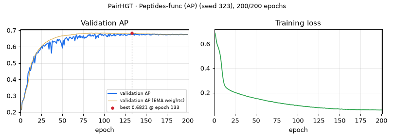

# PairHGT · Peptides-func (AP) — seed 323

[← all models](../README.md) · PairHGT notebook · peptides-func

| | |
|---|---|
| State | **finished** |
| Epochs | 200 of 200 |
| Best validation AP | **0.6821** at epoch 133 |
| Best validation AP, EMA weights | 0.6836 at epoch 85 |
| Test AP | raw 0.6864 / ema 0.6760 (final) |
| Seed | 323 |
| Parameters | 510,314 |
| Minutes per epoch (last 5, incl. validation) | 2.8 |
| Training time so far | 9.4 h |
| Training time left | done |
| Sessions (start + resumes) | 2 |
| Hottest GPU reading | 90.0 °C |
| Last update | 2026-11-25 11:16 (78.8 h ago) |



<details><summary>Settings of this run</summary>

| Setting | Value |
|---|---|
| Epochs (warm-up) | 200 (10) |
| Batch size | 128 |
| Learning rate, weight decay | 0.0003, 0.0 |
| Layers × width, heads | 4 × 96, 4 |
| Dropout, attention dropout | 0.0, 0.5 |
| Pair channel | width 16, dropout 0.1, value gate True |
| Precision | fp32 (TF32 matrix products) |
| EMA decay | 0.995930964693756 |
| Gradient clip | 1.0 |
| Protocol | v2_test_once |
| Notebook version, config hash | pairhgt-generalization-v1.0, b54198b07b05c422 |

</details>

## Final test (evaluated once)

| Weights | Epoch | Validation AP | Test AP |
|---|---|---|---|
| raw | 133 | 0.6821 | 0.6864 |
| ema | 85 | 0.6836 | 0.6760 |

## Every epoch (newest first)

| Epoch | Train loss | Val AP | Val AP (EMA weights) | Best so far | LR | Minutes |
|---|---|---|---|---|---|---|
| 200 | 0.0578 | 0.6739 | 0.6745 | 0.6821 (ep 133) | 2.05e-08 | 2.8 |
| 199 | 0.0578 | 0.6745 | 0.6744 | 0.6821 (ep 133) | 8.20e-08 | 2.8 |
| 198 | 0.0574 | 0.6739 | 0.6745 | 0.6821 (ep 133) | 1.85e-07 | 2.8 |
| 197 | 0.0574 | 0.6747 | 0.6745 | 0.6821 (ep 133) | 3.28e-07 | 2.8 |
| 196 | 0.0577 | 0.6742 | 0.6745 | 0.6821 (ep 133) | 5.12e-07 | 2.8 |
| 195 | 0.0579 | 0.6734 | 0.6745 | 0.6821 (ep 133) | 7.38e-07 | 2.8 |
| 194 | 0.0578 | 0.6746 | 0.6746 | 0.6821 (ep 133) | 1.00e-06 | 2.8 |
| 193 | 0.0587 | 0.6746 | 0.6746 | 0.6821 (ep 133) | 1.31e-06 | 2.8 |
| 192 | 0.0582 | 0.6758 | 0.6746 | 0.6821 (ep 133) | 1.66e-06 | 2.8 |
| 191 | 0.0588 | 0.6746 | 0.6745 | 0.6821 (ep 133) | 2.05e-06 | 2.8 |
| 190 | 0.0586 | 0.6747 | 0.6745 | 0.6821 (ep 133) | 2.47e-06 | 2.8 |
| 189 | 0.0590 | 0.6726 | 0.6745 | 0.6821 (ep 133) | 2.94e-06 | 2.8 |
| 188 | 0.0586 | 0.6746 | 0.6741 | 0.6821 (ep 133) | 3.45e-06 | 2.8 |
| 187 | 0.0584 | 0.6733 | 0.6743 | 0.6821 (ep 133) | 4.00e-06 | 2.8 |
| 186 | 0.0582 | 0.6750 | 0.6743 | 0.6821 (ep 133) | 4.59e-06 | 2.8 |
| 185 | 0.0590 | 0.6735 | 0.6745 | 0.6821 (ep 133) | 5.22e-06 | 2.8 |
| 184 | 0.0596 | 0.6741 | 0.6744 | 0.6821 (ep 133) | 5.89e-06 | 2.8 |
| 183 | 0.0588 | 0.6736 | 0.6743 | 0.6821 (ep 133) | 6.59e-06 | 2.8 |
| 182 | 0.0590 | 0.6755 | 0.6740 | 0.6821 (ep 133) | 7.34e-06 | 2.8 |
| 181 | 0.0594 | 0.6740 | 0.6740 | 0.6821 (ep 133) | 8.13e-06 | 2.8 |
| 180 | 0.0592 | 0.6739 | 0.6743 | 0.6821 (ep 133) | 8.95e-06 | 2.8 |
| 179 | 0.0601 | 0.6729 | 0.6746 | 0.6821 (ep 133) | 9.82e-06 | 2.8 |
| 178 | 0.0594 | 0.6739 | 0.6751 | 0.6821 (ep 133) | 1.07e-05 | 2.8 |
| 177 | 0.0598 | 0.6740 | 0.6748 | 0.6821 (ep 133) | 1.17e-05 | 2.8 |
| 176 | 0.0585 | 0.6731 | 0.6749 | 0.6821 (ep 133) | 1.26e-05 | 2.8 |
| 175 | 0.0600 | 0.6734 | 0.6747 | 0.6821 (ep 133) | 1.36e-05 | 2.8 |
| 174 | 0.0601 | 0.6713 | 0.6747 | 0.6821 (ep 133) | 1.47e-05 | 2.8 |
| 173 | 0.0607 | 0.6744 | 0.6751 | 0.6821 (ep 133) | 1.58e-05 | 2.8 |
| 172 | 0.0603 | 0.6746 | 0.6749 | 0.6821 (ep 133) | 1.69e-05 | 2.8 |
| 171 | 0.0598 | 0.6731 | 0.6744 | 0.6821 (ep 133) | 1.81e-05 | 2.8 |
| 170 | 0.0604 | 0.6736 | 0.6751 | 0.6821 (ep 133) | 1.93e-05 | 2.8 |
| 169 | 0.0608 | 0.6740 | 0.6747 | 0.6821 (ep 133) | 2.05e-05 | 2.8 |
| 168 | 0.0611 | 0.6747 | 0.6753 | 0.6821 (ep 133) | 2.18e-05 | 2.8 |
| 167 | 0.0624 | 0.6754 | 0.6751 | 0.6821 (ep 133) | 2.31e-05 | 2.8 |
| 166 | 0.0606 | 0.6744 | 0.6753 | 0.6821 (ep 133) | 2.44e-05 | 2.8 |
| 165 | 0.0621 | 0.6713 | 0.6758 | 0.6821 (ep 133) | 2.58e-05 | 2.8 |
| 164 | 0.0617 | 0.6755 | 0.6761 | 0.6821 (ep 133) | 2.72e-05 | 2.8 |
| 163 | 0.0609 | 0.6746 | 0.6761 | 0.6821 (ep 133) | 2.86e-05 | 2.8 |
| 162 | 0.0633 | 0.6738 | 0.6766 | 0.6821 (ep 133) | 3.01e-05 | 2.8 |
| 161 | 0.0625 | 0.6740 | 0.6767 | 0.6821 (ep 133) | 3.16e-05 | 2.8 |
| 160 | 0.0617 | 0.6774 | 0.6765 | 0.6821 (ep 133) | 3.32e-05 | 2.8 |
| 159 | 0.0632 | 0.6756 | 0.6774 | 0.6821 (ep 133) | 3.47e-05 | 2.8 |
| 158 | 0.0635 | 0.6770 | 0.6776 | 0.6821 (ep 133) | 3.63e-05 | 2.8 |
| 157 | 0.0623 | 0.6716 | 0.6773 | 0.6821 (ep 133) | 3.80e-05 | 2.8 |
| 156 | 0.0637 | 0.6747 | 0.6773 | 0.6821 (ep 133) | 3.96e-05 | 2.8 |
| 155 | 0.0634 | 0.6703 | 0.6776 | 0.6821 (ep 133) | 4.13e-05 | 2.8 |
| 154 | 0.0636 | 0.6765 | 0.6780 | 0.6821 (ep 133) | 4.31e-05 | 2.8 |
| 153 | 0.0646 | 0.6764 | 0.6780 | 0.6821 (ep 133) | 4.48e-05 | 2.8 |
| 152 | 0.0659 | 0.6765 | 0.6783 | 0.6821 (ep 133) | 4.66e-05 | 2.8 |
| 151 | 0.0641 | 0.6745 | 0.6787 | 0.6821 (ep 133) | 4.84e-05 | 2.8 |
| 150 | 0.0653 | 0.6742 | 0.6780 | 0.6821 (ep 133) | 5.02e-05 | 2.8 |
| 149 | 0.0657 | 0.6714 | 0.6780 | 0.6821 (ep 133) | 5.21e-05 | 2.8 |
| 148 | 0.0672 | 0.6743 | 0.6782 | 0.6821 (ep 133) | 5.40e-05 | 2.8 |
| 147 | 0.0676 | 0.6743 | 0.6785 | 0.6821 (ep 133) | 5.59e-05 | 2.8 |
| 146 | 0.0664 | 0.6736 | 0.6783 | 0.6821 (ep 133) | 5.79e-05 | 2.8 |
| 145 | 0.0667 | 0.6719 | 0.6791 | 0.6821 (ep 133) | 5.98e-05 | 2.8 |
| 144 | 0.0671 | 0.6770 | 0.6786 | 0.6821 (ep 133) | 6.18e-05 | 2.8 |
| 143 | 0.0662 | 0.6764 | 0.6785 | 0.6821 (ep 133) | 6.39e-05 | 2.8 |
| 142 | 0.0684 | 0.6701 | 0.6791 | 0.6821 (ep 133) | 6.59e-05 | 2.8 |
| 141 | 0.0685 | 0.6738 | 0.6792 | 0.6821 (ep 133) | 6.80e-05 | 2.8 |
| 140 | 0.0686 | 0.6745 | 0.6795 | 0.6821 (ep 133) | 7.00e-05 | 2.8 |
| 139 | 0.0694 | 0.6745 | 0.6805 | 0.6821 (ep 133) | 7.22e-05 | 2.8 |
| 138 | 0.0705 | 0.6740 | 0.6812 | 0.6821 (ep 133) | 7.43e-05 | 2.8 |
| 137 | 0.0706 | 0.6795 | 0.6817 | 0.6821 (ep 133) | 7.64e-05 | 2.8 |
| 136 | 0.0715 | 0.6695 | 0.6811 | 0.6821 (ep 133) | 7.86e-05 | 2.8 |
| 135 | 0.0718 | 0.6762 | 0.6804 | 0.6821 (ep 133) | 8.08e-05 | 2.8 |
| 134 | 0.0717 | 0.6755 | 0.6795 | 0.6821 (ep 133) | 8.30e-05 | 2.8 |
| 133 | 0.0720 | 0.6821 ⭐ | 0.6786 | 0.6821 (ep 133) | 8.52e-05 | 2.8 |
| 132 | 0.0744 | 0.6734 | 0.6787 | 0.6783 (ep 112) | 8.75e-05 | 2.8 |
| 131 | 0.0734 | 0.6730 | 0.6783 | 0.6783 (ep 112) | 8.97e-05 | 2.8 |
| 130 | 0.0731 | 0.6745 | 0.6788 | 0.6783 (ep 112) | 9.20e-05 | 2.8 |
| 129 | 0.0749 | 0.6769 | 0.6787 | 0.6783 (ep 112) | 9.43e-05 | 2.8 |
| 128 | 0.0746 | 0.6712 | 0.6786 | 0.6783 (ep 112) | 9.66e-05 | 2.8 |
| 127 | 0.0748 | 0.6706 | 0.6792 | 0.6783 (ep 112) | 9.90e-05 | 2.8 |
| 126 | 0.0763 | 0.6677 | 0.6802 | 0.6783 (ep 112) | 1.01e-04 | 2.8 |
| 125 | 0.0765 | 0.6753 | 0.6804 | 0.6783 (ep 112) | 1.04e-04 | 2.8 |
| 124 | 0.0763 | 0.6750 | 0.6806 | 0.6783 (ep 112) | 1.06e-04 | 2.8 |
| 123 | 0.0774 | 0.6702 | 0.6796 | 0.6783 (ep 112) | 1.08e-04 | 2.8 |
| 122 | 0.0779 | 0.6713 | 0.6792 | 0.6783 (ep 112) | 1.11e-04 | 2.8 |
| 121 | 0.0782 | 0.6719 | 0.6797 | 0.6783 (ep 112) | 1.13e-04 | 2.8 |
| 120 | 0.0793 | 0.6774 | 0.6797 | 0.6783 (ep 112) | 1.16e-04 | 2.8 |
| 119 | 0.0806 | 0.6671 | 0.6787 | 0.6783 (ep 112) | 1.18e-04 | 2.8 |
| 118 | 0.0806 | 0.6734 | 0.6793 | 0.6783 (ep 112) | 1.20e-04 | 2.8 |
| 117 | 0.0806 | 0.6761 | 0.6794 | 0.6783 (ep 112) | 1.23e-04 | 2.8 |
| 116 | 0.0821 | 0.6761 | 0.6800 | 0.6783 (ep 112) | 1.25e-04 | 2.8 |
| 115 | 0.0811 | 0.6723 | 0.6808 | 0.6783 (ep 112) | 1.28e-04 | 2.8 |
| 114 | 0.0841 | 0.6713 | 0.6799 | 0.6783 (ep 112) | 1.30e-04 | 2.8 |
| 113 | 0.0843 | 0.6654 | 0.6799 | 0.6783 (ep 112) | 1.33e-04 | 2.8 |
| 112 | 0.0860 | 0.6783 ⭐ | 0.6807 | 0.6783 (ep 112) | 1.35e-04 | 2.8 |
| 111 | 0.0867 | 0.6702 | 0.6808 | 0.6782 (ep 96) | 1.38e-04 | 2.8 |
| 110 | 0.0852 | 0.6688 | 0.6805 | 0.6782 (ep 96) | 1.40e-04 | 2.8 |
| 109 | 0.0868 | 0.6662 | 0.6810 | 0.6782 (ep 96) | 1.43e-04 | 2.8 |
| 108 | 0.0876 | 0.6706 | 0.6817 | 0.6782 (ep 96) | 1.45e-04 | 2.7 |
| 107 | 0.0875 | 0.6773 | 0.6821 | 0.6782 (ep 96) | 1.48e-04 | 2.8 |
| 106 | 0.0884 | 0.6631 | 0.6815 | 0.6782 (ep 96) | 1.50e-04 | 2.8 |
| 105 | 0.0899 | 0.6752 | 0.6822 | 0.6782 (ep 96) | 1.52e-04 | 2.8 |
| 104 | 0.0906 | 0.6609 | 0.6821 | 0.6782 (ep 96) | 1.55e-04 | 2.8 |
| 103 | 0.0918 | 0.6634 | 0.6821 | 0.6782 (ep 96) | 1.57e-04 | 2.8 |
| 102 | 0.0923 | 0.6708 | 0.6820 | 0.6782 (ep 96) | 1.60e-04 | 2.8 |
| 101 | 0.0927 | 0.6736 | 0.6834 | 0.6782 (ep 96) | 1.62e-04 | 2.8 |
| 100 | 0.0935 | 0.6720 | 0.6831 | 0.6782 (ep 96) | 1.65e-04 | 2.8 |
| 99 | 0.0954 | 0.6670 | 0.6828 | 0.6782 (ep 96) | 1.67e-04 | 2.8 |
| 98 | 0.0966 | 0.6737 | 0.6829 | 0.6782 (ep 96) | 1.70e-04 | 2.8 |
| 97 | 0.0963 | 0.6693 | 0.6833 | 0.6782 (ep 96) | 1.72e-04 | 2.8 |
| 96 | 0.0954 | 0.6782 ⭐ | 0.6823 | 0.6782 (ep 96) | 1.75e-04 | 2.8 |
| 95 | 0.0991 | 0.6733 | 0.6815 | 0.6765 (ep 89) | 1.77e-04 | 2.8 |
| 94 | 0.0995 | 0.6762 | 0.6819 | 0.6765 (ep 89) | 1.80e-04 | 2.8 |
| 93 | 0.1001 | 0.6558 | 0.6819 | 0.6765 (ep 89) | 1.82e-04 | 2.8 |
| 92 | 0.1006 | 0.6666 | 0.6825 | 0.6765 (ep 89) | 1.84e-04 | 2.8 |
| 91 | 0.1002 | 0.6628 | 0.6825 | 0.6765 (ep 89) | 1.87e-04 | 2.8 |
| 90 | 0.1045 | 0.6491 | 0.6834 | 0.6765 (ep 89) | 1.89e-04 | 2.8 |
| 89 | 0.1035 | 0.6765 ⭐ | 0.6817 | 0.6765 (ep 89) | 1.92e-04 | 2.8 |
| 88 | 0.1042 | 0.6713 | 0.6804 | 0.6760 (ep 83) | 1.94e-04 | 2.8 |
| 87 | 0.1048 | 0.6641 | 0.6817 | 0.6760 (ep 83) | 1.96e-04 | 2.8 |
| 86 | 0.1059 | 0.6705 | 0.6823 | 0.6760 (ep 83) | 1.99e-04 | 2.8 |
| 85 | 0.1077 | 0.6657 | 0.6836 | 0.6760 (ep 83) | 2.01e-04 | 2.8 |
| 84 | 0.1077 | 0.6646 | 0.6825 | 0.6760 (ep 83) | 2.03e-04 | 2.8 |
| 83 | 0.1098 | 0.6760 ⭐ | 0.6824 | 0.6760 (ep 83) | 2.06e-04 | 2.8 |
| 82 | 0.1099 | 0.6665 | 0.6824 | 0.6722 (ep 81) | 2.08e-04 | 2.8 |
| 81 | 0.1116 | 0.6722 ⭐ | 0.6817 | 0.6722 (ep 81) | 2.10e-04 | 2.8 |
| 80 | 0.1115 | 0.6635 | 0.6810 | 0.6712 (ep 67) | 2.13e-04 | 2.8 |
| 79 | 0.1139 | 0.6586 | 0.6814 | 0.6712 (ep 67) | 2.15e-04 | 2.8 |
| 78 | 0.1152 | 0.6546 | 0.6816 | 0.6712 (ep 67) | 2.17e-04 | 2.8 |
| 77 | 0.1153 | 0.6592 | 0.6809 | 0.6712 (ep 67) | 2.19e-04 | 2.8 |
| 76 | 0.1160 | 0.6507 | 0.6810 | 0.6712 (ep 67) | 2.21e-04 | 2.8 |
| 75 | 0.1181 | 0.6672 | 0.6809 | 0.6712 (ep 67) | 2.24e-04 | 2.8 |
| 74 | 0.1182 | 0.6543 | 0.6787 | 0.6712 (ep 67) | 2.26e-04 | 2.8 |
| 73 | 0.1210 | 0.6606 | 0.6791 | 0.6712 (ep 67) | 2.28e-04 | 2.8 |
| 72 | 0.1207 | 0.6558 | 0.6783 | 0.6712 (ep 67) | 2.30e-04 | 2.8 |
| 71 | 0.1227 | 0.6689 | 0.6791 | 0.6712 (ep 67) | 2.32e-04 | 2.8 |
| 70 | 0.1247 | 0.6557 | 0.6787 | 0.6712 (ep 67) | 2.34e-04 | 2.8 |
| 69 | 0.1269 | 0.6633 | 0.6790 | 0.6712 (ep 67) | 2.36e-04 | 2.8 |
| 68 | 0.1263 | 0.6474 | 0.6777 | 0.6712 (ep 67) | 2.38e-04 | 2.8 |
| 67 | 0.1264 | 0.6712 ⭐ | 0.6778 | 0.6712 (ep 67) | 2.40e-04 | 2.8 |
| 66 | 0.1292 | 0.6629 ⭐ | 0.6754 | 0.6629 (ep 66) | 2.42e-04 | 2.8 |
| 65 | 0.1292 | 0.6359 | 0.6753 | 0.6609 (ep 63) | 2.44e-04 | 2.8 |
| 64 | 0.1318 | 0.6601 | 0.6763 | 0.6609 (ep 63) | 2.46e-04 | 2.8 |
| 63 | 0.1324 | 0.6609 ⭐ | 0.6747 | 0.6609 (ep 63) | 2.48e-04 | 2.8 |
| 62 | 0.1339 | 0.6496 | 0.6741 | 0.6585 (ep 59) | 2.50e-04 | 2.8 |
| 61 | 0.1346 | 0.6492 | 0.6737 | 0.6585 (ep 59) | 2.52e-04 | 2.8 |
| 60 | 0.1378 | 0.6554 | 0.6714 | 0.6585 (ep 59) | 2.53e-04 | 2.8 |
| 59 | 0.1388 | 0.6585 ⭐ | 0.6711 | 0.6585 (ep 59) | 2.55e-04 | 2.8 |
| 58 | 0.1410 | 0.6517 | 0.6711 | 0.6561 (ep 55) | 2.57e-04 | 2.8 |
| 57 | 0.1407 | 0.6366 | 0.6699 | 0.6561 (ep 55) | 2.59e-04 | 2.8 |
| 56 | 0.1431 | 0.6458 | 0.6700 | 0.6561 (ep 55) | 2.60e-04 | 2.8 |
| 55 | 0.1435 | 0.6561 ⭐ | 0.6688 | 0.6561 (ep 55) | 2.62e-04 | 2.8 |
| 54 | 0.1465 | 0.6509 ⭐ | 0.6682 | 0.6509 (ep 54) | 2.64e-04 | 2.8 |
| 53 | 0.1482 | 0.6466 ⭐ | 0.6683 | 0.6466 (ep 53) | 2.65e-04 | 2.8 |
| 52 | 0.1501 | 0.6089 | 0.6671 | 0.6446 (ep 44) | 2.67e-04 | 2.8 |
| 51 | 0.1486 | 0.6380 | 0.6656 | 0.6446 (ep 44) | 2.68e-04 | 2.8 |
| 50 | 0.1514 | 0.5916 | 0.6663 | 0.6446 (ep 44) | 2.70e-04 | 2.8 |
| 49 | 0.1538 | 0.6182 | 0.6656 | 0.6446 (ep 44) | 2.71e-04 | 2.8 |
| 48 | 0.1551 | 0.6289 | 0.6643 | 0.6446 (ep 44) | 2.73e-04 | 2.8 |
| 47 | 0.1573 | 0.6418 | 0.6633 | 0.6446 (ep 44) | 2.74e-04 | 2.8 |
| 46 | 0.1578 | 0.6436 | 0.6624 | 0.6446 (ep 44) | 2.76e-04 | 2.8 |
| 45 | 0.1608 | 0.6344 | 0.6599 | 0.6446 (ep 44) | 2.77e-04 | 2.8 |
| 44 | 0.1619 | 0.6446 ⭐ | 0.6587 | 0.6446 (ep 44) | 2.78e-04 | 2.8 |
| 43 | 0.1639 | 0.6210 | 0.6576 | 0.6350 (ep 38) | 2.79e-04 | 2.8 |
| 42 | 0.1644 | 0.6275 | 0.6557 | 0.6350 (ep 38) | 2.81e-04 | 2.8 |
| 41 | 0.1674 | 0.6298 | 0.6534 | 0.6350 (ep 38) | 2.82e-04 | 2.8 |
| 40 | 0.1684 | 0.6317 | 0.6512 | 0.6350 (ep 38) | 2.83e-04 | 2.8 |
| 39 | 0.1701 | 0.6275 | 0.6487 | 0.6350 (ep 38) | 2.84e-04 | 2.8 |
| 38 | 0.1717 | 0.6350 ⭐ | 0.6465 | 0.6350 (ep 38) | 2.85e-04 | 2.8 |
| 37 | 0.1755 | 0.5604 | 0.6455 | 0.6298 (ep 35) | 2.86e-04 | 2.8 |
| 36 | 0.1759 | 0.6176 | 0.6426 | 0.6298 (ep 35) | 2.87e-04 | 2.8 |
| 35 | 0.1790 | 0.6298 ⭐ | 0.6401 | 0.6298 (ep 35) | 2.88e-04 | 2.8 |
| 34 | 0.1805 | 0.5848 | 0.6387 | 0.6230 (ep 33) | 2.89e-04 | 2.8 |
| 33 | 0.1826 | 0.6230 ⭐ | 0.6349 | 0.6230 (ep 33) | 2.90e-04 | 2.8 |
| 32 | 0.1843 | 0.6191 ⭐ | 0.6303 | 0.6191 (ep 32) | 2.91e-04 | 2.8 |
| 31 | 0.1855 | 0.6152 ⭐ | 0.6283 | 0.6152 (ep 31) | 2.92e-04 | 2.8 |
| 30 | 0.1901 | 0.6110 ⭐ | 0.6253 | 0.6110 (ep 30) | 2.93e-04 | 2.8 |
| 29 | 0.1911 | 0.6029 | 0.6205 | 0.6063 (ep 28) | 2.93e-04 | 2.8 |
| 28 | 0.1936 | 0.6063 ⭐ | 0.6170 | 0.6063 (ep 28) | 2.94e-04 | 2.8 |
| 27 | 0.1961 | 0.6062 ⭐ | 0.6132 | 0.6062 (ep 27) | 2.95e-04 | 2.8 |
| 26 | 0.1990 | 0.5902 | 0.6077 | 0.5999 (ep 25) | 2.95e-04 | 2.8 |
| 25 | 0.2015 | 0.5999 ⭐ | 0.6026 | 0.5999 (ep 25) | 2.96e-04 | 2.8 |
| 24 | 0.2031 | 0.5882 ⭐ | 0.5955 | 0.5882 (ep 24) | 2.97e-04 | 2.8 |
| 23 | 0.2064 | 0.5782 ⭐ | 0.5904 | 0.5782 (ep 23) | 2.97e-04 | 2.8 |
| 22 | 0.2094 | 0.5742 ⭐ | 0.5842 | 0.5742 (ep 22) | 2.98e-04 | 2.8 |
| 21 | 0.2114 | 0.5627 ⭐ | 0.5775 | 0.5627 (ep 21) | 2.98e-04 | 2.8 |
| 20 | 0.2159 | 0.5606 | 0.5685 | 0.5625 (ep 19) | 2.98e-04 | 2.8 |
| 19 | 0.2188 | 0.5625 ⭐ | 0.5606 | 0.5625 (ep 19) | 2.99e-04 | 2.8 |
| 18 | 0.2229 | 0.5418 ⭐ | 0.5521 | 0.5418 (ep 18) | 2.99e-04 | 2.8 |
| 17 | 0.2269 | 0.5007 | 0.5444 | 0.5402 (ep 16) | 2.99e-04 | 2.8 |
| 16 | 0.2314 | 0.5402 ⭐ | 0.5290 | 0.5402 (ep 16) | 2.99e-04 | 2.8 |
| 15 | 0.2365 | 0.5052 ⭐ | 0.5167 | 0.5052 (ep 15) | 3.00e-04 | 2.8 |
| 14 | 0.2430 | 0.5020 ⭐ | 0.5113 | 0.5020 (ep 14) | 3.00e-04 | 2.8 |
| 13 | 0.2518 | 0.4771 ⭐ | 0.4971 | 0.4771 (ep 13) | 3.00e-04 | 2.8 |
| 12 | 0.2662 | 0.4533 | 0.4757 | 0.4716 (ep 11) | 3.00e-04 | 2.8 |
| 11 | 0.2944 | 0.4716 ⭐ | 0.4496 | 0.4716 (ep 11) | 3.00e-04 | 2.8 |
| 10 | 0.3403 | 0.4478 ⭐ | 0.4124 | 0.4478 (ep 10) | 2.70e-04 | 2.8 |
| 9 | 0.4029 | 0.4380 ⭐ | 0.3804 | 0.4380 (ep 9) | 2.40e-04 | 2.8 |
| 8 | 0.4668 | 0.3702 ⭐ | 0.3547 | 0.3702 (ep 8) | 2.10e-04 | 2.8 |
| 7 | 0.5126 | 0.3533 ⭐ | 0.3394 | 0.3533 (ep 7) | 1.80e-04 | 2.8 |
| 6 | 0.5438 | 0.3350 ⭐ | 0.3250 | 0.3350 (ep 6) | 1.50e-04 | 2.8 |
| 5 | 0.5672 | 0.3069 ⭐ | 0.3008 | 0.3069 (ep 5) | 1.20e-04 | 2.8 |
| 4 | 0.5851 | 0.2819 ⭐ | 0.2785 | 0.2819 (ep 4) | 9.00e-05 | 2.8 |
| 3 | 0.6068 | 0.2722 ⭐ | 0.2706 | 0.2722 (ep 3) | 6.00e-05 | 2.8 |
| 2 | 0.6466 | 0.2611 ⭐ | 0.2621 | 0.2611 (ep 2) | 3.00e-05 | 2.8 |
| 1 | 0.6895 | 0.2149 ⭐ | 0.2128 | 0.2149 (ep 1) | 3.00e-10 | 2.8 |

## Last 80 log lines

_The log counts epochs from 0; the tables above count from 1._

```
[seed 543] epoch 165/200 | lr 2.58e-05 | train loss 0.0611 | val AP 0.6777 | best val 0.6833 @ep121 | EMA val 0.6814 | 168s (train 147s, eval 22s) | GPU max 89C | ETA<= 1.6h
[seed 543] epoch 166/200 | lr 2.44e-05 | train loss 0.0619 | val AP 0.6823 | best val 0.6833 @ep121 | EMA val 0.6810 | 168s (train 146s, eval 22s) | GPU max 89C | ETA<= 1.6h
[seed 543] epoch 167/200 | lr 2.31e-05 | train loss 0.0611 | val AP 0.6819 | best val 0.6833 @ep121 | EMA val 0.6812 | 168s (train 147s, eval 22s) | GPU max 88C | ETA<= 1.5h
[seed 543] epoch 168/200 | lr 2.18e-05 | train loss 0.0615 | val AP 0.6796 | best val 0.6833 @ep121 | EMA val 0.6815 | 168s (train 147s, eval 22s) | GPU max 89C | ETA<= 1.5h
[seed 543] epoch 169/200 | lr 2.05e-05 | train loss 0.0610 | val AP 0.6793 | best val 0.6833 @ep121 | EMA val 0.6809 | 169s (train 147s, eval 22s) | GPU max 89C | ETA<= 1.4h
[seed 543] epoch 170/200 | lr 1.93e-05 | train loss 0.0614 | val AP 0.6804 | best val 0.6833 @ep121 | EMA val 0.6806 | 168s (train 146s, eval 22s) | GPU max 89C | ETA<= 1.4h
[seed 543] epoch 171/200 | lr 1.81e-05 | train loss 0.0612 | val AP 0.6801 | best val 0.6833 @ep121 | EMA val 0.6808 | 168s (train 146s, eval 22s) | GPU max 89C | ETA<= 1.4h
[seed 543] epoch 172/200 | lr 1.69e-05 | train loss 0.0603 | val AP 0.6787 | best val 0.6833 @ep121 | EMA val 0.6813 | 169s (train 147s, eval 22s) | GPU max 89C | ETA<= 1.3h
[seed 543] epoch 173/200 | lr 1.58e-05 | train loss 0.0608 | val AP 0.6806 | best val 0.6833 @ep121 | EMA val 0.6809 | 169s (train 147s, eval 22s) | GPU max 89C | ETA<= 1.3h
[seed 543] epoch 174/200 | lr 1.47e-05 | train loss 0.0601 | val AP 0.6801 | best val 0.6833 @ep121 | EMA val 0.6809 | 168s (train 146s, eval 22s) | GPU max 89C | ETA<= 1.2h
[seed 543] epoch 175/200 | lr 1.36e-05 | train loss 0.0605 | val AP 0.6814 | best val 0.6833 @ep121 | EMA val 0.6810 | 168s (train 146s, eval 22s) | GPU max 88C | ETA<= 1.2h
[seed 543] epoch 176/200 | lr 1.26e-05 | train loss 0.0599 | val AP 0.6791 | best val 0.6833 @ep121 | EMA val 0.6810 | 169s (train 147s, eval 22s) | GPU max 88C | ETA<= 1.1h
[seed 543] epoch 177/200 | lr 1.17e-05 | train loss 0.0598 | val AP 0.6795 | best val 0.6833 @ep121 | EMA val 0.6808 | 168s (train 146s, eval 22s) | GPU max 89C | ETA<= 1.1h
[seed 543] epoch 178/200 | lr 1.07e-05 | train loss 0.0602 | val AP 0.6806 | best val 0.6833 @ep121 | EMA val 0.6806 | 169s (train 147s, eval 22s) | GPU max 89C | ETA<= 1.0h
[seed 543] epoch 179/200 | lr 9.82e-06 | train loss 0.0592 | val AP 0.6803 | best val 0.6833 @ep121 | EMA val 0.6807 | 168s (train 147s, eval 22s) | GPU max 89C | ETA<= 1.0h
[seed 543] epoch 180/200 | lr 8.95e-06 | train loss 0.0603 | val AP 0.6789 | best val 0.6833 @ep121 | EMA val 0.6806 | 169s (train 147s, eval 22s) | GPU max 88C | ETA<= 0.9h
[seed 543] epoch 181/200 | lr 8.13e-06 | train loss 0.0600 | val AP 0.6804 | best val 0.6833 @ep121 | EMA val 0.6805 | 168s (train 146s, eval 22s) | GPU max 89C | ETA<= 0.9h
[seed 543] epoch 182/200 | lr 7.34e-06 | train loss 0.0578 | val AP 0.6807 | best val 0.6833 @ep121 | EMA val 0.6805 | 168s (train 147s, eval 22s) | GPU max 88C | ETA<= 0.8h
[seed 543] epoch 183/200 | lr 6.59e-06 | train loss 0.0594 | val AP 0.6809 | best val 0.6833 @ep121 | EMA val 0.6806 | 169s (train 147s, eval 22s) | GPU max 89C | ETA<= 0.8h
[seed 543] epoch 184/200 | lr 5.89e-06 | train loss 0.0590 | val AP 0.6788 | best val 0.6833 @ep121 | EMA val 0.6803 | 168s (train 147s, eval 22s) | GPU max 89C | ETA<= 0.7h
[seed 543] epoch 185/200 | lr 5.22e-06 | train loss 0.0597 | val AP 0.6797 | best val 0.6833 @ep121 | EMA val 0.6803 | 168s (train 147s, eval 22s) | GPU max 89C | ETA<= 0.7h
[seed 543] epoch 186/200 | lr 4.59e-06 | train loss 0.0597 | val AP 0.6797 | best val 0.6833 @ep121 | EMA val 0.6802 | 168s (train 147s, eval 22s) | GPU max 88C | ETA<= 0.7h
[seed 543] epoch 187/200 | lr 4.00e-06 | train loss 0.0580 | val AP 0.6797 | best val 0.6833 @ep121 | EMA val 0.6802 | 169s (train 147s, eval 22s) | GPU max 89C | ETA<= 0.6h
[seed 543] epoch 188/200 | lr 3.45e-06 | train loss 0.0585 | val AP 0.6797 | best val 0.6833 @ep121 | EMA val 0.6800 | 168s (train 146s, eval 22s) | GPU max 88C | ETA<= 0.6h
[seed 543] epoch 189/200 | lr 2.94e-06 | train loss 0.0590 | val AP 0.6799 | best val 0.6833 @ep121 | EMA val 0.6800 | 169s (train 147s, eval 22s) | GPU max 89C | ETA<= 0.5h
[seed 543] epoch 190/200 | lr 2.47e-06 | train loss 0.0591 | val AP 0.6801 | best val 0.6833 @ep121 | EMA val 0.6801 | 169s (train 147s, eval 22s) | GPU max 89C | ETA<= 0.5h
[seed 543] epoch 191/200 | lr 2.05e-06 | train loss 0.0593 | val AP 0.6796 | best val 0.6833 @ep121 | EMA val 0.6801 | 168s (train 146s, eval 22s) | GPU max 89C | ETA<= 0.4h
[seed 543] epoch 192/200 | lr 1.66e-06 | train loss 0.0599 | val AP 0.6797 | best val 0.6833 @ep121 | EMA val 0.6800 | 168s (train 147s, eval 22s) | GPU max 89C | ETA<= 0.4h
[seed 543] epoch 193/200 | lr 1.31e-06 | train loss 0.0574 | val AP 0.6798 | best val 0.6833 @ep121 | EMA val 0.6801 | 168s (train 146s, eval 22s) | GPU max 88C | ETA<= 0.3h
[seed 543] epoch 194/200 | lr 1.00e-06 | train loss 0.0581 | val AP 0.6796 | best val 0.6833 @ep121 | EMA val 0.6801 | 168s (train 147s, eval 22s) | GPU max 89C | ETA<= 0.3h
[seed 543] epoch 195/200 | lr 7.38e-07 | train loss 0.0583 | val AP 0.6799 | best val 0.6833 @ep121 | EMA val 0.6801 | 168s (train 147s, eval 22s) | GPU max 88C | ETA<= 0.2h
[seed 543] epoch 196/200 | lr 5.12e-07 | train loss 0.0582 | val AP 0.6799 | best val 0.6833 @ep121 | EMA val 0.6802 | 169s (train 147s, eval 22s) | GPU max 89C | ETA<= 0.2h
[seed 543] epoch 197/200 | lr 3.28e-07 | train loss 0.0590 | val AP 0.6797 | best val 0.6833 @ep121 | EMA val 0.6803 | 168s (train 147s, eval 22s) | GPU max 89C | ETA<= 0.1h
[seed 543] epoch 198/200 | lr 1.85e-07 | train loss 0.0582 | val AP 0.6793 | best val 0.6833 @ep121 | EMA val 0.6803 | 169s (train 147s, eval 22s) | GPU max 89C | ETA<= 0.1h
[seed 543] epoch 199/200 | lr 8.20e-08 | train loss 0.0577 | val AP 0.6804 | best val 0.6833 @ep121 | EMA val 0.6802 | 169s (train 147s, eval 22s) | GPU max 88C | ETA<= 0.0h
[seed 543] epoch 200/200 | lr 2.05e-08 | train loss 0.0584 | val AP 0.6788 | best val 0.6833 @ep121 | EMA val 0.6803 | 169s (train 147s, eval 22s) | GPU max 89C | ETA<= 0.0h
[seed 543] FINAL TEST (evaluated once): raw epoch 121 val 0.6833 test 0.6876 | EMA epoch 126 val 0.6851 test 0.6944 (AP, higher is better)
--- cell 17 ---
PairHGT | gps_conf_PairHGT_ep200_peptides_func | AP (higher is better)
 seed  epochs  raw_epoch  raw_val  raw_test  ema_epoch  ema_val  ema_test  hours  train_s_per_epoch  total_s_per_epoch
  101 200/200        168   0.6845    0.6709        115   0.6850    0.6661 9.3929           147.1786           169.0725
  202 200/200        144   0.6814    0.6818        100   0.6859    0.6793 9.3079           145.9131           167.5427
  323 200/200        133   0.6821    0.6864         85   0.6836    0.6760 9.3599           146.7161           168.4774
  432 200/200        124   0.7005    0.6853        102   0.7051    0.6822 9.3305           146.2597           167.9494
  543 200/200        121   0.6833    0.6876        126   0.6851    0.6944 9.3328           146.3005           167.9896
mean ± sample SD (ddof=1) over 5 seed(s): raw test 0.6824 ± 0.0068 | EMA test 0.6796 ± 0.0103
A mean ± SD over fewer than 3 seeds is only a description; do not call it a confidence interval.
run manifest: 10 row(s) -> /home/student/thesis/outputs/pairhgt/outputs/confirmatory_peptides_func/run_manifest.csv
    model              gpu  seeds  params  train_s_per_epoch  val_eval_s_per_epoch  total_s_per_epoch  hours_per_seed  time_vs_GPS+EMA
GPS + EMA NVIDIA RTX A4000      5  504442               9.98                  1.30              11.29            0.63             1.00
  PairHGT NVIDIA RTX A4000      5  510314             146.47                 21.71             168.21            9.34            14.89
train = training steps incl. EMA update; val_eval = validation of raw + EMA weights; no test pass inside an epoch (protocol v2). For the thesis cost table use only seeds that had the GPU alone.
--- cell 19 ---
=== PairHGT  minus  GPS + EMA   (peptides-func, AP, higher is better; matched seeds) ===
 seed  raw_val  ema_val  raw_test  ema_test
  101   0.0218   0.0163    0.0148   -0.0020
  202   0.0254   0.0252    0.0322    0.0252
  323   0.0233   0.0205    0.0173    0.0123
  432   0.0318   0.0286    0.0284    0.0304
  543   0.0096   0.0089    0.0373    0.0407
  validation AP, raw        : mean +0.0224, sample SD 0.0081, per-seed [0.0218, 0.0254, 0.0233, 0.0318, 0.0096], seeds in favour of PairHGT: 5/5 | 95% t-interval [+0.0123, +0.0324] (n=5, df=4, t=6.17, p=0.004)
  validation AP, EMA        : mean +0.0199, sample SD 0.0077, per-seed [0.0163, 0.0252, 0.0205, 0.0286, 0.0089], seeds in favour of PairHGT: 5/5 | 95% t-interval [+0.0103, +0.0295] (n=5, df=4, t=5.75, p=0.005)
  test AP, raw vs raw       : mean +0.0260, sample SD 0.0097, per-seed [0.0148, 0.0322, 0.0173, 0.0284, 0.0373], seeds in favour of PairHGT: 5/5 | 95% t-interval [+0.0140, +0.0380] (n=5, df=4, t=6.03, p=0.004)
  test AP, EMA vs EMA       : mean +0.0213, sample SD 0.0166, per-seed [-0.002, 0.0252, 0.0123, 0.0304, 0.0407], seeds in favour of PairHGT: 4/5 | 95% t-interval [+0.0007, +0.0419] (n=5, df=4, t=2.87, p=0.045)
  Reading: interpret with the interval and the number of seeds in favour, not with a threshold. 'Significant' only for a stated test.
GPS sanity line (peptides-func, raw weights, 5 seed(s)): ours 0.6564 ± 0.0078 vs published 0.6535 ± 0.0041 (4 seeds): gap +0.0029 = +0.70 published SDs  (within 2 published SDs)
Planning (80% power, alpha 0.05, paired t, observed SD of the EMA test differences 0.0166): smallest detectable true difference n=3: 0.0541, n=5: 0.0279, n=10: 0.0165, n=20: 0.0109
--- cell 21 ---
        dataset  metric weights  n_seeds  gps_mean  pairhgt_mean  diff_mean   ci_lo  ci_hi  seeds_in_favour  diff_in_published_sd
   ogbg-molpcba      AP     raw        5    0.2904        0.2963     0.0059  0.0021 0.0097              5.0                2.1143
   ogbg-molpcba      AP     EMA        5    0.2980        0.3061     0.0082  0.0039 0.0124              5.0                2.9111
  Peptides-func      AP     raw        5    0.6564        0.6824     0.0260  0.0140 0.0380              5.0                6.3447
  Peptides-func      AP     EMA        5    0.6583        0.6796     0.0213  0.0007 0.0419              4.0                5.1978
Peptides-struct     MAE     raw        0       NaN           NaN        NaN     NaN    NaN              NaN                   NaN
Peptides-struct     MAE     EMA        0       NaN           NaN        NaN     NaN    NaN              NaN                   NaN
    ogbg-molhiv ROC-AUC     raw        5    0.7774        0.7842     0.0068 -0.0196 0.0333              4.0                0.6759
    ogbg-molhiv ROC-AUC     EMA        5    0.7855        0.7966     0.0110 -0.0004 0.0224              4.0                1.0909
-> /home/student/thesis/outputs/pairhgt/outputs/confirmatory_all_datasets/summary_all_datasets.csv and .tex (molpcba read from /home/student/thesis/outputs/pairhgt/checkpoints, read only)
--- cell 23 ---
===== 2026-11-25 22:26:57 notebook run ended (exit 0); executed notebook: /home/student/thesis/outputs/lab_runs/notebooks_gen/peptides_func_PairHGT_20261125_111635.ipynb =====
```
