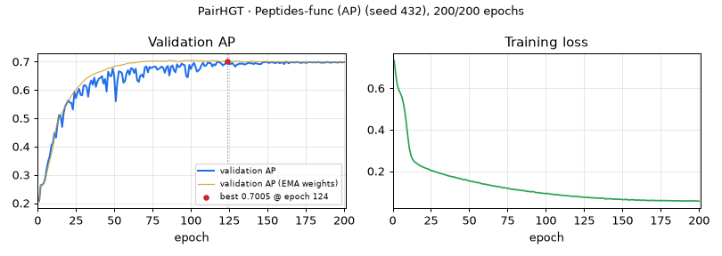

# PairHGT · Peptides-func (AP) — seed 432

[← all models](../README.md) · PairHGT notebook · peptides-func

| | |
|---|---|
| State | **finished** |
| Epochs | 200 of 200 |
| Best validation AP | **0.7005** at epoch 124 |
| Best validation AP, EMA weights | 0.7051 at epoch 102 |
| Test AP | raw 0.6853 / ema 0.6822 (final) |
| Seed | 432 |
| Parameters | 510,314 |
| Minutes per epoch (last 5, incl. validation) | 2.8 |
| Training time so far | 9.3 h |
| Training time left | done |
| Sessions (start + resumes) | 2 |
| Hottest GPU reading | 90.0 °C |
| Last update | 2026-11-25 13:05 (77.0 h ago) |



<details><summary>Settings of this run</summary>

| Setting | Value |
|---|---|
| Epochs (warm-up) | 200 (10) |
| Batch size | 128 |
| Learning rate, weight decay | 0.0003, 0.0 |
| Layers × width, heads | 4 × 96, 4 |
| Dropout, attention dropout | 0.0, 0.5 |
| Pair channel | width 16, dropout 0.1, value gate True |
| Precision | fp32 (TF32 matrix products) |
| EMA decay | 0.995930964693756 |
| Gradient clip | 1.0 |
| Protocol | v2_test_once |
| Notebook version, config hash | pairhgt-generalization-v1.0, b54198b07b05c422 |

</details>

## Final test (evaluated once)

| Weights | Epoch | Validation AP | Test AP |
|---|---|---|---|
| raw | 124 | 0.7005 | 0.6853 |
| ema | 102 | 0.7051 | 0.6822 |

## Every epoch (newest first)

| Epoch | Train loss | Val AP | Val AP (EMA weights) | Best so far | LR | Minutes |
|---|---|---|---|---|---|---|
| 200 | 0.0557 | 0.6982 | 0.6987 | 0.7005 (ep 124) | 2.05e-08 | 2.8 |
| 199 | 0.0567 | 0.6978 | 0.6987 | 0.7005 (ep 124) | 8.20e-08 | 2.8 |
| 198 | 0.0571 | 0.6981 | 0.6987 | 0.7005 (ep 124) | 1.85e-07 | 2.8 |
| 197 | 0.0573 | 0.6989 | 0.6987 | 0.7005 (ep 124) | 3.28e-07 | 2.8 |
| 196 | 0.0573 | 0.6967 | 0.6987 | 0.7005 (ep 124) | 5.12e-07 | 2.8 |
| 195 | 0.0574 | 0.6980 | 0.6987 | 0.7005 (ep 124) | 7.38e-07 | 2.8 |
| 194 | 0.0571 | 0.6983 | 0.6986 | 0.7005 (ep 124) | 1.00e-06 | 2.8 |
| 193 | 0.0574 | 0.6978 | 0.6985 | 0.7005 (ep 124) | 1.31e-06 | 2.8 |
| 192 | 0.0574 | 0.6980 | 0.6985 | 0.7005 (ep 124) | 1.66e-06 | 2.8 |
| 191 | 0.0565 | 0.6965 | 0.6985 | 0.7005 (ep 124) | 2.05e-06 | 2.8 |
| 190 | 0.0566 | 0.6978 | 0.6986 | 0.7005 (ep 124) | 2.47e-06 | 2.8 |
| 189 | 0.0566 | 0.6994 | 0.6986 | 0.7005 (ep 124) | 2.94e-06 | 2.8 |
| 188 | 0.0571 | 0.6972 | 0.6987 | 0.7005 (ep 124) | 3.45e-06 | 2.8 |
| 187 | 0.0576 | 0.6971 | 0.6985 | 0.7005 (ep 124) | 4.00e-06 | 2.8 |
| 186 | 0.0579 | 0.6970 | 0.6987 | 0.7005 (ep 124) | 4.59e-06 | 2.8 |
| 185 | 0.0570 | 0.6967 | 0.6987 | 0.7005 (ep 124) | 5.22e-06 | 2.8 |
| 184 | 0.0579 | 0.6977 | 0.6986 | 0.7005 (ep 124) | 5.89e-06 | 2.8 |
| 183 | 0.0576 | 0.6995 | 0.6986 | 0.7005 (ep 124) | 6.59e-06 | 2.8 |
| 182 | 0.0581 | 0.6971 | 0.6985 | 0.7005 (ep 124) | 7.34e-06 | 2.8 |
| 181 | 0.0581 | 0.6985 | 0.6985 | 0.7005 (ep 124) | 8.13e-06 | 2.8 |
| 180 | 0.0585 | 0.6976 | 0.6983 | 0.7005 (ep 124) | 8.95e-06 | 2.8 |
| 179 | 0.0576 | 0.6980 | 0.6984 | 0.7005 (ep 124) | 9.82e-06 | 2.8 |
| 178 | 0.0587 | 0.6983 | 0.6982 | 0.7005 (ep 124) | 1.07e-05 | 2.8 |
| 177 | 0.0585 | 0.6984 | 0.6983 | 0.7005 (ep 124) | 1.17e-05 | 2.8 |
| 176 | 0.0587 | 0.6973 | 0.6975 | 0.7005 (ep 124) | 1.26e-05 | 2.8 |
| 175 | 0.0587 | 0.6957 | 0.6978 | 0.7005 (ep 124) | 1.36e-05 | 2.8 |
| 174 | 0.0578 | 0.6982 | 0.6981 | 0.7005 (ep 124) | 1.47e-05 | 2.8 |
| 173 | 0.0596 | 0.6971 | 0.6981 | 0.7005 (ep 124) | 1.58e-05 | 2.8 |
| 172 | 0.0580 | 0.6958 | 0.6983 | 0.7005 (ep 124) | 1.69e-05 | 2.8 |
| 171 | 0.0596 | 0.6974 | 0.6986 | 0.7005 (ep 124) | 1.81e-05 | 2.8 |
| 170 | 0.0593 | 0.6977 | 0.6990 | 0.7005 (ep 124) | 1.93e-05 | 2.8 |
| 169 | 0.0601 | 0.6995 | 0.6990 | 0.7005 (ep 124) | 2.05e-05 | 2.8 |
| 168 | 0.0586 | 0.6972 | 0.6992 | 0.7005 (ep 124) | 2.18e-05 | 2.8 |
| 167 | 0.0593 | 0.6980 | 0.6994 | 0.7005 (ep 124) | 2.31e-05 | 2.8 |
| 166 | 0.0591 | 0.6981 | 0.6992 | 0.7005 (ep 124) | 2.44e-05 | 2.8 |
| 165 | 0.0600 | 0.6987 | 0.6996 | 0.7005 (ep 124) | 2.58e-05 | 2.8 |
| 164 | 0.0603 | 0.6944 | 0.6997 | 0.7005 (ep 124) | 2.72e-05 | 2.8 |
| 163 | 0.0611 | 0.6976 | 0.7000 | 0.7005 (ep 124) | 2.86e-05 | 2.8 |
| 162 | 0.0596 | 0.7002 | 0.7000 | 0.7005 (ep 124) | 3.01e-05 | 2.7 |
| 161 | 0.0616 | 0.6918 | 0.6999 | 0.7005 (ep 124) | 3.16e-05 | 2.8 |
| 160 | 0.0609 | 0.6967 | 0.6996 | 0.7005 (ep 124) | 3.32e-05 | 2.8 |
| 159 | 0.0609 | 0.6974 | 0.6995 | 0.7005 (ep 124) | 3.47e-05 | 2.8 |
| 158 | 0.0614 | 0.6946 | 0.6997 | 0.7005 (ep 124) | 3.63e-05 | 2.8 |
| 157 | 0.0629 | 0.6987 | 0.6999 | 0.7005 (ep 124) | 3.80e-05 | 2.8 |
| 156 | 0.0631 | 0.6966 | 0.6994 | 0.7005 (ep 124) | 3.96e-05 | 2.8 |
| 155 | 0.0621 | 0.6952 | 0.6999 | 0.7005 (ep 124) | 4.13e-05 | 2.8 |
| 154 | 0.0618 | 0.6970 | 0.7001 | 0.7005 (ep 124) | 4.31e-05 | 2.8 |
| 153 | 0.0631 | 0.6980 | 0.7001 | 0.7005 (ep 124) | 4.48e-05 | 2.8 |
| 152 | 0.0649 | 0.6982 | 0.7003 | 0.7005 (ep 124) | 4.66e-05 | 2.8 |
| 151 | 0.0629 | 0.6955 | 0.6999 | 0.7005 (ep 124) | 4.84e-05 | 2.8 |
| 150 | 0.0635 | 0.6984 | 0.7003 | 0.7005 (ep 124) | 5.02e-05 | 2.8 |
| 149 | 0.0643 | 0.6993 | 0.7001 | 0.7005 (ep 124) | 5.21e-05 | 2.8 |
| 148 | 0.0655 | 0.6980 | 0.7003 | 0.7005 (ep 124) | 5.40e-05 | 2.8 |
| 147 | 0.0643 | 0.6984 | 0.7001 | 0.7005 (ep 124) | 5.59e-05 | 2.8 |
| 146 | 0.0662 | 0.6920 | 0.6997 | 0.7005 (ep 124) | 5.79e-05 | 2.8 |
| 145 | 0.0654 | 0.6918 | 0.6999 | 0.7005 (ep 124) | 5.98e-05 | 2.8 |
| 144 | 0.0656 | 0.6919 | 0.7002 | 0.7005 (ep 124) | 6.18e-05 | 2.8 |
| 143 | 0.0667 | 0.6940 | 0.7010 | 0.7005 (ep 124) | 6.39e-05 | 2.8 |
| 142 | 0.0678 | 0.6952 | 0.7004 | 0.7005 (ep 124) | 6.59e-05 | 2.8 |
| 141 | 0.0672 | 0.6917 | 0.7010 | 0.7005 (ep 124) | 6.80e-05 | 2.8 |
| 140 | 0.0677 | 0.6947 | 0.7013 | 0.7005 (ep 124) | 7.00e-05 | 2.8 |
| 139 | 0.0661 | 0.6940 | 0.7017 | 0.7005 (ep 124) | 7.22e-05 | 2.8 |
| 138 | 0.0693 | 0.6962 | 0.7009 | 0.7005 (ep 124) | 7.43e-05 | 2.8 |
| 137 | 0.0701 | 0.6952 | 0.7003 | 0.7005 (ep 124) | 7.64e-05 | 2.8 |
| 136 | 0.0700 | 0.6915 | 0.6998 | 0.7005 (ep 124) | 7.86e-05 | 2.8 |
| 135 | 0.0700 | 0.6900 | 0.6997 | 0.7005 (ep 124) | 8.08e-05 | 2.8 |
| 134 | 0.0703 | 0.6940 | 0.7003 | 0.7005 (ep 124) | 8.30e-05 | 2.8 |
| 133 | 0.0710 | 0.6920 | 0.6999 | 0.7005 (ep 124) | 8.52e-05 | 2.8 |
| 132 | 0.0715 | 0.6944 | 0.7014 | 0.7005 (ep 124) | 8.75e-05 | 2.8 |
| 131 | 0.0720 | 0.6907 | 0.7012 | 0.7005 (ep 124) | 8.97e-05 | 2.8 |
| 130 | 0.0720 | 0.6902 | 0.7018 | 0.7005 (ep 124) | 9.20e-05 | 2.8 |
| 129 | 0.0730 | 0.6826 | 0.7013 | 0.7005 (ep 124) | 9.43e-05 | 2.8 |
| 128 | 0.0731 | 0.6899 | 0.7020 | 0.7005 (ep 124) | 9.66e-05 | 2.8 |
| 127 | 0.0747 | 0.6957 | 0.7012 | 0.7005 (ep 124) | 9.90e-05 | 2.8 |
| 126 | 0.0738 | 0.6918 | 0.7014 | 0.7005 (ep 124) | 1.01e-04 | 2.8 |
| 125 | 0.0752 | 0.6916 | 0.7016 | 0.7005 (ep 124) | 1.04e-04 | 2.8 |
| 124 | 0.0751 | 0.7005 ⭐ | 0.7018 | 0.7005 (ep 124) | 1.06e-04 | 2.8 |
| 123 | 0.0762 | 0.6945 | 0.7014 | 0.6992 (ep 118) | 1.08e-04 | 2.8 |
| 122 | 0.0767 | 0.6916 | 0.7016 | 0.6992 (ep 118) | 1.11e-04 | 2.8 |
| 121 | 0.0772 | 0.6867 | 0.7013 | 0.6992 (ep 118) | 1.13e-04 | 2.8 |
| 120 | 0.0787 | 0.6926 | 0.7007 | 0.6992 (ep 118) | 1.16e-04 | 2.8 |
| 119 | 0.0795 | 0.6971 | 0.7014 | 0.6992 (ep 118) | 1.18e-04 | 2.8 |
| 118 | 0.0795 | 0.6992 ⭐ | 0.7022 | 0.6992 (ep 118) | 1.20e-04 | 2.8 |
| 117 | 0.0796 | 0.6980 ⭐ | 0.7021 | 0.6980 (ep 117) | 1.23e-04 | 2.8 |
| 116 | 0.0799 | 0.6872 | 0.7037 | 0.6965 (ep 108) | 1.25e-04 | 2.8 |
| 115 | 0.0817 | 0.6911 | 0.7038 | 0.6965 (ep 108) | 1.28e-04 | 2.8 |
| 114 | 0.0823 | 0.6834 | 0.7039 | 0.6965 (ep 108) | 1.30e-04 | 2.8 |
| 113 | 0.0822 | 0.6955 | 0.7035 | 0.6965 (ep 108) | 1.33e-04 | 2.8 |
| 112 | 0.0827 | 0.6954 | 0.7025 | 0.6965 (ep 108) | 1.35e-04 | 2.8 |
| 111 | 0.0842 | 0.6963 | 0.7023 | 0.6965 (ep 108) | 1.38e-04 | 2.8 |
| 110 | 0.0846 | 0.6865 | 0.7018 | 0.6965 (ep 108) | 1.40e-04 | 2.8 |
| 109 | 0.0848 | 0.6848 | 0.7026 | 0.6965 (ep 108) | 1.43e-04 | 2.8 |
| 108 | 0.0874 | 0.6965 ⭐ | 0.7032 | 0.6965 (ep 108) | 1.45e-04 | 2.8 |
| 107 | 0.0875 | 0.6887 | 0.7034 | 0.6963 (ep 102) | 1.48e-04 | 2.8 |
| 106 | 0.0868 | 0.6754 | 0.7020 | 0.6963 (ep 102) | 1.50e-04 | 2.8 |
| 105 | 0.0884 | 0.6689 | 0.7030 | 0.6963 (ep 102) | 1.52e-04 | 2.8 |
| 104 | 0.0895 | 0.6651 | 0.7038 | 0.6963 (ep 102) | 1.55e-04 | 2.8 |
| 103 | 0.0898 | 0.6829 | 0.7044 | 0.6963 (ep 102) | 1.57e-04 | 2.8 |
| 102 | 0.0918 | 0.6963 ⭐ | 0.7051 | 0.6963 (ep 102) | 1.60e-04 | 2.8 |
| 101 | 0.0931 | 0.6877 | 0.7047 | 0.6936 (ep 94) | 1.62e-04 | 2.8 |
| 100 | 0.0924 | 0.6740 | 0.7033 | 0.6936 (ep 94) | 1.65e-04 | 2.8 |
| 99 | 0.0930 | 0.6888 | 0.7038 | 0.6936 (ep 94) | 1.67e-04 | 2.8 |
| 98 | 0.0937 | 0.6450 | 0.7040 | 0.6936 (ep 94) | 1.70e-04 | 2.8 |
| 97 | 0.0950 | 0.6491 | 0.7048 | 0.6936 (ep 94) | 1.72e-04 | 2.8 |
| 96 | 0.0957 | 0.6874 | 0.7032 | 0.6936 (ep 94) | 1.75e-04 | 2.8 |
| 95 | 0.0975 | 0.6896 | 0.7032 | 0.6936 (ep 94) | 1.77e-04 | 2.8 |
| 94 | 0.0966 | 0.6936 ⭐ | 0.7022 | 0.6936 (ep 94) | 1.80e-04 | 2.8 |
| 93 | 0.0987 | 0.6832 | 0.7013 | 0.6910 (ep 91) | 1.82e-04 | 2.8 |
| 92 | 0.1016 | 0.6815 | 0.7009 | 0.6910 (ep 91) | 1.84e-04 | 2.8 |
| 91 | 0.1022 | 0.6910 ⭐ | 0.7018 | 0.6910 (ep 91) | 1.87e-04 | 2.8 |
| 90 | 0.1008 | 0.6629 | 0.7022 | 0.6868 (ep 88) | 1.89e-04 | 2.8 |
| 89 | 0.1031 | 0.6696 | 0.7033 | 0.6868 (ep 88) | 1.92e-04 | 2.8 |
| 88 | 0.1026 | 0.6868 ⭐ | 0.7034 | 0.6868 (ep 88) | 1.94e-04 | 2.8 |
| 87 | 0.1046 | 0.6820 | 0.7038 | 0.6853 (ep 85) | 1.96e-04 | 2.8 |
| 86 | 0.1063 | 0.6514 | 0.7043 | 0.6853 (ep 85) | 1.99e-04 | 2.8 |
| 85 | 0.1071 | 0.6853 ⭐ | 0.7031 | 0.6853 (ep 85) | 2.01e-04 | 2.8 |
| 84 | 0.1072 | 0.6788 | 0.7020 | 0.6835 (ep 71) | 2.03e-04 | 2.8 |
| 83 | 0.1087 | 0.6610 | 0.7023 | 0.6835 (ep 71) | 2.06e-04 | 2.8 |
| 82 | 0.1103 | 0.6785 | 0.7020 | 0.6835 (ep 71) | 2.08e-04 | 2.8 |
| 81 | 0.1098 | 0.6832 | 0.7023 | 0.6835 (ep 71) | 2.10e-04 | 2.8 |
| 80 | 0.1120 | 0.6783 | 0.7017 | 0.6835 (ep 71) | 2.13e-04 | 2.8 |
| 79 | 0.1128 | 0.6749 | 0.7025 | 0.6835 (ep 71) | 2.15e-04 | 2.8 |
| 78 | 0.1130 | 0.6721 | 0.7032 | 0.6835 (ep 71) | 2.17e-04 | 2.8 |
| 77 | 0.1138 | 0.6827 | 0.7031 | 0.6835 (ep 71) | 2.19e-04 | 2.8 |
| 76 | 0.1172 | 0.6828 | 0.7025 | 0.6835 (ep 71) | 2.21e-04 | 2.8 |
| 75 | 0.1175 | 0.6798 | 0.7023 | 0.6835 (ep 71) | 2.24e-04 | 2.8 |
| 74 | 0.1192 | 0.6775 | 0.7022 | 0.6835 (ep 71) | 2.26e-04 | 2.8 |
| 73 | 0.1209 | 0.6816 | 0.7022 | 0.6835 (ep 71) | 2.28e-04 | 2.8 |
| 72 | 0.1199 | 0.6626 | 0.7024 | 0.6835 (ep 71) | 2.30e-04 | 2.8 |
| 71 | 0.1230 | 0.6835 ⭐ | 0.7014 | 0.6835 (ep 71) | 2.32e-04 | 2.8 |
| 70 | 0.1237 | 0.6803 ⭐ | 0.7005 | 0.6803 (ep 70) | 2.34e-04 | 2.8 |
| 69 | 0.1256 | 0.6447 | 0.7006 | 0.6773 (ep 61) | 2.36e-04 | 2.8 |
| 68 | 0.1271 | 0.6543 | 0.6996 | 0.6773 (ep 61) | 2.38e-04 | 2.8 |
| 67 | 0.1277 | 0.6507 | 0.7000 | 0.6773 (ep 61) | 2.40e-04 | 2.8 |
| 66 | 0.1286 | 0.6289 | 0.6989 | 0.6773 (ep 61) | 2.42e-04 | 2.8 |
| 65 | 0.1302 | 0.6344 | 0.6979 | 0.6773 (ep 61) | 2.44e-04 | 2.8 |
| 64 | 0.1317 | 0.6756 | 0.6971 | 0.6773 (ep 61) | 2.46e-04 | 2.8 |
| 63 | 0.1334 | 0.6603 | 0.6961 | 0.6773 (ep 61) | 2.48e-04 | 2.8 |
| 62 | 0.1354 | 0.6752 | 0.6955 | 0.6773 (ep 61) | 2.50e-04 | 2.8 |
| 61 | 0.1363 | 0.6773 ⭐ | 0.6959 | 0.6773 (ep 61) | 2.52e-04 | 2.8 |
| 60 | 0.1375 | 0.6539 | 0.6953 | 0.6760 (ep 49) | 2.53e-04 | 2.8 |
| 59 | 0.1391 | 0.6705 | 0.6944 | 0.6760 (ep 49) | 2.55e-04 | 2.8 |
| 58 | 0.1398 | 0.6594 | 0.6941 | 0.6760 (ep 49) | 2.57e-04 | 2.8 |
| 57 | 0.1434 | 0.6314 | 0.6909 | 0.6760 (ep 49) | 2.59e-04 | 2.8 |
| 56 | 0.1453 | 0.6261 | 0.6901 | 0.6760 (ep 49) | 2.60e-04 | 2.8 |
| 55 | 0.1456 | 0.6604 | 0.6886 | 0.6760 (ep 49) | 2.62e-04 | 2.8 |
| 54 | 0.1470 | 0.6643 | 0.6873 | 0.6760 (ep 49) | 2.64e-04 | 2.8 |
| 53 | 0.1498 | 0.6661 | 0.6863 | 0.6760 (ep 49) | 2.65e-04 | 2.8 |
| 52 | 0.1502 | 0.6283 | 0.6863 | 0.6760 (ep 49) | 2.67e-04 | 2.8 |
| 51 | 0.1517 | 0.5601 | 0.6850 | 0.6760 (ep 49) | 2.68e-04 | 2.8 |
| 50 | 0.1543 | 0.6482 | 0.6837 | 0.6760 (ep 49) | 2.70e-04 | 2.8 |
| 49 | 0.1545 | 0.6760 ⭐ | 0.6817 | 0.6760 (ep 49) | 2.71e-04 | 2.8 |
| 48 | 0.1589 | 0.6487 | 0.6794 | 0.6649 (ep 46) | 2.73e-04 | 2.8 |
| 47 | 0.1600 | 0.6503 | 0.6772 | 0.6649 (ep 46) | 2.74e-04 | 2.8 |
| 46 | 0.1590 | 0.6649 ⭐ | 0.6770 | 0.6649 (ep 46) | 2.76e-04 | 2.8 |
| 45 | 0.1633 | 0.5946 | 0.6748 | 0.6489 (ep 42) | 2.77e-04 | 2.8 |
| 44 | 0.1649 | 0.6391 | 0.6712 | 0.6489 (ep 42) | 2.78e-04 | 2.8 |
| 43 | 0.1662 | 0.6226 | 0.6692 | 0.6489 (ep 42) | 2.79e-04 | 2.8 |
| 42 | 0.1682 | 0.6489 ⭐ | 0.6671 | 0.6489 (ep 42) | 2.81e-04 | 2.8 |
| 41 | 0.1695 | 0.6436 | 0.6646 | 0.6439 (ep 37) | 2.82e-04 | 2.8 |
| 40 | 0.1733 | 0.6404 | 0.6639 | 0.6439 (ep 37) | 2.83e-04 | 2.8 |
| 39 | 0.1726 | 0.6302 | 0.6618 | 0.6439 (ep 37) | 2.84e-04 | 2.8 |
| 38 | 0.1752 | 0.6111 | 0.6593 | 0.6439 (ep 37) | 2.85e-04 | 2.8 |
| 37 | 0.1766 | 0.6439 ⭐ | 0.6565 | 0.6439 (ep 37) | 2.86e-04 | 2.8 |
| 36 | 0.1792 | 0.6184 | 0.6542 | 0.6341 (ep 35) | 2.87e-04 | 2.8 |
| 35 | 0.1808 | 0.6341 ⭐ | 0.6524 | 0.6341 (ep 35) | 2.88e-04 | 2.8 |
| 34 | 0.1841 | 0.6193 ⭐ | 0.6488 | 0.6193 (ep 34) | 2.89e-04 | 2.8 |
| 33 | 0.1858 | 0.5765 | 0.6450 | 0.6174 (ep 31) | 2.90e-04 | 2.8 |
| 32 | 0.1881 | 0.6099 | 0.6420 | 0.6174 (ep 31) | 2.91e-04 | 2.8 |
| 31 | 0.1896 | 0.6174 ⭐ | 0.6372 | 0.6174 (ep 31) | 2.92e-04 | 2.8 |
| 30 | 0.1921 | 0.6155 ⭐ | 0.6316 | 0.6155 (ep 30) | 2.93e-04 | 2.8 |
| 29 | 0.1949 | 0.5809 | 0.6261 | 0.6043 (ep 27) | 2.93e-04 | 2.8 |
| 28 | 0.1973 | 0.5835 | 0.6190 | 0.6043 (ep 27) | 2.94e-04 | 2.8 |
| 27 | 0.1996 | 0.6043 ⭐ | 0.6132 | 0.6043 (ep 27) | 2.95e-04 | 2.8 |
| 26 | 0.2030 | 0.5917 | 0.6076 | 0.5936 (ep 24) | 2.95e-04 | 2.8 |
| 25 | 0.2032 | 0.5714 | 0.6025 | 0.5936 (ep 24) | 2.96e-04 | 2.8 |
| 24 | 0.2074 | 0.5936 ⭐ | 0.5951 | 0.5936 (ep 24) | 2.97e-04 | 2.8 |
| 23 | 0.2116 | 0.5313 | 0.5872 | 0.5634 (ep 20) | 2.97e-04 | 2.8 |
| 22 | 0.2132 | 0.5544 | 0.5793 | 0.5634 (ep 20) | 2.98e-04 | 2.8 |
| 21 | 0.2169 | 0.5556 | 0.5700 | 0.5634 (ep 20) | 2.98e-04 | 2.8 |
| 20 | 0.2190 | 0.5634 ⭐ | 0.5601 | 0.5634 (ep 20) | 2.98e-04 | 2.8 |
| 19 | 0.2237 | 0.5527 ⭐ | 0.5507 | 0.5527 (ep 19) | 2.99e-04 | 2.8 |
| 18 | 0.2260 | 0.5432 ⭐ | 0.5420 | 0.5432 (ep 18) | 2.99e-04 | 2.8 |
| 17 | 0.2316 | 0.5195 ⭐ | 0.5307 | 0.5195 (ep 17) | 2.99e-04 | 2.8 |
| 16 | 0.2369 | 0.4697 | 0.5195 | 0.5115 (ep 14) | 2.99e-04 | 2.8 |
| 15 | 0.2418 | 0.5096 | 0.5096 | 0.5115 (ep 14) | 3.00e-04 | 2.8 |
| 14 | 0.2478 | 0.5115 ⭐ | 0.4988 | 0.5115 (ep 14) | 3.00e-04 | 2.8 |
| 13 | 0.2584 | 0.4818 ⭐ | 0.4845 | 0.4818 (ep 13) | 3.00e-04 | 2.8 |
| 12 | 0.2744 | 0.4318 | 0.4651 | 0.4489 (ep 11) | 3.00e-04 | 2.8 |
| 11 | 0.3073 | 0.4489 ⭐ | 0.4366 | 0.4489 (ep 11) | 3.00e-04 | 2.8 |
| 10 | 0.3608 | 0.4129 ⭐ | 0.4002 | 0.4129 (ep 10) | 2.70e-04 | 2.8 |
| 9 | 0.4275 | 0.4052 ⭐ | 0.3742 | 0.4052 (ep 9) | 2.40e-04 | 2.8 |
| 8 | 0.4869 | 0.3688 ⭐ | 0.3536 | 0.3688 (ep 8) | 2.10e-04 | 2.8 |
| 7 | 0.5288 | 0.3508 ⭐ | 0.3299 | 0.3508 (ep 7) | 1.80e-04 | 2.8 |
| 6 | 0.5585 | 0.3252 ⭐ | 0.3087 | 0.3252 (ep 6) | 1.50e-04 | 2.8 |
| 5 | 0.5772 | 0.2887 ⭐ | 0.2828 | 0.2887 (ep 5) | 1.20e-04 | 2.8 |
| 4 | 0.5929 | 0.2718 ⭐ | 0.2732 | 0.2718 (ep 4) | 9.00e-05 | 2.8 |
| 3 | 0.6183 | 0.2647 ⭐ | 0.2644 | 0.2647 (ep 3) | 6.00e-05 | 2.8 |
| 2 | 0.6677 | 0.2638 ⭐ | 0.2635 | 0.2638 (ep 2) | 3.00e-05 | 2.8 |
| 1 | 0.7348 | 0.2075 ⭐ | 0.2072 | 0.2075 (ep 1) | 3.00e-10 | 2.8 |

## Last 80 log lines

_The log counts epochs from 0; the tables above count from 1._

```
[seed 543] epoch 165/200 | lr 2.58e-05 | train loss 0.0611 | val AP 0.6777 | best val 0.6833 @ep121 | EMA val 0.6814 | 168s (train 147s, eval 22s) | GPU max 89C | ETA<= 1.6h
[seed 543] epoch 166/200 | lr 2.44e-05 | train loss 0.0619 | val AP 0.6823 | best val 0.6833 @ep121 | EMA val 0.6810 | 168s (train 146s, eval 22s) | GPU max 89C | ETA<= 1.6h
[seed 543] epoch 167/200 | lr 2.31e-05 | train loss 0.0611 | val AP 0.6819 | best val 0.6833 @ep121 | EMA val 0.6812 | 168s (train 147s, eval 22s) | GPU max 88C | ETA<= 1.5h
[seed 543] epoch 168/200 | lr 2.18e-05 | train loss 0.0615 | val AP 0.6796 | best val 0.6833 @ep121 | EMA val 0.6815 | 168s (train 147s, eval 22s) | GPU max 89C | ETA<= 1.5h
[seed 543] epoch 169/200 | lr 2.05e-05 | train loss 0.0610 | val AP 0.6793 | best val 0.6833 @ep121 | EMA val 0.6809 | 169s (train 147s, eval 22s) | GPU max 89C | ETA<= 1.4h
[seed 543] epoch 170/200 | lr 1.93e-05 | train loss 0.0614 | val AP 0.6804 | best val 0.6833 @ep121 | EMA val 0.6806 | 168s (train 146s, eval 22s) | GPU max 89C | ETA<= 1.4h
[seed 543] epoch 171/200 | lr 1.81e-05 | train loss 0.0612 | val AP 0.6801 | best val 0.6833 @ep121 | EMA val 0.6808 | 168s (train 146s, eval 22s) | GPU max 89C | ETA<= 1.4h
[seed 543] epoch 172/200 | lr 1.69e-05 | train loss 0.0603 | val AP 0.6787 | best val 0.6833 @ep121 | EMA val 0.6813 | 169s (train 147s, eval 22s) | GPU max 89C | ETA<= 1.3h
[seed 543] epoch 173/200 | lr 1.58e-05 | train loss 0.0608 | val AP 0.6806 | best val 0.6833 @ep121 | EMA val 0.6809 | 169s (train 147s, eval 22s) | GPU max 89C | ETA<= 1.3h
[seed 543] epoch 174/200 | lr 1.47e-05 | train loss 0.0601 | val AP 0.6801 | best val 0.6833 @ep121 | EMA val 0.6809 | 168s (train 146s, eval 22s) | GPU max 89C | ETA<= 1.2h
[seed 543] epoch 175/200 | lr 1.36e-05 | train loss 0.0605 | val AP 0.6814 | best val 0.6833 @ep121 | EMA val 0.6810 | 168s (train 146s, eval 22s) | GPU max 88C | ETA<= 1.2h
[seed 543] epoch 176/200 | lr 1.26e-05 | train loss 0.0599 | val AP 0.6791 | best val 0.6833 @ep121 | EMA val 0.6810 | 169s (train 147s, eval 22s) | GPU max 88C | ETA<= 1.1h
[seed 543] epoch 177/200 | lr 1.17e-05 | train loss 0.0598 | val AP 0.6795 | best val 0.6833 @ep121 | EMA val 0.6808 | 168s (train 146s, eval 22s) | GPU max 89C | ETA<= 1.1h
[seed 543] epoch 178/200 | lr 1.07e-05 | train loss 0.0602 | val AP 0.6806 | best val 0.6833 @ep121 | EMA val 0.6806 | 169s (train 147s, eval 22s) | GPU max 89C | ETA<= 1.0h
[seed 543] epoch 179/200 | lr 9.82e-06 | train loss 0.0592 | val AP 0.6803 | best val 0.6833 @ep121 | EMA val 0.6807 | 168s (train 147s, eval 22s) | GPU max 89C | ETA<= 1.0h
[seed 543] epoch 180/200 | lr 8.95e-06 | train loss 0.0603 | val AP 0.6789 | best val 0.6833 @ep121 | EMA val 0.6806 | 169s (train 147s, eval 22s) | GPU max 88C | ETA<= 0.9h
[seed 543] epoch 181/200 | lr 8.13e-06 | train loss 0.0600 | val AP 0.6804 | best val 0.6833 @ep121 | EMA val 0.6805 | 168s (train 146s, eval 22s) | GPU max 89C | ETA<= 0.9h
[seed 543] epoch 182/200 | lr 7.34e-06 | train loss 0.0578 | val AP 0.6807 | best val 0.6833 @ep121 | EMA val 0.6805 | 168s (train 147s, eval 22s) | GPU max 88C | ETA<= 0.8h
[seed 543] epoch 183/200 | lr 6.59e-06 | train loss 0.0594 | val AP 0.6809 | best val 0.6833 @ep121 | EMA val 0.6806 | 169s (train 147s, eval 22s) | GPU max 89C | ETA<= 0.8h
[seed 543] epoch 184/200 | lr 5.89e-06 | train loss 0.0590 | val AP 0.6788 | best val 0.6833 @ep121 | EMA val 0.6803 | 168s (train 147s, eval 22s) | GPU max 89C | ETA<= 0.7h
[seed 543] epoch 185/200 | lr 5.22e-06 | train loss 0.0597 | val AP 0.6797 | best val 0.6833 @ep121 | EMA val 0.6803 | 168s (train 147s, eval 22s) | GPU max 89C | ETA<= 0.7h
[seed 543] epoch 186/200 | lr 4.59e-06 | train loss 0.0597 | val AP 0.6797 | best val 0.6833 @ep121 | EMA val 0.6802 | 168s (train 147s, eval 22s) | GPU max 88C | ETA<= 0.7h
[seed 543] epoch 187/200 | lr 4.00e-06 | train loss 0.0580 | val AP 0.6797 | best val 0.6833 @ep121 | EMA val 0.6802 | 169s (train 147s, eval 22s) | GPU max 89C | ETA<= 0.6h
[seed 543] epoch 188/200 | lr 3.45e-06 | train loss 0.0585 | val AP 0.6797 | best val 0.6833 @ep121 | EMA val 0.6800 | 168s (train 146s, eval 22s) | GPU max 88C | ETA<= 0.6h
[seed 543] epoch 189/200 | lr 2.94e-06 | train loss 0.0590 | val AP 0.6799 | best val 0.6833 @ep121 | EMA val 0.6800 | 169s (train 147s, eval 22s) | GPU max 89C | ETA<= 0.5h
[seed 543] epoch 190/200 | lr 2.47e-06 | train loss 0.0591 | val AP 0.6801 | best val 0.6833 @ep121 | EMA val 0.6801 | 169s (train 147s, eval 22s) | GPU max 89C | ETA<= 0.5h
[seed 543] epoch 191/200 | lr 2.05e-06 | train loss 0.0593 | val AP 0.6796 | best val 0.6833 @ep121 | EMA val 0.6801 | 168s (train 146s, eval 22s) | GPU max 89C | ETA<= 0.4h
[seed 543] epoch 192/200 | lr 1.66e-06 | train loss 0.0599 | val AP 0.6797 | best val 0.6833 @ep121 | EMA val 0.6800 | 168s (train 147s, eval 22s) | GPU max 89C | ETA<= 0.4h
[seed 543] epoch 193/200 | lr 1.31e-06 | train loss 0.0574 | val AP 0.6798 | best val 0.6833 @ep121 | EMA val 0.6801 | 168s (train 146s, eval 22s) | GPU max 88C | ETA<= 0.3h
[seed 543] epoch 194/200 | lr 1.00e-06 | train loss 0.0581 | val AP 0.6796 | best val 0.6833 @ep121 | EMA val 0.6801 | 168s (train 147s, eval 22s) | GPU max 89C | ETA<= 0.3h
[seed 543] epoch 195/200 | lr 7.38e-07 | train loss 0.0583 | val AP 0.6799 | best val 0.6833 @ep121 | EMA val 0.6801 | 168s (train 147s, eval 22s) | GPU max 88C | ETA<= 0.2h
[seed 543] epoch 196/200 | lr 5.12e-07 | train loss 0.0582 | val AP 0.6799 | best val 0.6833 @ep121 | EMA val 0.6802 | 169s (train 147s, eval 22s) | GPU max 89C | ETA<= 0.2h
[seed 543] epoch 197/200 | lr 3.28e-07 | train loss 0.0590 | val AP 0.6797 | best val 0.6833 @ep121 | EMA val 0.6803 | 168s (train 147s, eval 22s) | GPU max 89C | ETA<= 0.1h
[seed 543] epoch 198/200 | lr 1.85e-07 | train loss 0.0582 | val AP 0.6793 | best val 0.6833 @ep121 | EMA val 0.6803 | 169s (train 147s, eval 22s) | GPU max 89C | ETA<= 0.1h
[seed 543] epoch 199/200 | lr 8.20e-08 | train loss 0.0577 | val AP 0.6804 | best val 0.6833 @ep121 | EMA val 0.6802 | 169s (train 147s, eval 22s) | GPU max 88C | ETA<= 0.0h
[seed 543] epoch 200/200 | lr 2.05e-08 | train loss 0.0584 | val AP 0.6788 | best val 0.6833 @ep121 | EMA val 0.6803 | 169s (train 147s, eval 22s) | GPU max 89C | ETA<= 0.0h
[seed 543] FINAL TEST (evaluated once): raw epoch 121 val 0.6833 test 0.6876 | EMA epoch 126 val 0.6851 test 0.6944 (AP, higher is better)
--- cell 17 ---
PairHGT | gps_conf_PairHGT_ep200_peptides_func | AP (higher is better)
 seed  epochs  raw_epoch  raw_val  raw_test  ema_epoch  ema_val  ema_test  hours  train_s_per_epoch  total_s_per_epoch
  101 200/200        168   0.6845    0.6709        115   0.6850    0.6661 9.3929           147.1786           169.0725
  202 200/200        144   0.6814    0.6818        100   0.6859    0.6793 9.3079           145.9131           167.5427
  323 200/200        133   0.6821    0.6864         85   0.6836    0.6760 9.3599           146.7161           168.4774
  432 200/200        124   0.7005    0.6853        102   0.7051    0.6822 9.3305           146.2597           167.9494
  543 200/200        121   0.6833    0.6876        126   0.6851    0.6944 9.3328           146.3005           167.9896
mean ± sample SD (ddof=1) over 5 seed(s): raw test 0.6824 ± 0.0068 | EMA test 0.6796 ± 0.0103
A mean ± SD over fewer than 3 seeds is only a description; do not call it a confidence interval.
run manifest: 10 row(s) -> /home/student/thesis/outputs/pairhgt/outputs/confirmatory_peptides_func/run_manifest.csv
    model              gpu  seeds  params  train_s_per_epoch  val_eval_s_per_epoch  total_s_per_epoch  hours_per_seed  time_vs_GPS+EMA
GPS + EMA NVIDIA RTX A4000      5  504442               9.98                  1.30              11.29            0.63             1.00
  PairHGT NVIDIA RTX A4000      5  510314             146.47                 21.71             168.21            9.34            14.89
train = training steps incl. EMA update; val_eval = validation of raw + EMA weights; no test pass inside an epoch (protocol v2). For the thesis cost table use only seeds that had the GPU alone.
--- cell 19 ---
=== PairHGT  minus  GPS + EMA   (peptides-func, AP, higher is better; matched seeds) ===
 seed  raw_val  ema_val  raw_test  ema_test
  101   0.0218   0.0163    0.0148   -0.0020
  202   0.0254   0.0252    0.0322    0.0252
  323   0.0233   0.0205    0.0173    0.0123
  432   0.0318   0.0286    0.0284    0.0304
  543   0.0096   0.0089    0.0373    0.0407
  validation AP, raw        : mean +0.0224, sample SD 0.0081, per-seed [0.0218, 0.0254, 0.0233, 0.0318, 0.0096], seeds in favour of PairHGT: 5/5 | 95% t-interval [+0.0123, +0.0324] (n=5, df=4, t=6.17, p=0.004)
  validation AP, EMA        : mean +0.0199, sample SD 0.0077, per-seed [0.0163, 0.0252, 0.0205, 0.0286, 0.0089], seeds in favour of PairHGT: 5/5 | 95% t-interval [+0.0103, +0.0295] (n=5, df=4, t=5.75, p=0.005)
  test AP, raw vs raw       : mean +0.0260, sample SD 0.0097, per-seed [0.0148, 0.0322, 0.0173, 0.0284, 0.0373], seeds in favour of PairHGT: 5/5 | 95% t-interval [+0.0140, +0.0380] (n=5, df=4, t=6.03, p=0.004)
  test AP, EMA vs EMA       : mean +0.0213, sample SD 0.0166, per-seed [-0.002, 0.0252, 0.0123, 0.0304, 0.0407], seeds in favour of PairHGT: 4/5 | 95% t-interval [+0.0007, +0.0419] (n=5, df=4, t=2.87, p=0.045)
  Reading: interpret with the interval and the number of seeds in favour, not with a threshold. 'Significant' only for a stated test.
GPS sanity line (peptides-func, raw weights, 5 seed(s)): ours 0.6564 ± 0.0078 vs published 0.6535 ± 0.0041 (4 seeds): gap +0.0029 = +0.70 published SDs  (within 2 published SDs)
Planning (80% power, alpha 0.05, paired t, observed SD of the EMA test differences 0.0166): smallest detectable true difference n=3: 0.0541, n=5: 0.0279, n=10: 0.0165, n=20: 0.0109
--- cell 21 ---
        dataset  metric weights  n_seeds  gps_mean  pairhgt_mean  diff_mean   ci_lo  ci_hi  seeds_in_favour  diff_in_published_sd
   ogbg-molpcba      AP     raw        5    0.2904        0.2963     0.0059  0.0021 0.0097              5.0                2.1143
   ogbg-molpcba      AP     EMA        5    0.2980        0.3061     0.0082  0.0039 0.0124              5.0                2.9111
  Peptides-func      AP     raw        5    0.6564        0.6824     0.0260  0.0140 0.0380              5.0                6.3447
  Peptides-func      AP     EMA        5    0.6583        0.6796     0.0213  0.0007 0.0419              4.0                5.1978
Peptides-struct     MAE     raw        0       NaN           NaN        NaN     NaN    NaN              NaN                   NaN
Peptides-struct     MAE     EMA        0       NaN           NaN        NaN     NaN    NaN              NaN                   NaN
    ogbg-molhiv ROC-AUC     raw        5    0.7774        0.7842     0.0068 -0.0196 0.0333              4.0                0.6759
    ogbg-molhiv ROC-AUC     EMA        5    0.7855        0.7966     0.0110 -0.0004 0.0224              4.0                1.0909
-> /home/student/thesis/outputs/pairhgt/outputs/confirmatory_all_datasets/summary_all_datasets.csv and .tex (molpcba read from /home/student/thesis/outputs/pairhgt/checkpoints, read only)
--- cell 23 ---
===== 2026-11-25 22:26:57 notebook run ended (exit 0); executed notebook: /home/student/thesis/outputs/lab_runs/notebooks_gen/peptides_func_PairHGT_20261125_111635.ipynb =====
```
