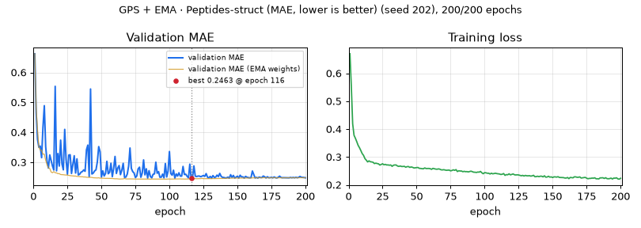

# GPS + EMA · Peptides-struct (MAE, lower is better) — seed 202

[← all models](../README.md) · PairHGT notebook · peptides-struct

| | |
|---|---|
| State | **finished** |
| Epochs | 200 of 200 |
| Best validation MAE | **0.2463** at epoch 116 |
| Best validation MAE, EMA weights | 0.2437 at epoch 98 |
| Test MAE | raw 0.2508 / ema 0.2475 (final) |
| Seed | 202 |
| Parameters | 504,539 |
| Minutes per epoch (last 5, incl. validation) | 0.2 |
| Training time so far | 38 min |
| Training time left | done |
| Sessions (start + resumes) | 1 |
| Hottest GPU reading | 89.0 °C |
| Last update | 2026-11-22 23:45 (138.4 h ago) |



<details><summary>Settings of this run</summary>

| Setting | Value |
|---|---|
| Epochs (warm-up) | 200 (10) |
| Batch size | 128 |
| Learning rate, weight decay | 0.0003, 0.0 |
| Layers × width, heads | 4 × 96, 4 |
| Dropout, attention dropout | 0.0, 0.5 |
| Pair channel | no pair channel |
| Precision | fp32 (TF32 matrix products) |
| EMA decay | 0.995930964693756 |
| Gradient clip | 1.0 |
| Protocol | v2_test_once |
| Notebook version, config hash | pairhgt-generalization-v1.0, ec7c1c1b6f8fd449 |

</details>

## Final test (evaluated once)

| Weights | Epoch | Validation MAE | Test MAE |
|---|---|---|---|
| raw | 116 | 0.2463 | 0.2508 |
| ema | 98 | 0.2437 | 0.2475 |

## Every epoch (newest first)

| Epoch | Train loss | Val MAE | Val MAE (EMA weights) | Best so far | LR | Minutes |
|---|---|---|---|---|---|---|
| 200 | 0.2236 | 0.2483 | 0.2485 | 0.2463 (ep 116) | 2.05e-08 | 0.2 |
| 199 | 0.2204 | 0.2492 | 0.2484 | 0.2463 (ep 116) | 8.20e-08 | 0.2 |
| 198 | 0.2214 | 0.2496 | 0.2484 | 0.2463 (ep 116) | 1.85e-07 | 0.2 |
| 197 | 0.2254 | 0.2500 | 0.2484 | 0.2463 (ep 116) | 3.28e-07 | 0.2 |
| 196 | 0.2238 | 0.2528 | 0.2484 | 0.2463 (ep 116) | 5.12e-07 | 0.2 |
| 195 | 0.2243 | 0.2497 | 0.2484 | 0.2463 (ep 116) | 7.38e-07 | 0.2 |
| 194 | 0.2209 | 0.2484 | 0.2484 | 0.2463 (ep 116) | 1.00e-06 | 0.2 |
| 193 | 0.2242 | 0.2499 | 0.2484 | 0.2463 (ep 116) | 1.31e-06 | 0.2 |
| 192 | 0.2225 | 0.2482 | 0.2483 | 0.2463 (ep 116) | 1.66e-06 | 0.2 |
| 191 | 0.2218 | 0.2495 | 0.2483 | 0.2463 (ep 116) | 2.05e-06 | 0.2 |
| 190 | 0.2224 | 0.2482 | 0.2483 | 0.2463 (ep 116) | 2.47e-06 | 0.2 |
| 189 | 0.2256 | 0.2495 | 0.2483 | 0.2463 (ep 116) | 2.94e-06 | 0.2 |
| 188 | 0.2229 | 0.2482 | 0.2483 | 0.2463 (ep 116) | 3.45e-06 | 0.2 |
| 187 | 0.2255 | 0.2481 | 0.2484 | 0.2463 (ep 116) | 4.00e-06 | 0.2 |
| 186 | 0.2250 | 0.2484 | 0.2483 | 0.2463 (ep 116) | 4.59e-06 | 0.2 |
| 185 | 0.2251 | 0.2485 | 0.2483 | 0.2463 (ep 116) | 5.22e-06 | 0.2 |
| 184 | 0.2214 | 0.2487 | 0.2483 | 0.2463 (ep 116) | 5.89e-06 | 0.2 |
| 183 | 0.2219 | 0.2485 | 0.2482 | 0.2463 (ep 116) | 6.59e-06 | 0.2 |
| 182 | 0.2218 | 0.2495 | 0.2481 | 0.2463 (ep 116) | 7.34e-06 | 0.2 |
| 181 | 0.2254 | 0.2538 | 0.2482 | 0.2463 (ep 116) | 8.13e-06 | 0.2 |
| 180 | 0.2239 | 0.2498 | 0.2482 | 0.2463 (ep 116) | 8.95e-06 | 0.2 |
| 179 | 0.2243 | 0.2477 | 0.2482 | 0.2463 (ep 116) | 9.82e-06 | 0.2 |
| 178 | 0.2232 | 0.2485 | 0.2484 | 0.2463 (ep 116) | 1.07e-05 | 0.2 |
| 177 | 0.2231 | 0.2511 | 0.2483 | 0.2463 (ep 116) | 1.17e-05 | 0.2 |
| 176 | 0.2219 | 0.2480 | 0.2485 | 0.2463 (ep 116) | 1.26e-05 | 0.2 |
| 175 | 0.2240 | 0.2499 | 0.2485 | 0.2463 (ep 116) | 1.36e-05 | 0.2 |
| 174 | 0.2268 | 0.2486 | 0.2485 | 0.2463 (ep 116) | 1.47e-05 | 0.2 |
| 173 | 0.2260 | 0.2485 | 0.2483 | 0.2463 (ep 116) | 1.58e-05 | 0.2 |
| 172 | 0.2252 | 0.2517 | 0.2481 | 0.2463 (ep 116) | 1.69e-05 | 0.2 |
| 171 | 0.2244 | 0.2477 | 0.2486 | 0.2463 (ep 116) | 1.81e-05 | 0.2 |
| 170 | 0.2286 | 0.2517 | 0.2486 | 0.2463 (ep 116) | 1.93e-05 | 0.2 |
| 169 | 0.2273 | 0.2541 | 0.2485 | 0.2463 (ep 116) | 2.05e-05 | 0.2 |
| 168 | 0.2272 | 0.2490 | 0.2484 | 0.2463 (ep 116) | 2.18e-05 | 0.2 |
| 167 | 0.2286 | 0.2492 | 0.2483 | 0.2463 (ep 116) | 2.31e-05 | 0.2 |
| 166 | 0.2288 | 0.2506 | 0.2482 | 0.2463 (ep 116) | 2.44e-05 | 0.2 |
| 165 | 0.2252 | 0.2474 | 0.2481 | 0.2463 (ep 116) | 2.58e-05 | 0.2 |
| 164 | 0.2259 | 0.2497 | 0.2482 | 0.2463 (ep 116) | 2.72e-05 | 0.2 |
| 163 | 0.2266 | 0.2477 | 0.2482 | 0.2463 (ep 116) | 2.86e-05 | 0.2 |
| 162 | 0.2223 | 0.2591 | 0.2482 | 0.2463 (ep 116) | 3.01e-05 | 0.2 |
| 161 | 0.2264 | 0.2709 | 0.2480 | 0.2463 (ep 116) | 3.16e-05 | 0.2 |
| 160 | 0.2244 | 0.2489 | 0.2476 | 0.2463 (ep 116) | 3.32e-05 | 0.2 |
| 159 | 0.2245 | 0.2482 | 0.2477 | 0.2463 (ep 116) | 3.47e-05 | 0.2 |
| 158 | 0.2260 | 0.2490 | 0.2474 | 0.2463 (ep 116) | 3.63e-05 | 0.2 |
| 157 | 0.2263 | 0.2502 | 0.2472 | 0.2463 (ep 116) | 3.80e-05 | 0.2 |
| 156 | 0.2264 | 0.2530 | 0.2470 | 0.2463 (ep 116) | 3.96e-05 | 0.2 |
| 155 | 0.2266 | 0.2472 | 0.2471 | 0.2463 (ep 116) | 4.13e-05 | 0.2 |
| 154 | 0.2293 | 0.2515 | 0.2471 | 0.2463 (ep 116) | 4.31e-05 | 0.2 |
| 153 | 0.2277 | 0.2512 | 0.2472 | 0.2463 (ep 116) | 4.48e-05 | 0.2 |
| 152 | 0.2285 | 0.2568 | 0.2474 | 0.2463 (ep 116) | 4.66e-05 | 0.2 |
| 151 | 0.2286 | 0.2475 | 0.2473 | 0.2463 (ep 116) | 4.84e-05 | 0.2 |
| 150 | 0.2262 | 0.2536 | 0.2474 | 0.2463 (ep 116) | 5.02e-05 | 0.2 |
| 149 | 0.2287 | 0.2503 | 0.2473 | 0.2463 (ep 116) | 5.21e-05 | 0.2 |
| 148 | 0.2276 | 0.2476 | 0.2470 | 0.2463 (ep 116) | 5.40e-05 | 0.2 |
| 147 | 0.2309 | 0.2562 | 0.2472 | 0.2463 (ep 116) | 5.59e-05 | 0.2 |
| 146 | 0.2282 | 0.2493 | 0.2472 | 0.2463 (ep 116) | 5.79e-05 | 0.2 |
| 145 | 0.2275 | 0.2586 | 0.2472 | 0.2463 (ep 116) | 5.98e-05 | 0.2 |
| 144 | 0.2325 | 0.2469 | 0.2469 | 0.2463 (ep 116) | 6.18e-05 | 0.2 |
| 143 | 0.2286 | 0.2505 | 0.2468 | 0.2463 (ep 116) | 6.39e-05 | 0.2 |
| 142 | 0.2309 | 0.2481 | 0.2469 | 0.2463 (ep 116) | 6.59e-05 | 0.2 |
| 141 | 0.2311 | 0.2478 | 0.2463 | 0.2463 (ep 116) | 6.80e-05 | 0.2 |
| 140 | 0.2293 | 0.2494 | 0.2461 | 0.2463 (ep 116) | 7.00e-05 | 0.2 |
| 139 | 0.2310 | 0.2497 | 0.2460 | 0.2463 (ep 116) | 7.22e-05 | 0.2 |
| 138 | 0.2297 | 0.2533 | 0.2459 | 0.2463 (ep 116) | 7.43e-05 | 0.2 |
| 137 | 0.2291 | 0.2630 | 0.2460 | 0.2463 (ep 116) | 7.64e-05 | 0.2 |
| 136 | 0.2342 | 0.2523 | 0.2460 | 0.2463 (ep 116) | 7.86e-05 | 0.2 |
| 135 | 0.2323 | 0.2573 | 0.2458 | 0.2463 (ep 116) | 8.08e-05 | 0.2 |
| 134 | 0.2312 | 0.2505 | 0.2458 | 0.2463 (ep 116) | 8.30e-05 | 0.2 |
| 133 | 0.2330 | 0.2498 | 0.2456 | 0.2463 (ep 116) | 8.52e-05 | 0.2 |
| 132 | 0.2324 | 0.2555 | 0.2458 | 0.2463 (ep 116) | 8.75e-05 | 0.2 |
| 131 | 0.2325 | 0.2474 | 0.2453 | 0.2463 (ep 116) | 8.97e-05 | 0.2 |
| 130 | 0.2339 | 0.2530 | 0.2455 | 0.2463 (ep 116) | 9.20e-05 | 0.2 |
| 129 | 0.2318 | 0.2481 | 0.2453 | 0.2463 (ep 116) | 9.43e-05 | 0.2 |
| 128 | 0.2340 | 0.2502 | 0.2454 | 0.2463 (ep 116) | 9.66e-05 | 0.2 |
| 127 | 0.2326 | 0.2623 | 0.2455 | 0.2463 (ep 116) | 9.90e-05 | 0.2 |
| 126 | 0.2341 | 0.2530 | 0.2454 | 0.2463 (ep 116) | 1.01e-04 | 0.2 |
| 125 | 0.2355 | 0.2559 | 0.2453 | 0.2463 (ep 116) | 1.04e-04 | 0.2 |
| 124 | 0.2361 | 0.2537 | 0.2462 | 0.2463 (ep 116) | 1.06e-04 | 0.2 |
| 123 | 0.2356 | 0.2520 | 0.2457 | 0.2463 (ep 116) | 1.08e-04 | 0.2 |
| 122 | 0.2361 | 0.2540 | 0.2454 | 0.2463 (ep 116) | 1.11e-04 | 0.2 |
| 121 | 0.2392 | 0.2540 | 0.2453 | 0.2463 (ep 116) | 1.13e-04 | 0.2 |
| 120 | 0.2376 | 0.2525 | 0.2452 | 0.2463 (ep 116) | 1.16e-04 | 0.2 |
| 119 | 0.2358 | 0.2536 | 0.2456 | 0.2463 (ep 116) | 1.18e-04 | 0.2 |
| 118 | 0.2396 | 0.2878 | 0.2448 | 0.2463 (ep 116) | 1.20e-04 | 0.2 |
| 117 | 0.2361 | 0.2512 | 0.2447 | 0.2463 (ep 116) | 1.23e-04 | 0.2 |
| 116 | 0.2367 | 0.2463 ⭐ | 0.2446 | 0.2463 (ep 116) | 1.25e-04 | 0.2 |
| 115 | 0.2340 | 0.2937 | 0.2446 | 0.2471 (ep 104) | 1.28e-04 | 0.2 |
| 114 | 0.2406 | 0.2480 | 0.2444 | 0.2471 (ep 104) | 1.30e-04 | 0.2 |
| 113 | 0.2381 | 0.2534 | 0.2444 | 0.2471 (ep 104) | 1.33e-04 | 0.2 |
| 112 | 0.2371 | 0.2602 | 0.2441 | 0.2471 (ep 104) | 1.35e-04 | 0.2 |
| 111 | 0.2389 | 0.2592 | 0.2440 | 0.2471 (ep 104) | 1.38e-04 | 0.2 |
| 110 | 0.2394 | 0.2862 | 0.2442 | 0.2471 (ep 104) | 1.40e-04 | 0.2 |
| 109 | 0.2403 | 0.2540 | 0.2442 | 0.2471 (ep 104) | 1.43e-04 | 0.2 |
| 108 | 0.2417 | 0.2539 | 0.2446 | 0.2471 (ep 104) | 1.45e-04 | 0.2 |
| 107 | 0.2408 | 0.2650 | 0.2444 | 0.2471 (ep 104) | 1.48e-04 | 0.2 |
| 106 | 0.2395 | 0.2540 | 0.2442 | 0.2471 (ep 104) | 1.50e-04 | 0.2 |
| 105 | 0.2418 | 0.2612 | 0.2442 | 0.2471 (ep 104) | 1.52e-04 | 0.2 |
| 104 | 0.2390 | 0.2471 ⭐ | 0.2442 | 0.2471 (ep 104) | 1.55e-04 | 0.2 |
| 103 | 0.2417 | 0.2736 | 0.2441 | 0.2472 (ep 84) | 1.57e-04 | 0.2 |
| 102 | 0.2417 | 0.2569 | 0.2441 | 0.2472 (ep 84) | 1.60e-04 | 0.2 |
| 101 | 0.2433 | 0.2627 | 0.2440 | 0.2472 (ep 84) | 1.62e-04 | 0.2 |
| 100 | 0.2438 | 0.3359 | 0.2440 | 0.2472 (ep 84) | 1.65e-04 | 0.2 |
| 99 | 0.2399 | 0.2708 | 0.2442 | 0.2472 (ep 84) | 1.67e-04 | 0.2 |
| 98 | 0.2432 | 0.2510 | 0.2437 | 0.2472 (ep 84) | 1.70e-04 | 0.2 |
| 97 | 0.2483 | 0.2959 | 0.2437 | 0.2472 (ep 84) | 1.72e-04 | 0.2 |
| 96 | 0.2455 | 0.2480 | 0.2439 | 0.2472 (ep 84) | 1.75e-04 | 0.2 |
| 95 | 0.2460 | 0.2605 | 0.2441 | 0.2472 (ep 84) | 1.77e-04 | 0.2 |
| 94 | 0.2444 | 0.2502 | 0.2439 | 0.2472 (ep 84) | 1.80e-04 | 0.2 |
| 93 | 0.2453 | 0.2501 | 0.2440 | 0.2472 (ep 84) | 1.82e-04 | 0.2 |
| 92 | 0.2454 | 0.2688 | 0.2442 | 0.2472 (ep 84) | 1.84e-04 | 0.2 |
| 91 | 0.2471 | 0.2634 | 0.2441 | 0.2472 (ep 84) | 1.87e-04 | 0.2 |
| 90 | 0.2491 | 0.3003 | 0.2440 | 0.2472 (ep 84) | 1.89e-04 | 0.2 |
| 89 | 0.2478 | 0.2614 | 0.2438 | 0.2472 (ep 84) | 1.92e-04 | 0.2 |
| 88 | 0.2464 | 0.2601 | 0.2440 | 0.2472 (ep 84) | 1.94e-04 | 0.2 |
| 87 | 0.2476 | 0.2481 | 0.2441 | 0.2472 (ep 84) | 1.96e-04 | 0.2 |
| 86 | 0.2473 | 0.2528 | 0.2437 | 0.2472 (ep 84) | 1.99e-04 | 0.2 |
| 85 | 0.2485 | 0.2721 | 0.2441 | 0.2472 (ep 84) | 2.01e-04 | 0.2 |
| 84 | 0.2471 | 0.2472 ⭐ | 0.2438 | 0.2472 (ep 84) | 2.03e-04 | 0.2 |
| 83 | 0.2497 | 0.2784 | 0.2441 | 0.2489 (ep 75) | 2.06e-04 | 0.2 |
| 82 | 0.2496 | 0.2580 | 0.2441 | 0.2489 (ep 75) | 2.08e-04 | 0.2 |
| 81 | 0.2506 | 0.3079 | 0.2440 | 0.2489 (ep 75) | 2.10e-04 | 0.2 |
| 80 | 0.2477 | 0.2639 | 0.2441 | 0.2489 (ep 75) | 2.13e-04 | 0.2 |
| 79 | 0.2547 | 0.2501 | 0.2440 | 0.2489 (ep 75) | 2.15e-04 | 0.2 |
| 78 | 0.2520 | 0.2837 | 0.2439 | 0.2489 (ep 75) | 2.17e-04 | 0.2 |
| 77 | 0.2539 | 0.2781 | 0.2440 | 0.2489 (ep 75) | 2.19e-04 | 0.2 |
| 76 | 0.2515 | 0.2543 | 0.2441 | 0.2489 (ep 75) | 2.21e-04 | 0.2 |
| 75 | 0.2502 | 0.2489 ⭐ | 0.2440 | 0.2489 (ep 75) | 2.24e-04 | 0.2 |
| 74 | 0.2529 | 0.2644 | 0.2443 | 0.2495 (ep 67) | 2.26e-04 | 0.2 |
| 73 | 0.2528 | 0.2689 | 0.2443 | 0.2495 (ep 67) | 2.28e-04 | 0.2 |
| 72 | 0.2522 | 0.2797 | 0.2445 | 0.2495 (ep 67) | 2.30e-04 | 0.2 |
| 71 | 0.2531 | 0.3478 | 0.2445 | 0.2495 (ep 67) | 2.32e-04 | 0.2 |
| 70 | 0.2544 | 0.2872 | 0.2446 | 0.2495 (ep 67) | 2.34e-04 | 0.2 |
| 69 | 0.2536 | 0.2608 | 0.2443 | 0.2495 (ep 67) | 2.36e-04 | 0.2 |
| 68 | 0.2540 | 0.2507 | 0.2445 | 0.2495 (ep 67) | 2.38e-04 | 0.2 |
| 67 | 0.2564 | 0.2495 ⭐ | 0.2459 | 0.2495 (ep 67) | 2.40e-04 | 0.2 |
| 66 | 0.2572 | 0.2966 | 0.2445 | 0.2509 (ep 50) | 2.42e-04 | 0.2 |
| 65 | 0.2560 | 0.2739 | 0.2443 | 0.2509 (ep 50) | 2.44e-04 | 0.2 |
| 64 | 0.2566 | 0.2587 | 0.2442 | 0.2509 (ep 50) | 2.46e-04 | 0.2 |
| 63 | 0.2578 | 0.2892 | 0.2440 | 0.2509 (ep 50) | 2.48e-04 | 0.2 |
| 62 | 0.2592 | 0.2805 | 0.2447 | 0.2509 (ep 50) | 2.50e-04 | 0.2 |
| 61 | 0.2557 | 0.2627 | 0.2451 | 0.2509 (ep 50) | 2.52e-04 | 0.2 |
| 60 | 0.2580 | 0.3195 | 0.2449 | 0.2509 (ep 50) | 2.53e-04 | 0.2 |
| 59 | 0.2589 | 0.2802 | 0.2455 | 0.2509 (ep 50) | 2.55e-04 | 0.2 |
| 58 | 0.2587 | 0.2521 | 0.2460 | 0.2509 (ep 50) | 2.57e-04 | 0.2 |
| 57 | 0.2585 | 0.2968 | 0.2459 | 0.2509 (ep 50) | 2.59e-04 | 0.2 |
| 56 | 0.2607 | 0.2666 | 0.2460 | 0.2509 (ep 50) | 2.60e-04 | 0.2 |
| 55 | 0.2577 | 0.2618 | 0.2463 | 0.2509 (ep 50) | 2.62e-04 | 0.2 |
| 54 | 0.2580 | 0.3033 | 0.2464 | 0.2509 (ep 50) | 2.64e-04 | 0.2 |
| 53 | 0.2589 | 0.2625 | 0.2462 | 0.2509 (ep 50) | 2.65e-04 | 0.2 |
| 52 | 0.2592 | 0.2543 | 0.2467 | 0.2509 (ep 50) | 2.67e-04 | 0.2 |
| 51 | 0.2623 | 0.2715 | 0.2469 | 0.2509 (ep 50) | 2.68e-04 | 0.2 |
| 50 | 0.2619 | 0.2509 ⭐ | 0.2469 | 0.2509 (ep 50) | 2.70e-04 | 0.2 |
| 49 | 0.2611 | 0.3353 | 0.2471 | 0.2518 (ep 41) | 2.71e-04 | 0.2 |
| 48 | 0.2607 | 0.3524 | 0.2484 | 0.2518 (ep 41) | 2.73e-04 | 0.2 |
| 47 | 0.2630 | 0.3015 | 0.2477 | 0.2518 (ep 41) | 2.74e-04 | 0.2 |
| 46 | 0.2642 | 0.2749 | 0.2479 | 0.2518 (ep 41) | 2.76e-04 | 0.2 |
| 45 | 0.2627 | 0.2713 | 0.2481 | 0.2518 (ep 41) | 2.77e-04 | 0.2 |
| 44 | 0.2657 | 0.2640 | 0.2484 | 0.2518 (ep 41) | 2.78e-04 | 0.2 |
| 43 | 0.2653 | 0.2610 | 0.2495 | 0.2518 (ep 41) | 2.79e-04 | 0.2 |
| 42 | 0.2633 | 0.5447 | 0.2497 | 0.2518 (ep 41) | 2.81e-04 | 0.2 |
| 41 | 0.2665 | 0.2518 ⭐ | 0.2499 | 0.2518 (ep 41) | 2.82e-04 | 0.2 |
| 40 | 0.2659 | 0.3575 | 0.2497 | 0.2579 (ep 33) | 2.83e-04 | 0.2 |
| 39 | 0.2658 | 0.3418 | 0.2502 | 0.2579 (ep 33) | 2.84e-04 | 0.2 |
| 38 | 0.2677 | 0.2700 | 0.2511 | 0.2579 (ep 33) | 2.85e-04 | 0.2 |
| 37 | 0.2663 | 0.2747 | 0.2509 | 0.2579 (ep 33) | 2.86e-04 | 0.2 |
| 36 | 0.2675 | 0.2693 | 0.2519 | 0.2579 (ep 33) | 2.87e-04 | 0.2 |
| 35 | 0.2712 | 0.2670 | 0.2518 | 0.2579 (ep 33) | 2.88e-04 | 0.2 |
| 34 | 0.2713 | 0.2602 | 0.2523 | 0.2579 (ep 33) | 2.89e-04 | 0.2 |
| 33 | 0.2705 | 0.2579 ⭐ | 0.2528 | 0.2579 (ep 33) | 2.90e-04 | 0.2 |
| 32 | 0.2664 | 0.3115 | 0.2529 | 0.2603 (ep 25) | 2.91e-04 | 0.2 |
| 31 | 0.2714 | 0.2642 | 0.2541 | 0.2603 (ep 25) | 2.92e-04 | 0.2 |
| 30 | 0.2704 | 0.3218 | 0.2541 | 0.2603 (ep 25) | 2.93e-04 | 0.2 |
| 29 | 0.2715 | 0.2934 | 0.2545 | 0.2603 (ep 25) | 2.93e-04 | 0.2 |
| 28 | 0.2713 | 0.2628 | 0.2549 | 0.2603 (ep 25) | 2.94e-04 | 0.2 |
| 27 | 0.2735 | 0.3252 | 0.2555 | 0.2603 (ep 25) | 2.95e-04 | 0.2 |
| 26 | 0.2721 | 0.3242 | 0.2563 | 0.2603 (ep 25) | 2.95e-04 | 0.2 |
| 25 | 0.2755 | 0.2603 ⭐ | 0.2572 | 0.2603 (ep 25) | 2.96e-04 | 0.2 |
| 24 | 0.2733 | 0.3097 | 0.2576 | 0.2716 (ep 17) | 2.97e-04 | 0.2 |
| 23 | 0.2710 | 0.4098 | 0.2579 | 0.2716 (ep 17) | 2.97e-04 | 0.2 |
| 22 | 0.2753 | 0.2750 | 0.2585 | 0.2716 (ep 17) | 2.98e-04 | 0.2 |
| 21 | 0.2764 | 0.2943 | 0.2589 | 0.2716 (ep 17) | 2.98e-04 | 0.2 |
| 20 | 0.2779 | 0.3740 | 0.2591 | 0.2716 (ep 17) | 2.98e-04 | 0.2 |
| 19 | 0.2763 | 0.2874 | 0.2621 | 0.2716 (ep 17) | 2.99e-04 | 0.2 |
| 18 | 0.2810 | 0.3291 | 0.2620 | 0.2716 (ep 17) | 2.99e-04 | 0.2 |
| 17 | 0.2822 | 0.2716 ⭐ | 0.2646 | 0.2716 (ep 17) | 2.99e-04 | 0.2 |
| 16 | 0.2828 | 0.5536 | 0.2653 | 0.2741 (ep 15) | 2.99e-04 | 0.2 |
| 15 | 0.2860 | 0.2741 ⭐ | 0.2689 | 0.2741 (ep 15) | 3.00e-04 | 0.2 |
| 14 | 0.2822 | 0.2879 | 0.2652 | 0.2807 (ep 11) | 3.00e-04 | 0.2 |
| 13 | 0.2887 | 0.3067 | 0.2677 | 0.2807 (ep 11) | 3.00e-04 | 0.2 |
| 12 | 0.2943 | 0.3247 | 0.2791 | 0.2807 (ep 11) | 3.00e-04 | 0.2 |
| 11 | 0.3057 | 0.2807 ⭐ | 0.2819 | 0.2807 (ep 11) | 3.00e-04 | 0.2 |
| 10 | 0.3122 | 0.3044 ⭐ | 0.2919 | 0.3044 (ep 10) | 2.70e-04 | 0.2 |
| 9 | 0.3231 | 0.3520 | 0.3070 | 0.3155 (ep 6) | 2.40e-04 | 0.2 |
| 8 | 0.3332 | 0.4890 | 0.3271 | 0.3155 (ep 6) | 2.10e-04 | 0.2 |
| 7 | 0.3419 | 0.4163 | 0.3271 | 0.3155 (ep 6) | 1.80e-04 | 0.2 |
| 6 | 0.3550 | 0.3155 ⭐ | 0.3397 | 0.3155 (ep 6) | 1.50e-04 | 0.2 |
| 5 | 0.3671 | 0.3541 | 0.3413 | 0.3501 (ep 4) | 1.20e-04 | 0.2 |
| 4 | 0.3778 | 0.3501 ⭐ | 0.3503 | 0.3501 (ep 4) | 9.00e-05 | 0.2 |
| 3 | 0.4190 | 0.3772 ⭐ | 0.4090 | 0.3772 (ep 3) | 6.00e-05 | 0.2 |
| 2 | 0.5537 | 0.4671 ⭐ | 0.4825 | 0.4671 (ep 2) | 3.00e-05 | 0.2 |
| 1 | 0.6704 | 0.6623 ⭐ | 0.6626 | 0.6623 (ep 1) | 3.00e-10 | 0.2 |

## Last 80 log lines

_The log counts epochs from 0; the tables above count from 1._

```
[seed 543] epoch 154/200 | lr 4.31e-05 | train loss 0.2289 | val MAE 0.2479 | best val 0.2449 @ep134 | EMA val 0.2462 | 11s (train 10s, eval 1s) | GPU max 89C | ETA<= 0.1h
[seed 543] epoch 155/200 | lr 4.13e-05 | train loss 0.2285 | val MAE 0.2474 | best val 0.2449 @ep134 | EMA val 0.2463 | 11s (train 10s, eval 1s) | GPU max 89C | ETA<= 0.1h
[seed 543] epoch 156/200 | lr 3.96e-05 | train loss 0.2301 | val MAE 0.2500 | best val 0.2449 @ep134 | EMA val 0.2463 | 11s (train 10s, eval 1s) | GPU max 88C | ETA<= 0.1h
[seed 543] epoch 157/200 | lr 3.80e-05 | train loss 0.2268 | val MAE 0.2464 | best val 0.2449 @ep134 | EMA val 0.2461 | 11s (train 10s, eval 1s) | GPU max 88C | ETA<= 0.1h
[seed 543] epoch 158/200 | lr 3.63e-05 | train loss 0.2312 | val MAE 0.2466 | best val 0.2449 @ep134 | EMA val 0.2462 | 11s (train 10s, eval 1s) | GPU max 88C | ETA<= 0.1h
[seed 543] epoch 159/200 | lr 3.47e-05 | train loss 0.2317 | val MAE 0.2470 | best val 0.2449 @ep134 | EMA val 0.2461 | 11s (train 10s, eval 1s) | GPU max 88C | ETA<= 0.1h
[seed 543] epoch 160/200 | lr 3.32e-05 | train loss 0.2243 | val MAE 0.2476 | best val 0.2449 @ep134 | EMA val 0.2463 | 11s (train 10s, eval 1s) | GPU max 88C | ETA<= 0.1h
[seed 543] epoch 161/200 | lr 3.16e-05 | train loss 0.2278 | val MAE 0.2479 | best val 0.2449 @ep134 | EMA val 0.2464 | 11s (train 10s, eval 1s) | GPU max 88C | ETA<= 0.1h
[seed 543] epoch 162/200 | lr 3.01e-05 | train loss 0.2295 | val MAE 0.2485 | best val 0.2449 @ep134 | EMA val 0.2469 | 11s (train 10s, eval 1s) | GPU max 88C | ETA<= 0.1h
[seed 543] epoch 163/200 | lr 2.86e-05 | train loss 0.2280 | val MAE 0.2485 | best val 0.2449 @ep134 | EMA val 0.2470 | 11s (train 10s, eval 1s) | GPU max 88C | ETA<= 0.1h
[seed 543] epoch 164/200 | lr 2.72e-05 | train loss 0.2272 | val MAE 0.2482 | best val 0.2449 @ep134 | EMA val 0.2471 | 11s (train 10s, eval 1s) | GPU max 88C | ETA<= 0.1h
[seed 543] epoch 165/200 | lr 2.58e-05 | train loss 0.2278 | val MAE 0.2479 | best val 0.2449 @ep134 | EMA val 0.2471 | 11s (train 10s, eval 1s) | GPU max 89C | ETA<= 0.1h
[seed 543] epoch 166/200 | lr 2.44e-05 | train loss 0.2267 | val MAE 0.2473 | best val 0.2449 @ep134 | EMA val 0.2471 | 11s (train 10s, eval 1s) | GPU max 88C | ETA<= 0.1h
[seed 543] epoch 167/200 | lr 2.31e-05 | train loss 0.2291 | val MAE 0.2477 | best val 0.2449 @ep134 | EMA val 0.2473 | 11s (train 10s, eval 1s) | GPU max 89C | ETA<= 0.1h
[seed 543] epoch 168/200 | lr 2.18e-05 | train loss 0.2240 | val MAE 0.2489 | best val 0.2449 @ep134 | EMA val 0.2473 | 11s (train 10s, eval 1s) | GPU max 88C | ETA<= 0.1h
[seed 543] epoch 169/200 | lr 2.05e-05 | train loss 0.2250 | val MAE 0.2481 | best val 0.2449 @ep134 | EMA val 0.2476 | 11s (train 10s, eval 1s) | GPU max 88C | ETA<= 0.1h
[seed 543] epoch 170/200 | lr 1.93e-05 | train loss 0.2297 | val MAE 0.2468 | best val 0.2449 @ep134 | EMA val 0.2475 | 11s (train 10s, eval 1s) | GPU max 88C | ETA<= 0.1h
[seed 543] epoch 171/200 | lr 1.81e-05 | train loss 0.2301 | val MAE 0.2478 | best val 0.2449 @ep134 | EMA val 0.2474 | 11s (train 10s, eval 1s) | GPU max 88C | ETA<= 0.1h
[seed 543] epoch 172/200 | lr 1.69e-05 | train loss 0.2238 | val MAE 0.2475 | best val 0.2449 @ep134 | EMA val 0.2473 | 11s (train 10s, eval 1s) | GPU max 88C | ETA<= 0.1h
[seed 543] epoch 173/200 | lr 1.58e-05 | train loss 0.2280 | val MAE 0.2502 | best val 0.2449 @ep134 | EMA val 0.2472 | 11s (train 10s, eval 1s) | GPU max 88C | ETA<= 0.1h
[seed 543] epoch 174/200 | lr 1.47e-05 | train loss 0.2261 | val MAE 0.2485 | best val 0.2449 @ep134 | EMA val 0.2473 | 11s (train 10s, eval 1s) | GPU max 89C | ETA<= 0.1h
[seed 543] epoch 175/200 | lr 1.36e-05 | train loss 0.2252 | val MAE 0.2483 | best val 0.2449 @ep134 | EMA val 0.2474 | 11s (train 10s, eval 1s) | GPU max 89C | ETA<= 0.1h
[seed 543] epoch 176/200 | lr 1.26e-05 | train loss 0.2256 | val MAE 0.2494 | best val 0.2449 @ep134 | EMA val 0.2473 | 11s (train 10s, eval 1s) | GPU max 88C | ETA<= 0.1h
[seed 543] epoch 177/200 | lr 1.17e-05 | train loss 0.2290 | val MAE 0.2479 | best val 0.2449 @ep134 | EMA val 0.2474 | 11s (train 10s, eval 1s) | GPU max 89C | ETA<= 0.1h
[seed 543] epoch 178/200 | lr 1.07e-05 | train loss 0.2265 | val MAE 0.2480 | best val 0.2449 @ep134 | EMA val 0.2475 | 11s (train 10s, eval 1s) | GPU max 88C | ETA<= 0.1h
[seed 543] epoch 179/200 | lr 9.82e-06 | train loss 0.2300 | val MAE 0.2487 | best val 0.2449 @ep134 | EMA val 0.2475 | 11s (train 10s, eval 1s) | GPU max 88C | ETA<= 0.1h
[seed 543] epoch 180/200 | lr 8.95e-06 | train loss 0.2310 | val MAE 0.2482 | best val 0.2449 @ep134 | EMA val 0.2475 | 11s (train 10s, eval 1s) | GPU max 89C | ETA<= 0.1h
[seed 543] epoch 181/200 | lr 8.13e-06 | train loss 0.2246 | val MAE 0.2499 | best val 0.2449 @ep134 | EMA val 0.2475 | 11s (train 10s, eval 1s) | GPU max 88C | ETA<= 0.1h
[seed 543] epoch 182/200 | lr 7.34e-06 | train loss 0.2240 | val MAE 0.2475 | best val 0.2449 @ep134 | EMA val 0.2476 | 11s (train 10s, eval 1s) | GPU max 88C | ETA<= 0.1h
[seed 543] epoch 183/200 | lr 6.59e-06 | train loss 0.2276 | val MAE 0.2494 | best val 0.2449 @ep134 | EMA val 0.2476 | 11s (train 10s, eval 1s) | GPU max 88C | ETA<= 0.1h
[seed 543] epoch 184/200 | lr 5.89e-06 | train loss 0.2249 | val MAE 0.2482 | best val 0.2449 @ep134 | EMA val 0.2476 | 11s (train 10s, eval 1s) | GPU max 88C | ETA<= 0.1h
[seed 543] epoch 185/200 | lr 5.22e-06 | train loss 0.2258 | val MAE 0.2479 | best val 0.2449 @ep134 | EMA val 0.2476 | 11s (train 10s, eval 1s) | GPU max 88C | ETA<= 0.0h
[seed 543] epoch 186/200 | lr 4.59e-06 | train loss 0.2269 | val MAE 0.2483 | best val 0.2449 @ep134 | EMA val 0.2477 | 11s (train 10s, eval 1s) | GPU max 88C | ETA<= 0.0h
[seed 543] epoch 187/200 | lr 4.00e-06 | train loss 0.2264 | val MAE 0.2486 | best val 0.2449 @ep134 | EMA val 0.2476 | 11s (train 10s, eval 1s) | GPU max 88C | ETA<= 0.0h
[seed 543] epoch 188/200 | lr 3.45e-06 | train loss 0.2247 | val MAE 0.2480 | best val 0.2449 @ep134 | EMA val 0.2476 | 11s (train 10s, eval 1s) | GPU max 88C | ETA<= 0.0h
[seed 543] epoch 189/200 | lr 2.94e-06 | train loss 0.2266 | val MAE 0.2475 | best val 0.2449 @ep134 | EMA val 0.2475 | 11s (train 10s, eval 1s) | GPU max 88C | ETA<= 0.0h
[seed 543] epoch 190/200 | lr 2.47e-06 | train loss 0.2285 | val MAE 0.2473 | best val 0.2449 @ep134 | EMA val 0.2476 | 11s (train 10s, eval 1s) | GPU max 88C | ETA<= 0.0h
[seed 543] epoch 191/200 | lr 2.05e-06 | train loss 0.2267 | val MAE 0.2482 | best val 0.2449 @ep134 | EMA val 0.2476 | 11s (train 10s, eval 1s) | GPU max 88C | ETA<= 0.0h
[seed 543] epoch 192/200 | lr 1.66e-06 | train loss 0.2297 | val MAE 0.2541 | best val 0.2449 @ep134 | EMA val 0.2476 | 11s (train 10s, eval 1s) | GPU max 88C | ETA<= 0.0h
[seed 543] epoch 193/200 | lr 1.31e-06 | train loss 0.2254 | val MAE 0.2479 | best val 0.2449 @ep134 | EMA val 0.2476 | 11s (train 10s, eval 1s) | GPU max 88C | ETA<= 0.0h
[seed 543] epoch 194/200 | lr 1.00e-06 | train loss 0.2273 | val MAE 0.2493 | best val 0.2449 @ep134 | EMA val 0.2476 | 11s (train 10s, eval 1s) | GPU max 88C | ETA<= 0.0h
[seed 543] epoch 195/200 | lr 7.38e-07 | train loss 0.2279 | val MAE 0.2492 | best val 0.2449 @ep134 | EMA val 0.2475 | 11s (train 10s, eval 1s) | GPU max 88C | ETA<= 0.0h
[seed 543] epoch 196/200 | lr 5.12e-07 | train loss 0.2267 | val MAE 0.2474 | best val 0.2449 @ep134 | EMA val 0.2476 | 11s (train 10s, eval 1s) | GPU max 88C | ETA<= 0.0h
[seed 543] epoch 197/200 | lr 3.28e-07 | train loss 0.2237 | val MAE 0.2473 | best val 0.2449 @ep134 | EMA val 0.2475 | 11s (train 10s, eval 1s) | GPU max 88C | ETA<= 0.0h
[seed 543] epoch 198/200 | lr 1.85e-07 | train loss 0.2269 | val MAE 0.2476 | best val 0.2449 @ep134 | EMA val 0.2475 | 11s (train 10s, eval 1s) | GPU max 88C | ETA<= 0.0h
[seed 543] epoch 199/200 | lr 8.20e-08 | train loss 0.2267 | val MAE 0.2483 | best val 0.2449 @ep134 | EMA val 0.2475 | 11s (train 10s, eval 1s) | GPU max 88C | ETA<= 0.0h
[seed 543] epoch 200/200 | lr 2.05e-08 | train loss 0.2237 | val MAE 0.2477 | best val 0.2449 @ep134 | EMA val 0.2475 | 11s (train 10s, eval 1s) | GPU max 88C | ETA<= 0.0h
[seed 543] FINAL TEST (evaluated once): raw epoch 134 val 0.2449 test 0.2510 | EMA epoch 105 val 0.2432 test 0.2487 (MAE, lower is better)
--- cell 17 ---
GPS + EMA | gps_conf_GPS_ema_ep200_peptides_struct | MAE (lower is better)
 seed  epochs  raw_epoch  raw_val  raw_test  ema_epoch  ema_val  ema_test  hours  train_s_per_epoch  total_s_per_epoch
  101 200/200        110   0.2477    0.2506         94   0.2438    0.2461 0.6251             9.9565            11.2519
  202 200/200        116   0.2463    0.2508         98   0.2437    0.2475 0.6261             9.9716            11.2690
  323 200/200        134   0.2471    0.2486         88   0.2446    0.2481 0.6262             9.9764            11.2723
  432 200/200        138   0.2428    0.2475        127   0.2426    0.2476 0.6264             9.9768            11.2751
  543 200/200        134   0.2449    0.2510        105   0.2432    0.2487 0.6265             9.9792            11.2778
mean ± sample SD (ddof=1) over 5 seed(s): raw test 0.2497 ± 0.0016 | EMA test 0.2476 ± 0.0010
A mean ± SD over fewer than 3 seeds is only a description; do not call it a confidence interval.
run manifest: 5 row(s) -> /home/student/thesis/outputs/pairhgt/outputs/confirmatory_peptides_struct/run_manifest.csv
    model              gpu  seeds  params  train_s_per_epoch  val_eval_s_per_epoch  total_s_per_epoch  hours_per_seed  time_vs_GPS+EMA
GPS + EMA NVIDIA RTX A4000      5  504539               9.97                  1.28              11.27            0.63              1.0
train = training steps incl. EMA update; val_eval = validation of raw + EMA weights; no test pass inside an epoch (protocol v2). For the thesis cost table use only seeds that had the GPU alone.
--- cell 19 ---
=== PairHGT  minus  GPS + EMA   (peptides-struct, MAE, lower is better; matched seeds) ===
  MAE is lower-is-better: a NEGATIVE difference means PairHGT is better.
  no matched finished seeds with a final test result yet
GPS sanity line (peptides-struct, raw weights, 5 seed(s)): ours 0.2497 ± 0.0016 vs published 0.2500 ± 0.0005 (4 seeds): gap -0.0003 = -0.64 published SDs  (within 2 published SDs)
--- cell 21 ---
        dataset  metric weights  n_seeds  gps_mean  pairhgt_mean  diff_mean  ci_lo  ci_hi  seeds_in_favour  diff_in_published_sd
   ogbg-molpcba      AP     raw        5    0.2904        0.2963     0.0059 0.0021 0.0097              5.0                2.1143
   ogbg-molpcba      AP     EMA        5    0.2980        0.3061     0.0082 0.0039 0.0124              5.0                2.9111
  Peptides-func      AP     raw        0       NaN           NaN        NaN    NaN    NaN              NaN                   NaN
  Peptides-func      AP     EMA        0       NaN           NaN        NaN    NaN    NaN              NaN                   NaN
Peptides-struct     MAE     raw        0       NaN           NaN        NaN    NaN    NaN              NaN                   NaN
Peptides-struct     MAE     EMA        0       NaN           NaN        NaN    NaN    NaN              NaN                   NaN
    ogbg-molhiv ROC-AUC     raw        0       NaN           NaN        NaN    NaN    NaN              NaN                   NaN
    ogbg-molhiv ROC-AUC     EMA        0       NaN           NaN        NaN    NaN    NaN              NaN                   NaN
-> /home/student/thesis/outputs/pairhgt/outputs/confirmatory_all_datasets/summary_all_datasets.csv and .tex (molpcba read from /home/student/thesis/outputs/pairhgt/checkpoints, read only)
--- cell 23 ---
===== 2026-11-23 01:39:05 notebook run ended (exit 0); executed notebook: /home/student/thesis/outputs/lab_runs/notebooks_gen/peptides_struct_GPS_ema_20261122_223003.ipynb =====
```
