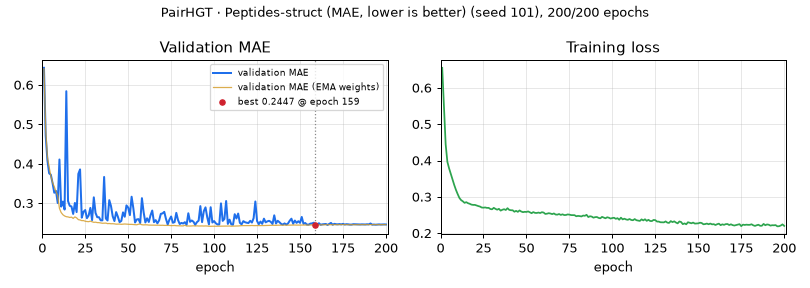

# PairHGT · Peptides-struct (MAE, lower is better) — seed 101

[← all models](../README.md) · PairHGT notebook · peptides-struct

| | |
|---|---|
| State | **finished** |
| Epochs | 200 of 200 |
| Best validation MAE | **0.2447** at epoch 159 |
| Best validation MAE, EMA weights | 0.2413 at epoch 98 |
| Test MAE | raw 0.2470 / ema 0.2459 (final) |
| Seed | 101 |
| Parameters | 510,411 |
| Minutes per epoch (last 5, incl. validation) | 2.4 |
| Training time so far | 7.9 h |
| Training time left | done |
| Sessions (start + resumes) | 1 |
| Hottest GPU reading | 90.0 °C |
| Last update | 2026-11-27 14:23 (27.7 h ago) |



<details><summary>Settings of this run</summary>

| Setting | Value |
|---|---|
| Epochs (warm-up) | 200 (10) |
| Batch size | 128 |
| Learning rate, weight decay | 0.0003, 0.0 |
| Layers × width, heads | 4 × 96, 4 |
| Dropout, attention dropout | 0.0, 0.5 |
| Pair channel | width 16, dropout 0.1, value gate True |
| Precision | fp32 (TF32 matrix products) |
| EMA decay | 0.995930964693756 |
| Gradient clip | 1.0 |
| Protocol | v2_test_once |
| Notebook version, config hash | pairhgt-generalization-v1.0, 74ab09727852a3b6 |

</details>

## Final test (evaluated once)

| Weights | Epoch | Validation MAE | Test MAE |
|---|---|---|---|
| raw | 159 | 0.2447 | 0.2470 |
| ema | 98 | 0.2413 | 0.2459 |

## Every epoch (newest first)

| Epoch | Train loss | Val MAE | Val MAE (EMA weights) | Best so far | LR | Minutes |
|---|---|---|---|---|---|---|
| 200 | 0.2201 | 0.2459 | 0.2456 | 0.2447 (ep 159) | 2.05e-08 | 2.4 |
| 199 | 0.2244 | 0.2462 | 0.2456 | 0.2447 (ep 159) | 8.20e-08 | 2.4 |
| 198 | 0.2211 | 0.2461 | 0.2456 | 0.2447 (ep 159) | 1.85e-07 | 2.4 |
| 197 | 0.2192 | 0.2457 | 0.2456 | 0.2447 (ep 159) | 3.28e-07 | 2.4 |
| 196 | 0.2190 | 0.2461 | 0.2455 | 0.2447 (ep 159) | 5.12e-07 | 2.4 |
| 195 | 0.2223 | 0.2458 | 0.2455 | 0.2447 (ep 159) | 7.38e-07 | 2.4 |
| 194 | 0.2218 | 0.2454 | 0.2455 | 0.2447 (ep 159) | 1.00e-06 | 2.4 |
| 193 | 0.2220 | 0.2458 | 0.2455 | 0.2447 (ep 159) | 1.31e-06 | 2.4 |
| 192 | 0.2209 | 0.2454 | 0.2455 | 0.2447 (ep 159) | 1.66e-06 | 2.4 |
| 191 | 0.2234 | 0.2485 | 0.2456 | 0.2447 (ep 159) | 2.05e-06 | 2.4 |
| 190 | 0.2241 | 0.2461 | 0.2456 | 0.2447 (ep 159) | 2.47e-06 | 2.4 |
| 189 | 0.2220 | 0.2464 | 0.2456 | 0.2447 (ep 159) | 2.94e-06 | 2.4 |
| 188 | 0.2256 | 0.2459 | 0.2456 | 0.2447 (ep 159) | 3.45e-06 | 2.4 |
| 187 | 0.2205 | 0.2462 | 0.2455 | 0.2447 (ep 159) | 4.00e-06 | 2.4 |
| 186 | 0.2205 | 0.2463 | 0.2455 | 0.2447 (ep 159) | 4.59e-06 | 2.4 |
| 185 | 0.2234 | 0.2459 | 0.2455 | 0.2447 (ep 159) | 5.22e-06 | 2.4 |
| 184 | 0.2219 | 0.2462 | 0.2455 | 0.2447 (ep 159) | 5.89e-06 | 2.4 |
| 183 | 0.2201 | 0.2462 | 0.2454 | 0.2447 (ep 159) | 6.59e-06 | 2.4 |
| 182 | 0.2217 | 0.2465 | 0.2454 | 0.2447 (ep 159) | 7.34e-06 | 2.4 |
| 181 | 0.2246 | 0.2467 | 0.2454 | 0.2447 (ep 159) | 8.13e-06 | 2.4 |
| 180 | 0.2231 | 0.2457 | 0.2453 | 0.2447 (ep 159) | 8.95e-06 | 2.4 |
| 179 | 0.2230 | 0.2457 | 0.2454 | 0.2447 (ep 159) | 9.82e-06 | 2.4 |
| 178 | 0.2235 | 0.2463 | 0.2454 | 0.2447 (ep 159) | 1.07e-05 | 2.4 |
| 177 | 0.2227 | 0.2467 | 0.2455 | 0.2447 (ep 159) | 1.17e-05 | 2.4 |
| 176 | 0.2236 | 0.2458 | 0.2456 | 0.2447 (ep 159) | 1.26e-05 | 2.4 |
| 175 | 0.2195 | 0.2475 | 0.2457 | 0.2447 (ep 159) | 1.36e-05 | 2.4 |
| 174 | 0.2249 | 0.2461 | 0.2456 | 0.2447 (ep 159) | 1.47e-05 | 2.4 |
| 173 | 0.2240 | 0.2470 | 0.2456 | 0.2447 (ep 159) | 1.58e-05 | 2.4 |
| 172 | 0.2225 | 0.2463 | 0.2455 | 0.2447 (ep 159) | 1.69e-05 | 2.4 |
| 171 | 0.2211 | 0.2466 | 0.2455 | 0.2447 (ep 159) | 1.81e-05 | 2.4 |
| 170 | 0.2222 | 0.2476 | 0.2454 | 0.2447 (ep 159) | 1.93e-05 | 2.4 |
| 169 | 0.2245 | 0.2453 | 0.2454 | 0.2447 (ep 159) | 2.05e-05 | 2.4 |
| 168 | 0.2225 | 0.2499 | 0.2453 | 0.2447 (ep 159) | 2.18e-05 | 2.4 |
| 167 | 0.2253 | 0.2474 | 0.2452 | 0.2447 (ep 159) | 2.31e-05 | 2.4 |
| 166 | 0.2250 | 0.2448 | 0.2454 | 0.2447 (ep 159) | 2.44e-05 | 2.4 |
| 165 | 0.2230 | 0.2473 | 0.2453 | 0.2447 (ep 159) | 2.58e-05 | 2.4 |
| 164 | 0.2244 | 0.2468 | 0.2453 | 0.2447 (ep 159) | 2.72e-05 | 2.4 |
| 163 | 0.2222 | 0.2463 | 0.2451 | 0.2447 (ep 159) | 2.86e-05 | 2.4 |
| 162 | 0.2263 | 0.2452 | 0.2450 | 0.2447 (ep 159) | 3.01e-05 | 2.4 |
| 161 | 0.2248 | 0.2491 | 0.2450 | 0.2447 (ep 159) | 3.16e-05 | 2.4 |
| 160 | 0.2226 | 0.2448 | 0.2451 | 0.2447 (ep 159) | 3.32e-05 | 2.4 |
| 159 | 0.2249 | 0.2447 ⭐ | 0.2451 | 0.2447 (ep 159) | 3.47e-05 | 2.4 |
| 158 | 0.2244 | 0.2505 | 0.2451 | 0.2451 (ep 89) | 3.63e-05 | 2.4 |
| 157 | 0.2266 | 0.2487 | 0.2450 | 0.2451 (ep 89) | 3.80e-05 | 2.4 |
| 156 | 0.2246 | 0.2481 | 0.2448 | 0.2451 (ep 89) | 3.96e-05 | 2.4 |
| 155 | 0.2265 | 0.2455 | 0.2445 | 0.2451 (ep 89) | 4.13e-05 | 2.4 |
| 154 | 0.2252 | 0.2457 | 0.2446 | 0.2451 (ep 89) | 4.31e-05 | 2.4 |
| 153 | 0.2245 | 0.2497 | 0.2445 | 0.2451 (ep 89) | 4.48e-05 | 2.4 |
| 152 | 0.2280 | 0.2477 | 0.2443 | 0.2451 (ep 89) | 4.66e-05 | 2.4 |
| 151 | 0.2290 | 0.2651 | 0.2444 | 0.2451 (ep 89) | 4.84e-05 | 2.4 |
| 150 | 0.2271 | 0.2501 | 0.2444 | 0.2451 (ep 89) | 5.02e-05 | 2.4 |
| 149 | 0.2268 | 0.2542 | 0.2445 | 0.2451 (ep 89) | 5.21e-05 | 2.4 |
| 148 | 0.2265 | 0.2500 | 0.2444 | 0.2451 (ep 89) | 5.40e-05 | 2.4 |
| 147 | 0.2293 | 0.2559 | 0.2446 | 0.2451 (ep 89) | 5.59e-05 | 2.4 |
| 146 | 0.2273 | 0.2479 | 0.2445 | 0.2451 (ep 89) | 5.79e-05 | 2.4 |
| 145 | 0.2287 | 0.2606 | 0.2445 | 0.2451 (ep 89) | 5.98e-05 | 2.4 |
| 144 | 0.2302 | 0.2555 | 0.2444 | 0.2451 (ep 89) | 6.18e-05 | 2.4 |
| 143 | 0.2245 | 0.2484 | 0.2442 | 0.2451 (ep 89) | 6.39e-05 | 2.4 |
| 142 | 0.2270 | 0.2457 | 0.2441 | 0.2451 (ep 89) | 6.59e-05 | 2.4 |
| 141 | 0.2249 | 0.2487 | 0.2444 | 0.2451 (ep 89) | 6.80e-05 | 2.4 |
| 140 | 0.2308 | 0.2457 | 0.2442 | 0.2451 (ep 89) | 7.00e-05 | 2.4 |
| 139 | 0.2323 | 0.2474 | 0.2442 | 0.2451 (ep 89) | 7.22e-05 | 2.4 |
| 138 | 0.2271 | 0.2518 | 0.2440 | 0.2451 (ep 89) | 7.43e-05 | 2.4 |
| 137 | 0.2294 | 0.2554 | 0.2441 | 0.2451 (ep 89) | 7.64e-05 | 2.4 |
| 136 | 0.2327 | 0.2484 | 0.2437 | 0.2451 (ep 89) | 7.86e-05 | 2.4 |
| 135 | 0.2305 | 0.2692 | 0.2438 | 0.2451 (ep 89) | 8.08e-05 | 2.4 |
| 134 | 0.2334 | 0.2472 | 0.2439 | 0.2451 (ep 89) | 8.30e-05 | 2.4 |
| 133 | 0.2283 | 0.2526 | 0.2439 | 0.2451 (ep 89) | 8.52e-05 | 2.4 |
| 132 | 0.2291 | 0.2552 | 0.2436 | 0.2451 (ep 89) | 8.75e-05 | 2.4 |
| 131 | 0.2325 | 0.2539 | 0.2434 | 0.2451 (ep 89) | 8.97e-05 | 2.4 |
| 130 | 0.2298 | 0.2513 | 0.2434 | 0.2451 (ep 89) | 9.20e-05 | 2.4 |
| 129 | 0.2300 | 0.2607 | 0.2432 | 0.2451 (ep 89) | 9.43e-05 | 2.4 |
| 128 | 0.2301 | 0.2476 | 0.2432 | 0.2451 (ep 89) | 9.66e-05 | 2.4 |
| 127 | 0.2320 | 0.2533 | 0.2431 | 0.2451 (ep 89) | 9.90e-05 | 2.4 |
| 126 | 0.2320 | 0.2466 | 0.2432 | 0.2451 (ep 89) | 1.01e-04 | 2.4 |
| 125 | 0.2359 | 0.2548 | 0.2430 | 0.2451 (ep 89) | 1.04e-04 | 2.4 |
| 124 | 0.2365 | 0.3043 | 0.2431 | 0.2451 (ep 89) | 1.06e-04 | 2.4 |
| 123 | 0.2334 | 0.2621 | 0.2431 | 0.2451 (ep 89) | 1.08e-04 | 2.4 |
| 122 | 0.2336 | 0.2509 | 0.2435 | 0.2451 (ep 89) | 1.11e-04 | 2.4 |
| 121 | 0.2369 | 0.2552 | 0.2431 | 0.2451 (ep 89) | 1.13e-04 | 2.4 |
| 120 | 0.2340 | 0.2496 | 0.2431 | 0.2451 (ep 89) | 1.16e-04 | 2.4 |
| 119 | 0.2384 | 0.2504 | 0.2431 | 0.2451 (ep 89) | 1.18e-04 | 2.4 |
| 118 | 0.2352 | 0.2516 | 0.2431 | 0.2451 (ep 89) | 1.20e-04 | 2.4 |
| 117 | 0.2381 | 0.2544 | 0.2430 | 0.2451 (ep 89) | 1.23e-04 | 2.4 |
| 116 | 0.2338 | 0.2463 | 0.2430 | 0.2451 (ep 89) | 1.25e-04 | 2.4 |
| 115 | 0.2348 | 0.2501 | 0.2426 | 0.2451 (ep 89) | 1.28e-04 | 2.4 |
| 114 | 0.2357 | 0.2736 | 0.2422 | 0.2451 (ep 89) | 1.30e-04 | 2.4 |
| 113 | 0.2389 | 0.2612 | 0.2421 | 0.2451 (ep 89) | 1.33e-04 | 2.4 |
| 112 | 0.2357 | 0.2720 | 0.2420 | 0.2451 (ep 89) | 1.35e-04 | 2.4 |
| 111 | 0.2364 | 0.2454 | 0.2418 | 0.2451 (ep 89) | 1.38e-04 | 2.4 |
| 110 | 0.2391 | 0.2462 | 0.2416 | 0.2451 (ep 89) | 1.40e-04 | 2.4 |
| 109 | 0.2369 | 0.2582 | 0.2420 | 0.2451 (ep 89) | 1.43e-04 | 2.4 |
| 108 | 0.2378 | 0.2473 | 0.2418 | 0.2451 (ep 89) | 1.45e-04 | 2.4 |
| 107 | 0.2400 | 0.3055 | 0.2418 | 0.2451 (ep 89) | 1.48e-04 | 2.4 |
| 106 | 0.2380 | 0.2600 | 0.2417 | 0.2451 (ep 89) | 1.50e-04 | 2.4 |
| 105 | 0.2427 | 0.2551 | 0.2417 | 0.2451 (ep 89) | 1.52e-04 | 2.4 |
| 104 | 0.2370 | 0.2995 | 0.2417 | 0.2451 (ep 89) | 1.55e-04 | 2.4 |
| 103 | 0.2414 | 0.2460 | 0.2416 | 0.2451 (ep 89) | 1.57e-04 | 2.4 |
| 102 | 0.2396 | 0.2460 | 0.2415 | 0.2451 (ep 89) | 1.60e-04 | 2.4 |
| 101 | 0.2426 | 0.2489 | 0.2415 | 0.2451 (ep 89) | 1.62e-04 | 2.4 |
| 100 | 0.2418 | 0.2546 | 0.2414 | 0.2451 (ep 89) | 1.65e-04 | 2.4 |
| 99 | 0.2403 | 0.2509 | 0.2415 | 0.2451 (ep 89) | 1.67e-04 | 2.4 |
| 98 | 0.2426 | 0.2897 | 0.2413 | 0.2451 (ep 89) | 1.70e-04 | 2.4 |
| 97 | 0.2439 | 0.2460 | 0.2415 | 0.2451 (ep 89) | 1.72e-04 | 2.4 |
| 96 | 0.2410 | 0.2645 | 0.2420 | 0.2451 (ep 89) | 1.75e-04 | 2.4 |
| 95 | 0.2430 | 0.2894 | 0.2423 | 0.2451 (ep 89) | 1.77e-04 | 2.4 |
| 94 | 0.2450 | 0.2795 | 0.2420 | 0.2451 (ep 89) | 1.80e-04 | 2.4 |
| 93 | 0.2410 | 0.2519 | 0.2422 | 0.2451 (ep 89) | 1.82e-04 | 2.4 |
| 92 | 0.2421 | 0.2925 | 0.2423 | 0.2451 (ep 89) | 1.84e-04 | 2.4 |
| 91 | 0.2446 | 0.2557 | 0.2421 | 0.2451 (ep 89) | 1.87e-04 | 2.4 |
| 90 | 0.2442 | 0.2519 | 0.2425 | 0.2451 (ep 89) | 1.89e-04 | 2.4 |
| 89 | 0.2427 | 0.2451 ⭐ | 0.2421 | 0.2451 (ep 89) | 1.92e-04 | 2.4 |
| 88 | 0.2457 | 0.2529 | 0.2425 | 0.2452 (ep 84) | 1.94e-04 | 2.4 |
| 87 | 0.2467 | 0.2561 | 0.2421 | 0.2452 (ep 84) | 1.96e-04 | 2.4 |
| 86 | 0.2444 | 0.2527 | 0.2420 | 0.2452 (ep 84) | 1.99e-04 | 2.4 |
| 85 | 0.2506 | 0.2745 | 0.2422 | 0.2452 (ep 84) | 2.01e-04 | 2.4 |
| 84 | 0.2479 | 0.2452 ⭐ | 0.2420 | 0.2452 (ep 84) | 2.03e-04 | 2.4 |
| 83 | 0.2486 | 0.2518 | 0.2441 | 0.2459 (ep 73) | 2.06e-04 | 2.4 |
| 82 | 0.2462 | 0.2484 | 0.2422 | 0.2459 (ep 73) | 2.08e-04 | 2.4 |
| 81 | 0.2471 | 0.2499 | 0.2424 | 0.2459 (ep 73) | 2.10e-04 | 2.4 |
| 80 | 0.2476 | 0.2471 | 0.2428 | 0.2459 (ep 73) | 2.13e-04 | 2.4 |
| 79 | 0.2466 | 0.2573 | 0.2427 | 0.2459 (ep 73) | 2.15e-04 | 2.4 |
| 78 | 0.2496 | 0.2754 | 0.2428 | 0.2459 (ep 73) | 2.17e-04 | 2.4 |
| 77 | 0.2498 | 0.2520 | 0.2434 | 0.2459 (ep 73) | 2.19e-04 | 2.4 |
| 76 | 0.2499 | 0.2503 | 0.2432 | 0.2459 (ep 73) | 2.21e-04 | 2.4 |
| 75 | 0.2512 | 0.2662 | 0.2430 | 0.2459 (ep 73) | 2.24e-04 | 2.4 |
| 74 | 0.2517 | 0.2583 | 0.2436 | 0.2459 (ep 73) | 2.26e-04 | 2.4 |
| 73 | 0.2501 | 0.2459 ⭐ | 0.2437 | 0.2459 (ep 73) | 2.28e-04 | 2.4 |
| 72 | 0.2500 | 0.2600 | 0.2436 | 0.2489 (ep 67) | 2.30e-04 | 2.4 |
| 71 | 0.2520 | 0.2780 | 0.2436 | 0.2489 (ep 67) | 2.32e-04 | 2.4 |
| 70 | 0.2503 | 0.2741 | 0.2440 | 0.2489 (ep 67) | 2.34e-04 | 2.4 |
| 69 | 0.2528 | 0.2729 | 0.2438 | 0.2489 (ep 67) | 2.36e-04 | 2.4 |
| 68 | 0.2511 | 0.2562 | 0.2441 | 0.2489 (ep 67) | 2.38e-04 | 2.4 |
| 67 | 0.2513 | 0.2489 ⭐ | 0.2445 | 0.2489 (ep 67) | 2.40e-04 | 2.4 |
| 66 | 0.2544 | 0.2570 | 0.2445 | 0.2498 (ep 57) | 2.42e-04 | 2.4 |
| 65 | 0.2525 | 0.2518 | 0.2443 | 0.2498 (ep 57) | 2.44e-04 | 2.4 |
| 64 | 0.2541 | 0.2813 | 0.2443 | 0.2498 (ep 57) | 2.46e-04 | 2.4 |
| 63 | 0.2551 | 0.2693 | 0.2445 | 0.2498 (ep 57) | 2.48e-04 | 2.4 |
| 62 | 0.2538 | 0.2523 | 0.2444 | 0.2498 (ep 57) | 2.50e-04 | 2.4 |
| 61 | 0.2530 | 0.2616 | 0.2450 | 0.2498 (ep 57) | 2.52e-04 | 2.4 |
| 60 | 0.2568 | 0.2511 | 0.2452 | 0.2498 (ep 57) | 2.53e-04 | 2.4 |
| 59 | 0.2578 | 0.2769 | 0.2449 | 0.2498 (ep 57) | 2.55e-04 | 2.4 |
| 58 | 0.2555 | 0.3127 | 0.2453 | 0.2498 (ep 57) | 2.57e-04 | 2.4 |
| 57 | 0.2568 | 0.2498 ⭐ | 0.2470 | 0.2498 (ep 57) | 2.59e-04 | 2.4 |
| 56 | 0.2557 | 0.2596 | 0.2466 | 0.2510 (ep 54) | 2.60e-04 | 2.4 |
| 55 | 0.2559 | 0.2587 | 0.2452 | 0.2510 (ep 54) | 2.62e-04 | 2.4 |
| 54 | 0.2581 | 0.2510 ⭐ | 0.2455 | 0.2510 (ep 54) | 2.64e-04 | 2.4 |
| 53 | 0.2551 | 0.2873 | 0.2457 | 0.2519 (ep 45) | 2.65e-04 | 2.4 |
| 52 | 0.2577 | 0.3163 | 0.2463 | 0.2519 (ep 45) | 2.67e-04 | 2.4 |
| 51 | 0.2600 | 0.2697 | 0.2462 | 0.2519 (ep 45) | 2.68e-04 | 2.4 |
| 50 | 0.2585 | 0.2888 | 0.2463 | 0.2519 (ep 45) | 2.70e-04 | 2.4 |
| 49 | 0.2589 | 0.2944 | 0.2468 | 0.2519 (ep 45) | 2.71e-04 | 2.4 |
| 48 | 0.2579 | 0.2655 | 0.2472 | 0.2519 (ep 45) | 2.73e-04 | 2.4 |
| 47 | 0.2596 | 0.2767 | 0.2467 | 0.2519 (ep 45) | 2.74e-04 | 2.4 |
| 46 | 0.2627 | 0.2550 | 0.2464 | 0.2519 (ep 45) | 2.76e-04 | 2.4 |
| 45 | 0.2588 | 0.2519 ⭐ | 0.2470 | 0.2519 (ep 45) | 2.77e-04 | 2.4 |
| 44 | 0.2615 | 0.2657 | 0.2470 | 0.2547 (ep 42) | 2.78e-04 | 2.4 |
| 43 | 0.2591 | 0.2774 | 0.2468 | 0.2547 (ep 42) | 2.79e-04 | 2.4 |
| 42 | 0.2631 | 0.2547 ⭐ | 0.2475 | 0.2547 (ep 42) | 2.81e-04 | 2.4 |
| 41 | 0.2632 | 0.2668 | 0.2479 | 0.2562 (ep 38) | 2.82e-04 | 2.4 |
| 40 | 0.2642 | 0.2928 | 0.2478 | 0.2562 (ep 38) | 2.83e-04 | 2.4 |
| 39 | 0.2688 | 0.3077 | 0.2484 | 0.2562 (ep 38) | 2.84e-04 | 2.4 |
| 38 | 0.2639 | 0.2562 ⭐ | 0.2481 | 0.2562 (ep 38) | 2.85e-04 | 2.4 |
| 37 | 0.2660 | 0.2612 | 0.2495 | 0.2564 (ep 35) | 2.86e-04 | 2.4 |
| 36 | 0.2645 | 0.3665 | 0.2493 | 0.2564 (ep 35) | 2.87e-04 | 2.4 |
| 35 | 0.2622 | 0.2564 ⭐ | 0.2491 | 0.2564 (ep 35) | 2.88e-04 | 2.4 |
| 34 | 0.2671 | 0.2565 ⭐ | 0.2499 | 0.2565 (ep 34) | 2.89e-04 | 2.4 |
| 33 | 0.2647 | 0.2644 | 0.2506 | 0.2570 (ep 29) | 2.90e-04 | 2.4 |
| 32 | 0.2669 | 0.2645 | 0.2508 | 0.2570 (ep 29) | 2.91e-04 | 2.4 |
| 31 | 0.2698 | 0.2754 | 0.2518 | 0.2570 (ep 29) | 2.92e-04 | 2.4 |
| 30 | 0.2658 | 0.3148 | 0.2514 | 0.2570 (ep 29) | 2.93e-04 | 2.4 |
| 29 | 0.2666 | 0.2570 ⭐ | 0.2527 | 0.2570 (ep 29) | 2.93e-04 | 2.4 |
| 28 | 0.2698 | 0.2880 | 0.2544 | 0.2620 (ep 26) | 2.94e-04 | 2.4 |
| 27 | 0.2697 | 0.2687 | 0.2531 | 0.2620 (ep 26) | 2.95e-04 | 2.4 |
| 26 | 0.2709 | 0.2620 ⭐ | 0.2534 | 0.2620 (ep 26) | 2.95e-04 | 2.4 |
| 25 | 0.2703 | 0.2826 | 0.2542 | 0.2632 (ep 23) | 2.96e-04 | 2.4 |
| 24 | 0.2707 | 0.2780 | 0.2558 | 0.2632 (ep 23) | 2.97e-04 | 2.4 |
| 23 | 0.2733 | 0.2632 ⭐ | 0.2557 | 0.2632 (ep 23) | 2.97e-04 | 2.4 |
| 22 | 0.2747 | 0.3857 | 0.2574 | 0.2727 (ep 18) | 2.98e-04 | 2.4 |
| 21 | 0.2763 | 0.3743 | 0.2582 | 0.2727 (ep 18) | 2.98e-04 | 2.4 |
| 20 | 0.2780 | 0.2774 | 0.2627 | 0.2727 (ep 18) | 2.98e-04 | 2.4 |
| 19 | 0.2779 | 0.3007 | 0.2652 | 0.2727 (ep 18) | 2.99e-04 | 2.4 |
| 18 | 0.2787 | 0.2727 ⭐ | 0.2614 | 0.2727 (ep 18) | 2.99e-04 | 2.4 |
| 17 | 0.2809 | 0.2917 | 0.2646 | 0.2838 (ep 13) | 2.99e-04 | 2.4 |
| 16 | 0.2826 | 0.2933 | 0.2638 | 0.2838 (ep 13) | 2.99e-04 | 2.4 |
| 15 | 0.2854 | 0.3053 | 0.2651 | 0.2838 (ep 13) | 3.00e-04 | 2.4 |
| 14 | 0.2835 | 0.5840 | 0.2657 | 0.2838 (ep 13) | 3.00e-04 | 2.4 |
| 13 | 0.2878 | 0.2838 ⭐ | 0.2675 | 0.2838 (ep 13) | 3.00e-04 | 2.4 |
| 12 | 0.2910 | 0.3042 | 0.2707 | 0.2912 (ep 11) | 3.00e-04 | 2.4 |
| 11 | 0.2971 | 0.2912 ⭐ | 0.2762 | 0.2912 (ep 11) | 3.00e-04 | 2.4 |
| 10 | 0.3075 | 0.4108 | 0.2869 | 0.3004 (ep 9) | 2.70e-04 | 2.4 |
| 9 | 0.3191 | 0.3004 ⭐ | 0.3188 | 0.3004 (ep 9) | 2.40e-04 | 2.4 |
| 8 | 0.3326 | 0.3310 | 0.3297 | 0.3264 (ep 7) | 2.10e-04 | 2.4 |
| 7 | 0.3474 | 0.3264 ⭐ | 0.3417 | 0.3264 (ep 7) | 1.80e-04 | 2.4 |
| 6 | 0.3631 | 0.3510 ⭐ | 0.3525 | 0.3510 (ep 6) | 1.50e-04 | 2.4 |
| 5 | 0.3784 | 0.3721 ⭐ | 0.3690 | 0.3721 (ep 5) | 1.20e-04 | 2.4 |
| 4 | 0.3964 | 0.3759 ⭐ | 0.3918 | 0.3759 (ep 4) | 9.00e-05 | 2.4 |
| 3 | 0.4447 | 0.4091 ⭐ | 0.4171 | 0.4091 (ep 3) | 6.00e-05 | 2.4 |
| 2 | 0.5472 | 0.4714 ⭐ | 0.4864 | 0.4714 (ep 2) | 3.00e-05 | 2.4 |
| 1 | 0.6551 | 0.6433 ⭐ | 0.6411 | 0.6433 (ep 1) | 3.00e-10 | 2.3 |

## Last 80 log lines

_The log counts epochs from 0; the tables above count from 1._

```
RUN_DEBUG_FIRST is False: debug checks skipped.
--- cell 15 ---
Restored 0 seed folder(s).
prereg.json checked: configuration identical (hash 74ab09727852a3b6); seeds [101, 202, 323, 432, 543]
[seed 101] RESUMED from epoch 200/200 (lr 0.00e+00, best val MAE so far 0.2447)
[seed 101] final test result already recorded (2026-11-26 06:22:05); test is not evaluated again
[seed 202] RESUMED from epoch 200/200 (lr 0.00e+00, best val MAE so far 0.2430)
[seed 202] final test result already recorded (2026-11-26 14:16:34); test is not evaluated again
[seed 323] RESUMED from epoch 200/200 (lr 0.00e+00, best val MAE so far 0.2450)
[seed 323] final test result already recorded (2026-11-26 22:11:06); test is not evaluated again
[seed 432] RESUMED from epoch 200/200 (lr 0.00e+00, best val MAE so far 0.2432)
[seed 432] final test result already recorded (2026-11-27 06:06:29); test is not evaluated again
[seed 543] RESUMED from epoch 178/200 (lr 9.82e-06, best val MAE so far 0.2418)
[seed 543] epoch 179/200 | lr 9.82e-06 | train loss 0.2251 | val MAE 0.2437 | best val 0.2418 @ep119 | EMA val 0.2437 | 135s (train 118s, eval 18s) | GPU max 35C | ETA<= 0.8h
[seed 543] epoch 180/200 | lr 8.95e-06 | train loss 0.2259 | val MAE 0.2458 | best val 0.2418 @ep119 | EMA val 0.2436 | 139s (train 121s, eval 18s) | GPU max 74C | ETA<= 0.8h
[seed 543] epoch 181/200 | lr 8.13e-06 | train loss 0.2198 | val MAE 0.2441 | best val 0.2418 @ep119 | EMA val 0.2436 | 139s (train 121s, eval 18s) | GPU max 80C | ETA<= 0.7h
[seed 543] epoch 182/200 | lr 7.34e-06 | train loss 0.2186 | val MAE 0.2441 | best val 0.2418 @ep119 | EMA val 0.2437 | 141s (train 122s, eval 18s) | GPU max 84C | ETA<= 0.7h
[seed 543] epoch 183/200 | lr 6.59e-06 | train loss 0.2219 | val MAE 0.2443 | best val 0.2418 @ep119 | EMA val 0.2439 | 141s (train 123s, eval 18s) | GPU max 85C | ETA<= 0.7h
[seed 543] epoch 184/200 | lr 5.89e-06 | train loss 0.2196 | val MAE 0.2442 | best val 0.2418 @ep119 | EMA val 0.2439 | 142s (train 124s, eval 18s) | GPU max 87C | ETA<= 0.6h
[seed 543] epoch 185/200 | lr 5.22e-06 | train loss 0.2197 | val MAE 0.2454 | best val 0.2418 @ep119 | EMA val 0.2439 | 142s (train 123s, eval 18s) | GPU max 87C | ETA<= 0.6h
[seed 543] epoch 186/200 | lr 4.59e-06 | train loss 0.2211 | val MAE 0.2442 | best val 0.2418 @ep119 | EMA val 0.2439 | 142s (train 124s, eval 18s) | GPU max 88C | ETA<= 0.6h
[seed 543] epoch 187/200 | lr 4.00e-06 | train loss 0.2202 | val MAE 0.2442 | best val 0.2418 @ep119 | EMA val 0.2440 | 142s (train 124s, eval 18s) | GPU max 88C | ETA<= 0.5h
[seed 543] epoch 188/200 | lr 3.45e-06 | train loss 0.2199 | val MAE 0.2439 | best val 0.2418 @ep119 | EMA val 0.2440 | 142s (train 124s, eval 18s) | GPU max 88C | ETA<= 0.5h
[seed 543] epoch 189/200 | lr 2.94e-06 | train loss 0.2214 | val MAE 0.2441 | best val 0.2418 @ep119 | EMA val 0.2440 | 142s (train 124s, eval 18s) | GPU max 88C | ETA<= 0.4h
[seed 543] epoch 190/200 | lr 2.47e-06 | train loss 0.2231 | val MAE 0.2441 | best val 0.2418 @ep119 | EMA val 0.2440 | 142s (train 124s, eval 18s) | GPU max 88C | ETA<= 0.4h
[seed 543] epoch 191/200 | lr 2.05e-06 | train loss 0.2208 | val MAE 0.2445 | best val 0.2418 @ep119 | EMA val 0.2440 | 142s (train 124s, eval 18s) | GPU max 89C | ETA<= 0.4h
[seed 543] epoch 192/200 | lr 1.66e-06 | train loss 0.2235 | val MAE 0.2482 | best val 0.2418 @ep119 | EMA val 0.2440 | 142s (train 124s, eval 18s) | GPU max 88C | ETA<= 0.3h
[seed 543] epoch 193/200 | lr 1.31e-06 | train loss 0.2202 | val MAE 0.2443 | best val 0.2418 @ep119 | EMA val 0.2440 | 142s (train 124s, eval 18s) | GPU max 88C | ETA<= 0.3h
[seed 543] epoch 194/200 | lr 1.00e-06 | train loss 0.2226 | val MAE 0.2450 | best val 0.2418 @ep119 | EMA val 0.2440 | 142s (train 124s, eval 18s) | GPU max 88C | ETA<= 0.2h
[seed 543] epoch 195/200 | lr 7.38e-07 | train loss 0.2231 | val MAE 0.2451 | best val 0.2418 @ep119 | EMA val 0.2440 | 142s (train 124s, eval 18s) | GPU max 89C | ETA<= 0.2h
[seed 543] epoch 196/200 | lr 5.12e-07 | train loss 0.2201 | val MAE 0.2441 | best val 0.2418 @ep119 | EMA val 0.2440 | 143s (train 124s, eval 18s) | GPU max 88C | ETA<= 0.2h
[seed 543] epoch 197/200 | lr 3.28e-07 | train loss 0.2184 | val MAE 0.2439 | best val 0.2418 @ep119 | EMA val 0.2440 | 142s (train 124s, eval 18s) | GPU max 89C | ETA<= 0.1h
[seed 543] epoch 198/200 | lr 1.85e-07 | train loss 0.2223 | val MAE 0.2441 | best val 0.2418 @ep119 | EMA val 0.2440 | 142s (train 124s, eval 18s) | GPU max 88C | ETA<= 0.1h
[seed 543] epoch 199/200 | lr 8.20e-08 | train loss 0.2216 | val MAE 0.2446 | best val 0.2418 @ep119 | EMA val 0.2440 | 142s (train 124s, eval 18s) | GPU max 88C | ETA<= 0.0h
[seed 543] epoch 200/200 | lr 2.05e-08 | train loss 0.2190 | val MAE 0.2451 | best val 0.2418 @ep119 | EMA val 0.2439 | 142s (train 124s, eval 18s) | GPU max 89C | ETA<= 0.0h
[seed 543] FINAL TEST (evaluated once): raw epoch 119 val 0.2418 test 0.2470 | EMA epoch 113 val 0.2408 test 0.2458 (MAE, lower is better)
--- cell 17 ---
PairHGT | gps_conf_PairHGT_ep200_peptides_struct | MAE (lower is better)
 seed  epochs  raw_epoch  raw_val  raw_test  ema_epoch  ema_val  ema_test  hours  train_s_per_epoch  total_s_per_epoch
  101 200/200        159   0.2447    0.2470         98   0.2413    0.2459 7.8909           123.7615           142.0355
  202 200/200        113   0.2430    0.2464        101   0.2410    0.2423 7.8702           123.4502           141.6638
  323 200/200        103   0.2450    0.2496         88   0.2423    0.2459 7.8955           123.8501           142.1195
  432 200/200        199   0.2432    0.2463        108   0.2410    0.2445 7.8823           123.6305           141.8821
  543 200/200        119   0.2418    0.2470        113   0.2408    0.2458 7.8775           123.5508           141.7946
mean ± sample SD (ddof=1) over 5 seed(s): raw test 0.2472 ± 0.0014 | EMA test 0.2449 ± 0.0016
A mean ± SD over fewer than 3 seeds is only a description; do not call it a confidence interval.
run manifest: 10 row(s) -> /home/student/thesis/outputs/pairhgt/outputs/confirmatory_peptides_struct/run_manifest.csv
    model              gpu  seeds  params  train_s_per_epoch  val_eval_s_per_epoch  total_s_per_epoch  hours_per_seed  time_vs_GPS+EMA
GPS + EMA NVIDIA RTX A4000      5  504539               9.97                  1.28              11.27            0.63             1.00
  PairHGT NVIDIA RTX A4000      5  510411             123.65                 18.23             141.90            7.88            12.59
train = training steps incl. EMA update; val_eval = validation of raw + EMA weights; no test pass inside an epoch (protocol v2). For the thesis cost table use only seeds that had the GPU alone.
--- cell 19 ---
=== PairHGT  minus  GPS + EMA   (peptides-struct, MAE, lower is better; matched seeds) ===
  MAE is lower-is-better: a NEGATIVE difference means PairHGT is better.
 seed  raw_val  ema_val  raw_test  ema_test
  101  -0.0029  -0.0025   -0.0035   -0.0002
  202  -0.0033  -0.0026   -0.0044   -0.0052
  323  -0.0022  -0.0023    0.0010   -0.0022
  432   0.0004  -0.0016   -0.0012   -0.0031
  543  -0.0031  -0.0023   -0.0040   -0.0030
  validation MAE, raw       : mean -0.0022, sample SD 0.0015, per-seed [-0.0029, -0.0033, -0.0022, 0.0004, -0.0031], seeds in favour of PairHGT: 4/5 | 95% t-interval [-0.0041, -0.0004] (n=5, df=4, t=-3.30, p=0.030)
  validation MAE, EMA       : mean -0.0023, sample SD 0.0004, per-seed [-0.0025, -0.0026, -0.0023, -0.0016, -0.0023], seeds in favour of PairHGT: 5/5 | 95% t-interval [-0.0028, -0.0018] (n=5, df=4, t=-12.56, p=0.000)
  test MAE, raw vs raw      : mean -0.0024, sample SD 0.0023, per-seed [-0.0035, -0.0044, 0.001, -0.0012, -0.004], seeds in favour of PairHGT: 4/5 | 95% t-interval [-0.0053, +0.0004] (n=5, df=4, t=-2.40, p=0.074)
  test MAE, EMA vs EMA      : mean -0.0027, sample SD 0.0018, per-seed [-0.0002, -0.0052, -0.0022, -0.0031, -0.003], seeds in favour of PairHGT: 5/5 | 95% t-interval [-0.0050, -0.0005] (n=5, df=4, t=-3.35, p=0.029)
  Reading: interpret with the interval and the number of seeds in favour, not with a threshold. 'Significant' only for a stated test.
GPS sanity line (peptides-struct, raw weights, 5 seed(s)): ours 0.2497 ± 0.0016 vs published 0.2500 ± 0.0005 (4 seeds): gap -0.0003 = -0.64 published SDs  (within 2 published SDs)
Planning (80% power, alpha 0.05, paired t, observed SD of the EMA test differences 0.0018): smallest detectable true difference n=3: 0.0059, n=5: 0.0031, n=10: 0.0018, n=20: 0.0012
--- cell 21 ---
        dataset  metric weights  n_seeds  gps_mean  pairhgt_mean  diff_mean   ci_lo   ci_hi  seeds_in_favour  diff_in_published_sd
   ogbg-molpcba      AP     raw        5    0.2904        0.2963     0.0059  0.0021  0.0097                5                2.1143
   ogbg-molpcba      AP     EMA        5    0.2980        0.3061     0.0082  0.0039  0.0124                5                2.9111
  Peptides-func      AP     raw        5    0.6564        0.6824     0.0260  0.0140  0.0380                5                6.3447
  Peptides-func      AP     EMA        5    0.6583        0.6796     0.0213  0.0007  0.0419                4                5.1978
Peptides-struct     MAE     raw        5    0.2497        0.2472    -0.0024 -0.0053  0.0004                4               -4.8978
Peptides-struct     MAE     EMA        5    0.2476        0.2449    -0.0027 -0.0050 -0.0005                5               -5.4518
    ogbg-molhiv ROC-AUC     raw        5    0.7774        0.7842     0.0068 -0.0196  0.0333                4                0.6759
    ogbg-molhiv ROC-AUC     EMA        5    0.7855        0.7966     0.0110 -0.0004  0.0224                4                1.0909
-> /home/student/thesis/outputs/pairhgt/outputs/confirmatory_all_datasets/summary_all_datasets.csv and .tex (molpcba read from /home/student/thesis/outputs/pairhgt/checkpoints, read only)
--- cell 23 ---
===== 2026-11-27 15:16:29 notebook run ended (exit 0); executed notebook: /home/student/thesis/outputs/lab_runs/notebooks_gen/peptides_struct_PairHGT_20261127_142348.ipynb =====
```
